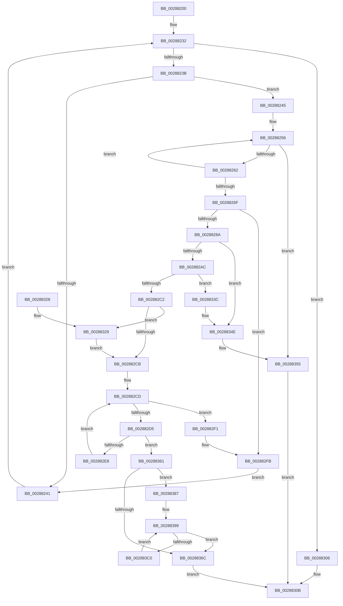

# MiCreateUltraThreadContext

- RVA: `0x00288200`–`0x002883C2` (길이 `450` bytes)
- VA: `0x0000000140288200`
- 실행 섹션: `.text`
- PDB 이름 있음: `예`; PDB Function 태그: `아니요`
- unwind 정보 RVA: `0x00066DD4`
- 디코드: `120`개 명령, `450/450` bytes 표시
- 미해석 바이트: `0` (있으면 어셈블리에 `.byte`로 보존)

> 이 문서는 커널 이미지의 기계어와 PDB 기호를 분석해 생성했습니다. 4번과 5번은 함수 원형과 자료형을 바이너리 사용 방식에서 추정한 C 해석이며 원본 소스 복구 결과는 아닙니다.

## 1. Dependencies

- 직접 호출 지점: **9**; 고유 호출 대상: **8**
- 직접 호출자로 확인된 함수: **12**
- RIP 상대 이미지 참조: **5**

### Outgoing calls
- `0x0028829F` → [MiChargeCommit](MiChargeCommit_function_00286EB0.md) (function, `0x00286EB0`)
- `0x002882B9` → [MiChargeResident](MiChargeResident_function_0028A0F0.md) (function, `0x0028A0F0`)
- `0x002882DD` → [MiGetUltraPage](MiGetUltraPage_function_002883D0.md) (function, `0x002883D0`)
- `0x00288335` → [MiReplenishUltraPageTables](../2C/MiReplenishUltraPageTables_function_002CB4EC.md) (function, `0x002CB4EC`)
- `0x00288349` → [MiReturnCommit](../24/MiReturnCommit_function_00248410.md) (function, `0x00248410`)
- `0x00288358` → [MiDeleteUltraThreadContext](../32/MiDeleteUltraThreadContext_function_00322C90.md) (function, `0x00322C90`)
- `0x00288376` → [MiReleaseNonPagedResources](../32/MiReleaseNonPagedResources_function_0032299C.md) (function, `0x0032299C`)
- `0x0028837E` → [MiDeleteUltraThreadContext](../32/MiDeleteUltraThreadContext_function_00322C90.md) (function, `0x00322C90`)
- `0x002883AF` → [MiReleaseFreshPage](../33/MiReleaseFreshPage_function_00334AE0.md) (function, `0x00334AE0`)

### Direct callers
- [MiFindContiguousPagesEx](MiFindContiguousPagesEx_function_0028BDE0.md) at `0x0028BFE6`
- [MiZeroInParallelWorker](../2C/MiZeroInParallelWorker_function_002C6600.md) at `0x002C66DB`
- [MiZeroLargePage](../2C/MiZeroLargePage_function_002C6914.md) at `0x002C6B78`
- [MiInitializeNewUltraHugeContext](../3F/MiInitializeNewUltraHugeContext_function_003FB974.md) at `0x003FBA53`
- [MiHugePageOperation](../68/MiHugePageOperation_function_0068C490.md) at `0x0068C567`
- [MiDefragmentSlabWorker](../68/MiDefragmentSlabWorker_function_0068D730.md) at `0x0068D807`
- [MiInitializeScrubPacket](../../page/80/MiInitializeScrubPacket_function_0080EA10.md) at `0x0080EA67`
- [MiCreateZeroThreadContext](../../page/81/MiCreateZeroThreadContext_function_008105B4.md) at `0x0081068B`
- [MmRelocatePfnList](../../page/90/MmRelocatePfnList_function_00901E70.md) at `0x00901F37`
- [MiCombineIdenticalPages](../../page/AB/MiCombineIdenticalPages_function_00AB2324.md) at `0x00AB2597`
- [MiInitializeForkMaps](../../page/AD/MiInitializeForkMaps_function_00AD4A40.md) at `0x00AD4AB4`
- [MmInitializeProcessor](../../pagelk/B7/MmInitializeProcessor_function_00B737F8.md) at `0x00B738A8`

### Static image references
- `0x00288245` → RVA `0x00E3601C` (`.data`; read)
- `0x00288256` → RVA `0x00E36018` (`.data`; read)
- `0x0028828E` → RVA `0x00E38D00` (`.data`; read)
- `0x002882C2` → RVA `0x00E2DC41` (`.data`; read)
- `0x0028834E` → RVA `0x00E3601C` (`.data`; read/write)

## 2. Other-region calls and transfers

- 다른 실행 섹션으로 향하는 call: **0**
- 별도 외부 분기/꼬리 이동을 확인하지 못했습니다.

## 3. Assembly (complete function range)

```asm
00288200  48 89 5C 24 08                  mov qword ptr [rsp + 8], rbx
00288205  48 89 6C 24 18                  mov qword ptr [rsp + 0x18], rbp
0028820A  48 89 74 24 20                  mov qword ptr [rsp + 0x20], rsi
0028820F  48 89 54 24 10                  mov qword ptr [rsp + 0x10], rdx
00288214  57                              push rdi
00288215  41 54                           push r12
00288217  41 55                           push r13
00288219  41 56                           push r14
0028821B  41 57                           push r15
0028821D  48 83 EC 20                     sub rsp, 0x20
00288221  33 FF                           xor edi, edi
00288223  48 8B EA                        mov rbp, rdx
00288226  45 8B E9                        mov r13d, r9d
00288229  45 8B F8                        mov r15d, r8d
0028822C  4C 8B E1                        mov r12, rcx
0028822F  8D 57 02                        lea edx, [rdi + 2]
00288232  83 FF 04                        cmp edi, 4
00288235  0F 83 CB 00 00 00               jae 0x140288306
0028823B  41 0F A3 FF                     bt r15d, edi
0028823F  72 04                           jb 0x140288245
00288241  FF C7                           inc edi
00288243  EB ED                           jmp 0x140288232
00288245  8B 05 D1 DD BA 00               mov eax, dword ptr [rip + 0xbaddd1]
0028824B  8B DF                           mov ebx, edi
0028824D  48 C1 E3 05                     shl rbx, 5
00288251  49 03 DC                        add rbx, r12
00288254  8B F7                           mov esi, edi
00288256  3B 05 BC DD BA 00               cmp eax, dword ptr [rip + 0xbaddbc]
0028825C  0F 84 F3 00 00 00               je 0x140288355
00288262  8D 48 01                        lea ecx, [rax + 1]
00288265  F0 0F B1 0D AF DD BA 00         lock cmpxchg dword ptr [rip + 0xbaddaf], ecx
0028826D  75 E7                           jne 0x140288256
0028826F  48 C7 03 00 00 00 00            mov qword ptr [rbx], 0
00288276  48 C7 43 08 FF FF FF FF         mov qword ptr [rbx + 8], 0xffffffffffffffff
0028827E  48 C7 43 10 FF FF FF FF         mov qword ptr [rbx + 0x10], 0xffffffffffffffff
00288286  85 FF                           test edi, edi
00288288  74 71                           je 0x1402882fb
0028828A  48 83 FE 02                     cmp rsi, 2
0028828E  48 8D 0D 6B 0A BB 00            lea rcx, [rip + 0xbb0a6b]
00288295  48 0F 47 F2                     cmova rsi, rdx
00288299  45 33 C0                        xor r8d, r8d
0028829C  48 8B D6                        mov rdx, rsi
0028829F  E8 0C EC FF FF                  call 0x140286eb0
002882A4  85 C0                           test eax, eax
002882A6  0F 84 A2 00 00 00               je 0x14028834e
002882AC  45 33 C0                        xor r8d, r8d
002882AF  48 8D 0D 4A 0A BB 00            lea rcx, [rip + 0xbb0a4a]
002882B6  48 8B D6                        mov rdx, rsi
002882B9  E8 32 1E 00 00                  call 0x14028a0f0
002882BE  85 C0                           test eax, eax
002882C0  74 7A                           je 0x14028833c
002882C2  80 3D 78 59 BA 00 00            cmp byte ptr [rip + 0xba5978], 0
002882C9  75 5E                           jne 0x140288329
002882CB  33 ED                           xor ebp, ebp
002882CD  44 8B F5                        mov r14d, ebp
002882D0  4C 3B F6                        cmp r14, rsi
002882D3  73 1C                           jae 0x1402882f1
002882D5  48 8B 4C 24 58                  mov rcx, qword ptr [rsp + 0x58]
002882DA  41 8B D5                        mov edx, r13d
002882DD  E8 EE 00 00 00                  call 0x1402883d0
002882E2  48 83 F8 FF                     cmp rax, -1
002882E6  74 79                           je 0x140288361
002882E8  48 89 44 EB 08                  mov qword ptr [rbx + rbp*8 + 8], rax
002882ED  FF C5                           inc ebp
002882EF  EB DC                           jmp 0x1402882cd
002882F1  48 8B 6C 24 58                  mov rbp, qword ptr [rsp + 0x58]
002882F6  BA 02 00 00 00                  mov edx, 2
002882FB  66 C7 43 18 01 00               mov word ptr [rbx + 0x18], 1
00288301  E9 3B FF FF FF                  jmp 0x140288241
00288306  B8 01 00 00 00                  mov eax, 1
0028830B  48 8B 5C 24 50                  mov rbx, qword ptr [rsp + 0x50]
00288310  48 8B 6C 24 60                  mov rbp, qword ptr [rsp + 0x60]
00288315  48 8B 74 24 68                  mov rsi, qword ptr [rsp + 0x68]
0028831A  48 83 C4 20                     add rsp, 0x20
0028831E  41 5F                           pop r15
00288320  41 5E                           pop r14
00288322  41 5D                           pop r13
00288324  41 5C                           pop r12
00288326  5F                              pop rdi
00288327  C3                              ret
00288328  CC                              int3
00288329  8B 4D 08                        mov ecx, dword ptr [rbp + 8]
0028832C  41 8B D5                        mov edx, r13d
0028832F  C1 E9 09                        shr ecx, 9
00288332  83 E1 3F                        and ecx, 0x3f
00288335  E8 B2 31 04 00                  call 0x1402cb4ec
0028833A  EB 8F                           jmp 0x1402882cb
0028833C  45 33 C0                        xor r8d, r8d
0028833F  48 8D 0D BA 09 BB 00            lea rcx, [rip + 0xbb09ba]
00288346  48 8B D6                        mov rdx, rsi
00288349  E8 C2 00 FC FF                  call 0x140248410
0028834E  F0 FF 0D C7 DC BA 00            lock dec dword ptr [rip + 0xbadcc7]
00288355  49 8B CC                        mov rcx, r12
00288358  E8 33 A9 09 00                  call 0x140322c90
0028835D  33 C0                           xor eax, eax
0028835F  EB AA                           jmp 0x14028830b
00288361  F0 FF 0D B4 DC BA 00            lock dec dword ptr [rip + 0xbadcb4]
00288368  85 ED                           test ebp, ebp
0028836A  75 1B                           jne 0x140288387
0028836C  48 8B D6                        mov rdx, rsi
0028836F  48 8D 0D 8A 09 BB 00            lea rcx, [rip + 0xbb098a]
00288376  E8 21 A6 09 00                  call 0x14032299c
0028837B  49 8B CC                        mov rcx, r12
0028837E  E8 0D A9 09 00                  call 0x140322c90
00288383  33 C0                           xor eax, eax
00288385  EB 84                           jmp 0x14028830b
00288387  48 8D 1C EB                     lea rbx, [rbx + rbp*8]
0028838B  48 BF 00 00 00 00 00 DE FF FF   movabs rdi, 0xffffde0000000000
00288395  48 83 C3 08                     add rbx, 8
00288399  48 8B 43 F8                     mov rax, qword ptr [rbx - 8]
0028839D  48 8D 5B F8                     lea rbx, [rbx - 8]
002883A1  48 8D 0C 40                     lea rcx, [rax + rax*2]
002883A5  48 C1 E1 04                     shl rcx, 4
002883A9  48 8B C7                        mov rax, rdi
002883AC  48 03 C8                        add rcx, rax
002883AF  E8 2C C7 0A 00                  call 0x140334ae0
002883B4  48 C7 03 FF FF FF FF            mov qword ptr [rbx], 0xffffffffffffffff
002883BB  83 C5 FF                        add ebp, -1
002883BE  74 AC                           je 0x14028836c
002883C0  EB D7                           jmp 0x140288399
```

## 4. C-style interpretation (structured pseudocode)

```c
__int64 __fastcall MiCreateUltraThreadContext(__int64 a1, __int64 a2, int a3, int a4)
{
    __int64 result;
    __int64 v_rbp;
    __int64 v_rbx;
    __int64 v_rdi;
    __int64 v_rsi;
    __int64 v_rsp;
    unsigned __int64 v_stack_p10;
    unsigned __int64 v_stack_p18;
    unsigned __int64 v_stack_p20;
    unsigned __int64 v_stack_p8;

    v_stack_p8 = v_rbx;
    v_stack_p18 = v_rbp;
    v_stack_p20 = v_rsi;
    v_stack_p10 = a2;
    v_rsp = (v_rsp) - (32);
    v_rdi = 0;
loc_00288232:
    if (0 >= 4) goto loc_00288306;
    if (0 < 4) goto loc_00288245;
loc_00288241:
    v_rdi = (unsigned int)((v_rdi) + 1);
    goto loc_00288232;
loc_00288245:
    v_rbx = ((unsigned int)((unsigned int)(v_rdi))) << (5);
    v_rbx = (v_rbx) + (a1);
loc_00288256:
    if (((unsigned int)((unsigned int)(*(unsigned int *)(v_rip + 12246481)))) == (*(unsigned int *)(v_rip + 12246460))) goto loc_00288355;
    if (((unsigned int)((unsigned int)(*(unsigned int *)(v_rip + 12246481)))) != (*(unsigned int *)(v_rip + 12246460))) goto loc_00288256;
    *(unsigned __int64 *)(v_rbx) = 0;
    *(unsigned __int64 *)(v_rbx + 8) = -1;
    *(unsigned __int64 *)(v_rbx + 16) = -1;
    if ((unsigned int)(v_rdi) == 0) goto loc_002882FB;
    v_rsi = (unsigned int)((unsigned int)(v_rdi));
    if (((unsigned int)((unsigned int)(v_rdi))) > 2) { v_rsi = v_rdi + 2; }
    a3 = 0;
    result = MiChargeCommit(v_rip + 12257899, v_rsi, a3, a4);
    if ((unsigned int)(result) == 0) goto loc_0028834E;
    a3 = 0;
    result = MiChargeResident(v_rip + 12257866, v_rsi, a3, a4);
    if ((unsigned int)(result) == 0) goto loc_0028833C;
    if ((*(unsigned __int8 *)(v_rip + 12212600)) != 0) goto loc_00288329;
loc_002882CB:
    v_rbp = 0;
loc_002882CD:
    if (0 >= v_rsi) goto loc_002882F1;
    result = MiGetUltraPage(v_stack_p10, (unsigned int)((unsigned int)((unsigned int)(a4))), a3, a4);
    if (result == -1) goto loc_00288361;
    *(unsigned __int64 *)(v_rbx + v_rbp * 8 + 8) = result;
    v_rbp = (unsigned int)((v_rbp) + 1);
    goto loc_002882CD;
loc_002882F1:
loc_002882FB:
    *(unsigned __int16 *)(v_rbx + 24) = 1;
    goto loc_00288241;
loc_00288306:
loc_0028830B:
    v_rsp = (v_rsp) + (32);
    return 1;
loc_00288329:
    a1 = (unsigned int)(((unsigned int)(*(unsigned int *)(v_stack_p18 + 8))) >> (9));
    a1 = (unsigned int)((a1) & (63));
    result = MiReplenishUltraPageTables(a1, (unsigned int)((unsigned int)((unsigned int)(a4))), a3, a4);
    goto loc_002882CB;
loc_0028833C:
    a3 = 0;
    result = MiReturnCommit(v_rip + 12257722, v_stack_p20, a3, a4);
loc_0028834E:
loc_00288355:
    result = MiDeleteUltraThreadContext(a1, v_stack_p20, a3, a4);
    result = 0;
    goto loc_0028830B;
loc_00288361:
    if ((unsigned int)(v_stack_p18) != 0) goto loc_00288387;
loc_0028836C:
    result = MiReleaseNonPagedResources(v_rip + 12257674, v_stack_p20, a3, a4);
    result = MiDeleteUltraThreadContext(a1, v_stack_p20, a3, a4);
    result = 0;
    goto loc_0028830B;
loc_00288387:
    v_rbx = (v_stack_p8 + v_stack_p18 * 8) + (8);
loc_00288399:
    a1 = (*(unsigned __int64 *)(v_rbx - 8) + *(unsigned __int64 *)(v_rbx - 8) * 2) << (4);
    a1 = (a1) + (v_rdi);
    result = MiReleaseFreshPage(a1, v_stack_p20, a3, a4);
    *(unsigned __int64 *)(v_rbx - 8) = -1;
    v_rbp = (unsigned int)((v_stack_p18) + (-1));
    if (condition_is_equal) goto loc_0028836C;
    goto loc_00288399;
}
```

## 5. (Beta) C Style

```c
int64_t MiCreateUltraThreadContext(int64_t Arg1, int64_t Arg2, int32_t Arg3, int32_t Arg4)
{
    int64_t result;
    int64_t local_rbp;
    int64_t local_rbx;
    int64_t local_rdi;
    int64_t local_rsi;
    int64_t local_rsp;
    uint64_t v_stack_p10;
    uint64_t v_stack_p18;
    uint64_t v_stack_p20;
    uint64_t v_stack_p8;

    v_stack_p8 = local_rbx;
    v_stack_p18 = local_rbp;
    v_stack_p20 = local_rsi;
    v_stack_p10 = Arg2;
    local_rsp = (local_rsp) - (32);
    local_rdi = 0;
loc_00288232:
    if (0 >= 4) goto loc_00288306;
    if (0 < 4) goto loc_00288245;
loc_00288241:
    local_rdi = (uint32_t)((local_rdi) + 1);
    goto loc_00288232;
loc_00288245:
    local_rbx = ((uint32_t)((uint32_t)(local_rdi))) << (5);
    local_rbx = (local_rbx) + (Arg1);
loc_00288256:
    if (((uint32_t)((uint32_t)(*(uint32_t *)(v_rip + 0xBADDD1)))) == (*(uint32_t *)(v_rip + 0xBADDBC))) goto loc_00288355;
    if (((uint32_t)((uint32_t)(*(uint32_t *)(v_rip + 0xBADDD1)))) != (*(uint32_t *)(v_rip + 0xBADDBC))) goto loc_00288256;
    *(uint64_t *)(local_rbx) = 0;
    *(uint64_t *)(local_rbx + 0x8) = -1;
    *(uint64_t *)(local_rbx + 0x10) = -1;
    if ((uint32_t)(local_rdi) == 0) goto loc_002882FB;
    local_rsi = (uint32_t)((uint32_t)(local_rdi));
    if (((uint32_t)((uint32_t)(local_rdi))) > 2) { local_rsi = local_rdi + 2; }
    Arg3 = 0;
    result = MiChargeCommit(v_rip + 12257899, local_rsi, Arg3, Arg4);
    if ((uint32_t)(result) == 0) goto loc_0028834E;
    Arg3 = 0;
    result = MiChargeResident(v_rip + 12257866, local_rsi, Arg3, Arg4);
    if ((uint32_t)(result) == 0) goto loc_0028833C;
    if ((*(uint8_t *)(v_rip + 0xBA5978)) != 0) goto loc_00288329;
loc_002882CB:
    local_rbp = 0;
loc_002882CD:
    if (0 >= local_rsi) goto loc_002882F1;
    result = MiGetUltraPage(v_stack_p10, (uint32_t)((uint32_t)((uint32_t)(Arg4))), Arg3, Arg4);
    if (result == -1) goto loc_00288361;
    *(uint64_t *)(local_rbx + local_rbp * 8 + 0x8) = result;
    local_rbp = (uint32_t)((local_rbp) + 1);
    goto loc_002882CD;
loc_002882F1:
loc_002882FB:
    *(uint16_t *)(local_rbx + 0x18) = 1;
    goto loc_00288241;
loc_00288306:
loc_0028830B:
    local_rsp = (local_rsp) + (32);
    return 1;
loc_00288329:
    Arg1 = (uint32_t)(((uint32_t)(*(uint32_t *)(v_stack_p18 + 0x8))) >> (9));
    Arg1 = (uint32_t)((Arg1) & (63));
    result = MiReplenishUltraPageTables(Arg1, (uint32_t)((uint32_t)((uint32_t)(Arg4))), Arg3, Arg4);
    goto loc_002882CB;
loc_0028833C:
    Arg3 = 0;
    result = MiReturnCommit(v_rip + 12257722, v_stack_p20, Arg3, Arg4);
loc_0028834E:
loc_00288355:
    result = MiDeleteUltraThreadContext(Arg1, v_stack_p20, Arg3, Arg4);
    result = 0;
    goto loc_0028830B;
loc_00288361:
    if ((uint32_t)(v_stack_p18) != 0) goto loc_00288387;
loc_0028836C:
    result = MiReleaseNonPagedResources(v_rip + 12257674, v_stack_p20, Arg3, Arg4);
    result = MiDeleteUltraThreadContext(Arg1, v_stack_p20, Arg3, Arg4);
    result = 0;
    goto loc_0028830B;
loc_00288387:
    local_rbx = (v_stack_p8 + v_stack_p18 * 8) + (8);
loc_00288399:
    Arg1 = (*(uint64_t *)(local_rbx - 0x8) + *(uint64_t *)(local_rbx - 0x8) * 2) << (4);
    Arg1 = (Arg1) + (local_rdi);
    result = MiReleaseFreshPage(Arg1, v_stack_p20, Arg3, Arg4);
    *(uint64_t *)(local_rbx - 0x8) = -1;
    local_rbp = (uint32_t)((v_stack_p18) + (-1));
    if (condition_is_equal) goto loc_0028836C;
    goto loc_00288399;
}
```

## 6. Execution-region graph

[열기: 2D/3D 그래프와 함수 탐색 컨트롤 패널](../../../control-panel.html?section=text&rva=0x00288200&view=graph)

- 2D 그래프는 위에서 아래로 흐르고, 3D 그래프는 빈 공간을 드래그해 회전합니다. Shift+드래그는 이동, 휠은 확대·축소, 함수 노드 선택은 대상 보고서 이동입니다.

### Static fallback


