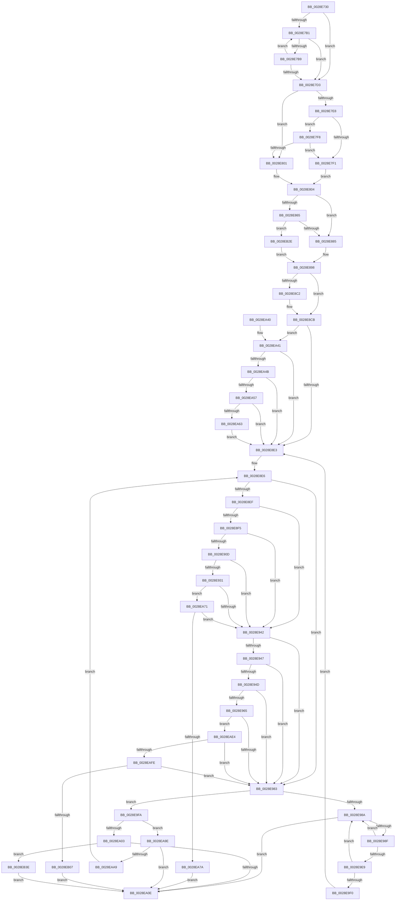

# MiFlushSingleTbEntry

- RVA: `0x0028E730`–`0x0028EB48` (길이 `1,048` bytes)
- VA: `0x000000014028E730`
- 실행 섹션: `.text`
- PDB 이름 있음: `예`; PDB Function 태그: `아니요`
- unwind 정보 RVA: `0x000670CC`
- 디코드: `256`개 명령, `1,048/1,048` bytes 표시
- 미해석 바이트: `0` (있으면 어셈블리에 `.byte`로 보존)

> 이 문서는 커널 이미지의 기계어와 PDB 기호를 분석해 생성했습니다. 4번과 5번은 함수 원형과 자료형을 바이너리 사용 방식에서 추정한 C 해석이며 원본 소스 복구 결과는 아닙니다.

## 1. Dependencies

- 직접 호출 지점: **6**; 고유 호출 대상: **6**
- 직접 호출자로 확인된 함수: **30**
- RIP 상대 이미지 참조: **5**

### Outgoing calls
- `0x0028E7F1` → [MiGetSystemRegionType](MiGetSystemRegionType_function_0028EC80.md) (function, `0x0028EC80`)
- `0x0028E806` → [MiSystemVaTypeToVm](MiSystemVaTypeToVm_function_0028EB50.md) (function, `0x0028EB50`)
- `0x0028EA13` → [MiFlushTbList](../31/MiFlushTbList_function_00311FC0.md) (function, `0x00311FC0`)
- `0x0028EA1F` → [_security_check_cookie](../6A/_security_check_cookie_function_006AC640.md) (function, `0x006AC640`)
- `0x0028EABE` → [qsort](../50/qsort_function_005009F0.md) (function, `0x005009F0`)
- `0x0028EAC8` → [MiCompressTbFlushList](../2A/MiCompressTbFlushList_function_002A93A8.md) (function, `0x002A93A8`)

### Direct callers
- [MmStealTopLevelPage](../22/MmStealTopLevelPage_function_002281E0.md) at `0x00228399`
- [MiMapSinglePage](../22/MiMapSinglePage_function_00229D00.md) at `0x00229E63`
- [MiWsleFlush](../23/MiWsleFlush_function_0023FB30.md) at `0x0023FED0`
- [MiReleasePageFileInfo](MiReleasePageFileInfo_function_00283FD0.md) at `0x00284413`
- [MiSwapStackPageNoDpc](../2A/MiSwapStackPageNoDpc_function_002A0270.md) at `0x002A033A`
- [MiAbortCombineScan](../2A/MiAbortCombineScan_function_002A1160.md) at `0x002A1211`
- [MiStealPage](../2B/MiStealPage_function_002B28D0.md) at `0x002B2D0D`
- [MiStealPage](../2B/MiStealPage_function_002B28D0.md) at `0x002B2EE1`
- [MiStealPage](../2B/MiStealPage_function_002B28D0.md) at `0x002B32EE`
- [MiStealPage](../2B/MiStealPage_function_002B28D0.md) at `0x002B38AC`
- [MiSharePages](../31/MiSharePages_function_00315110.md) at `0x00315FA1`
- [sub_003328DD](../33/Unknown_function_003328DD.md) at `0x003328F4`
- [sub_00332AE1](../33/Unknown_function_00332AE1.md) at `0x00332AF7`
- [MiCopyOnWrite](../36/MiCopyOnWrite_function_00362A0C.md) at `0x00362FB3`
- [MiCopyOnWrite](../36/MiCopyOnWrite_function_00362A0C.md) at `0x003631A4`
- [MiPrivateFixup](../36/MiPrivateFixup_function_003693E8.md) at `0x00369AFF`
- [MiTradeActivePage](../37/MiTradeActivePage_function_00374424.md) at `0x00374523`
- [MiTradeActivePage](../37/MiTradeActivePage_function_00374424.md) at `0x0037462F`
- [MiValidateInPage](../38/MiValidateInPage_function_00382E0C.md) at `0x00383112`
- [MiLargePageFault](../3F/MiLargePageFault_function_003F01C4.md) at `0x003F03C2`
- [MiNoFaultFound](../41/MiNoFaultFound_function_0041BB20.md) at `0x0041BCBE`
- [MiUpdateImagePfnImportRelocations](../44/MiUpdateImagePfnImportRelocations_function_00449E84.md) at `0x0044A072`
- [MiPrepareToTradeUsingAccessedBit](../45/MiPrepareToTradeUsingAccessedBit_function_0045B488.md) at `0x0045B51D`
- [MiLockPagedAddress](../48/MiLockPagedAddress_function_00484CDC.md) at `0x00484E17`
- [MiCopyKstack](../67/MiCopyKstack_function_0067B058.md) at `0x0067B102`
- [MiReleaseFaultPte](../67/MiReleaseFaultPte_function_0067E5B4.md) at `0x0067E5F5`
- [MiMarkBootGuardPage](../68/MiMarkBootGuardPage_function_0068643C.md) at `0x00686552`
- [MmReadProcessPageTables](../68/MmReadProcessPageTables_function_006866C8.md) at `0x00686758`
- [MmReadProcessPageTables](../68/MmReadProcessPageTables_function_006866C8.md) at `0x006868C5`
- [MmReadProcessPageTables](../68/MmReadProcessPageTables_function_006866C8.md) at `0x00686970`
- [sub_006E1C8E](../6E/Unknown_function_006E1C8E.md) at `0x006E1DEA`
- [MiRelocateImagePfn](../../page/93/MiRelocateImagePfn_function_0093F2A8.md) at `0x0093F5E3`
- [MmInvalidateDumpAddresses](../../pagelk/B7/MmInvalidateDumpAddresses_function_00B74970.md) at `0x00B749B2`
- [MiProtectSharedUserPage](../../init/C6/MiProtectSharedUserPage_function_00C60F44.md) at `0x00C61194`
- [MxCopyPage](../../init/C6/MxCopyPage_function_00C631F4.md) at `0x00C632AC`
- [MiInitializeBootShadowStackPage](../../init/C6/MiInitializeBootShadowStackPage_function_00C67D8C.md) at `0x00C67EEC`
- [MiInitializeBootShadowStackPage](../../init/C6/MiInitializeBootShadowStackPage_function_00C67D8C.md) at `0x00C6800D`
- [MiTradeBootImagePage](../../init/C6/MiTradeBootImagePage_function_00C6C554.md) at `0x00C6C70D`

### Static image references
- `0x0028E74E` → RVA `0x00E0A740` (`.data`; read)
- `0x0028E7E8` → RVA `0x00E2F380` (`.data`; read)
- `0x0028E7F8` → RVA `0x00E2F390` (`.data`; read)
- `0x0028E81A` → RVA `0x00E38200` (`.data`; read)
- `0x0028EAAC` → RVA `0x00695890` (`MiTbFlushSort`; read)

## 2. Other-region calls and transfers

- 다른 실행 섹션으로 향하는 call: **0**
- 별도 외부 분기/꼬리 이동을 확인하지 못했습니다.

## 3. Assembly (complete function range)

```asm
0028E730  48 89 5C 24 10                  mov qword ptr [rsp + 0x10], rbx
0028E735  48 89 74 24 18                  mov qword ptr [rsp + 0x18], rsi
0028E73A  55                              push rbp
0028E73B  57                              push rdi
0028E73C  41 54                           push r12
0028E73E  41 56                           push r14
0028E740  41 57                           push r15
0028E742  48 8D 6C 24 C9                  lea rbp, [rsp - 0x37]
0028E747  48 81 EC 00 01 00 00            sub rsp, 0x100
0028E74E  48 8B 05 EB BF B7 00            mov rax, qword ptr [rip + 0xb7bfeb]
0028E755  48 33 C4                        xor rax, rsp
0028E758  48 89 45 27                     mov qword ptr [rbp + 0x27], rax
0028E75C  0F 57 C0                        xorps xmm0, xmm0
0028E75F  49 BE 00 00 00 00 80 F6 FF FF   movabs r14, 0xfffff68000000000
0028E769  33 C0                           xor eax, eax
0028E76B  0F 29 45 87                     movaps xmmword ptr [rbp - 0x79], xmm0
0028E76F  88 44 24 3B                     mov byte ptr [rsp + 0x3b], al
0028E773  41 8B F0                        mov esi, r8d
0028E776  0F 29 45 97                     movaps xmmword ptr [rbp - 0x69], xmm0
0028E77A  8B FA                           mov edi, edx
0028E77C  0F 29 45 A7                     movaps xmmword ptr [rbp - 0x59], xmm0
0028E780  48 8B D9                        mov rbx, rcx
0028E783  0F 29 45 B7                     movaps xmmword ptr [rbp - 0x49], xmm0
0028E787  0F 29 45 C7                     movaps xmmword ptr [rbp - 0x39], xmm0
0028E78B  0F 29 45 D7                     movaps xmmword ptr [rbp - 0x29], xmm0
0028E78F  0F 29 45 E7                     movaps xmmword ptr [rbp - 0x19], xmm0
0028E793  0F 29 45 F7                     movaps xmmword ptr [rbp - 9], xmm0
0028E797  0F 29 45 07                     movaps xmmword ptr [rbp + 7], xmm0
0028E79B  48 89 45 17                     mov qword ptr [rbp + 0x17], rax
0028E79F  49 8B C6                        mov rax, r14
0028E7A2  49 BF FF FF FF FF FF F6 FF FF   movabs r15, 0xfffff6ffffffffff
0028E7AC  48 3B C8                        cmp rcx, rax
0028E7AF  72 22                           jb 0x14028e7d3
0028E7B1  49 8B C7                        mov rax, r15
0028E7B4  48 3B C8                        cmp rcx, rax
0028E7B7  77 1A                           ja 0x14028e7d3
0028E7B9  48 C1 E1 19                     shl rcx, 0x19
0028E7BD  49 8B C6                        mov rax, r14
0028E7C0  48 C1 E0 19                     shl rax, 0x19
0028E7C4  48 2B C8                        sub rcx, rax
0028E7C7  48 C1 F9 10                     sar rcx, 0x10
0028E7CB  49 8B C6                        mov rax, r14
0028E7CE  48 3B C8                        cmp rcx, rax
0028E7D1  73 DE                           jae 0x14028e7b1
0028E7D3  48 B8 00 00 00 00 00 80 FF FF   movabs rax, 0xffff800000000000
0028E7DD  41 BC 01 00 00 00               mov r12d, 1
0028E7E3  48 3B C8                        cmp rcx, rax
0028E7E6  72 19                           jb 0x14028e801
0028E7E8  48 3B 0D 91 0B BA 00            cmp rcx, qword ptr [rip + 0xba0b91]
0028E7EF  73 07                           jae 0x14028e7f8
0028E7F1  E8 8A 04 00 00                  call 0x14028ec80
0028E7F6  EB 0C                           jmp 0x14028e804
0028E7F8  48 3B 0D 91 0B BA 00            cmp rcx, qword ptr [rip + 0xba0b91]
0028E7FF  77 F0                           ja 0x14028e7f1
0028E801  41 8B C4                        mov eax, r12d
0028E804  8B C8                           mov ecx, eax
0028E806  E8 45 03 00 00                  call 0x14028eb50
0028E80B  48 85 C0                        test rax, rax
0028E80E  C7 44 24 2C 14 00 00 00         mov dword ptr [rsp + 0x2c], 0x14
0028E816  89 74 24 34                     mov dword ptr [rsp + 0x34], esi
0028E81A  48 8D 15 DF 99 BA 00            lea rdx, [rip + 0xba99df]
0028E821  48 0F 45 D0                     cmovne rdx, rax
0028E825  33 C0                           xor eax, eax
0028E827  83 FF FF                        cmp edi, -1
0028E82A  48 89 54 24 20                  mov qword ptr [rsp + 0x20], rdx
0028E82F  0F 94 C0                        sete al
0028E832  83 C0 08                        add eax, 8
0028E835  44 8B C8                        mov r9d, eax
0028E838  41 83 C9 04                     or r9d, 4
0028E83C  83 FF 02                        cmp edi, 2
0028E83F  44 0F 45 C8                     cmovne r9d, eax
0028E843  44 89 4C 24 30                  mov dword ptr [rsp + 0x30], r9d
0028E848  8B 82 B8 00 00 00               mov eax, dword ptr [rdx + 0xb8]
0028E84E  C1 E8 08                        shr eax, 8
0028E851  C0 E8 03                        shr al, 3
0028E854  41 22 C4                        and al, r12b
0028E857  88 44 24 38                     mov byte ptr [rsp + 0x38], al
0028E85B  8B 82 B8 00 00 00               mov eax, dword ptr [rdx + 0xb8]
0028E861  A8 0F                           test al, 0xf
0028E863  75 20                           jne 0x14028e885
0028E865  65 48 8B 04 25 88 01 00 00      mov rax, qword ptr gs:[0x188]
0028E86E  48 8B 88 B8 00 00 00            mov rcx, qword ptr [rax + 0xb8]
0028E875  48 81 C1 00 04 00 00            add rcx, 0x400
0028E87C  48 3B D1                        cmp rdx, rcx
0028E87F  0F 85 A9 02 00 00               jne 0x14028eb2e
0028E885  8B 82 B8 00 00 00               mov eax, dword ptr [rdx + 0xb8]
0028E88B  33 C9                           xor ecx, ecx
0028E88D  44 8B 44 24 30                  mov r8d, dword ptr [rsp + 0x30]
0028E892  A8 0F                           test al, 0xf
0028E894  41 0F 44 CC                     cmove ecx, r12d
0028E898  45 33 D2                        xor r10d, r10d
0028E89B  89 4C 24 28                     mov dword ptr [rsp + 0x28], ecx
0028E89F  45 33 DB                        xor r11d, r11d
0028E8A2  66 C7 44 24 39 00 00            mov word ptr [rsp + 0x39], 0
0028E8A9  41 83 E0 DB                     and r8d, 0xffffffdb
0028E8AD  44 89 54 24 3C                  mov dword ptr [rsp + 0x3c], r10d
0028E8B2  4C 89 5C 24 40                  mov qword ptr [rsp + 0x40], r11
0028E8B7  44 89 44 24 30                  mov dword ptr [rsp + 0x30], r8d
0028E8BC  41 F6 C1 04                     test r9b, 4
0028E8C0  74 09                           je 0x14028e8cb
0028E8C2  41 83 C8 04                     or r8d, 4
0028E8C6  44 89 44 24 30                  mov dword ptr [rsp + 0x30], r8d
0028E8CB  48 81 E3 00 F0 FF FF            and rbx, 0xfffffffffffff000
0028E8D2  4C 89 54 24 48                  mov qword ptr [rsp + 0x48], r10
0028E8D7  49 8B FC                        mov rdi, r12
0028E8DA  41 3B CC                        cmp ecx, r12d
0028E8DD  0F 85 5E 01 00 00               jne 0x14028ea41
0028E8E3  45 33 F6                        xor r14d, r14d
0028E8E6  45 85 D2                        test r10d, r10d
0028E8E9  0F 84 94 00 00 00               je 0x14028e983
0028E8EF  41 F6 C0 02                     test r8b, 2
0028E8F3  75 4D                           jne 0x14028e942
0028E8F5  41 8D 42 FF                     lea eax, [r10 - 1]
0028E8F9  48 8D 74 24 48                  lea rsi, [rsp + 0x48]
0028E8FE  48 8D 34 C6                     lea rsi, [rsi + rax*8]
0028E902  48 8B 06                        mov rax, qword ptr [rsi]
0028E905  48 A9 00 0C 00 00               test rax, 0xc00
0028E90B  75 35                           jne 0x14028e942
0028E90D  4C 8B C8                        mov r9, rax
0028E910  48 8B C8                        mov rcx, rax
0028E913  41 81 E1 FF 03 00 00            and r9d, 0x3ff
0028E91A  48 81 E1 00 F0 FF FF            and rcx, 0xfffffffffffff000
0028E921  49 8D 51 01                     lea rdx, [r9 + 1]
0028E925  48 C1 E2 0C                     shl rdx, 0xc
0028E929  48 03 D1                        add rdx, rcx
0028E92C  48 3B D3                        cmp rdx, rbx
0028E92F  75 11                           jne 0x14028e942
0028E931  49 8D 0C 39                     lea rcx, [r9 + rdi]
0028E935  48 81 F9 FF 03 00 00            cmp rcx, 0x3ff
0028E93C  0F 86 2F 01 00 00               jbe 0x14028ea71
0028E942  45 85 D2                        test r10d, r10d
0028E945  74 3C                           je 0x14028e983
0028E947  41 F6 C0 02                     test r8b, 2
0028E94B  75 36                           jne 0x14028e983
0028E94D  41 8D 42 FF                     lea eax, [r10 - 1]
0028E951  4C 8D 4C 24 48                  lea r9, [rsp + 0x48]
0028E956  4D 8D 0C C1                     lea r9, [r9 + rax*8]
0028E95A  49 8B 01                        mov rax, qword ptr [r9]
0028E95D  48 A9 00 0C 00 00               test rax, 0xc00
0028E963  75 1E                           jne 0x14028e983
0028E965  4C 8B C7                        mov r8, rdi
0028E968  48 8B C8                        mov rcx, rax
0028E96B  49 C1 E0 0C                     shl r8, 0xc
0028E96F  48 81 E1 00 F0 FF FF            and rcx, 0xfffffffffffff000
0028E976  49 8D 14 18                     lea rdx, [r8 + rbx]
0028E97A  48 3B CA                        cmp rcx, rdx
0028E97D  0F 84 61 01 00 00               je 0x14028eae4
0028E983  44 3B 54 24 2C                  cmp r10d, dword ptr [rsp + 0x2c]
0028E988  74 70                           je 0x14028e9fa
0028E98A  48 85 FF                        test rdi, rdi
0028E98D  74 7F                           je 0x14028ea0e
0028E98F  48 8D 47 FF                     lea rax, [rdi - 1]
0028E993  48 8B CB                        mov rcx, rbx
0028E996  48 3D FF 03 00 00               cmp rax, 0x3ff
0028E99C  BA 00 04 00 00                  mov edx, 0x400
0028E9A1  48 0F 46 D7                     cmovbe rdx, rdi
0028E9A5  48 81 E1 00 F0 FF FF            and rcx, 0xfffffffffffff000
0028E9AC  48 8D 42 FF                     lea rax, [rdx - 1]
0028E9B0  25 FF 03 00 00                  and eax, 0x3ff
0028E9B5  48 0B C1                        or rax, rcx
0028E9B8  48 8B CA                        mov rcx, rdx
0028E9BB  48 C1 E1 0C                     shl rcx, 0xc
0028E9BF  48 03 D9                        add rbx, rcx
0028E9C2  41 8B CA                        mov ecx, r10d
0028E9C5  48 89 44 CC 48                  mov qword ptr [rsp + rcx*8 + 0x48], rax
0028E9CA  44 8B 54 24 3C                  mov r10d, dword ptr [rsp + 0x3c]
0028E9CF  4C 8B 5C 24 40                  mov r11, qword ptr [rsp + 0x40]
0028E9D4  41 FF C2                        inc r10d
0028E9D7  4C 03 DA                        add r11, rdx
0028E9DA  44 89 54 24 3C                  mov dword ptr [rsp + 0x3c], r10d
0028E9DF  4C 89 5C 24 40                  mov qword ptr [rsp + 0x40], r11
0028E9E4  48 2B FA                        sub rdi, rdx
0028E9E7  74 A1                           je 0x14028e98a
0028E9E9  44 3B 54 24 2C                  cmp r10d, dword ptr [rsp + 0x2c]
0028E9EE  75 9A                           jne 0x14028e98a
0028E9F0  44 8B 44 24 30                  mov r8d, dword ptr [rsp + 0x30]
0028E9F5  E9 E9 FE FF FF                  jmp 0x14028e8e3
0028E9FA  45 85 F6                        test r14d, r14d
0028E9FD  0F 84 9B 00 00 00               je 0x14028ea9e
0028EA03  80 7C 24 39 00                  cmp byte ptr [rsp + 0x39], 0
0028EA08  0F 84 30 01 00 00               je 0x14028eb3e
0028EA0E  48 8D 4C 24 20                  lea rcx, [rsp + 0x20]
0028EA13  E8 A8 35 08 00                  call 0x140311fc0
0028EA18  48 8B 4D 27                     mov rcx, qword ptr [rbp + 0x27]
0028EA1C  48 33 CC                        xor rcx, rsp
0028EA1F  E8 1C DC 41 00                  call 0x1406ac640
0028EA24  4C 8D 9C 24 00 01 00 00         lea r11, [rsp + 0x100]
0028EA2C  49 8B 5B 38                     mov rbx, qword ptr [r11 + 0x38]
0028EA30  49 8B 73 40                     mov rsi, qword ptr [r11 + 0x40]
0028EA34  49 8B E3                        mov rsp, r11
0028EA37  41 5F                           pop r15
0028EA39  41 5E                           pop r14
0028EA3B  41 5C                           pop r12
0028EA3D  5F                              pop rdi
0028EA3E  5D                              pop rbp
0028EA3F  C3                              ret
0028EA40  CC                              int3
0028EA41  41 F6 C0 04                     test r8b, 4
0028EA45  0F 85 98 FE FF FF               jne 0x14028e8e3
0028EA4B  49 8B C6                        mov rax, r14
0028EA4E  48 3B D8                        cmp rbx, rax
0028EA51  0F 82 8C FE FF FF               jb 0x14028e8e3
0028EA57  49 8B C7                        mov rax, r15
0028EA5A  48 3B D8                        cmp rbx, rax
0028EA5D  0F 87 80 FE FF FF               ja 0x14028e8e3
0028EA63  41 83 C8 04                     or r8d, 4
0028EA67  44 89 44 24 30                  mov dword ptr [rsp + 0x30], r8d
0028EA6C  E9 72 FE FF FF                  jmp 0x14028e8e3
0028EA71  49 3B C9                        cmp rcx, r9
0028EA74  0F 86 C8 FE FF FF               jbe 0x14028e942
0028EA7A  48 8D 0C 38                     lea rcx, [rax + rdi]
0028EA7E  4C 03 DF                        add r11, rdi
0028EA81  48 8B D1                        mov rdx, rcx
0028EA84  4C 89 5C 24 40                  mov qword ptr [rsp + 0x40], r11
0028EA89  48 33 D0                        xor rdx, rax
0028EA8C  48 81 E2 00 FC FF FF            and rdx, 0xfffffffffffffc00
0028EA93  48 33 D1                        xor rdx, rcx
0028EA96  48 89 16                        mov qword ptr [rsi], rdx
0028EA99  E9 70 FF FF FF                  jmp 0x14028ea0e
0028EA9E  80 7C 24 39 00                  cmp byte ptr [rsp + 0x39], 0
0028EAA3  0F 85 65 FF FF FF               jne 0x14028ea0e
0028EAA9  41 8B D2                        mov edx, r10d
0028EAAC  4C 8D 0D DD 6D 40 00            lea r9, [rip + 0x406ddd]
0028EAB3  41 B8 08 00 00 00               mov r8d, 8
0028EAB9  48 8D 4C 24 48                  lea rcx, [rsp + 0x48]
0028EABE  E8 2D 1F 27 00                  call 0x1405009f0
0028EAC3  48 8D 4C 24 20                  lea rcx, [rsp + 0x20]
0028EAC8  E8 DB A8 01 00                  call 0x1402a93a8
0028EACD  4C 8B 5C 24 40                  mov r11, qword ptr [rsp + 0x40]
0028EAD2  45 8B F4                        mov r14d, r12d
0028EAD5  44 8B 54 24 3C                  mov r10d, dword ptr [rsp + 0x3c]
0028EADA  44 8B 44 24 30                  mov r8d, dword ptr [rsp + 0x30]
0028EADF  E9 02 FE FF FF                  jmp 0x14028e8e6
0028EAE4  48 8B C8                        mov rcx, rax
0028EAE7  81 E1 FF 03 00 00               and ecx, 0x3ff
0028EAED  48 8D 14 39                     lea rdx, [rcx + rdi]
0028EAF1  48 81 FA FF 03 00 00            cmp rdx, 0x3ff
0028EAF8  0F 87 85 FE FF FF               ja 0x14028e983
0028EAFE  48 3B D1                        cmp rdx, rcx
0028EB01  0F 86 7C FE FF FF               jbe 0x14028e983
0028EB07  49 2B C0                        sub rax, r8
0028EB0A  4C 03 DF                        add r11, rdi
0028EB0D  4C 89 5C 24 40                  mov qword ptr [rsp + 0x40], r11
0028EB12  48 8D 0C 38                     lea rcx, [rax + rdi]
0028EB16  48 8B D1                        mov rdx, rcx
0028EB19  48 33 D0                        xor rdx, rax
0028EB1C  48 81 E2 00 FC FF FF            and rdx, 0xfffffffffffffc00
0028EB23  48 33 D1                        xor rdx, rcx
0028EB26  49 89 11                        mov qword ptr [r9], rdx
0028EB29  E9 E0 FE FF FF                  jmp 0x14028ea0e
0028EB2E  44 8B 44 24 30                  mov r8d, dword ptr [rsp + 0x30]
0028EB33  33 C9                           xor ecx, ecx
0028EB35  41 83 C8 09                     or r8d, 9
0028EB39  E9 5A FD FF FF                  jmp 0x14028e898
0028EB3E  44 88 64 24 39                  mov byte ptr [rsp + 0x39], r12b
0028EB43  E9 C6 FE FF FF                  jmp 0x14028ea0e
```

## 4. C-style interpretation (structured pseudocode)

```c
__int64 __fastcall MiFlushSingleTbEntry(__int64 a1, int a2, int a3)
{
    __int64 result;
    __int64 v_r10;
    __int64 v_r11;
    __int64 v_r14;
    __int64 v_rbx;
    __int64 v_rdi;
    __int64 v_rsp;
    unsigned int v_stack_m100;
    unsigned __int64 v_stack_m108;
    unsigned __int64 v_stack_m28;
    unsigned __int64 v_stack_m38;
    unsigned __int64 v_stack_m48;
    unsigned __int64 v_stack_m58;
    unsigned __int64 v_stack_m5F;
    unsigned __int64 v_stack_m68;
    unsigned __int64 v_stack_m78;
    unsigned __int64 v_stack_m88;
    unsigned __int64 v_stack_m98;
    unsigned __int64 v_stack_mA8;
    unsigned __int64 v_stack_mB8;
    unsigned __int64 v_stack_mC0;
    unsigned int v_stack_mC4;
    unsigned __int8 v_stack_mC7;
    unsigned __int64 v_stack_mC8;
    unsigned int v_stack_mD0;
    unsigned __int64 v_stack_mD8;
    unsigned __int64 v_stack_mE0;
    unsigned __int64 v_stack_mE8;
    unsigned int v_stack_mEC;
    unsigned __int8 v_stack_mED;
    unsigned __int16 v_stack_mEF;
    unsigned __int8 v_stack_mF0;
    unsigned int v_stack_mF4;
    unsigned int v_stack_mF8;
    unsigned int v_stack_mFC;
    unsigned __int64 v_stack_p10;
    unsigned __int64 v_stack_p18;

    v_stack_p10 = v_rbx;
    v_stack_p18 = v_rsi;
    v_rsp = (v_rsp) - (256);
    result = (*(unsigned __int64 *)(v_rip + 12042219)) ^ (v_rsp);
    v_stack_m38 = result;
    result = 0;
    v_stack_mD8 = v_xmm0;
    v_stack_mED = 0;
    v_stack_mC8 = v_xmm0;
    v_stack_mB8 = v_xmm0;
    v_stack_mA8 = v_xmm0;
    v_stack_m98 = v_xmm0;
    v_stack_m88 = v_xmm0;
    v_stack_m78 = v_xmm0;
    v_stack_m68 = v_xmm0;
    v_stack_m58 = v_xmm0;
    v_stack_m48 = 0;
    if (a1 < v_r14) goto loc_0028E7D3;
loc_0028E7B1:
    if (a1 > v_r15) goto loc_0028E7D3;
    a1 = (a1) << (25);
    result = (v_r14) << (25);
    a1 = (a1) - (result);
    a1 = (a1) >> (16);
    if (a1 >= v_r14) goto loc_0028E7B1;
loc_0028E7D3:
    if (a1 < v_r14) goto loc_0028E801;
    if (a1 >= (*(unsigned __int64 *)(v_rip + 12192657))) goto loc_0028E7F8;
loc_0028E7F1:
    result = MiGetSystemRegionType(a1, a2, a3, a4);
    goto loc_0028E804;
loc_0028E7F8:
    if (a1 > (*(unsigned __int64 *)(v_rip + 12192657))) goto loc_0028E7F1;
loc_0028E801:
loc_0028E804:
    result = MiSystemVaTypeToVm(1, a2, a3, a4);
    v_stack_mFC = 20;
    v_stack_mF4 = (unsigned int)((unsigned int)(a3));
    a2 = v_rip + 12229087;
    if (result != 0) { a2 = result; }
    result = 0;
    v_stack_m108 = a2;
    result = (((unsigned int)((unsigned int)(a2))) == -1) ? 1 : 0;
    result = (unsigned int)((result) + (8));
    a4 = (unsigned int)(((unsigned int)((unsigned int)(result))) | (4));
    if (((unsigned int)((unsigned int)(a2))) != 2) { a4 = (unsigned int)(result); }
    v_stack_mF8 = (unsigned int)(a4);
    result = (unsigned int)(((unsigned int)(*(unsigned int *)(a2 + 184))) >> (8));
    result = (unsigned __int8)((result) >> (3));
    result = (unsigned __int8)((result) & (1));
    v_stack_mF0 = (unsigned __int8)(result);
    if ((((unsigned __int8)((unsigned int)(*(unsigned int *)(a2 + 184)))) & (15)) != 0) goto loc_0028E885;
    a1 = (*(unsigned __int64 *)(*(unsigned __int64 *)(gs_base + (0 + 392)) + 184)) + (0x400ULL);
    if (a2 != a1) goto loc_0028EB2E;
loc_0028E885:
    a1 = 0;
    if ((((unsigned __int8)((unsigned int)(*(unsigned int *)(a2 + 184)))) & (15)) == 0) { a1 = 1; }
loc_0028E898:
    v_r10 = 0;
    v_stack_m100 = (unsigned int)(a1);
    v_r11 = 0;
    v_stack_mEF = 0;
    a3 = (unsigned int)(((unsigned int)(v_stack_mF8)) & (0xFFFFFFDBULL));
    v_stack_mEC = 0;
    v_stack_mE8 = 0;
    v_stack_mF8 = a3;
    if ((((unsigned __int8)(a4)) & (4)) != 0) {
        a3 = (unsigned int)((a3) | (4));
        v_stack_mF8 = a3;
    }
    v_rbx = (a1) & (0xFFFFFFFFFFFFF000ULL);
    v_stack_mE0 = 0;
    if (((unsigned int)(a1)) != 1) goto loc_0028EA41;
loc_0028E8E3:
    v_r14 = 0;
loc_0028E8E6:
    if (0 == 0) goto loc_0028E983;
    if ((((unsigned __int8)(a3)) & (2)) != 0) goto loc_0028E942;
    if (((*(unsigned __int64 *)(v_stack_mE0 + v_r10 - 1 * 8)) & (0xC00ULL)) != 0) goto loc_0028E942;
    a4 = (unsigned int)((*(unsigned __int64 *)(v_stack_mE0 + v_r10 - 1 * 8)) & (0x3FFULL));
    a1 = (*(unsigned __int64 *)(v_stack_mE0 + v_r10 - 1 * 8)) & (0xFFFFFFFFFFFFF000ULL);
    a2 = (a4 + 1) << (12);
    a2 = (a2) + (a1);
    if (a2 != v_rbx) goto loc_0028E942;
    if ((a4 + 1 * 1) <= 0x3FFULL) goto loc_0028EA71;
loc_0028E942:
    if (0 == 0) goto loc_0028E983;
    if ((((unsigned __int8)(a3)) & (2)) != 0) goto loc_0028E983;
    if (((*(unsigned __int64 *)(v_stack_mE0 + v_r10 - 1 * 8)) & (0xC00ULL)) != 0) goto loc_0028E983;
    a3 = (1) << (12);
    a1 = (*(unsigned __int64 *)(v_stack_mE0 + v_r10 - 1 * 8)) & (0xFFFFFFFFFFFFF000ULL);
    if (a1 == (a3 + v_rbx * 1)) goto loc_0028EAE4;
loc_0028E983:
    if (0 == v_stack_mFC) goto loc_0028E9FA;
loc_0028E98A:
    if (1 == 0) goto loc_0028EA0E;
    a2 = (unsigned int)(0x400ULL);
    if ((1 - 1) <= 0x3FFULL) { a2 = 1; }
    a1 = (v_rbx) & (0xFFFFFFFFFFFFF000ULL);
    result = (unsigned int)((a2 - 1) & (0x3FFULL));
    result = (result) | (a1);
    a1 = (a2) << (12);
    v_rbx = (v_rbx) + (a1);
    *(unsigned __int64 *)(v_rsp + 0 * 8 + 72) = result;
    v_r10 = (unsigned int)(((unsigned int)(v_stack_mEC)) + 1);
    v_r11 = (v_stack_mE8) + (a2);
    v_stack_mEC = (unsigned int)(v_r10);
    v_stack_mE8 = v_r11;
    v_rdi = (1) - (a2);
    if (condition_is_equal) goto loc_0028E98A;
    if (((unsigned int)(v_r10)) != v_stack_mFC) goto loc_0028E98A;
    goto loc_0028E8E3;
loc_0028E9FA:
    if (0 == 0) goto loc_0028EA9E;
    if (v_stack_mEF == 0) goto loc_0028EB3E;
loc_0028EA0E:
    result = MiFlushTbList(v_stack_m108, a2, (unsigned int)(v_stack_mF8), v_stack_mE0 + v_r10 - 1 * 8);
    a1 = (v_stack_m38) ^ (v_rsp);
    result = _security_check_cookie(a1, a2, (unsigned int)(v_stack_mF8), v_stack_mE0 + v_r10 - 1 * 8);
    return result;
loc_0028EA41:
    if ((((unsigned __int8)((unsigned int)(v_stack_mF8))) & (4)) != 0) goto loc_0028E8E3;
    if ((*(unsigned __int64 *)(v_stack_m28 + 56)) < 0) goto loc_0028E8E3;
    if ((*(unsigned __int64 *)(v_stack_m28 + 56)) > v_r15) goto loc_0028E8E3;
    a3 = (unsigned int)(((unsigned int)(v_stack_mF8)) | (4));
    v_stack_mD0 = a3;
    goto loc_0028E8E3;
loc_0028EA71:
    if (a1 <= (v_stack_mE0 + v_r10 - 1 * 8)) goto loc_0028E942;
    v_r11 = (v_stack_m28) + (v_rdi);
    v_stack_mC0 = v_r11;
    a2 = (v_r15 + v_rdi * 1) ^ (v_r15);
    a2 = (a2) & (0xFFFFFFFFFFFFFC00ULL);
    a2 = (a2) ^ (v_r15 + v_rdi * 1);
    *(unsigned __int64 *)(*(unsigned __int64 *)(v_stack_m28 + 64)) = a2;
    goto loc_0028EA0E;
loc_0028EA9E:
    if (v_stack_mC7 != 0) goto loc_0028EA0E;
    result = qsort(v_stack_mB8, (unsigned int)((unsigned int)(v_r10)), 8, v_rip + 4222429);
    result = MiCompressTbFlushList(v_stack_mE0, (unsigned int)((unsigned int)(v_r10)), 8, v_rip + 4222429);
    goto loc_0028E8E6;
loc_0028EAE4:
    a1 = (unsigned int)((result) & (0x3FFULL));
    if ((a1 + v_rdi * 1) > 0x3FFULL) goto loc_0028E983;
    if ((a1 + v_rdi * 1) <= a1) goto loc_0028E983;
    result = (result) - ((unsigned int)(v_stack_mD0));
    v_r11 = (v_stack_mC0) + (v_rdi);
    v_stack_mC0 = v_r11;
    a2 = (result + v_rdi * 1) ^ (result);
    a2 = (a2) & (0xFFFFFFFFFFFFFC00ULL);
    a2 = (a2) ^ (result + v_rdi * 1);
    *(unsigned __int64 *)(v_rip + 4222429) = a2;
    goto loc_0028EA0E;
loc_0028EB2E:
    a1 = 0;
    a3 = (unsigned int)(((unsigned int)(v_stack_mD0)) | (9));
    goto loc_0028E898;
loc_0028EB3E:
    v_stack_mC7 = 1;
    goto loc_0028EA0E;
}
```

## 5. (Beta) C Style

```c
int64_t MiFlushSingleTbEntry(int64_t Arg1, int32_t Arg2, int32_t Arg3)
{
    int64_t result;
    int64_t local_r10;
    int64_t local_r11;
    int64_t local_r14;
    int64_t local_rbx;
    int64_t local_rdi;
    int64_t local_rsp;
    uint32_t v_stack_m100;
    uint64_t v_stack_m108;
    uint64_t v_stack_m28;
    uint64_t v_stack_m38;
    uint64_t v_stack_m48;
    uint64_t v_stack_m58;
    uint64_t v_stack_m5F;
    uint64_t v_stack_m68;
    uint64_t v_stack_m78;
    uint64_t v_stack_m88;
    uint64_t v_stack_m98;
    uint64_t v_stack_mA8;
    uint64_t v_stack_mB8;
    uint64_t v_stack_mC0;
    uint32_t v_stack_mC4;
    uint8_t v_stack_mC7;
    uint64_t v_stack_mC8;
    uint32_t v_stack_mD0;
    uint64_t v_stack_mD8;
    uint64_t v_stack_mE0;
    uint64_t v_stack_mE8;
    uint32_t v_stack_mEC;
    uint8_t v_stack_mED;
    uint16_t v_stack_mEF;
    uint8_t v_stack_mF0;
    uint32_t v_stack_mF4;
    uint32_t v_stack_mF8;
    uint32_t v_stack_mFC;
    uint64_t v_stack_p10;
    uint64_t v_stack_p18;

    v_stack_p10 = local_rbx;
    v_stack_p18 = local_rsi;
    local_rsp = (local_rsp) - (256);
    result = (*(uint64_t *)(v_rip + 0xB7BFEB)) ^ (local_rsp);
    v_stack_m38 = result;
    result = 0;
    v_stack_mD8 = v_xmm0;
    v_stack_mED = 0;
    v_stack_mC8 = v_xmm0;
    v_stack_mB8 = v_xmm0;
    v_stack_mA8 = v_xmm0;
    v_stack_m98 = v_xmm0;
    v_stack_m88 = v_xmm0;
    v_stack_m78 = v_xmm0;
    v_stack_m68 = v_xmm0;
    v_stack_m58 = v_xmm0;
    v_stack_m48 = 0;
    if (Arg1 < local_r14) goto loc_0028E7D3;
loc_0028E7B1:
    if (Arg1 > local_r15) goto loc_0028E7D3;
    Arg1 = (Arg1) << (25);
    result = (local_r14) << (25);
    Arg1 = (Arg1) - (result);
    Arg1 = (Arg1) >> (16);
    if (Arg1 >= local_r14) goto loc_0028E7B1;
loc_0028E7D3:
    if (Arg1 < local_r14) goto loc_0028E801;
    if (Arg1 >= (*(uint64_t *)(v_rip + 0xBA0B91))) goto loc_0028E7F8;
loc_0028E7F1:
    result = MiGetSystemRegionType(Arg1, Arg2, Arg3, a4);
    goto loc_0028E804;
loc_0028E7F8:
    if (Arg1 > (*(uint64_t *)(v_rip + 0xBA0B91))) goto loc_0028E7F1;
loc_0028E801:
loc_0028E804:
    result = MiSystemVaTypeToVm(1, Arg2, Arg3, a4);
    v_stack_mFC = 20;
    v_stack_mF4 = (uint32_t)((uint32_t)(Arg3));
    Arg2 = v_rip + 12229087;
    if (result != 0) { Arg2 = result; }
    result = 0;
    v_stack_m108 = Arg2;
    result = (((uint32_t)((uint32_t)(Arg2))) == -1) ? 1 : 0;
    result = (uint32_t)((result) + (8));
    a4 = (uint32_t)(((uint32_t)((uint32_t)(result))) | (4));
    if (((uint32_t)((uint32_t)(Arg2))) != 2) { a4 = (uint32_t)(result); }
    v_stack_mF8 = (uint32_t)(a4);
    result = (uint32_t)(((uint32_t)(*(uint32_t *)(Arg2 + 0xB8))) >> (8));
    result = (uint8_t)((result) >> (3));
    result = (uint8_t)((result) & (1));
    v_stack_mF0 = (uint8_t)(result);
    if ((((uint8_t)((uint32_t)(*(uint32_t *)(Arg2 + 0xB8)))) & (15)) != 0) goto loc_0028E885;
    Arg1 = (*(uint64_t *)(*(uint64_t *)(gs_base + (0 + 0x188)) + 0xB8)) + (0x400ULL);
    if (Arg2 != Arg1) goto loc_0028EB2E;
loc_0028E885:
    Arg1 = 0;
    if ((((uint8_t)((uint32_t)(*(uint32_t *)(Arg2 + 0xB8)))) & (15)) == 0) { Arg1 = 1; }
loc_0028E898:
    local_r10 = 0;
    v_stack_m100 = (uint32_t)(Arg1);
    local_r11 = 0;
    v_stack_mEF = 0;
    Arg3 = (uint32_t)(((uint32_t)(v_stack_mF8)) & (0xFFFFFFDBULL));
    v_stack_mEC = 0;
    v_stack_mE8 = 0;
    v_stack_mF8 = Arg3;
    if ((((uint8_t)(a4)) & (4)) != 0) {
        Arg3 = (uint32_t)((Arg3) | (4));
        v_stack_mF8 = Arg3;
    }
    local_rbx = (Arg1) & (0xFFFFFFFFFFFFF000ULL);
    v_stack_mE0 = 0;
    if (((uint32_t)(Arg1)) != 1) goto loc_0028EA41;
loc_0028E8E3:
    local_r14 = 0;
loc_0028E8E6:
    if (0 == 0) goto loc_0028E983;
    if ((((uint8_t)(Arg3)) & (2)) != 0) goto loc_0028E942;
    if (((*(uint64_t *)(v_stack_mE0 + local_r10 - 0x1 * 8)) & (0xC00ULL)) != 0) goto loc_0028E942;
    a4 = (uint32_t)((*(uint64_t *)(v_stack_mE0 + local_r10 - 0x1 * 8)) & (0x3FFULL));
    Arg1 = (*(uint64_t *)(v_stack_mE0 + local_r10 - 0x1 * 8)) & (0xFFFFFFFFFFFFF000ULL);
    Arg2 = (a4 + 1) << (12);
    Arg2 = (Arg2) + (Arg1);
    if (Arg2 != local_rbx) goto loc_0028E942;
    if ((a4 + 1 * 1) <= 0x3FFULL) goto loc_0028EA71;
loc_0028E942:
    if (0 == 0) goto loc_0028E983;
    if ((((uint8_t)(Arg3)) & (2)) != 0) goto loc_0028E983;
    if (((*(uint64_t *)(v_stack_mE0 + local_r10 - 0x1 * 8)) & (0xC00ULL)) != 0) goto loc_0028E983;
    Arg3 = (1) << (12);
    Arg1 = (*(uint64_t *)(v_stack_mE0 + local_r10 - 0x1 * 8)) & (0xFFFFFFFFFFFFF000ULL);
    if (Arg1 == (Arg3 + local_rbx * 1)) goto loc_0028EAE4;
loc_0028E983:
    if (0 == v_stack_mFC) goto loc_0028E9FA;
loc_0028E98A:
    if (1 == 0) goto loc_0028EA0E;
    Arg2 = (uint32_t)(0x400ULL);
    if ((1 - 1) <= 0x3FFULL) { Arg2 = 1; }
    Arg1 = (local_rbx) & (0xFFFFFFFFFFFFF000ULL);
    result = (uint32_t)((Arg2 - 1) & (0x3FFULL));
    result = (result) | (Arg1);
    Arg1 = (Arg2) << (12);
    local_rbx = (local_rbx) + (Arg1);
    *(uint64_t *)(local_rsp + 0x0 * 8 + 0x48) = result;
    local_r10 = (uint32_t)(((uint32_t)(v_stack_mEC)) + 1);
    local_r11 = (v_stack_mE8) + (Arg2);
    v_stack_mEC = (uint32_t)(local_r10);
    v_stack_mE8 = local_r11;
    local_rdi = (1) - (Arg2);
    if (condition_is_equal) goto loc_0028E98A;
    if (((uint32_t)(local_r10)) != v_stack_mFC) goto loc_0028E98A;
    goto loc_0028E8E3;
loc_0028E9FA:
    if (0 == 0) goto loc_0028EA9E;
    if (v_stack_mEF == 0) goto loc_0028EB3E;
loc_0028EA0E:
    result = MiFlushTbList(v_stack_m108, Arg2, (uint32_t)(v_stack_mF8), v_stack_mE0 + local_r10 - 1 * 8);
    Arg1 = (v_stack_m38) ^ (local_rsp);
    result = _security_check_cookie(Arg1, Arg2, (uint32_t)(v_stack_mF8), v_stack_mE0 + local_r10 - 1 * 8);
    return result;
loc_0028EA41:
    if ((((uint8_t)((uint32_t)(v_stack_mF8))) & (4)) != 0) goto loc_0028E8E3;
    if ((*(uint64_t *)(v_stack_m28 + 0x38)) < 0) goto loc_0028E8E3;
    if ((*(uint64_t *)(v_stack_m28 + 0x38)) > local_r15) goto loc_0028E8E3;
    Arg3 = (uint32_t)(((uint32_t)(v_stack_mF8)) | (4));
    v_stack_mD0 = Arg3;
    goto loc_0028E8E3;
loc_0028EA71:
    if (Arg1 <= (v_stack_mE0 + local_r10 - 1 * 8)) goto loc_0028E942;
    local_r11 = (v_stack_m28) + (local_rdi);
    v_stack_mC0 = local_r11;
    Arg2 = (local_r15 + local_rdi * 1) ^ (local_r15);
    Arg2 = (Arg2) & (0xFFFFFFFFFFFFFC00ULL);
    Arg2 = (Arg2) ^ (local_r15 + local_rdi * 1);
    *(uint64_t *)(*(uint64_t *)(v_stack_m28 + 0x40)) = Arg2;
    goto loc_0028EA0E;
loc_0028EA9E:
    if (v_stack_mC7 != 0) goto loc_0028EA0E;
    result = qsort(v_stack_mB8, (uint32_t)((uint32_t)(local_r10)), 8, v_rip + 4222429);
    result = MiCompressTbFlushList(v_stack_mE0, (uint32_t)((uint32_t)(local_r10)), 8, v_rip + 4222429);
    goto loc_0028E8E6;
loc_0028EAE4:
    Arg1 = (uint32_t)((result) & (0x3FFULL));
    if ((Arg1 + local_rdi * 1) > 0x3FFULL) goto loc_0028E983;
    if ((Arg1 + local_rdi * 1) <= Arg1) goto loc_0028E983;
    result = (result) - ((uint32_t)(v_stack_mD0));
    local_r11 = (v_stack_mC0) + (local_rdi);
    v_stack_mC0 = local_r11;
    Arg2 = (result + local_rdi * 1) ^ (result);
    Arg2 = (Arg2) & (0xFFFFFFFFFFFFFC00ULL);
    Arg2 = (Arg2) ^ (result + local_rdi * 1);
    *(uint64_t *)(v_rip + 0x406DDD) = Arg2;
    goto loc_0028EA0E;
loc_0028EB2E:
    Arg1 = 0;
    Arg3 = (uint32_t)(((uint32_t)(v_stack_mD0)) | (9));
    goto loc_0028E898;
loc_0028EB3E:
    v_stack_mC7 = 1;
    goto loc_0028EA0E;
}
```

## 6. Execution-region graph

[열기: 2D/3D 그래프와 함수 탐색 컨트롤 패널](../../../control-panel.html?section=text&rva=0x0028E730&view=graph)

- 2D 그래프는 위에서 아래로 흐르고, 3D 그래프는 빈 공간을 드래그해 회전합니다. Shift+드래그는 이동, 휠은 확대·축소, 함수 노드 선택은 대상 보고서 이동입니다.

### Static fallback


