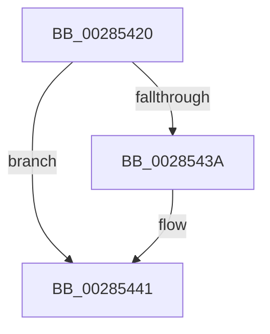

# MiGetPagePrivilege

- RVA: `0x00285420`–`0x00285448` (길이 `40` bytes)
- VA: `0x0000000140285420`
- 실행 섹션: `.text`
- PDB 이름 있음: `예`; PDB Function 태그: `예`
- unwind 정보 RVA: `0x00066964`
- 디코드: `14`개 명령, `40/40` bytes 표시
- 미해석 바이트: `0` (있으면 어셈블리에 `.byte`로 보존)

> 이 문서는 커널 이미지의 기계어와 PDB 기호를 분석해 생성했습니다. 4번과 5번은 함수 원형과 자료형을 바이너리 사용 방식에서 추정한 C 해석이며 원본 소스 복구 결과는 아닙니다.

## 1. Dependencies

- 직접 호출 지점: **0**; 고유 호출 대상: **0**
- 직접 호출자로 확인된 함수: **37**
- RIP 상대 이미지 참조: **1**

### Outgoing calls
- 직접 디코드된 call 명령이 없습니다.

### Direct callers
- [MiResetAccessBitPte](../22/MiResetAccessBitPte_function_0022A800.md) at `0x0022A90D`
- [MmStoreProbeAndLockPages](../23/MmStoreProbeAndLockPages_function_0023E570.md) at `0x0023E77E`
- [MiEmptyWorkingSetHelper](../24/MiEmptyWorkingSetHelper_function_00240C00.md) at `0x00241116`
- [sub_00241476](../24/Unknown_function_00241476.md) at `0x002419E4`
- [MiWsleFree](MiWsleFree_function_00284600.md) at `0x002846F2`
- [MiAddPageToFlushMdl](MiAddPageToFlushMdl_function_00286930.md) at `0x00286B56`
- [sub_0028F8D8](Unknown_function_0028F8D8.md) at `0x0028F990`
- [MiSetVaAgeList](../29/MiSetVaAgeList_function_00290A20.md) at `0x00291766`
- [MiTrimThisWsle](../29/MiTrimThisWsle_function_002932E4.md) at `0x002934A8`
- [MiTrimThisWsle](../29/MiTrimThisWsle_function_002932E4.md) at `0x00293620`
- [MI_WSLE_LOG_ACCESS](../29/MI_WSLE_LOG_ACCESS_function_00294400.md) at `0x00294503`
- [sub_002B1BCF](../2B/Unknown_function_002B1BCF.md) at `0x002B1BDA`
- [MiStealPage](../2B/MiStealPage_function_002B28D0.md) at `0x002B320A`
- [MiCombineCandidate](../31/MiCombineCandidate_function_00316290.md) at `0x003163E5`
- [MiAllocateWsle](../33/MiAllocateWsle_function_003332C0.md) at `0x00333722`
- [MiAllocateWsle](../33/MiAllocateWsle_function_003332C0.md) at `0x00333840`
- [MiRemoveLowestPriorityStandbyPage](../33/MiRemoveLowestPriorityStandbyPage_function_00334600.md) at `0x00334825`
- [sub_003354FB](../33/Unknown_function_003354FB.md) at `0x00335F41`
- [sub_0033603B](../33/Unknown_function_0033603B.md) at `0x0033604B`
- [MiRestoreTransitionPte](../33/MiRestoreTransitionPte_function_0033DD90.md) at `0x0033E1CF`
- [MiCompleteProtoPteFault](../34/MiCompleteProtoPteFault_function_00345710.md) at `0x00346471`
- [MiLockCode](../36/MiLockCode_function_0036F91C.md) at `0x0036FA91`
- [MiLockCode](../36/MiLockCode_function_0036F91C.md) at `0x0036FD83`
- [MiActivePageTradeable](../37/MiActivePageTradeable_function_003747F0.md) at `0x00374845`
- [MiActivePageTradeable](../37/MiActivePageTradeable_function_003747F0.md) at `0x003748BD`
- [MiMarkPfnVerified](../38/MiMarkPfnVerified_function_003833C4.md) at `0x003834F5`
- [MiSetSystemCodeProtection](../38/MiSetSystemCodeProtection_function_00384420.md) at `0x00384677`
- [MiReferencePageForModifiedWrite](../40/MiReferencePageForModifiedWrite_function_00405DAC.md) at `0x00405EC0`
- [sub_00407035](../40/Unknown_function_00407035.md) at `0x00407069`
- [sub_0040D91B](../40/Unknown_function_0040D91B.md) at `0x0040DA0C`
- [MiPageMightBeZero](../45/MiPageMightBeZero_function_0045FEFC.md) at `0x0045FF38`
- [MiSimpleAgePte](../4A/MiSimpleAgePte_function_004ACD40.md) at `0x004ACE92`
- [MiAdjustSecureDriverStateForIatCapture](../4B/MiAdjustSecureDriverStateForIatCapture_function_004BE864.md) at `0x004BEA09`
- [MiUpdateOldPte](../4E/MiUpdateOldPte_function_004EDD20.md) at `0x004EDE64`
- [MiApplyDebuggerPatches](../4F/MiApplyDebuggerPatches_function_004F7BE4.md) at `0x004F7CA6`
- [MiProtectDriverSectionPte](../67/MiProtectDriverSectionPte_function_006706C0.md) at `0x0067084C`
- [MiDbgWriteCheck](../68/MiDbgWriteCheck_function_00685BE4.md) at `0x00685DAE`
- [sub_006DA56C](../6D/Unknown_function_006DA56C.md) at `0x006DA57B`
- [sub_006DBBC0](../6D/Unknown_function_006DBBC0.md) at `0x006DBC42`
- [sub_006DC422](../6D/Unknown_function_006DC422.md) at `0x006DC46C`
- [MmChangeImageProtection](../../page/A5/MmChangeImageProtection_function_00A565F0.md) at `0x00A567B1`

### Static image references
- `0x00285441` → RVA `0x00FC6A88` (`ALMOSTRO`; read)

## 2. Other-region calls and transfers

- 다른 실행 섹션으로 향하는 call: **0**
- 별도 외부 분기/꼬리 이동을 확인하지 못했습니다.

## 3. Assembly (complete function range)

```asm
00285420  40 53                           push rbx
00285422  56                              push rsi
00285423  57                              push rdi
00285424  41 55                           push r13
00285426  48 83 EC 28                     sub rsp, 0x28
0028542A  45 33 ED                        xor r13d, r13d
0028542D  49 8B D8                        mov rbx, r8
00285430  8B F2                           mov esi, edx
00285432  48 8B F9                        mov rdi, rcx
00285435  4D 85 C0                        test r8, r8
00285438  74 07                           je 0x140285441
0028543A  4D 89 28                        mov qword ptr [r8], r13
0028543D  4D 89 68 08                     mov qword ptr [r8 + 8], r13
00285441  48 8B 05 40 16 D4 00            mov rax, qword ptr [rip + 0xd41640]
```

## 4. C-style interpretation (structured pseudocode)

```c
__int64 __fastcall MiGetPagePrivilege(__int64 a1, int a2, __int64 a3)
{
    __int64 v_r13;
    __int64 v_rsp;

    v_rsp = (v_rsp) - (40);
    v_r13 = 0;
    if (a3 != 0) {
        *(unsigned __int64 *)(a3) = 0;
        *(unsigned __int64 *)(a3 + 8) = 0;
    }
    return *(unsigned __int64 *)(v_rip + 13899328);
}
```

## 5. (Beta) C Style

```c
int64_t MiGetPagePrivilege(int64_t Arg1, int32_t Arg2, int64_t Arg3)
{
    int64_t local_r13;
    int64_t local_rsp;

    local_rsp = (local_rsp) - (40);
    local_r13 = 0;
    if (Arg3 != 0) {
        *(uint64_t *)(Arg3) = 0;
        *(uint64_t *)(Arg3 + 0x8) = 0;
    }
    return *(uint64_t *)(v_rip + 0xD41640);
}
```

## 6. Execution-region graph

[열기: 2D/3D 그래프와 함수 탐색 컨트롤 패널](../../../control-panel.html?section=text&rva=0x00285420&view=graph)

- 2D 그래프는 위에서 아래로 흐르고, 3D 그래프는 빈 공간을 드래그해 회전합니다. Shift+드래그는 이동, 휠은 확대·축소, 함수 노드 선택은 대상 보고서 이동입니다.

### Static fallback


