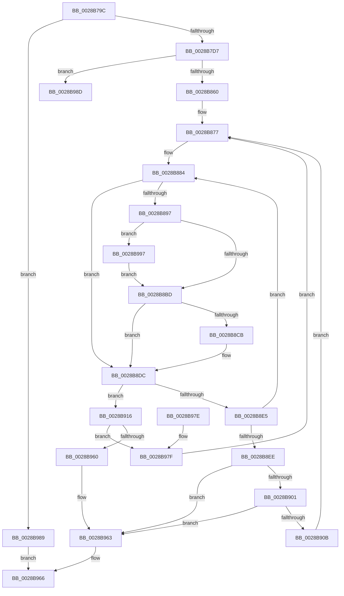

# MiGetPageSlist

- RVA: `0x0028B79C`–`0x0028B9A5` (길이 `521` bytes)
- VA: `0x000000014028B79C`
- 실행 섹션: `.text`
- PDB 이름 있음: `예`; PDB Function 태그: `예`
- unwind 정보 RVA: `0x00066F98`
- 디코드: `147`개 명령, `521/521` bytes 표시
- 미해석 바이트: `0` (있으면 어셈블리에 `.byte`로 보존)

> 이 문서는 커널 이미지의 기계어와 PDB 기호를 분석해 생성했습니다. 4번과 5번은 함수 원형과 자료형을 바이너리 사용 방식에서 추정한 C 해석이며 원본 소스 복구 결과는 아닙니다.

## 1. Dependencies

- 직접 호출 지점: **1**; 고유 호출 대상: **1**
- 직접 호출자로 확인된 함수: **2**
- RIP 상대 이미지 참조: **3**

### Outgoing calls
- `0x0028B956` → [MiSlistGetFreePage](MiSlistGetFreePage_function_0028A170.md) (function, `0x0028A170`)

### Direct callers
- [MiGetPage](MiGetPage_function_002884C0.md) at `0x002891DA`
- [MiGetPage](MiGetPage_function_002884C0.md) at `0x002892C0`
- [MiGetFreeOrZeroPageAnyColor](../43/MiGetFreeOrZeroPageAnyColor_function_004352D8.md) at `0x004353BC`
- [MiGetFreeOrZeroPageAnyColor](../43/MiGetFreeOrZeroPageAnyColor_function_004352D8.md) at `0x0043542E`

### Static image references
- `0x0028B7DB` → RVA `0x00010860` (`.rdata`; read)
- `0x0028B7E6` → RVA `0x00011038` (`.rdata`; read)
- `0x0028B832` → RVA `0x00E2CB40` (`.data`; read)

## 2. Other-region calls and transfers

- 다른 실행 섹션으로 향하는 call: **0**
- call이 아닌 외부 분기/꼬리 이동: **1**
  - `0x0028B992` → [sub_006DA3EE](../6D/Unknown_function_006DA3EE.md) (`tail-transfer`)

## 3. Assembly (complete function range)

```asm
0028B79C  4C 8B DC                        mov r11, rsp
0028B79F  49 89 5B 10                     mov qword ptr [r11 + 0x10], rbx
0028B7A3  55                              push rbp
0028B7A4  56                              push rsi
0028B7A5  57                              push rdi
0028B7A6  41 54                           push r12
0028B7A8  41 55                           push r13
0028B7AA  41 56                           push r14
0028B7AC  41 57                           push r15
0028B7AE  48 83 EC 60                     sub rsp, 0x60
0028B7B2  33 F6                           xor esi, esi
0028B7B4  8B DA                           mov ebx, edx
0028B7B6  48 8B 91 88 3A 00 00            mov rdx, qword ptr [rcx + 0x3a88]
0028B7BD  41 8B F8                        mov edi, r8d
0028B7C0  49 89 73 98                     mov qword ptr [r11 - 0x68], rsi
0028B7C4  89 74 24 40                     mov dword ptr [rsp + 0x40], esi
0028B7C8  89 74 24 4C                     mov dword ptr [rsp + 0x4c], esi
0028B7CC  8B 42 04                        mov eax, dword ptr [rdx + 4]
0028B7CF  A8 10                           test al, 0x10
0028B7D1  0F 85 B2 01 00 00               jne 0x14028b989
0028B7D7  49 89 4B 90                     mov qword ptr [r11 - 0x70], rcx
0028B7DB  48 8D 05 7E 50 D8 FF            lea rax, [rip - 0x27af82]
0028B7E2  49 89 73 B8                     mov qword ptr [r11 - 0x48], rsi
0028B7E6  48 8D 0D 4B 58 D8 FF            lea rcx, [rip - 0x27a7b5]
0028B7ED  41 83 E0 10                     and r8d, 0x10
0028B7F1  89 B4 24 A0 00 00 00            mov dword ptr [rsp + 0xa0], esi
0028B7F8  44 8B D6                        mov r10d, esi
0028B7FB  48 89 74 24 20                  mov qword ptr [rsp + 0x20], rsi
0028B800  48 0F 44 C1                     cmove rax, rcx
0028B804  8B EE                           mov ebp, esi
0028B806  49 89 43 A0                     mov qword ptr [r11 - 0x60], rax
0028B80A  8B CB                           mov ecx, ebx
0028B80C  4C 8B 5A 10                     mov r11, qword ptr [rdx + 0x10]
0028B810  8B C3                           mov eax, ebx
0028B812  48 C1 E8 09                     shr rax, 9
0028B816  44 8B EE                        mov r13d, esi
0028B819  83 E0 3F                        and eax, 0x3f
0028B81C  48 C1 E9 10                     shr rcx, 0x10
0028B820  4C 69 C8 80 DF 00 00            imul r9, rax, 0xdf80
0028B827  83 E1 03                        and ecx, 3
0028B82A  89 7C 24 48                     mov dword ptr [rsp + 0x48], edi
0028B82E  89 5C 24 44                     mov dword ptr [rsp + 0x44], ebx
0028B832  48 8D 05 07 13 BA 00            lea rax, [rip + 0xba1307]
0028B839  8B 94 88 80 11 00 00            mov edx, dword ptr [rax + rcx*4 + 0x1180]
0028B840  44 8B E2                        mov r12d, edx
0028B843  0F B6 C3                        movzx eax, bl
0028B846  89 84 24 A0 00 00 00            mov dword ptr [rsp + 0xa0], eax
0028B84D  44 8B F8                        mov r15d, eax
0028B850  89 94 24 B8 00 00 00            mov dword ptr [rsp + 0xb8], edx
0028B857  83 E7 40                        and edi, 0x40
0028B85A  0F 85 2D 01 00 00               jne 0x14028b98d
0028B860  41 F7 D8                        neg r8d
0028B863  4D 1B F6                        sbb r14, r14
0028B866  49 83 E6 F0                     and r14, 0xfffffffffffffff0
0028B86A  49 81 C6 18 3A 00 00            add r14, 0x3a18
0028B871  4D 03 F1                        add r14, r9
0028B874  4D 03 F3                        add r14, r11
0028B877  4D 8B 1E                        mov r11, qword ptr [r14]
0028B87A  45 8B C4                        mov r8d, r12d
0028B87D  41 83 E0 3F                     and r8d, 0x3f
0028B881  45 8B CC                        mov r9d, r12d
0028B884  41 8B C7                        mov eax, r15d
0028B887  48 C1 E8 06                     shr rax, 6
0028B88B  41 8B D7                        mov edx, r15d
0028B88E  49 8D 0C C3                     lea rcx, [r11 + rax*8]
0028B892  4C 3B D1                        cmp r10, rcx
0028B895  74 45                           je 0x14028b8dc
0028B897  4C 8B D1                        mov r10, rcx
0028B89A  48 89 4C 24 20                  mov qword ptr [rsp + 0x20], rcx
0028B89F  8A CA                           mov cl, dl
0028B8A1  BD 01 00 00 00                  mov ebp, 1
0028B8A6  80 E1 3F                        and cl, 0x3f
0028B8A9  48 D3 E5                        shl rbp, cl
0028B8AC  48 FF CD                        dec rbp
0028B8AF  48 F7 D5                        not rbp
0028B8B2  49 23 2A                        and rbp, qword ptr [r10]
0028B8B5  85 FF                           test edi, edi
0028B8B7  0F 85 DA 00 00 00               jne 0x14028b997
0028B8BD  49 8B C1                        mov rax, r9
0028B8C0  48 33 C2                        xor rax, rdx
0028B8C3  48 A9 C0 FF FF FF               test rax, -0x40
0028B8C9  75 11                           jne 0x14028b8dc
0028B8CB  49 8B C8                        mov rcx, r8
0028B8CE  B8 01 00 00 00                  mov eax, 1
0028B8D3  48 D3 E0                        shl rax, cl
0028B8D6  48 FF C8                        dec rax
0028B8D9  48 23 E8                        and rbp, rax
0028B8DC  41 83 E7 C0                     and r15d, 0xffffffc0
0028B8E0  48 85 ED                        test rbp, rbp
0028B8E3  75 31                           jne 0x14028b916
0028B8E5  41 83 C7 40                     add r15d, 0x40
0028B8E9  45 3B FC                        cmp r15d, r12d
0028B8EC  72 96                           jb 0x14028b884
0028B8EE  8B 84 24 A0 00 00 00            mov eax, dword ptr [rsp + 0xa0]
0028B8F5  4C 8B D6                        mov r10, rsi
0028B8F8  48 89 74 24 20                  mov qword ptr [rsp + 0x20], rsi
0028B8FD  85 C0                           test eax, eax
0028B8FF  74 62                           je 0x14028b963
0028B901  44 3B A4 24 B8 00 00 00         cmp r12d, dword ptr [rsp + 0xb8]
0028B909  75 58                           jne 0x14028b963
0028B90B  44 8B E0                        mov r12d, eax
0028B90E  44 8B FE                        mov r15d, esi
0028B911  E9 61 FF FF FF                  jmp 0x14028b877
0028B916  4C 0F BC C5                     bsf r8, rbp
0028B91A  33 D2                           xor edx, edx
0028B91C  4C 8D 0D 1D 12 BA 00            lea r9, [rip + 0xba121d]
0028B923  8B CB                           mov ecx, ebx
0028B925  45 03 F8                        add r15d, r8d
0028B928  48 C1 E9 10                     shr rcx, 0x10
0028B92C  41 8B C7                        mov eax, r15d
0028B92F  83 E1 03                        and ecx, 3
0028B932  41 F7 B4 89 80 11 00 00         div dword ptr [r9 + rcx*4 + 0x1180]
0028B93A  48 8D 4C 24 28                  lea rcx, [rsp + 0x28]
0028B93F  33 D3                           xor edx, ebx
0028B941  0F B6 C2                        movzx eax, dl
0028B944  BA 01 00 00 00                  mov edx, 1
0028B949  33 D8                           xor ebx, eax
0028B94B  41 8B C0                        mov eax, r8d
0028B94E  48 0F B3 C5                     btr rbp, rax
0028B952  89 5C 24 44                     mov dword ptr [rsp + 0x44], ebx
0028B956  E8 15 E8 FF FF                  call 0x14028a170
0028B95B  48 85 C0                        test rax, rax
0028B95E  74 1F                           je 0x14028b97f
0028B960  48 8B F0                        mov rsi, rax
0028B963  48 8B C6                        mov rax, rsi
0028B966  48 8B 9C 24 A8 00 00 00         mov rbx, qword ptr [rsp + 0xa8]
0028B96E  48 83 C4 60                     add rsp, 0x60
0028B972  41 5F                           pop r15
0028B974  41 5E                           pop r14
0028B976  41 5D                           pop r13
0028B978  41 5C                           pop r12
0028B97A  5F                              pop rdi
0028B97B  5E                              pop rsi
0028B97C  5D                              pop rbp
0028B97D  C3                              ret
0028B97E  CC                              int3
0028B97F  4C 8B 54 24 20                  mov r10, qword ptr [rsp + 0x20]
0028B984  E9 EE FE FF FF                  jmp 0x14028b877
0028B989  33 C0                           xor eax, eax
0028B98B  EB D9                           jmp 0x14028b966
0028B98D  8B CB                           mov ecx, ebx
0028B98F  83 E1 0F                        and ecx, 0xf
0028B992  E9 57 EA 44 00                  jmp 0x1406da3ee
0028B997  49 8B C5                        mov rax, r13
0028B99A  48 F7 D0                        not rax
0028B99D  48 23 E8                        and rbp, rax
0028B9A0  E9 18 FF FF FF                  jmp 0x14028b8bd
```

## 4. C-style interpretation (structured pseudocode)

```c
__int64 __fastcall MiGetPageSlist(__int64 a1, int a2, int a3)
{
    __int64 result;
    __int64 v_r14;
    __int64 v_r15;
    __int64 v_rbp;
    __int64 v_rbx;
    __int64 v_rdi;
    __int64 v_rsi;
    __int64 v_rsp;
    unsigned int v_stack_m4C;
    unsigned int v_stack_m50;
    unsigned int v_stack_m54;
    unsigned int v_stack_m58;
    unsigned __int64 v_stack_m70;
    unsigned __int64 v_stack_m78;
    unsigned __int64 v_stack_p10;
    unsigned int v_stack_p20;
    unsigned int v_stack_p8;

    *(unsigned __int64 *)(v_rsp + 16) = v_rbx;
    v_rsp = (v_rsp) - (96);
    v_rsi = 0;
    *(unsigned __int64 *)(v_rsp - 104) = 0;
    v_stack_m58 = 0;
    v_stack_m4C = 0;
    if ((((unsigned __int8)((unsigned int)(*(unsigned int *)(*(unsigned __int64 *)(a1 + 14984) + 4)))) & (16)) != 0) goto loc_0028B989;
    *(unsigned __int64 *)(v_rsp - 112) = a1;
    *(unsigned __int64 *)(v_rsp - 72) = 0;
    a3 = (unsigned int)((a3) & (16));
    v_stack_p8 = 0;
    v_stack_m78 = 0;
    result = v_rip - 2600834;
    if (condition_is_equal) { result = v_rip - 2598837; }
    *(unsigned __int64 *)(v_rsp - 96) = result;
    result = ((unsigned int)((unsigned int)((unsigned int)(a2)))) >> (9);
    result = (unsigned int)((result) & (63));
    a1 = ((unsigned int)((unsigned int)((unsigned int)(a2)))) >> (16);
    a4 = (a4) * (result);
    a1 = (unsigned int)((a1) & (3));
    v_stack_m50 = (unsigned int)((unsigned int)(a3));
    v_stack_m54 = (unsigned int)((unsigned int)(a2));
    v_stack_p8 = (unsigned int)((unsigned __int8)((unsigned int)(a2)));
    v_stack_p20 = (unsigned int)((unsigned int)(*(unsigned int *)(v_rip + 12194567 + a1 * 4 + 4480)));
    v_rdi = (unsigned int)(((unsigned int)(a3)) & (64));
    if (condition_is_not_equal) goto loc_0028B98D;
    a3 = (unsigned int)(-(a3));
    v_r14 = (v_r14) & (-16);
    v_r14 = (v_r14) + (0x3A18ULL);
    v_r14 = (v_r14) + (a4);
    v_r14 = (v_r14) + (*(unsigned __int64 *)(*(unsigned __int64 *)(a1 + 14984) + 16));
loc_0028B877:
    a3 = (unsigned int)(((unsigned int)((unsigned int)((unsigned int)((unsigned int)((unsigned int)(*(unsigned int *)(v_rip + 12194567 + a1 * 4 + 4480))))))) & (63));
loc_0028B884:
    result = ((unsigned int)((unsigned int)((unsigned int)((unsigned int)((unsigned __int8)((unsigned int)(a2))))))) >> (6);
    if (0 == (*(unsigned __int64 *)(v_r14) + result * 8)) goto loc_0028B8DC;
    v_stack_m78 = *(unsigned __int64 *)(v_r14) + result * 8;
    a1 = (unsigned __int8)(((unsigned __int8)((unsigned int)((unsigned int)((unsigned int)((unsigned int)((unsigned __int8)((unsigned int)(a2)))))))) & (63));
    v_rbp = (1) << ((unsigned __int8)(a1));
    v_rbp = (v_rbp) - 1;
    v_rbp = ~(v_rbp);
    v_rbp = (v_rbp) & (*(unsigned __int64 *)(*(unsigned __int64 *)(v_r14) + result * 8));
    if ((unsigned int)(v_rdi) != 0) goto loc_0028B997;
loc_0028B8BD:
    result = ((unsigned int)((unsigned int)((unsigned int)((unsigned int)((unsigned int)(*(unsigned int *)(v_rip + 12194567 + a1 * 4 + 4480))))))) ^ ((unsigned int)((unsigned int)((unsigned int)((unsigned int)((unsigned __int8)((unsigned int)(a2)))))));
    if (((result) & (-64)) == 0) {
        a1 = a3;
        result = 1;
        result = (result) << ((unsigned __int8)(a1));
        result = (result) - 1;
        v_rbp = (v_rbp) & (result);
    }
    v_r15 = (unsigned int)(((unsigned int)((unsigned int)((unsigned __int8)((unsigned int)(a2))))) & (0xFFFFFFC0ULL));
    if (v_rbp != 0) goto loc_0028B916;
    v_r15 = (unsigned int)((v_r15) + (64));
    if (((unsigned int)(v_r15)) < ((unsigned int)((unsigned int)((unsigned int)((unsigned int)(*(unsigned int *)(v_rip + 12194567 + a1 * 4 + 4480))))))) goto loc_0028B884;
    v_stack_m78 = 0;
    if ((unsigned int)((unsigned int)(v_stack_p8)) == 0) goto loc_0028B963;
    if (((unsigned int)((unsigned int)((unsigned int)((unsigned int)(*(unsigned int *)(v_rip + 12194567 + a1 * 4 + 4480)))))) != v_stack_p20) goto loc_0028B963;
    goto loc_0028B877;
loc_0028B916:
    a2 = 0;
    v_r15 = (unsigned int)((0) + (a3));
    a1 = ((unsigned int)((unsigned int)((unsigned int)(a2)))) >> (16);
    a1 = (unsigned int)((a1) & (3));
    a2 = (unsigned int)((a2) ^ ((unsigned int)((unsigned int)(a2))));
    v_rbx = (unsigned int)(((unsigned int)(a2)) ^ ((unsigned int)((unsigned __int8)(a2))));
    v_stack_m54 = (unsigned int)(v_rbx);
    result = MiSlistGetFreePage(v_stack_m70, 1, a3, v_rip + 12194333);
    if (result == 0) goto loc_0028B97F;
loc_0028B963:
loc_0028B966:
    v_rsp = (v_rsp) + (96);
    return result;
loc_0028B97F:
    goto loc_0028B877;
loc_0028B989:
    result = 0;
    goto loc_0028B966;
loc_0028B98D:
    a1 = (unsigned int)(((unsigned int)((unsigned int)(v_stack_p10))) & (15));
loc_0028B997:
    result = ~(0);
    v_rbp = (v_rbp) & (result);
    goto loc_0028B8BD;
}
```

## 5. (Beta) C Style

```c
int64_t MiGetPageSlist(void *Arg1, int32_t Arg2, int32_t Arg3)
{
    uint8_t *arg1 = (uint8_t *)Arg1;

    int64_t result;
    int64_t local_r14;
    int64_t local_r15;
    int64_t local_rbp;
    int64_t local_rbx;
    int64_t local_rdi;
    int64_t local_rsi;
    int64_t local_rsp;
    uint32_t v_stack_m4C;
    uint32_t v_stack_m50;
    uint32_t v_stack_m54;
    uint32_t v_stack_m58;
    uint64_t v_stack_m70;
    uint64_t v_stack_m78;
    uint64_t v_stack_p10;
    uint32_t v_stack_p20;
    uint32_t v_stack_p8;

    *(uint64_t *)(local_rsp + 0x10) = local_rbx;
    local_rsp = (local_rsp) - (96);
    local_rsi = 0;
    *(uint64_t *)(local_rsp - 0x68) = 0;
    v_stack_m58 = 0;
    v_stack_m4C = 0;
    if ((((uint8_t)((uint32_t)(*(uint32_t *)(*(uint64_t *)(arg1 + 0x3A88) + 0x4)))) & (16)) != 0) goto loc_0028B989;
    *(void **)(local_rsp - 0x70) = Arg1;
    *(uint64_t *)(local_rsp - 0x48) = 0;
    Arg3 = (uint32_t)((Arg3) & (16));
    v_stack_p8 = 0;
    v_stack_m78 = 0;
    result = v_rip - 2600834;
    if (condition_is_equal) { result = v_rip - 2598837; }
    *(uint64_t *)(local_rsp - 0x60) = result;
    result = ((uint32_t)((uint32_t)((uint32_t)(Arg2)))) >> (9);
    result = (uint32_t)((result) & (63));
    Arg1 = ((uint32_t)((uint32_t)((uint32_t)(Arg2)))) >> (16);
    a4 = (a4) * (result);
    Arg1 = (uint32_t)((Arg1) & (3));
    v_stack_m50 = (uint32_t)((uint32_t)(Arg3));
    v_stack_m54 = (uint32_t)((uint32_t)(Arg2));
    v_stack_p8 = (uint32_t)((uint8_t)((uint32_t)(Arg2)));
    v_stack_p20 = (uint32_t)((uint32_t)(*(uint32_t *)(v_rip + 0xBA1307 + arg1 * 4 + 0x1180)));
    local_rdi = (uint32_t)(((uint32_t)(Arg3)) & (64));
    if (condition_is_not_equal) goto loc_0028B98D;
    Arg3 = (uint32_t)(-(Arg3));
    local_r14 = (local_r14) & (-16);
    local_r14 = (local_r14) + (0x3A18ULL);
    local_r14 = (local_r14) + (a4);
    local_r14 = (local_r14) + (*(uint64_t *)(*(uint64_t *)(arg1 + 0x3A88) + 0x10));
loc_0028B877:
    Arg3 = (uint32_t)(((uint32_t)((uint32_t)((uint32_t)((uint32_t)((uint32_t)(*(uint32_t *)(v_rip + 0xBA1307 + arg1 * 4 + 0x1180))))))) & (63));
loc_0028B884:
    result = ((uint32_t)((uint32_t)((uint32_t)((uint32_t)((uint8_t)((uint32_t)(Arg2))))))) >> (6);
    if (0 == (*(uint64_t *)(local_r14) + result * 8)) goto loc_0028B8DC;
    v_stack_m78 = *(uint64_t *)(local_r14) + result * 8;
    Arg1 = (uint8_t)(((uint8_t)((uint32_t)((uint32_t)((uint32_t)((uint32_t)((uint8_t)((uint32_t)(Arg2)))))))) & (63));
    local_rbp = (1) << ((uint8_t)(Arg1));
    local_rbp = (local_rbp) - 1;
    local_rbp = ~(local_rbp);
    local_rbp = (local_rbp) & (*(uint64_t *)(*(uint64_t *)(local_r14) + result * 8));
    if ((uint32_t)(local_rdi) != 0) goto loc_0028B997;
loc_0028B8BD:
    result = ((uint32_t)((uint32_t)((uint32_t)((uint32_t)((uint32_t)(*(uint32_t *)(v_rip + 0xBA1307 + arg1 * 4 + 0x1180))))))) ^ ((uint32_t)((uint32_t)((uint32_t)((uint32_t)((uint8_t)((uint32_t)(Arg2)))))));
    if (((result) & (-64)) == 0) {
        Arg1 = Arg3;
        result = 1;
        result = (result) << ((uint8_t)(Arg1));
        result = (result) - 1;
        local_rbp = (local_rbp) & (result);
    }
    local_r15 = (uint32_t)(((uint32_t)((uint32_t)((uint8_t)((uint32_t)(Arg2))))) & (0xFFFFFFC0ULL));
    if (local_rbp != 0) goto loc_0028B916;
    local_r15 = (uint32_t)((local_r15) + (64));
    if (((uint32_t)(local_r15)) < ((uint32_t)((uint32_t)((uint32_t)((uint32_t)(*(uint32_t *)(v_rip + 0xBA1307 + arg1 * 4 + 0x1180))))))) goto loc_0028B884;
    v_stack_m78 = 0;
    if ((uint32_t)((uint32_t)(v_stack_p8)) == 0) goto loc_0028B963;
    if (((uint32_t)((uint32_t)((uint32_t)((uint32_t)(*(uint32_t *)(v_rip + 0xBA1307 + arg1 * 4 + 0x1180)))))) != v_stack_p20) goto loc_0028B963;
    goto loc_0028B877;
loc_0028B916:
    Arg2 = 0;
    local_r15 = (uint32_t)((0) + (Arg3));
    Arg1 = ((uint32_t)((uint32_t)((uint32_t)(Arg2)))) >> (16);
    Arg1 = (uint32_t)((Arg1) & (3));
    Arg2 = (uint32_t)((Arg2) ^ ((uint32_t)((uint32_t)(Arg2))));
    local_rbx = (uint32_t)(((uint32_t)(Arg2)) ^ ((uint32_t)((uint8_t)(Arg2))));
    v_stack_m54 = (uint32_t)(local_rbx);
    result = MiSlistGetFreePage(v_stack_m70, 1, Arg3, v_rip + 12194333);
    if (result == 0) goto loc_0028B97F;
loc_0028B963:
loc_0028B966:
    local_rsp = (local_rsp) + (96);
    return result;
loc_0028B97F:
    goto loc_0028B877;
loc_0028B989:
    result = 0;
    goto loc_0028B966;
loc_0028B98D:
    Arg1 = (uint32_t)(((uint32_t)((uint32_t)(v_stack_p10))) & (15));
loc_0028B997:
    result = ~(0);
    local_rbp = (local_rbp) & (result);
    goto loc_0028B8BD;
}
```

### 관측된 메모리 오프셋

구조체 형식이 확인되지 않은 접근은 인자 기준의 오프셋으로만 기록했습니다.

| 기준 인자 | 오프셋 표현 | 폭 (bit) | 접근 |
|---|---:|---:|---|
| `Arg1` | `+ 0x3A88` | `64` | `R` |

## 6. Execution-region graph

[열기: 2D/3D 그래프와 함수 탐색 컨트롤 패널](../../../control-panel.html?section=text&rva=0x0028B79C&view=graph)

- 2D 그래프는 위에서 아래로 흐르고, 3D 그래프는 빈 공간을 드래그해 회전합니다. Shift+드래그는 이동, 휠은 확대·축소, 함수 노드 선택은 대상 보고서 이동입니다.

### Static fallback


