# MiGetPerfectFreeOrZeroPage

- RVA: `0x002898E0`–`0x00289CA1` (길이 `961` bytes)
- VA: `0x00000001402898E0`
- 실행 섹션: `.text`
- PDB 이름 있음: `예`; PDB Function 태그: `아니요`
- unwind 정보 RVA: `0x00066E40`
- 디코드: `240`개 명령, `961/961` bytes 표시
- 미해석 바이트: `0` (있으면 어셈블리에 `.byte`로 보존)

> 이 문서는 커널 이미지의 기계어와 PDB 기호를 분석해 생성했습니다. 4번과 5번은 함수 원형과 자료형을 바이너리 사용 방식에서 추정한 C 해석이며 원본 소스 복구 결과는 아닙니다.

## 1. Dependencies

- 직접 호출 지점: **8**; 고유 호출 대상: **6**
- 직접 호출자로 확인된 함수: **1**
- RIP 상대 이미지 참조: **8**

### Outgoing calls
- `0x00289994` → [ExpInterlockedPopEntrySList](../6B/ExpInterlockedPopEntrySList_function_006BA570.md) (function, `0x006BA570`)
- `0x002899D8` → [MiGetPerfectColorHeadPage](MiGetPerfectColorHeadPage_function_00289CA8.md) (function, `0x00289CA8`)
- `0x00289A64` → [ExpInterlockedPopEntrySList](../6B/ExpInterlockedPopEntrySList_function_006BA570.md) (function, `0x006BA570`)
- `0x00289A93` → [KiLowerIrqlProcessIrqlFlags](../4F/KiLowerIrqlProcessIrqlFlags_function_004F5698.md) (function, `0x004F5698`)
- `0x00289ABB` → [MiSetOriginalPtePfnFromFreeList](MiSetOriginalPtePfnFromFreeList_function_0028A99C.md) (function, `0x0028A99C`)
- `0x00289AEA` → [KiRaiseIrqlProcessIrqlFlags](../4F/KiRaiseIrqlProcessIrqlFlags_function_004F56FC.md) (function, `0x004F56FC`)
- `0x00289B51` → [KiLowerIrqlProcessIrqlFlags](../4F/KiLowerIrqlProcessIrqlFlags_function_004F5698.md) (function, `0x004F5698`)
- `0x00289BC0` → [MiArePageContentsZero](../4D/MiArePageContentsZero_function_004D4278.md) (function, `0x004D4278`)

### Direct callers
- [MiGetPage](MiGetPage_function_002884C0.md) at `0x0028896F`

### Static image references
- `0x00289917` → RVA `0x00011038` (`.rdata`; read)
- `0x0028992F` → RVA `0x00010860` (`.rdata`; read)
- `0x002899A1` → RVA `0x00010880` (`.rdata`; read)
- `0x002899B4` → RVA `0x00FC6A88` (`ALMOSTRO`; read)
- `0x00289A83` → RVA `0x00FC6D20` (`ALMOSTRO`; read)
- `0x00289B7F` → RVA `0x00E30270` (`.data`; read)
- `0x00289B87` → RVA `0x00FC5054` (`ALMOSTRO`; reference)
- `0x00289B8D` → RVA `0x00E30270` (`.data`; write)

## 2. Other-region calls and transfers

- 다른 실행 섹션으로 향하는 call: **0**
- 별도 외부 분기/꼬리 이동을 확인하지 못했습니다.

## 3. Assembly (complete function range)

```asm
002898E0  48 8B C4                        mov rax, rsp
002898E3  48 89 58 10                     mov qword ptr [rax + 0x10], rbx
002898E7  55                              push rbp
002898E8  56                              push rsi
002898E9  57                              push rdi
002898EA  41 54                           push r12
002898EC  41 55                           push r13
002898EE  41 56                           push r14
002898F0  41 57                           push r15
002898F2  48 83 EC 60                     sub rsp, 0x60
002898F6  45 33 C9                        xor r9d, r9d
002898F9  48 89 48 98                     mov qword ptr [rax - 0x68], rcx
002898FD  4C 89 48 A0                     mov qword ptr [rax - 0x60], r9
00289901  41 0F BA E0 04                  bt r8d, 4
00289906  44 89 48 BC                     mov dword ptr [rax - 0x44], r9d
0028990A  41 8B D8                        mov ebx, r8d
0028990D  4C 89 48 C0                     mov qword ptr [rax - 0x40], r9
00289911  48 8B F1                        mov rsi, rcx
00289914  89 58 B8                        mov dword ptr [rax - 0x48], ebx
00289917  48 8D 0D 1A 77 D8 FF            lea rcx, [rip - 0x2788e6]
0028991E  C7 40 B0 01 00 00 00            mov dword ptr [rax - 0x50], 1
00289925  41 8B F9                        mov edi, r9d
00289928  89 50 B4                        mov dword ptr [rax - 0x4c], edx
0028992B  40 0F 93 C7                     setae dil
0028992F  48 8D 05 2A 6F D8 FF            lea rax, [rip - 0x2790d6]
00289936  48 0F 43 C1                     cmovae rax, rcx
0028993A  48 89 44 24 40                  mov qword ptr [rsp + 0x40], rax
0028993F  8B C2                           mov eax, edx
00289941  25 00 00 03 00                  and eax, 0x30000
00289946  3D 00 00 03 00                  cmp eax, 0x30000
0028994B  0F 85 82 00 00 00               jne 0x1402899d3
00289951  8B C2                           mov eax, edx
00289953  25 00 00 0C 00                  and eax, 0xc0000
00289958  3D 00 00 04 00                  cmp eax, 0x40000
0028995D  75 74                           jne 0x1402899d3
0028995F  44 0F B6 EA                     movzx r13d, dl
00289963  45 8B FD                        mov r15d, r13d
00289966  48 63 CF                        movsxd rcx, edi
00289969  48 8D A9 A0 03 00 00            lea rbp, [rcx + 0x3a0]
00289970  48 03 ED                        add rbp, rbp
00289973  48 8B 44 EE 08                  mov rax, qword ptr [rsi + rbp*8 + 8]
00289978  4C 0F A3 38                     bt qword ptr [rax], r15
0028997C  0F 83 1E 01 00 00               jae 0x140289aa0
00289982  4D 8B E7                        mov r12, r15
00289985  49 C1 E4 04                     shl r12, 4
00289989  4C 03 A4 CE 60 3A 00 00         add r12, qword ptr [rsi + rcx*8 + 0x3a60]
00289991  49 8B CC                        mov rcx, r12
00289994  E8 D7 0B 43 00                  call 0x1406ba570
00289999  4C 8B F0                        mov r14, rax
0028999C  48 85 C0                        test rax, rax
0028999F  74 55                           je 0x1402899f6
002899A1  48 8B 05 D8 6E D8 FF            mov rax, qword ptr [rip - 0x279128]
002899A8  49 89 46 10                     mov qword ptr [r14 + 0x10], rax
002899AC  85 FF                           test edi, edi
002899AE  0F 85 03 01 00 00               jne 0x140289ab7
002899B4  0F B6 05 CD D0 D3 00            movzx eax, byte ptr [rip + 0xd3d0cd]
002899BB  84 C0                           test al, al
002899BD  0F 88 BC 01 00 00               js 0x140289b7f
002899C3  49 C7 06 00 00 00 00            mov qword ptr [r14], 0
002899CA  49 8B 46 10                     mov rax, qword ptr [r14 + 0x10]
002899CE  49 8B C6                        mov rax, r14
002899D1  EB 0A                           jmp 0x1402899dd
002899D3  48 8D 4C 24 30                  lea rcx, [rsp + 0x30]
002899D8  E8 CB 02 00 00                  call 0x140289ca8
002899DD  48 8B 9C 24 A8 00 00 00         mov rbx, qword ptr [rsp + 0xa8]
002899E5  48 83 C4 60                     add rsp, 0x60
002899E9  41 5F                           pop r15
002899EB  41 5E                           pop r14
002899ED  41 5D                           pop r13
002899EF  41 5C                           pop r12
002899F1  5F                              pop rdi
002899F2  5E                              pop rsi
002899F3  5D                              pop rbp
002899F4  C3                              ret
002899F5  CC                              int3
002899F6  8B C3                           mov eax, ebx
002899F8  D1 E8                           shr eax, 1
002899FA  0B C3                           or eax, ebx
002899FC  A8 01                           test al, 1
002899FE  0F 84 C1 00 00 00               je 0x140289ac5
00289A04  B1 11                           mov cl, 0x11
00289A06  48 89 8C 24 A0 00 00 00         mov qword ptr [rsp + 0xa0], rcx
00289A0E  4C 8B 4C EE 08                  mov r9, qword ptr [rsi + rbp*8 + 8]
00289A13  4D 8B C7                        mov r8, r15
00289A16  41 83 E0 1F                     and r8d, 0x1f
00289A1A  49 8B C7                        mov rax, r15
00289A1D  48 C1 E8 05                     shr rax, 5
00289A21  B9 01 00 00 00                  mov ecx, 1
00289A26  4C 89 84 24 B8 00 00 00         mov qword ptr [rsp + 0xb8], r8
00289A2E  48 8D 14 85 00 00 00 00         lea rdx, [rax*4]
00289A36  49 8D 40 01                     lea rax, [r8 + 1]
00289A3A  48 89 54 24 20                  mov qword ptr [rsp + 0x20], rdx
00289A3F  4C 03 CA                        add r9, rdx
00289A42  48 89 44 24 28                  mov qword ptr [rsp + 0x28], rax
00289A47  48 83 F8 20                     cmp rax, 0x20
00289A4B  0F 87 A3 00 00 00               ja 0x140289af4
00289A51  41 8B C8                        mov ecx, r8d
00289A54  B8 01 00 00 00                  mov eax, 1
00289A59  D3 E0                           shl eax, cl
00289A5B  F7 D0                           not eax
00289A5D  F0 41 21 01                     lock and dword ptr [r9], eax
00289A61  49 8B CC                        mov rcx, r12
00289A64  E8 07 0B 43 00                  call 0x1406ba570
00289A69  4C 8B F0                        mov r14, rax
00289A6C  48 85 C0                        test rax, rax
00289A6F  0F 85 94 00 00 00               jne 0x140289b09
00289A75  48 8B AC 24 A0 00 00 00         mov rbp, qword ptr [rsp + 0xa0]
00289A7D  40 80 FD 11                     cmp bpl, 0x11
00289A81  74 1D                           je 0x140289aa0
00289A83  39 05 97 D2 D3 00               cmp dword ptr [rip + 0xd3d297], eax
00289A89  74 0D                           je 0x140289a98
00289A8B  44 0F 20 C1                     mov rcx, cr8
00289A8F  40 0F B6 D5                     movzx edx, bpl
00289A93  E8 00 BC 26 00                  call 0x1404f5698
00289A98  40 0F B6 C5                     movzx eax, bpl
00289A9C  44 0F 22 C0                     mov cr8, rax
00289AA0  48 8B 44 24 40                  mov rax, qword ptr [rsp + 0x40]
00289AA5  8B 48 04                        mov ecx, dword ptr [rax + 4]
00289AA8  3B F9                           cmp edi, ecx
00289AAA  0F 84 23 FF FF FF               je 0x1402899d3
00289AB0  8B F9                           mov edi, ecx
00289AB2  E9 AF FE FF FF                  jmp 0x140289966
00289AB7  49 8D 4E 10                     lea rcx, [r14 + 0x10]
00289ABB  E8 DC 0E 00 00                  call 0x14028a99c
00289AC0  E9 FE FE FF FF                  jmp 0x1402899c3
00289AC5  44 0F 20 C1                     mov rcx, cr8
00289AC9  48 89 8C 24 A0 00 00 00         mov qword ptr [rsp + 0xa0], rcx
00289AD1  B8 02 00 00 00                  mov eax, 2
00289AD6  44 0F 22 C0                     mov cr8, rax
00289ADA  83 3D 3F D2 D3 00 00            cmp dword ptr [rip + 0xd3d23f], 0
00289AE1  0F 84 27 FF FF FF               je 0x140289a0e
00289AE7  0F B6 D0                        movzx edx, al
00289AEA  E8 0D BC 26 00                  call 0x1404f56fc
00289AEF  E9 1A FF FF FF                  jmp 0x140289a0e
00289AF4  4D 85 C0                        test r8, r8
00289AF7  0F 85 DB 00 00 00               jne 0x140289bd8
00289AFD  B8 FF FF FF FF                  mov eax, 0xffffffff
00289B02  D3 E0                           shl eax, cl
00289B04  E9 54 FF FF FF                  jmp 0x140289a5d
00289B09  4C 8B 44 24 20                  mov r8, qword ptr [rsp + 0x20]
00289B0E  BA 01 00 00 00                  mov edx, 1
00289B13  4C 03 44 EE 08                  add r8, qword ptr [rsi + rbp*8 + 8]
00289B18  48 83 7C 24 28 20               cmp qword ptr [rsp + 0x28], 0x20
00289B1E  77 42                           ja 0x140289b62
00289B20  48 8B 8C 24 B8 00 00 00         mov rcx, qword ptr [rsp + 0xb8]
00289B28  8B C2                           mov eax, edx
00289B2A  D3 E0                           shl eax, cl
00289B2C  F0 41 09 00                     lock or dword ptr [r8], eax
00289B30  48 8B 9C 24 A0 00 00 00         mov rbx, qword ptr [rsp + 0xa0]
00289B38  80 FB 11                        cmp bl, 0x11
00289B3B  0F 84 60 FE FF FF               je 0x1402899a1
00289B41  83 3D D8 D1 D3 00 00            cmp dword ptr [rip + 0xd3d1d8], 0
00289B48  74 0C                           je 0x140289b56
00289B4A  44 0F 20 C1                     mov rcx, cr8
00289B4E  0F B6 D3                        movzx edx, bl
00289B51  E8 42 BB 26 00                  call 0x1404f5698
00289B56  0F B6 C3                        movzx eax, bl
00289B59  44 0F 22 C0                     mov cr8, rax
00289B5D  E9 3F FE FF FF                  jmp 0x1402899a1
00289B62  48 83 BC 24 B8 00 00 00 00      cmp qword ptr [rsp + 0xb8], 0
00289B6B  0F 85 CB 00 00 00               jne 0x140289c3c
00289B71  48 8B CA                        mov rcx, rdx
00289B74  B8 01 00 00 00                  mov eax, 1
00289B79  D3 E0                           shl eax, cl
00289B7B  FF C8                           dec eax
00289B7D  EB AD                           jmp 0x140289b2c
00289B7F  8B 05 EB 66 BA 00               mov eax, dword ptr [rip + 0xba66eb]
00289B85  FF C0                           inc eax
00289B87  85 05 C7 B4 D3 00               test dword ptr [rip + 0xd3b4c7], eax
00289B8D  89 05 DD 66 BA 00               mov dword ptr [rip + 0xba66dd], eax
00289B93  0F 85 2A FE FF FF               jne 0x1402899c3
00289B99  48 B8 00 00 00 00 00 DE FF FF   movabs rax, 0xffffde0000000000
00289BA3  49 8B CE                        mov rcx, r14
00289BA6  BA 01 00 00 00                  mov edx, 1
00289BAB  48 2B C8                        sub rcx, rax
00289BAE  48 B8 AB AA AA AA AA AA AA AA   movabs rax, 0xaaaaaaaaaaaaaaab
00289BB8  48 C1 F9 04                     sar rcx, 4
00289BBC  48 0F AF C8                     imul rcx, rax
00289BC0  E8 B3 A6 24 00                  call 0x1404d4278
00289BC5  49 C7 06 00 00 00 00            mov qword ptr [r14], 0
00289BCC  49 8B 46 10                     mov rax, qword ptr [r14 + 0x10]
00289BD0  49 8B C6                        mov rax, r14
00289BD3  E9 05 FE FF FF                  jmp 0x1402899dd
00289BD8  41 8B C5                        mov eax, r13d
00289BDB  BA 20 00 00 00                  mov edx, 0x20
00289BE0  83 E0 1F                        and eax, 0x1f
00289BE3  2B D0                           sub edx, eax
00289BE5  B8 01 00 00 00                  mov eax, 1
00289BEA  8B CA                           mov ecx, edx
00289BEC  D3 E0                           shl eax, cl
00289BEE  49 8B C8                        mov rcx, r8
00289BF1  FF C8                           dec eax
00289BF3  D3 E0                           shl eax, cl
00289BF5  F7 D0                           not eax
00289BF7  F0 41 21 01                     lock and dword ptr [r9], eax
00289BFB  8B C2                           mov eax, edx
00289BFD  B9 01 00 00 00                  mov ecx, 1
00289C02  48 2B C8                        sub rcx, rax
00289C05  49 83 C1 04                     add r9, 4
00289C09  48 83 F9 20                     cmp rcx, 0x20
00289C0D  72 1F                           jb 0x140289c2e
00289C0F  48 8B D1                        mov rdx, rcx
00289C12  48 C1 EA 05                     shr rdx, 5
00289C16  48 6B C2 E0                     imul rax, rdx, -0x20
00289C1A  48 03 C8                        add rcx, rax
00289C1D  41 C7 01 00 00 00 00            mov dword ptr [r9], 0
00289C24  49 83 C1 04                     add r9, 4
00289C28  48 83 EA 01                     sub rdx, 1
00289C2C  75 EF                           jne 0x140289c1d
00289C2E  48 85 C9                        test rcx, rcx
00289C31  0F 84 2A FE FF FF               je 0x140289a61
00289C37  E9 C1 FE FF FF                  jmp 0x140289afd
00289C3C  41 83 E5 1F                     and r13d, 0x1f
00289C40  BA 20 00 00 00                  mov edx, 0x20
00289C45  41 2B D5                        sub edx, r13d
00289C48  B8 01 00 00 00                  mov eax, 1
00289C4D  8B CA                           mov ecx, edx
00289C4F  D3 E0                           shl eax, cl
00289C51  41 0F B6 CF                     movzx ecx, r15b
00289C55  80 E1 1F                        and cl, 0x1f
00289C58  FF C8                           dec eax
00289C5A  D3 E0                           shl eax, cl
00289C5C  F0 41 09 00                     lock or dword ptr [r8], eax
00289C60  8B C2                           mov eax, edx
00289C62  49 83 C0 04                     add r8, 4
00289C66  BA 01 00 00 00                  mov edx, 1
00289C6B  48 2B D0                        sub rdx, rax
00289C6E  48 83 FA 20                     cmp rdx, 0x20
00289C72  72 1F                           jb 0x140289c93
00289C74  48 8B CA                        mov rcx, rdx
00289C77  48 C1 E9 05                     shr rcx, 5
00289C7B  48 6B C1 E0                     imul rax, rcx, -0x20
00289C7F  48 03 D0                        add rdx, rax
00289C82  41 C7 00 FF FF FF FF            mov dword ptr [r8], 0xffffffff
00289C89  49 83 C0 04                     add r8, 4
00289C8D  48 83 E9 01                     sub rcx, 1
00289C91  75 EF                           jne 0x140289c82
00289C93  48 85 D2                        test rdx, rdx
00289C96  0F 84 94 FE FF FF               je 0x140289b30
00289C9C  E9 D0 FE FF FF                  jmp 0x140289b71
```

## 4. C-style interpretation (structured pseudocode)

```c
__int64 __fastcall MiGetPerfectFreeOrZeroPage(__int64 a1, int a2, int a3, int a4)
{
    __int64 result;
    __int64 v_r12;
    __int64 v_r13;
    __int64 v_rbp;
    __int64 v_rdi;
    __int64 v_rsp;
    unsigned __int64 v_stack_m58;
    unsigned __int64 v_stack_m68;
    unsigned __int64 v_stack_p10;
    unsigned __int64 v_stack_p20;
    unsigned __int64 v_stack_p28;
    unsigned __int64 v_stack_p40;
    unsigned __int64 v_stack_pA0;
    unsigned __int64 v_stack_pB8;

    *(unsigned __int64 *)(v_rsp + 16) = v_rbx;
    v_rsp = (v_rsp) - (96);
    a4 = 0;
    *(unsigned __int64 *)(v_rsp - 104) = a1;
    *(unsigned __int64 *)(v_rsp - 96) = 0;
    *(unsigned int *)(v_rsp - 68) = 0;
    *(unsigned __int64 *)(v_rsp - 64) = 0;
    *(unsigned int *)(v_rsp - 72) = (unsigned int)((unsigned int)(a3));
    *(unsigned int *)(v_rsp - 80) = 1;
    *(unsigned int *)(v_rsp - 76) = a2;
    v_rdi = (condition_is_above_or_equal) ? 1 : 0;
    result = v_rip - 2592982;
    if (condition_is_above_or_equal) { result = v_rip - 2590950; }
    v_stack_m58 = result;
    result = (unsigned int)(((unsigned int)(a2)) & (0x30000ULL));
    if (((unsigned int)(result)) != 0x30000ULL) goto loc_002899D3;
    result = (unsigned int)(((unsigned int)(a2)) & (0xC0000ULL));
    if (((unsigned int)(result)) != 0x40000ULL) goto loc_002899D3;
loc_00289966:
    v_rbp = ((int)((unsigned int)(v_rdi)) + 928) + ((int)((unsigned int)(v_rdi)) + 928);
    if (condition_is_above_or_equal) goto loc_00289AA0;
    v_r12 = ((unsigned int)((unsigned int)((unsigned __int8)(a2)))) << (4);
    v_r12 = (v_r12) + (*(unsigned __int64 *)(a1 + (int)((unsigned int)(v_rdi)) * 8 + 14944));
    result = ExpInterlockedPopEntrySList(v_r12, a2, a3, a4);
    if (result == 0) goto loc_002899F6;
loc_002899A1:
    *(unsigned __int64 *)(result + 16) = *(unsigned __int64 *)(v_rip - 2593064);
    if ((unsigned int)(v_rdi) != 0) goto loc_00289AB7;
    if (sign_flag) goto loc_00289B7F;
loc_002899C3:
    *(unsigned __int64 *)(result) = 0;
    goto loc_002899DD;
loc_002899D3:
    result = MiGetPerfectColorHeadPage(v_stack_m68, a2, a3, a4);
loc_002899DD:
    v_rsp = (v_rsp) + (96);
    return result;
loc_002899F6:
    result = (unsigned int)(((unsigned int)((unsigned int)(v_stack_p10))) >> (1));
    result = (unsigned int)((result) | ((unsigned int)(v_stack_p10)));
    if ((((unsigned __int8)(result)) & (1)) == 0) goto loc_00289AC5;
    v_stack_pA0 = 17;
loc_00289A0E:
    a3 = (unsigned int)(((unsigned int)((unsigned int)((unsigned __int8)(a2)))) & (31));
    result = ((unsigned int)((unsigned int)((unsigned __int8)(a2)))) >> (5);
    v_stack_pB8 = a3;
    v_stack_p20 = result * 4;
    a4 = (*(unsigned __int64 *)(a1 + v_rbp * 8 + 8)) + (result * 4);
    v_stack_p28 = a3 + 1;
    if ((a3 + 1) > 32) goto loc_00289AF4;
    result = (unsigned int)((1) << ((unsigned __int8)((unsigned int)(a3))));
    result = (unsigned int)(~(result));
loc_00289A5D:
loc_00289A61:
    result = ExpInterlockedPopEntrySList(v_r12, result * 4, a3, a4);
    if (result != 0) goto loc_00289B09;
    if (((unsigned __int8)(v_stack_pA0)) == 17) goto loc_00289AA0;
    if ((*(unsigned int *)(v_rip + 13882007)) != ((unsigned int)(result))) {
        a1 = v_cr8;
        a2 = (unsigned __int8)(v_stack_pA0);
        result = KiLowerIrqlProcessIrqlFlags(a1, a2, a3, a4);
    }
loc_00289AA0:
    if (((unsigned int)(v_rdi)) == ((unsigned int)((unsigned int)(*(unsigned int *)(v_stack_p40 + 4))))) goto loc_002899D3;
    goto loc_00289966;
loc_00289AB7:
    result = MiSetOriginalPtePfnFromFreeList(result + 16, a2, a3, a4);
    goto loc_002899C3;
loc_00289AC5:
    v_stack_pA0 = (unsigned __int8)(v_stack_pA0);
    if ((*(unsigned int *)(v_rip + 13881919)) == 0) goto loc_00289A0E;
    result = KiRaiseIrqlProcessIrqlFlags((unsigned __int8)(v_stack_pA0), 2, a3, a4);
    goto loc_00289A0E;
loc_00289AF4:
    if (a3 != 0) goto loc_00289BD8;
loc_00289AFD:
    result = (unsigned int)(((unsigned int)(0xFFFFFFFFULL)) << ((unsigned __int8)((unsigned __int8)(v_stack_pA0))));
    goto loc_00289A5D;
loc_00289B09:
    a3 = (v_stack_p20) + (*(unsigned __int64 *)(a1 + v_stack_pA0 * 8 + 8));
    if (v_stack_p28 > 32) goto loc_00289B62;
    result = (unsigned int)((1) << ((unsigned __int8)(v_stack_pB8)));
loc_00289B2C:
loc_00289B30:
    if (((unsigned __int8)(v_stack_pA0)) == 17) goto loc_002899A1;
    if ((*(unsigned int *)(v_rip + 13881816)) != 0) {
        a1 = 2;
        a2 = (unsigned __int8)(v_stack_pA0);
        result = KiLowerIrqlProcessIrqlFlags(a1, a2, a3, a4);
    }
    goto loc_002899A1;
loc_00289B62:
    if (v_stack_pB8 != 0) goto loc_00289C3C;
loc_00289B71:
    result = (unsigned int)((1) << ((unsigned __int8)(a2)));
    result = (unsigned int)((result) - 1);
    goto loc_00289B2C;
loc_00289B7F:
    result = (unsigned int)(((unsigned int)(*(unsigned int *)(v_rip + 12216043))) + 1);
    *(unsigned int *)(v_rip + 12216029) = (unsigned int)(result);
    if (((*(unsigned int *)(v_rip + 13874375)) & ((unsigned int)(result))) != 0) goto loc_002899C3;
    a1 = (result) - (result);
    a1 = (a1) >> (4);
    a1 = (a1) * (result);
    result = MiArePageContentsZero(a1, 1, a3, a4);
    *(unsigned __int64 *)(result) = 0;
    goto loc_002899DD;
loc_00289BD8:
    result = (unsigned int)(((unsigned int)((unsigned int)((unsigned __int8)(a2)))) & (31));
    a2 = (unsigned int)((32) - ((unsigned int)(result)));
    result = (unsigned int)((1) << ((unsigned __int8)((unsigned int)(a2))));
    result = (unsigned int)((result) - 1);
    result = (unsigned int)((result) << ((unsigned __int8)(a3)));
    result = (unsigned int)(~(result));
    a1 = (1) - ((unsigned int)(a2));
    a4 = (a4) + (4);
    if (a1 < 32) goto loc_00289C2E;
    a2 = (a1) >> (5);
    result = ((unsigned int)(a2)) * (a2);
    a1 = (a1) + (result);
loc_00289C1D:
    *(unsigned int *)(a4) = 0;
    a4 = (a4) + (4);
    a2 = (a2) - (1);
    if (condition_is_not_equal) goto loc_00289C1D;
loc_00289C2E:
    if (a1 == 0) goto loc_00289A61;
    goto loc_00289AFD;
loc_00289C3C:
    v_r13 = (unsigned int)(((unsigned __int8)(a2)) & (31));
    a2 = (unsigned int)((32) - ((unsigned int)(v_r13)));
    result = (unsigned int)((1) << ((unsigned __int8)((unsigned int)(a2))));
    a1 = (unsigned __int8)(((unsigned __int8)((unsigned int)((unsigned int)((unsigned __int8)(a2))))) & (31));
    result = (unsigned int)((result) - 1);
    result = (unsigned int)((result) << ((unsigned __int8)(a1)));
    a3 = (a3) + (4);
    a2 = (1) - ((unsigned int)(a2));
    if (a2 < 32) goto loc_00289C93;
    a1 = (a2) >> (5);
    result = ((unsigned int)(a2)) * (a1);
    a2 = (a2) + (result);
loc_00289C82:
    *(unsigned int *)(a3) = 0xFFFFFFFFULL;
    a3 = (a3) + (4);
    a1 = (a1) - (1);
    if (condition_is_not_equal) goto loc_00289C82;
loc_00289C93:
    if (a2 == 0) goto loc_00289B30;
    goto loc_00289B71;
}
```

## 5. (Beta) C Style

```c
int64_t MiGetPerfectFreeOrZeroPage(void *Arg1, void *Arg2, int32_t Arg3, int32_t Arg4)
{
    uint8_t *arg1 = (uint8_t *)Arg1;
    uint8_t *arg2 = (uint8_t *)Arg2;

    int64_t result;
    int64_t local_r12;
    int64_t local_r13;
    int64_t local_rbp;
    int64_t local_rdi;
    int64_t local_rsp;
    uint64_t v_stack_m58;
    uint64_t v_stack_m68;
    uint64_t v_stack_p10;
    uint64_t v_stack_p20;
    uint64_t v_stack_p28;
    uint64_t v_stack_p40;
    uint64_t v_stack_pA0;
    uint64_t v_stack_pB8;

    *(uint64_t *)(local_rsp + 0x10) = local_rbx;
    local_rsp = (local_rsp) - (96);
    Arg4 = 0;
    *(void **)(local_rsp - 0x68) = Arg1;
    *(uint64_t *)(local_rsp - 0x60) = 0;
    *(uint32_t *)(local_rsp - 0x44) = 0;
    *(uint64_t *)(local_rsp - 0x40) = 0;
    *(uint32_t *)(local_rsp - 0x48) = (uint32_t)((uint32_t)(Arg3));
    *(uint32_t *)(local_rsp - 0x50) = 1;
    *(uint32_t *)(local_rsp - 0x4C) = Arg2;
    local_rdi = (condition_is_above_or_equal) ? 1 : 0;
    result = v_rip - 2592982;
    if (condition_is_above_or_equal) { result = v_rip - 2590950; }
    v_stack_m58 = result;
    result = (uint32_t)(((uint32_t)(Arg2)) & (0x30000ULL));
    if (((uint32_t)(result)) != 0x30000ULL) goto loc_002899D3;
    result = (uint32_t)(((uint32_t)(Arg2)) & (0xC0000ULL));
    if (((uint32_t)(result)) != 0x40000ULL) goto loc_002899D3;
loc_00289966:
    local_rbp = ((int32_t)((uint32_t)(local_rdi)) + 928) + ((int32_t)((uint32_t)(local_rdi)) + 928);
    if (condition_is_above_or_equal) goto loc_00289AA0;
    local_r12 = ((uint32_t)((uint32_t)((uint8_t)(Arg2)))) << (4);
    local_r12 = (local_r12) + (*(uint64_t *)(arg1 + (int32_t)((uint32_t)(local_rdi)) * 8 + 0x3A60));
    result = ExpInterlockedPopEntrySList(local_r12, Arg2, Arg3, Arg4);
    if (result == 0) goto loc_002899F6;
loc_002899A1:
    *(uint64_t *)(result + 0x10) = *(uint64_t *)(v_rip - 0x279128);
    if ((uint32_t)(local_rdi) != 0) goto loc_00289AB7;
    if (sign_flag) goto loc_00289B7F;
loc_002899C3:
    *(uint64_t *)(result) = 0;
    goto loc_002899DD;
loc_002899D3:
    result = MiGetPerfectColorHeadPage(v_stack_m68, Arg2, Arg3, Arg4);
loc_002899DD:
    local_rsp = (local_rsp) + (96);
    return result;
loc_002899F6:
    result = (uint32_t)(((uint32_t)((uint32_t)(v_stack_p10))) >> (1));
    result = (uint32_t)((result) | ((uint32_t)(v_stack_p10)));
    if ((((uint8_t)(result)) & (1)) == 0) goto loc_00289AC5;
    v_stack_pA0 = 17;
loc_00289A0E:
    Arg3 = (uint32_t)(((uint32_t)((uint32_t)((uint8_t)(Arg2)))) & (31));
    result = ((uint32_t)((uint32_t)((uint8_t)(Arg2)))) >> (5);
    v_stack_pB8 = Arg3;
    v_stack_p20 = result * 4;
    Arg4 = (*(uint64_t *)(arg1 + local_rbp * 8 + 0x8)) + (result * 4);
    v_stack_p28 = Arg3 + 1;
    if ((Arg3 + 1) > 32) goto loc_00289AF4;
    result = (uint32_t)((1) << ((uint8_t)((uint32_t)(Arg3))));
    result = (uint32_t)(~(result));
loc_00289A5D:
loc_00289A61:
    result = ExpInterlockedPopEntrySList(local_r12, result * 4, Arg3, Arg4);
    if (result != 0) goto loc_00289B09;
    if (((uint8_t)(v_stack_pA0)) == 17) goto loc_00289AA0;
    if ((*(uint32_t *)(v_rip + 0xD3D297)) != ((uint32_t)(result))) {
        Arg1 = v_cr8;
        Arg2 = (uint8_t)(v_stack_pA0);
        result = KiLowerIrqlProcessIrqlFlags(Arg1, Arg2, Arg3, Arg4);
    }
loc_00289AA0:
    if (((uint32_t)(local_rdi)) == ((uint32_t)((uint32_t)(*(uint32_t *)(v_stack_p40 + 0x4))))) goto loc_002899D3;
    goto loc_00289966;
loc_00289AB7:
    result = MiSetOriginalPtePfnFromFreeList(result + 16, Arg2, Arg3, Arg4);
    goto loc_002899C3;
loc_00289AC5:
    v_stack_pA0 = (uint8_t)(v_stack_pA0);
    if ((*(uint32_t *)(v_rip + 0xD3D23F)) == 0) goto loc_00289A0E;
    result = KiRaiseIrqlProcessIrqlFlags((uint8_t)(v_stack_pA0), 2, Arg3, Arg4);
    goto loc_00289A0E;
loc_00289AF4:
    if (Arg3 != 0) goto loc_00289BD8;
loc_00289AFD:
    result = (uint32_t)(((uint32_t)(0xFFFFFFFFULL)) << ((uint8_t)((uint8_t)(v_stack_pA0))));
    goto loc_00289A5D;
loc_00289B09:
    Arg3 = (v_stack_p20) + (*(uint64_t *)(arg1 + v_stack_pA0 * 8 + 0x8));
    if (v_stack_p28 > 32) goto loc_00289B62;
    result = (uint32_t)((1) << ((uint8_t)(v_stack_pB8)));
loc_00289B2C:
loc_00289B30:
    if (((uint8_t)(v_stack_pA0)) == 17) goto loc_002899A1;
    if ((*(uint32_t *)(v_rip + 0xD3D1D8)) != 0) {
        Arg1 = 2;
        Arg2 = (uint8_t)(v_stack_pA0);
        result = KiLowerIrqlProcessIrqlFlags(Arg1, Arg2, Arg3, Arg4);
    }
    goto loc_002899A1;
loc_00289B62:
    if (v_stack_pB8 != 0) goto loc_00289C3C;
loc_00289B71:
    result = (uint32_t)((1) << ((uint8_t)(Arg2)));
    result = (uint32_t)((result) - 1);
    goto loc_00289B2C;
loc_00289B7F:
    result = (uint32_t)(((uint32_t)(*(uint32_t *)(v_rip + 0xBA66EB))) + 1);
    *(uint32_t *)(v_rip + 0xBA66DD) = (uint32_t)(result);
    if (((*(uint32_t *)(v_rip + 0xD3B4C7)) & ((uint32_t)(result))) != 0) goto loc_002899C3;
    Arg1 = (result) - (result);
    Arg1 = (Arg1) >> (4);
    Arg1 = (Arg1) * (result);
    result = MiArePageContentsZero(Arg1, 1, Arg3, Arg4);
    *(uint64_t *)(result) = 0;
    goto loc_002899DD;
loc_00289BD8:
    result = (uint32_t)(((uint32_t)((uint32_t)((uint8_t)(Arg2)))) & (31));
    Arg2 = (uint32_t)((32) - ((uint32_t)(result)));
    result = (uint32_t)((1) << ((uint8_t)((uint32_t)(Arg2))));
    result = (uint32_t)((result) - 1);
    result = (uint32_t)((result) << ((uint8_t)(Arg3)));
    result = (uint32_t)(~(result));
    Arg1 = (1) - ((uint32_t)(Arg2));
    Arg4 = (Arg4) + (4);
    if (Arg1 < 32) goto loc_00289C2E;
    Arg2 = (Arg1) >> (5);
    result = ((uint32_t)(Arg2)) * (Arg2);
    Arg1 = (Arg1) + (result);
loc_00289C1D:
    *(uint32_t *)(Arg4) = 0;
    Arg4 = (Arg4) + (4);
    Arg2 = (Arg2) - (1);
    if (condition_is_not_equal) goto loc_00289C1D;
loc_00289C2E:
    if (Arg1 == NULL) goto loc_00289A61;
    goto loc_00289AFD;
loc_00289C3C:
    local_r13 = (uint32_t)(((uint8_t)(Arg2)) & (31));
    Arg2 = (uint32_t)((32) - ((uint32_t)(local_r13)));
    result = (uint32_t)((1) << ((uint8_t)((uint32_t)(Arg2))));
    Arg1 = (uint8_t)(((uint8_t)((uint32_t)((uint32_t)((uint8_t)(Arg2))))) & (31));
    result = (uint32_t)((result) - 1);
    result = (uint32_t)((result) << ((uint8_t)(Arg1)));
    Arg3 = (Arg3) + (4);
    Arg2 = (1) - ((uint32_t)(Arg2));
    if (Arg2 < 32) goto loc_00289C93;
    Arg1 = (Arg2) >> (5);
    result = ((uint32_t)(Arg2)) * (Arg1);
    Arg2 = (Arg2) + (result);
loc_00289C82:
    *(uint32_t *)(Arg3) = 0xFFFFFFFFULL;
    Arg3 = (Arg3) + (4);
    Arg1 = (Arg1) - (1);
    if (condition_is_not_equal) goto loc_00289C82;
loc_00289C93:
    if (Arg2 == NULL) goto loc_00289B30;
    goto loc_00289B71;
}
```

### 관측된 메모리 오프셋

구조체 형식이 확인되지 않은 접근은 인자 기준의 오프셋으로만 기록했습니다.

| 기준 인자 | 오프셋 표현 | 폭 (bit) | 접근 |
|---|---:|---:|---|
| `Arg1` | `+ 0x8 + rbp*8` | `64` | `R` |
| `Arg1` | `+ 0x3A60 + rcx*8` | `64` | `R` |
| `Arg2` | `+ 0x1` | `64` | `R` |

## 6. Execution-region graph

[열기: 2D/3D 그래프와 함수 탐색 컨트롤 패널](../../../control-panel.html?section=text&rva=0x002898E0&view=graph)

- 2D 그래프는 위에서 아래로 흐르고, 3D 그래프는 빈 공간을 드래그해 회전합니다. Shift+드래그는 이동, 휠은 확대·축소, 함수 노드 선택은 대상 보고서 이동입니다.

### Static fallback

```mermaid
flowchart TD
  bb_002898E0[BB_002898E0]
  bb_00289951[BB_00289951]
  bb_0028995F[BB_0028995F]
  bb_00289966[BB_00289966]
  bb_00289982[BB_00289982]
  bb_002899A1[BB_002899A1]
  bb_002899B4[BB_002899B4]
  bb_002899C3[BB_002899C3]
  bb_002899D3[BB_002899D3]
  bb_002899DD[BB_002899DD]
  bb_002899F5[BB_002899F5]
  bb_002899F6[BB_002899F6]
  bb_00289A04[BB_00289A04]
  bb_00289A0E[BB_00289A0E]
  bb_00289A51[BB_00289A51]
  bb_00289A5D[BB_00289A5D]
  bb_00289A61[BB_00289A61]
  bb_00289A75[BB_00289A75]
  bb_00289A83[BB_00289A83]
  bb_00289A8B[BB_00289A8B]
  bb_00289A98[BB_00289A98]
  bb_00289AA0[BB_00289AA0]
  bb_00289AB0[BB_00289AB0]
  bb_00289AB7[BB_00289AB7]
  bb_00289AC5[BB_00289AC5]
  bb_00289AE7[BB_00289AE7]
  bb_00289AF4[BB_00289AF4]
  bb_00289AFD[BB_00289AFD]
  bb_00289B09[BB_00289B09]
  bb_00289B20[BB_00289B20]
  bb_00289B2C[BB_00289B2C]
  bb_00289B30[BB_00289B30]
  bb_00289B41[BB_00289B41]
  bb_00289B4A[BB_00289B4A]
  bb_00289B56[BB_00289B56]
  bb_00289B62[BB_00289B62]
  bb_00289B71[BB_00289B71]
  bb_00289B7F[BB_00289B7F]
  bb_00289B99[BB_00289B99]
  bb_00289BD8[BB_00289BD8]
  bb_00289C0F[BB_00289C0F]
  bb_00289C1D[BB_00289C1D]
  bb_00289C2E[BB_00289C2E]
  bb_00289C37[BB_00289C37]
  bb_00289C3C[BB_00289C3C]
  bb_00289C74[BB_00289C74]
  bb_00289C82[BB_00289C82]
  bb_00289C93[BB_00289C93]
  bb_00289C9C[BB_00289C9C]
  bb_002898E0 -->|branch| bb_002899D3
  bb_002898E0 -->|fallthrough| bb_00289951
  bb_00289951 -->|branch| bb_002899D3
  bb_00289951 -->|fallthrough| bb_0028995F
  bb_0028995F -->|flow| bb_00289966
  bb_00289966 -->|branch| bb_00289AA0
  bb_00289966 -->|fallthrough| bb_00289982
  bb_00289982 -->|branch| bb_002899F6
  bb_00289982 -->|fallthrough| bb_002899A1
  bb_002899A1 -->|branch| bb_00289AB7
  bb_002899A1 -->|fallthrough| bb_002899B4
  bb_002899B4 -->|branch| bb_00289B7F
  bb_002899B4 -->|fallthrough| bb_002899C3
  bb_002899C3 -->|branch| bb_002899DD
  bb_002899D3 -->|flow| bb_002899DD
  bb_002899F5 -->|flow| bb_002899F6
  bb_002899F6 -->|branch| bb_00289AC5
  bb_002899F6 -->|fallthrough| bb_00289A04
  bb_00289A04 -->|flow| bb_00289A0E
  bb_00289A0E -->|branch| bb_00289AF4
  bb_00289A0E -->|fallthrough| bb_00289A51
  bb_00289A51 -->|flow| bb_00289A5D
  bb_00289A5D -->|flow| bb_00289A61
  bb_00289A61 -->|branch| bb_00289B09
  bb_00289A61 -->|fallthrough| bb_00289A75
  bb_00289A75 -->|branch| bb_00289AA0
  bb_00289A75 -->|fallthrough| bb_00289A83
  bb_00289A83 -->|branch| bb_00289A98
  bb_00289A83 -->|fallthrough| bb_00289A8B
  bb_00289A8B -->|flow| bb_00289A98
  bb_00289A98 -->|flow| bb_00289AA0
  bb_00289AA0 -->|branch| bb_002899D3
  bb_00289AA0 -->|fallthrough| bb_00289AB0
  bb_00289AB0 -->|branch| bb_00289966
  bb_00289AB7 -->|branch| bb_002899C3
  bb_00289AC5 -->|branch| bb_00289A0E
  bb_00289AC5 -->|fallthrough| bb_00289AE7
  bb_00289AE7 -->|branch| bb_00289A0E
  bb_00289AF4 -->|branch| bb_00289BD8
  bb_00289AF4 -->|fallthrough| bb_00289AFD
  bb_00289AFD -->|branch| bb_00289A5D
  bb_00289B09 -->|branch| bb_00289B62
  bb_00289B09 -->|fallthrough| bb_00289B20
  bb_00289B20 -->|flow| bb_00289B2C
  bb_00289B2C -->|flow| bb_00289B30
  bb_00289B30 -->|branch| bb_002899A1
  bb_00289B30 -->|fallthrough| bb_00289B41
  bb_00289B41 -->|branch| bb_00289B56
  bb_00289B41 -->|fallthrough| bb_00289B4A
  bb_00289B4A -->|flow| bb_00289B56
  bb_00289B56 -->|branch| bb_002899A1
  bb_00289B62 -->|branch| bb_00289C3C
  bb_00289B62 -->|fallthrough| bb_00289B71
  bb_00289B71 -->|branch| bb_00289B2C
  bb_00289B7F -->|branch| bb_002899C3
  bb_00289B7F -->|fallthrough| bb_00289B99
  bb_00289B99 -->|branch| bb_002899DD
  bb_00289BD8 -->|branch| bb_00289C2E
  bb_00289BD8 -->|fallthrough| bb_00289C0F
  bb_00289C0F -->|flow| bb_00289C1D
  bb_00289C1D -->|branch| bb_00289C1D
  bb_00289C1D -->|fallthrough| bb_00289C2E
  bb_00289C2E -->|branch| bb_00289A61
  bb_00289C2E -->|fallthrough| bb_00289C37
  bb_00289C37 -->|branch| bb_00289AFD
  bb_00289C3C -->|branch| bb_00289C93
  bb_00289C3C -->|fallthrough| bb_00289C74
  bb_00289C74 -->|flow| bb_00289C82
  bb_00289C82 -->|branch| bb_00289C82
  bb_00289C82 -->|fallthrough| bb_00289C93
  bb_00289C93 -->|branch| bb_00289B30
  bb_00289C93 -->|fallthrough| bb_00289C9C
  bb_00289C9C -->|branch| bb_00289B71
```


