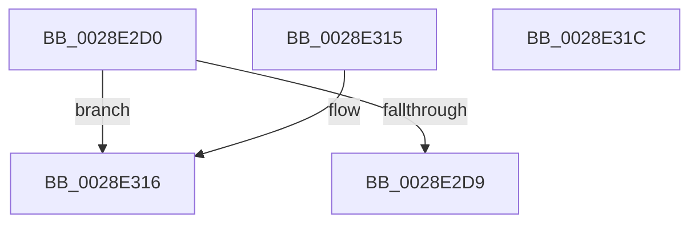

# MiGetPfnSlabType

- RVA: `0x0028E2D0`–`0x0028E31D` (길이 `77` bytes)
- VA: `0x000000014028E2D0`
- 실행 섹션: `.text`
- PDB 이름 있음: `예`; PDB Function 태그: `아니요`
- unwind 정보 RVA: `0x000DB714`
- 디코드: `19`개 명령, `77/77` bytes 표시
- 미해석 바이트: `0` (있으면 어셈블리에 `.byte`로 보존)

> 이 문서는 커널 이미지의 기계어와 PDB 기호를 분석해 생성했습니다. 4번과 5번은 함수 원형과 자료형을 바이너리 사용 방식에서 추정한 C 해석이며 원본 소스 복구 결과는 아닙니다.

## 1. Dependencies

- 직접 호출 지점: **0**; 고유 호출 대상: **0**
- 직접 호출자로 확인된 함수: **58**
- RIP 상대 이미지 참조: **2**

### Outgoing calls
- 직접 디코드된 call 명령이 없습니다.

### Direct callers
- [MiCanBatchHardFaultPages](../24/MiCanBatchHardFaultPages_function_0024AE00.md) at `0x0024AE47`
- [MiResolveTransitionFault](MiResolveTransitionFault_function_00282940.md) at `0x002833DF`
- [sub_00283850](Unknown_function_00283850.md) at `0x00283998`
- [MiTradeTransitionPage](MiTradeTransitionPage_function_0028B9AC.md) at `0x0028BB89`
- [MiTradeTransitionPage](MiTradeTransitionPage_function_0028B9AC.md) at `0x0028BBEC`
- [MiTradeTransitionPage](MiTradeTransitionPage_function_0028B9AC.md) at `0x0028BBFD`
- [MiTradePage](MiTradePage_function_0028D160.md) at `0x0028D274`
- [MiMigratePfn](MiMigratePfn_function_0028DBB0.md) at `0x0028DBF4`
- [sub_0028E4EC](Unknown_function_0028E4EC.md) at `0x0028E644`
- [sub_002901B8](../29/Unknown_function_002901B8.md) at `0x002903C3`
- [MiSwapStackPage](../29/MiSwapStackPage_function_0029FDE0.md) at `0x0029FFF7`
- [MiSwapStackPage](../29/MiSwapStackPage_function_0029FDE0.md) at `0x002A0002`
- [MiIsPfnFromChargedSlabAllocation](../2A/MiIsPfnFromChargedSlabAllocation_function_002A2968.md) at `0x002A296F`
- [MiStandbyPageContentsIntact](../2A/MiStandbyPageContentsIntact_function_002AF0D4.md) at `0x002AF10A`
- [MiReplaceTransitionPage](../2B/MiReplaceTransitionPage_function_002B1120.md) at `0x002B1225`
- [MiReplaceTransitionPage](../2B/MiReplaceTransitionPage_function_002B1120.md) at `0x002B1377`
- [MiLockStealUserVm](../2B/MiLockStealUserVm_function_002B3EDC.md) at `0x002B4258`
- [MiUpdatePfnPriority](../2B/MiUpdatePfnPriority_function_002B8570.md) at `0x002B869C`
- [sub_002B98DD](../2B/Unknown_function_002B98DD.md) at `0x002B99C1`
- [MiSynchronizeFastPageInsert](../2B/MiSynchronizeFastPageInsert_function_002BAE80.md) at `0x002BB3C3`
- [MiSynchronizeFastPageInsert](../2B/MiSynchronizeFastPageInsert_function_002BAE80.md) at `0x002BB4A7`
- [MiCombineCandidate](../31/MiCombineCandidate_function_00316290.md) at `0x003163A4`
- [MiPfnsWorthTrying](../31/MiPfnsWorthTrying_function_0031B0C0.md) at `0x0031B722`
- [MiAllocateWsle](../33/MiAllocateWsle_function_003332C0.md) at `0x003338E0`
- [MiRemoveLowestPriorityStandbyPage](../33/MiRemoveLowestPriorityStandbyPage_function_00334600.md) at `0x003347F9`
- [sub_00338E63](../33/Unknown_function_00338E63.md) at `0x003392A1`
- [sub_00338E63](../33/Unknown_function_00338E63.md) at `0x00339531`
- [sub_00338E63](../33/Unknown_function_00338E63.md) at `0x00339599`
- [sub_00339DE2](../33/Unknown_function_00339DE2.md) at `0x00339EA4`
- [sub_00339DE2](../33/Unknown_function_00339DE2.md) at `0x00339F2D`
- [MiFindSuitableLookasideReplacement](../33/MiFindSuitableLookasideReplacement_function_0033A0C0.md) at `0x0033A7AA`
- [MiFindSuitableLookasideReplacement](../33/MiFindSuitableLookasideReplacement_function_0033A0C0.md) at `0x0033A8A2`
- [MiFindSuitableLookasideReplacement](../33/MiFindSuitableLookasideReplacement_function_0033A0C0.md) at `0x0033A8CA`
- [sub_0033C384](../33/Unknown_function_0033C384.md) at `0x0033C40A`
- [MiSharedInsertPfnChainInList](../33/MiSharedInsertPfnChainInList_function_0033CA70.md) at `0x0033D230`
- [sub_0033DA89](../33/Unknown_function_0033DA89.md) at `0x0033DB9F`
- [sub_0033EA66](../33/Unknown_function_0033EA66.md) at `0x0033EAAD`
- [MiWalkEntireImage](../36/MiWalkEntireImage_function_00365D70.md) at `0x003663CB`
- [MiWalkEntireImage](../36/MiWalkEntireImage_function_00365D70.md) at `0x00366A78`
- [MiWalkEntireImage](../36/MiWalkEntireImage_function_00365D70.md) at `0x00366F76`
- [MiWalkEntireImage](../36/MiWalkEntireImage_function_00365D70.md) at `0x00366F87`
- [MiLockCode](../36/MiLockCode_function_0036F91C.md) at `0x0036FCB2`
- [MiDeleteSectionCluster](../37/MiDeleteSectionCluster_function_00373DF0.md) at `0x00373F3E`
- [MiFreeMdlPageRun](../37/MiFreeMdlPageRun_function_00375A4C.md) at `0x00375B79`
- [MiFreeSmallPageFromMdl](../37/MiFreeSmallPageFromMdl_function_00375D58.md) at `0x00375E10`
- [MiWaitForInPageComplete](../38/MiWaitForInPageComplete_function_00380AB8.md) at `0x00380F65`
- [MiReplaceLockedPage](../38/MiReplaceLockedPage_function_0038351C.md) at `0x00383668`
- [MiMakeDriverPagesPrivate](../38/MiMakeDriverPagesPrivate_function_00384C60.md) at `0x00384ECF`
- [MiMakeDriverPagesPrivate](../38/MiMakeDriverPagesPrivate_function_00384C60.md) at `0x00384FB6`
- [MiLockStandbyOldestPage](../3D/MiLockStandbyOldestPage_function_003D4EA4.md) at `0x003D505C`
- [MiLockStandbyOldestPage](../3D/MiLockStandbyOldestPage_function_003D4EA4.md) at `0x003D5080`
- [sub_003D5527](../3D/Unknown_function_003D5527.md) at `0x003D557C`
- [MiGetStandbyPageType](../3D/MiGetStandbyPageType_function_003D55B0.md) at `0x003D55F9`
- [MiInsertProtectedStandbyPage](../45/MiInsertProtectedStandbyPage_function_004527D8.md) at `0x0045282C`
- [MiCompleteSecureProcessFault](../46/MiCompleteSecureProcessFault_function_0046710C.md) at `0x00467238`
- [MiBetterDriverPageNeeded](../48/MiBetterDriverPageNeeded_function_004819E0.md) at `0x00481A02`
- [MiBetterDriverPageNeeded](../48/MiBetterDriverPageNeeded_function_004819E0.md) at `0x00481A3D`
- [MiUpdatePageAttributeStamp](../48/MiUpdatePageAttributeStamp_function_00482364.md) at `0x004823DB`
- [MiKernelShadowStackIdealForCaching](../48/MiKernelShadowStackIdealForCaching_function_00484330.md) at `0x00484411`
- [MiPurgeSlabEntry](../48/MiPurgeSlabEntry_function_0048D444.md) at `0x0048D4CD`
- [MiFinalizeImageHeaderPage](../4A/MiFinalizeImageHeaderPage_function_004A89A8.md) at `0x004A8A9B`
- [MiIsFreeSlabPage](../4F/MiIsFreeSlabPage_function_004FCDE4.md) at `0x004FCDEB`
- [MiFreeLargeInitializationCodePages](../67/MiFreeLargeInitializationCodePages_function_00670080.md) at `0x00670098`
- [MiProtectDriverSectionPte](../67/MiProtectDriverSectionPte_function_006706C0.md) at `0x00670896`
- [MiProtectDriverSectionPte](../67/MiProtectDriverSectionPte_function_006706C0.md) at `0x00670953`
- [MmMarkPhysicalMemoryAsBad](../67/MmMarkPhysicalMemoryAsBad_function_0067AA50.md) at `0x0067AD5E`
- [MiCheckContiguityTradeEligible](../68/MiCheckContiguityTradeEligible_function_00687300.md) at `0x00687364`
- [MiInitializeBootLoadedDriverPfnRange](../69/MiInitializeBootLoadedDriverPfnRange_function_00696F60.md) at `0x00696FBD`
- [sub_006DB77C](../6D/Unknown_function_006DB77C.md) at `0x006DB8A7`
- [sub_006DB77C](../6D/Unknown_function_006DB77C.md) at `0x006DB8B2`
- [sub_006F60F8](../6F/Unknown_function_006F60F8.md) at `0x006F61C5`
- [sub_006F60F8](../6F/Unknown_function_006F60F8.md) at `0x006F61D0`
- [sub_006F9D5A](../6F/Unknown_function_006F9D5A.md) at `0x006F9DEA`
- [sub_006F9D5A](../6F/Unknown_function_006F9D5A.md) at `0x006F9DFB`
- [MiPfPrepareReadList](../../page/93/MiPfPrepareReadList_function_0093CD5C.md) at `0x0093D23B`
- [MiUpdateBootHpatPagesInUse](../../init/C6/MiUpdateBootHpatPagesInUse_function_00C67548.md) at `0x00C6765E`
- [MiInitializeBootShadowStackPage](../../init/C6/MiInitializeBootShadowStackPage_function_00C67D8C.md) at `0x00C67E0A`
- [MiHandleBootImage](../../init/C6/MiHandleBootImage_function_00C6B854.md) at `0x00C6B9BF`

### Static image references
- `0x0028E2D0` → RVA `0x00E3CBE6` (`.data`; read)
- `0x0028E2F8` → RVA `0x00E3D240` (`.data`; read)

## 2. Other-region calls and transfers

- 다른 실행 섹션으로 향하는 call: **0**
- 별도 외부 분기/꼬리 이동을 확인하지 못했습니다.

## 3. Assembly (complete function range)

```asm
0028E2D0  80 3D 0F E9 BA 00 00            cmp byte ptr [rip + 0xbae90f], 0
0028E2D7  74 3D                           je 0x14028e316
0028E2D9  48 B8 00 00 00 00 00 DE FF FF   movabs rax, 0xffffde0000000000
0028E2E3  48 2B C8                        sub rcx, rax
0028E2E6  48 B8 AB AA AA AA AA AA AA AA   movabs rax, 0xaaaaaaaaaaaaaaab
0028E2F0  48 C1 F9 04                     sar rcx, 4
0028E2F4  48 0F AF C8                     imul rcx, rax
0028E2F8  48 8B 05 41 EF BA 00            mov rax, qword ptr [rip + 0xbaef41]
0028E2FF  48 C1 E9 09                     shr rcx, 9
0028E303  0F B6 14 48                     movzx edx, byte ptr [rax + rcx*2]
0028E307  B9 09 00 00 00                  mov ecx, 9
0028E30C  85 D2                           test edx, edx
0028E30E  8D 42 FF                        lea eax, [rdx - 1]
0028E311  0F 44 C1                        cmove eax, ecx
0028E314  C3                              ret
0028E315  CC                              int3
0028E316  B8 09 00 00 00                  mov eax, 9
0028E31B  C3                              ret
0028E31C  CC                              int3
```

## 4. C-style interpretation (structured pseudocode)

```c
__int64 __fastcall MiGetPfnSlabType(__int64 a1)
{
    __int64 result;

    if ((*(unsigned __int8 *)(v_rip + 12249359)) == 0) goto loc_0028E316;
    a1 = (a1) - (result);
    a1 = (a1) >> (4);
    a1 = (a1) * (result);
    a1 = (a1) >> (9);
    result = *(unsigned __int8 *)(*(unsigned __int64 *)(v_rip + 12250945) + a1 * 2) - 1;
    if ((unsigned int)(*(unsigned __int8 *)(*(unsigned __int64 *)(v_rip + 12250945) + a1 * 2)) == 0) { result = 9; }
    return result;
loc_0028E316:
    return 9;
}
```

## 5. (Beta) C Style

```c
int64_t MiGetPfnSlabType(int64_t Arg1)
{
    int64_t result;

    if ((*(uint8_t *)(v_rip + 0xBAE90F)) == 0) goto loc_0028E316;
    Arg1 = (Arg1) - (result);
    Arg1 = (Arg1) >> (4);
    Arg1 = (Arg1) * (result);
    Arg1 = (Arg1) >> (9);
    result = *(uint8_t *)(*(uint64_t *)(v_rip + 0xBAEF41) + Arg1 * 2) - 1;
    if ((uint32_t)(*(uint8_t *)(*(uint64_t *)(v_rip + 0xBAEF41) + Arg1 * 2)) == 0) { result = 9; }
    return result;
loc_0028E316:
    return 9;
}
```

## 6. Execution-region graph

[열기: 2D/3D 그래프와 함수 탐색 컨트롤 패널](../../../control-panel.html?section=text&rva=0x0028E2D0&view=graph)

- 2D 그래프는 위에서 아래로 흐르고, 3D 그래프는 빈 공간을 드래그해 회전합니다. Shift+드래그는 이동, 휠은 확대·축소, 함수 노드 선택은 대상 보고서 이동입니다.

### Static fallback


