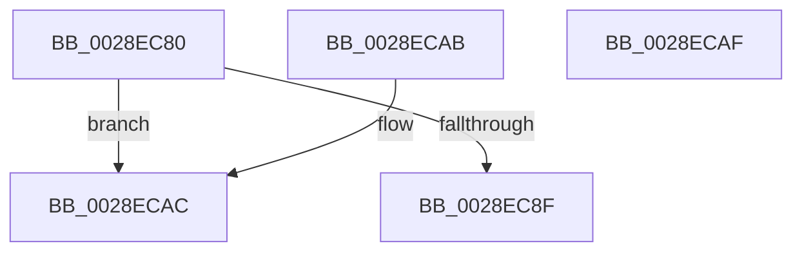

# MiGetSystemRegionType

- RVA: `0x0028EC80`–`0x0028ECB0` (길이 `48` bytes)
- VA: `0x000000014028EC80`
- 실행 섹션: `.text`
- PDB 이름 있음: `예`; PDB Function 태그: `아니요`
- unwind 정보 RVA: `0x000DB714`
- 디코드: `13`개 명령, `48/48` bytes 표시
- 미해석 바이트: `0` (있으면 어셈블리에 `.byte`로 보존)

> 이 문서는 커널 이미지의 기계어와 PDB 기호를 분석해 생성했습니다. 4번과 5번은 함수 원형과 자료형을 바이너리 사용 방식에서 추정한 C 해석이며 원본 소스 복구 결과는 아닙니다.

## 1. Dependencies

- 직접 호출 지점: **0**; 고유 호출 대상: **0**
- 직접 호출자로 확인된 함수: **41**
- RIP 상대 이미지 참조: **1**

### Outgoing calls
- 직접 디코드된 call 명령이 없습니다.

### Direct callers
- [MiTranslatePageForCopy](../22/MiTranslatePageForCopy_function_00228960.md) at `0x00228A8B`
- [MiRemoveWsle](../22/MiRemoveWsle_function_0022D0C4.md) at `0x0022D25A`
- [MmProtectPool](../26/MmProtectPool_function_002697AC.md) at `0x00269831`
- [MiAddWorkingSetEntries](../27/MiAddWorkingSetEntries_function_0027DC00.md) at `0x0027E278`
- [MiMigratePfn](MiMigratePfn_function_0028DBB0.md) at `0x0028DD49`
- [MiFlushSingleTbEntry](MiFlushSingleTbEntry_function_0028E730.md) at `0x0028E7F1`
- [sub_0029273F](../29/Unknown_function_0029273F.md) at `0x002929FB`
- [MiCheckLinearProtectedPteAccessedBit](../29/MiCheckLinearProtectedPteAccessedBit_function_00292D80.md) at `0x00292DB1`
- [MiSwapStackPage](../29/MiSwapStackPage_function_0029FDE0.md) at `0x0029FE76`
- [MiSwapStackPage](../29/MiSwapStackPage_function_0029FDE0.md) at `0x0029FFBC`
- [MiReplaceTransitionPage](../2B/MiReplaceTransitionPage_function_002B1120.md) at `0x002B18D2`
- [MiStoreCheckCandidatePage](../2B/MiStoreCheckCandidatePage_function_002B54E8.md) at `0x002B5565`
- [MiTrimSharedPageFromViews](../2E/MiTrimSharedPageFromViews_function_002E16F8.md) at `0x002E1AF5`
- [MiTrimSharedPageFromViews](../2E/MiTrimSharedPageFromViews_function_002E16F8.md) at `0x002E1BB8`
- [MiCombineCandidate](../31/MiCombineCandidate_function_00316290.md) at `0x00316407`
- [MiVaToFlushVm](../31/MiVaToFlushVm_function_0031AD84.md) at `0x0031ADA8`
- [MiActivePageClaimCandidate](../31/MiActivePageClaimCandidate_function_0031BB00.md) at `0x0031BF69`
- [MiActivePageClaimCandidate](../31/MiActivePageClaimCandidate_function_0031BB00.md) at `0x0031C005`
- [MiActivePageClaimCandidate](../31/MiActivePageClaimCandidate_function_0031BB00.md) at `0x0031C131`
- [sub_0031CD16](../31/Unknown_function_0031CD16.md) at `0x0031CE56`
- [sub_0031CD16](../31/Unknown_function_0031CD16.md) at `0x0031CEB2`
- [sub_0031D027](../31/Unknown_function_0031D027.md) at `0x0031D027`
- [sub_0031D027](../31/Unknown_function_0031D027.md) at `0x0031D044`
- [MiUpdatePfnForPrefetchByPte](../32/MiUpdatePfnForPrefetchByPte_function_00321210.md) at `0x0032158D`
- [MiSystemFault](../34/MiSystemFault_function_0034AA64.md) at `0x0034AB8D`
- [MiCopyOnWrite](../36/MiCopyOnWrite_function_00362A0C.md) at `0x00362AEC`
- [MiResolvePageFileFault](../36/MiResolvePageFileFault_function_0036D968.md) at `0x0036DA96`
- [MiLockCode](../36/MiLockCode_function_0036F91C.md) at `0x0036F97F`
- [MiIssueHardFaultIo](../38/MiIssueHardFaultIo_function_003812EC.md) at `0x003814D6`
- [MmFreeContiguousMemory](../3F/MmFreeContiguousMemory_function_003F6F60.md) at `0x003F6F89`
- [MiUnmapContiguousMemory](../3F/MiUnmapContiguousMemory_function_003F7908.md) at `0x003F79B7`
- [MiMakeTransitionHeatBatch](../40/MiMakeTransitionHeatBatch_function_00409A94.md) at `0x00409BC6`
- [MiFaultInProbeAddress](../40/MiFaultInProbeAddress_function_0040E108.md) at `0x0040E225`
- [MiPfnIsNonPagedPool](../41/MiPfnIsNonPagedPool_function_0041F3D8.md) at `0x0041F40D`
- [MiHandleSpecialPurposeMemoryCachedFault](../44/MiHandleSpecialPurposeMemoryCachedFault_function_0044C740.md) at `0x0044C838`
- [MmIsNonPagedSystemAddressValid](../4B/MmIsNonPagedSystemAddressValid_function_004B79F0.md) at `0x004B79F4`
- [MmGetVaTypeForVerifier](../67/MmGetVaTypeForVerifier_function_0067B544.md) at `0x0067B560`
- [MiCrashdumpRemovePte](../67/MiCrashdumpRemovePte_function_0067D430.md) at `0x0067D445`
- [MiFilterCrashDumpPte](../67/MiFilterCrashDumpPte_function_0067D4D0.md) at `0x0067D518`
- [MiFilterCrashDumpPte](../67/MiFilterCrashDumpPte_function_0067D4D0.md) at `0x0067D6D9`
- [MmAddRangeToCrashDump](../67/MmAddRangeToCrashDump_function_0067D8B0.md) at `0x0067D951`
- [MmAllocateSecurePoolMemory](../68/MmAllocateSecurePoolMemory_function_00682CC8.md) at `0x00682D3A`
- [MmFreeSecurePoolMemory](../68/MmFreeSecurePoolMemory_function_00682E10.md) at `0x00682E2D`
- [MiDbgCopyMemoryTarget](../68/MiDbgCopyMemoryTarget_function_00684E70.md) at `0x00684F45`
- [MiMarkBootGuardPage](../68/MiMarkBootGuardPage_function_0068643C.md) at `0x00686584`
- [MiCheckPteRelease](../69/MiCheckPteRelease_function_006948C4.md) at `0x00694928`
- [MiCheckPteRelease](../69/MiCheckPteRelease_function_006948C4.md) at `0x0069494B`
- [sub_006E4582](../6E/Unknown_function_006E4582.md) at `0x006E4671`
- [MiPerformFixups](../../page/93/MiPerformFixups_function_0093F5F4.md) at `0x0093F919`
- [MiPerformFixups](../../page/93/MiPerformFixups_function_0093F5F4.md) at `0x0093F94E`

### Static image references
- `0x0028EC9F` → RVA `0x00E38AA8` (`.data`; read)

## 2. Other-region calls and transfers

- 다른 실행 섹션으로 향하는 call: **0**
- 별도 외부 분기/꼬리 이동을 확인하지 못했습니다.

## 3. Assembly (complete function range)

```asm
0028EC80  48 B8 00 00 00 00 00 80 FF FF   movabs rax, 0xffff800000000000
0028EC8A  48 3B C8                        cmp rcx, rax
0028EC8D  72 1D                           jb 0x14028ecac
0028EC8F  48 C1 E9 27                     shr rcx, 0x27
0028EC93  81 E1 FF 01 00 00               and ecx, 0x1ff
0028EC99  8D 81 00 FF FF FF               lea eax, [rcx - 0x100]
0028EC9F  48 8D 0D 02 9E BA 00            lea rcx, [rip + 0xba9e02]
0028ECA6  0F B6 04 08                     movzx eax, byte ptr [rax + rcx]
0028ECAA  C3                              ret
0028ECAB  CC                              int3
0028ECAC  33 C0                           xor eax, eax
0028ECAE  C3                              ret
0028ECAF  CC                              int3
```

## 4. C-style interpretation (structured pseudocode)

```c
__int64 __fastcall MiGetSystemRegionType(__int64 a1)
{
    __int64 result;

    if (a1 < result) goto loc_0028ECAC;
    a1 = (a1) >> (39);
    a1 = (unsigned int)((a1) & (511));
    return *(unsigned __int8 *)(a1 - 256 + v_rip + 12230146 * 1);
loc_0028ECAC:
    result = 0;
    return result;
}
```

## 5. (Beta) C Style

```c
int64_t MiGetSystemRegionType(int64_t Arg1)
{
    int64_t result;

    if (Arg1 < result) goto loc_0028ECAC;
    Arg1 = (Arg1) >> (39);
    Arg1 = (uint32_t)((Arg1) & (511));
    return *(uint8_t *)(Arg1 - 0x100 + v_rip + 0xBA9E02 * 1);
loc_0028ECAC:
    result = 0;
    return result;
}
```

## 6. Execution-region graph

[열기: 2D/3D 그래프와 함수 탐색 컨트롤 패널](../../../control-panel.html?section=text&rva=0x0028EC80&view=graph)

- 2D 그래프는 위에서 아래로 흐르고, 3D 그래프는 빈 공간을 드래그해 회전합니다. Shift+드래그는 이동, 휠은 확대·축소, 함수 노드 선택은 대상 보고서 이동입니다.

### Static fallback


