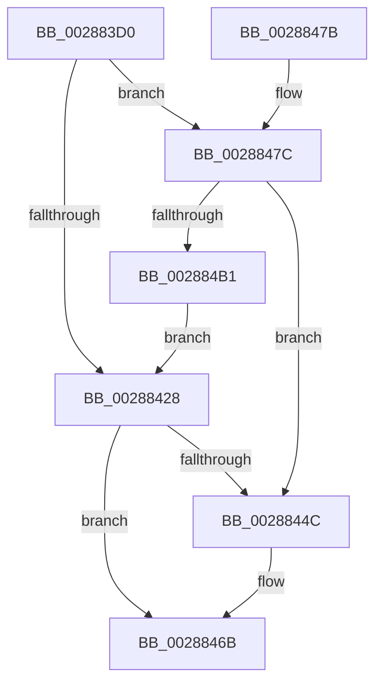

# MiGetUltraPage

- RVA: `0x002883D0`–`0x002884B6` (길이 `230` bytes)
- VA: `0x00000001402883D0`
- 실행 섹션: `.text`
- PDB 이름 있음: `예`; PDB Function 태그: `아니요`
- unwind 정보 RVA: `0x00066DF4`
- 디코드: `59`개 명령, `230/230` bytes 표시
- 미해석 바이트: `0` (있으면 어셈블리에 `.byte`로 보존)

> 이 문서는 커널 이미지의 기계어와 PDB 기호를 분석해 생성했습니다. 4번과 5번은 함수 원형과 자료형을 바이너리 사용 방식에서 추정한 C 해석이며 원본 소스 복구 결과는 아닙니다.

## 1. Dependencies

- 직접 호출 지점: **2**; 고유 호출 대상: **2**
- 직접 호출자로 확인된 함수: **3**
- RIP 상대 이미지 참조: **3**

### Outgoing calls
- `0x0028843E` → [MiGetPage](MiGetPage_function_002884C0.md) (function, `0x002884C0`)
- `0x002884A3` → [MiGetSlabPage](../37/MiGetSlabPage_function_00376FBC.md) (function, `0x00376FBC`)

### Direct callers
- [MiCreateUltraThreadContext](MiCreateUltraThreadContext_function_00288200.md) at `0x002882DD`
- [MiCreateUltraThreadContextHelper](../2C/MiCreateUltraThreadContextHelper_function_002CB380.md) at `0x002CB429`
- [MiReplenishUltraPageTables](../2C/MiReplenishUltraPageTables_function_002CB4EC.md) at `0x002CB5E0`

### Static image references
- `0x002883F5` → RVA `0x00E2DCC0` (`.data`; read)
- `0x0028842A` → RVA `0x00E38D00` (`.data`; read)
- `0x0028844C` → RVA `0x00010880` (`.rdata`; read)

## 2. Other-region calls and transfers

- 다른 실행 섹션으로 향하는 call: **0**
- 별도 외부 분기/꼬리 이동을 확인하지 못했습니다.

## 3. Assembly (complete function range)

```asm
002883D0  48 89 5C 24 08                  mov qword ptr [rsp + 8], rbx
002883D5  48 89 74 24 10                  mov qword ptr [rsp + 0x10], rsi
002883DA  57                              push rdi
002883DB  48 83 EC 30                     sub rsp, 0x30
002883DF  44 8B 41 08                     mov r8d, dword ptr [rcx + 8]
002883E3  44 8B CA                        mov r9d, edx
002883E6  48 8B 09                        mov rcx, qword ptr [rcx]
002883E9  B8 01 00 00 00                  mov eax, 1
002883EE  F0 0F C1 01                     lock xadd dword ptr [rcx], eax
002883F2  41 8B C8                        mov ecx, r8d
002883F5  4C 8D 15 C4 58 BA 00            lea r10, [rip + 0xba58c4]
002883FC  48 C1 E9 10                     shr rcx, 0x10
00288400  33 D2                           xor edx, edx
00288402  83 E1 03                        and ecx, 3
00288405  41 81 E0 00 FF F7 FF            and r8d, 0xfff7ff00
0028840C  41 8B F1                        mov esi, r9d
0028840F  33 FF                           xor edi, edi
00288411  83 E6 04                        and esi, 4
00288414  41 F7 34 8A                     div dword ptr [r10 + rcx*4]
00288418  0F B6 DA                        movzx ebx, dl
0028841B  41 0B D8                        or ebx, r8d
0028841E  0F BA EB 12                     bts ebx, 0x12
00288422  41 F6 C1 08                     test r9b, 8
00288426  75 54                           jne 0x14028847c
00288428  85 F6                           test esi, esi
0028842A  48 8D 0D CF 08 BB 00            lea rcx, [rip + 0xbb08cf]
00288431  8B D3                           mov edx, ebx
00288433  40 0F 95 C7                     setne dil
00288437  44 8D 87 B0 00 00 00            lea r8d, [rdi + 0xb0]
0028843E  E8 7D 00 00 00                  call 0x1402884c0
00288443  48 8B D0                        mov rdx, rax
00288446  48 83 F8 FF                     cmp rax, -1
0028844A  74 1F                           je 0x14028846b
0028844C  48 8B 05 2D 84 D8 FF            mov rax, qword ptr [rip - 0x277bd3]
00288453  48 8D 0C 52                     lea rcx, [rdx + rdx*2]
00288457  48 03 C9                        add rcx, rcx
0028845A  49 B8 10 00 00 00 00 DE FF FF   movabs r8, 0xffffde0000000010
00288464  49 89 04 C8                     mov qword ptr [r8 + rcx*8], rax
00288468  48 8B C2                        mov rax, rdx
0028846B  48 8B 5C 24 40                  mov rbx, qword ptr [rsp + 0x40]
00288470  48 8B 74 24 48                  mov rsi, qword ptr [rsp + 0x48]
00288475  48 83 C4 30                     add rsp, 0x30
00288479  5F                              pop rdi
0028847A  C3                              ret
0028847B  CC                              int3
0028847C  B8 0C 00 00 00                  mov eax, 0xc
00288481  89 7C 24 28                     mov dword ptr [rsp + 0x28], edi
00288485  41 B9 1C 00 00 00               mov r9d, 0x1c
0028848B  48 89 7C 24 20                  mov qword ptr [rsp + 0x20], rdi
00288490  85 F6                           test esi, esi
00288492  48 8D 0D 67 08 BB 00            lea rcx, [rip + 0xbb0867]
00288499  44 8B C3                        mov r8d, ebx
0028849C  8D 50 FB                        lea edx, [rax - 5]
0028849F  44 0F 44 C8                     cmove r9d, eax
002884A3  E8 14 EB 0E 00                  call 0x140376fbc
002884A8  48 8B D0                        mov rdx, rax
002884AB  48 83 F8 FF                     cmp rax, -1
002884AF  75 9B                           jne 0x14028844c
002884B1  E9 72 FF FF FF                  jmp 0x140288428
```

## 4. C-style interpretation (structured pseudocode)

```c
__int64 __fastcall MiGetUltraPage(__int64 a1, int a2)
{
    __int64 result;
    __int64 v_rbx;
    __int64 v_rdi;
    __int64 v_rsi;
    __int64 v_rsp;
    unsigned __int64 v_stack_p10;
    unsigned __int64 v_stack_p20;
    unsigned int v_stack_p28;
    unsigned __int64 v_stack_p8;

    v_stack_p8 = v_rbx;
    v_stack_p10 = v_rsi;
    v_rsp = (v_rsp) - (48);
    a1 = ((unsigned int)((unsigned int)((unsigned int)(*(unsigned int *)(a1 + 8))))) >> (16);
    a2 = 0;
    a1 = (unsigned int)((a1) & (3));
    a3 = (unsigned int)(((unsigned int)(*(unsigned int *)(a1 + 8))) & (0xFFF7FF00ULL));
    v_rdi = 0;
    v_rsi = (unsigned int)(((unsigned int)((unsigned int)((unsigned int)(a2)))) & (4));
    v_rbx = (unsigned int)((0) | ((unsigned int)(a3)));
    if ((((unsigned __int8)((unsigned int)(a2))) & (8)) != 0) goto loc_0028847C;
loc_00288428:
    v_rdi = ((unsigned int)(v_rsi) != 0) ? 1 : 0;
    result = MiGetPage(v_rip + 12257487, (unsigned int)((unsigned int)(v_rbx)), v_rdi + 176, (unsigned int)(a2));
    if (result != -1) {
        result = *(unsigned __int64 *)(v_rip - 2587603);
        a1 = result + result * 2;
        a1 = (a1) + (a1);
        *(unsigned __int64 *)(v_rdi + 176 + a1 * 8) = result;
        result = result;
    }
    v_rsp = (v_rsp) + (48);
    return result;
loc_0028847C:
    v_stack_p28 = (unsigned int)(v_rdi);
    v_stack_p20 = v_rdi;
    a4 = 28;
    if ((unsigned int)(v_stack_p10) == 0) { a4 = 12; }
    result = MiGetSlabPage(v_rip + 12257383, 12 - 5, (unsigned int)((unsigned int)(v_stack_p8)), a4);
    if (result != -1) goto loc_0028844C;
    goto loc_00288428;
}
```

## 5. (Beta) C Style

```c
int64_t MiGetUltraPage(void *Arg1, int32_t Arg2)
{
    uint8_t *arg1 = (uint8_t *)Arg1;

    int64_t result;
    int64_t local_rbx;
    int64_t local_rdi;
    int64_t local_rsi;
    int64_t local_rsp;
    uint64_t v_stack_p10;
    uint64_t v_stack_p20;
    uint32_t v_stack_p28;
    uint64_t v_stack_p8;

    v_stack_p8 = local_rbx;
    v_stack_p10 = local_rsi;
    local_rsp = (local_rsp) - (48);
    Arg1 = ((uint32_t)((uint32_t)((uint32_t)(*(uint32_t *)(arg1 + 0x8))))) >> (16);
    Arg2 = 0;
    Arg1 = (uint32_t)((Arg1) & (3));
    a3 = (uint32_t)(((uint32_t)(*(uint32_t *)(arg1 + 0x8))) & (0xFFF7FF00ULL));
    local_rdi = 0;
    local_rsi = (uint32_t)(((uint32_t)((uint32_t)((uint32_t)(Arg2)))) & (4));
    local_rbx = (uint32_t)((0) | ((uint32_t)(a3)));
    if ((((uint8_t)((uint32_t)(Arg2))) & (8)) != 0) goto loc_0028847C;
loc_00288428:
    local_rdi = ((uint32_t)(local_rsi) != 0) ? 1 : 0;
    result = MiGetPage(v_rip + 12257487, (uint32_t)((uint32_t)(local_rbx)), local_rdi + 176, (uint32_t)(Arg2));
    if (result != -1) {
        result = *(uint64_t *)(v_rip - 0x277BD3);
        Arg1 = result + result * 2;
        Arg1 = (Arg1) + (Arg1);
        *(uint64_t *)(local_rdi + 0xB0 + arg1 * 8) = result;
        result = result;
    }
    local_rsp = (local_rsp) + (48);
    return result;
loc_0028847C:
    v_stack_p28 = (uint32_t)(local_rdi);
    v_stack_p20 = local_rdi;
    a4 = 28;
    if ((uint32_t)(v_stack_p10) == 0) { a4 = 12; }
    result = MiGetSlabPage(v_rip + 12257383, 12 - 5, (uint32_t)((uint32_t)(v_stack_p8)), a4);
    if (result != -1) goto loc_0028844C;
    goto loc_00288428;
}
```

### 관측된 메모리 오프셋

구조체 형식이 확인되지 않은 접근은 인자 기준의 오프셋으로만 기록했습니다.

| 기준 인자 | 오프셋 표현 | 폭 (bit) | 접근 |
|---|---:|---:|---|
| `Arg1` | `+ 0x0` | `64` | `R` |
| `Arg1` | `+ 0x8` | `32` | `R` |

## 6. Execution-region graph

[열기: 2D/3D 그래프와 함수 탐색 컨트롤 패널](../../../control-panel.html?section=text&rva=0x002883D0&view=graph)

- 2D 그래프는 위에서 아래로 흐르고, 3D 그래프는 빈 공간을 드래그해 회전합니다. Shift+드래그는 이동, 휠은 확대·축소, 함수 노드 선택은 대상 보고서 이동입니다.

### Static fallback


