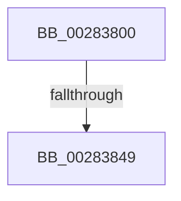

# MiHandleTransitionFault

- RVA: `0x00283800`–`0x00283850` (길이 `80` bytes)
- VA: `0x0000000140283800`
- 실행 섹션: `.text`
- PDB 이름 있음: `예`; PDB Function 태그: `아니요`
- unwind 정보 RVA: `0x00066870`
- 디코드: `21`개 명령, `80/80` bytes 표시
- 미해석 바이트: `0` (있으면 어셈블리에 `.byte`로 보존)

> 이 문서는 커널 이미지의 기계어와 PDB 기호를 분석해 생성했습니다. 4번과 5번은 함수 원형과 자료형을 바이너리 사용 방식에서 추정한 C 해석이며 원본 소스 복구 결과는 아닙니다.

## 1. Dependencies

- 직접 호출 지점: **0**; 고유 호출 대상: **0**
- 직접 호출자로 확인된 함수: **1**
- RIP 상대 이미지 참조: **0**

### Outgoing calls
- 직접 디코드된 call 명령이 없습니다.

### Direct callers
- [MiResolveTransitionFault](MiResolveTransitionFault_function_00282940.md) at `0x00282AB2`

### Static image references
- 디코드된 RIP-relative 메모리 참조가 없습니다.

## 2. Other-region calls and transfers

- 다른 실행 섹션으로 향하는 call: **0**
- call이 아닌 외부 분기/꼬리 이동: **1**
  - `0x00283843` → [sub_00283AC5 + 0x1](Unknown_function_00283AC5.md) (`tail-transfer`)

## 3. Assembly (complete function range)

```asm
00283800  48 89 54 24 10                  mov qword ptr [rsp + 0x10], rdx
00283805  55                              push rbp
00283806  57                              push rdi
00283807  41 54                           push r12
00283809  41 55                           push r13
0028380B  41 57                           push r15
0028380D  48 83 EC 60                     sub rsp, 0x60
00283811  48 8B AC 24 C0 00 00 00         mov rbp, qword ptr [rsp + 0xc0]
00283819  4D 8B E8                        mov r13, r8
0028381C  4C 8B BC 24 B0 00 00 00         mov r15, qword ptr [rsp + 0xb0]
00283824  45 33 C0                        xor r8d, r8d
00283827  49 8B 41 28                     mov rax, qword ptr [r9 + 0x28]
0028382B  49 8B F9                        mov rdi, r9
0028382E  C6 84 24 A8 00 00 00 00         mov byte ptr [rsp + 0xa8], 0
00283836  4C 8B E1                        mov r12, rcx
00283839  4C 89 45 00                     mov qword ptr [rbp], r8
0028383D  4D 89 07                        mov qword ptr [r15], r8
00283840  48 85 C0                        test rax, rax
00283843  0F 89 7D 02 00 00               jns 0x140283ac6
00283849  49 8B 41 10                     mov rax, qword ptr [r9 + 0x10]
0028384D  48 8B D0                        mov rdx, rax
```

## 4. C-style interpretation (structured pseudocode)

```c
__int64 __fastcall MiHandleTransitionFault(__int64 a1, __int64 a2, __int64 a3, __int64 a4, __int64 a5, __int64 a6, __int64 a7)
{
    __int64 v_rsp;
    unsigned __int64 v_stack_p10;
    unsigned __int8 v_stack_p20;

    v_stack_p10 = a2;
    v_rsp = (v_rsp) - (96);
    a3 = 0;
    v_stack_p20 = 0;
    *(unsigned __int64 *)(a7) = 0;
    *(unsigned __int64 *)(a5) = 0;
    return *(unsigned __int64 *)(a4 + 16);
}
```

## 5. (Beta) C Style

```c
int64_t MiHandleTransitionFault(int64_t Arg1, int64_t Arg2, int64_t Arg3, void *Arg4, void *Arg5, uint64_t Arg6, void *Arg7)
{
    uint8_t *arg4 = (uint8_t *)Arg4;
    uint8_t *arg5 = (uint8_t *)Arg5;
    uint8_t *arg7 = (uint8_t *)Arg7;

    int64_t local_rsp;
    uint64_t v_stack_p10;
    uint8_t v_stack_p20;

    v_stack_p10 = Arg2;
    local_rsp = (local_rsp) - (96);
    Arg3 = 0;
    v_stack_p20 = 0;
    *(uint64_t *)(arg7) = 0;
    *(uint64_t *)(arg5) = 0;
    return *(uint64_t *)(arg4 + 0x10);
}
```

### 관측된 메모리 오프셋

구조체 형식이 확인되지 않은 접근은 인자 기준의 오프셋으로만 기록했습니다.

| 기준 인자 | 오프셋 표현 | 폭 (bit) | 접근 |
|---|---:|---:|---|
| `Arg4` | `+ 0x10` | `64` | `R` |
| `Arg4` | `+ 0x28` | `64` | `R` |
| `Arg5` | `+ 0x0` | `64` | `W` |
| `Arg7` | `+ 0x0` | `64` | `W` |

## 6. Execution-region graph

[열기: 2D/3D 그래프와 함수 탐색 컨트롤 패널](../../../control-panel.html?section=text&rva=0x00283800&view=graph)

- 2D 그래프는 위에서 아래로 흐르고, 3D 그래프는 빈 공간을 드래그해 회전합니다. Shift+드래그는 이동, 휠은 확대·축소, 함수 노드 선택은 대상 보고서 이동입니다.

### Static fallback


