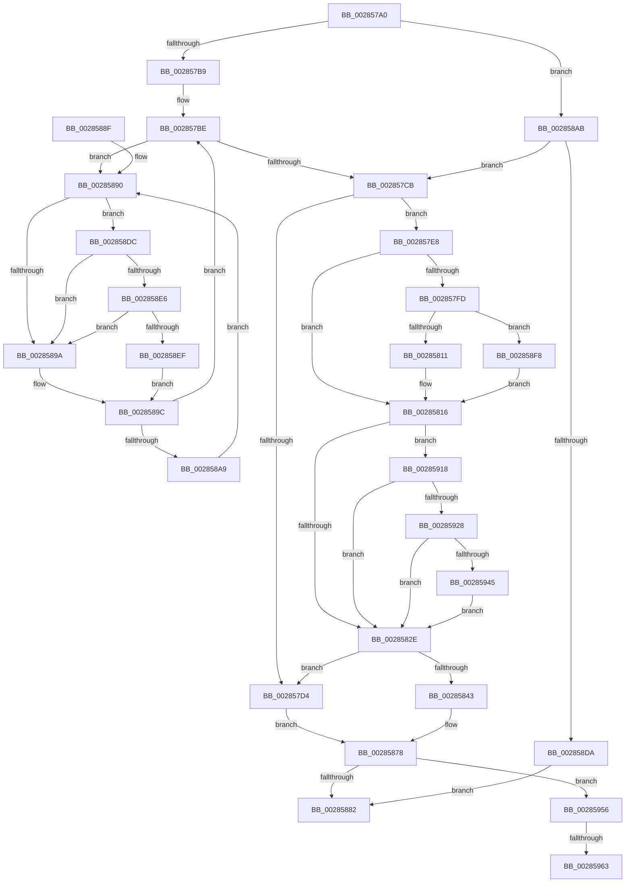

# MiLockPageAndSetDirty

- RVA: `0x002857A0`–`0x00285976` (길이 `470` bytes)
- VA: `0x00000001402857A0`
- 실행 섹션: `.text`
- PDB 이름 있음: `예`; PDB Function 태그: `예`
- unwind 정보 RVA: `0x00066A94`
- 디코드: `121`개 명령, `470/470` bytes 표시
- 미해석 바이트: `0` (있으면 어셈블리에 `.byte`로 보존)

> 이 문서는 커널 이미지의 기계어와 PDB 기호를 분석해 생성했습니다. 4번과 5번은 함수 원형과 자료형을 바이너리 사용 방식에서 추정한 C 해석이며 원본 소스 복구 결과는 아닙니다.

## 1. Dependencies

- 직접 호출 지점: **7**; 고유 호출 대상: **7**
- 직접 호출자로 확인된 함수: **9**
- RIP 상대 이미지 참조: **4**

### Outgoing calls
- `0x00285873` → [MiReleasePageFileInfo](MiReleasePageFileInfo_function_00283FD0.md) (function, `0x00283FD0`)
- `0x002858CA` → [MiSafeLockPage](../32/MiSafeLockPage_function_00321620.md) (function, `0x00321620`)
- `0x002858E6` → [KiCheckVpBackingLongSpinWaitHypercall](../30/KiCheckVpBackingLongSpinWaitHypercall_function_0030F490.md) (function, `0x0030F490`)
- `0x002858F1` → [HvlNotifyLongSpinWait](../30/HvlNotifyLongSpinWait_function_0030F460.md) (function, `0x0030F460`)
- `0x00285909` → [MiClearPageFileReservation](../32/MiClearPageFileReservation_function_0032B68C.md) (function, `0x0032B68C`)
- `0x0028591B` → [MiCanPfnOriginalPteBeLost](../37/MiCanPfnOriginalPteBeLost_function_00373D3C.md) (function, `0x00373D3C`)
- `0x0028596B` → [KiLowerIrqlProcessIrqlFlags](../4F/KiLowerIrqlProcessIrqlFlags_function_004F5698.md) (function, `0x004F5698`)

### Direct callers
- [MiMakePteClean](../2A/MiMakePteClean_function_002A901C.md) at `0x002A9258`
- [MiRevertValidPte](../2C/MiRevertValidPte_function_002C5160.md) at `0x002C545E`
- [MiValidFault](../32/MiValidFault_function_003280B4.md) at `0x00328403`
- [MiValidFault](../32/MiValidFault_function_003280B4.md) at `0x00328555`
- [MiIssueHardFault](../38/MiIssueHardFault_function_00380074.md) at `0x003805D9`
- [MiCopyToUserVa](../3D/MiCopyToUserVa_function_003D1E68.md) at `0x003D1FFE`
- [NtLockVirtualMemory](../40/NtLockVirtualMemory_function_004088A0.md) at `0x00408FF8`
- [MiMakeCombineCandidateClean](../46/MiMakeCombineCandidateClean_function_00465170.md) at `0x004651BF`
- [MiSetPageProtection](../67/MiSetPageProtection_function_00674BDC.md) at `0x00674DB5`
- [MiInitializeBootShadowStackPage](../../init/C6/MiInitializeBootShadowStackPage_function_00C67D8C.md) at `0x00C67F82`

### Static image references
- `0x00285847` → RVA `0x00E30088` (`.data`; read)
- `0x00285892` → RVA `0x00FC52AC` (`ALMOSTRO`; reference)
- `0x002858DC` → RVA `0x00FC6AB8` (`ALMOSTRO`; read)
- `0x00285956` → RVA `0x00FC6D20` (`ALMOSTRO`; read)

## 2. Other-region calls and transfers

- 다른 실행 섹션으로 향하는 call: **0**
- call이 아닌 외부 분기/꼬리 이동: **2**
  - `0x0028595D` → [sub_006DA246](../6D/Unknown_function_006DA246.md) (`tail-transfer`)
  - `0x00285971` → [sub_006DA246](../6D/Unknown_function_006DA246.md) (`tail-transfer`)

## 3. Assembly (complete function range)

```asm
002857A0  48 89 5C 24 08                  mov qword ptr [rsp + 8], rbx
002857A5  55                              push rbp
002857A6  56                              push rsi
002857A7  57                              push rdi
002857A8  48 83 EC 20                     sub rsp, 0x20
002857AC  33 DB                           xor ebx, ebx
002857AE  48 8B F9                        mov rdi, rcx
002857B1  85 D2                           test edx, edx
002857B3  0F 84 F2 00 00 00               je 0x1402858ab
002857B9  40 B5 11                        mov bpl, 0x11
002857BC  8B F3                           mov esi, ebx
002857BE  F0 48 0F BA 6F 18 3F            lock bts qword ptr [rdi + 0x18], 0x3f
002857C5  0F 82 C5 00 00 00               jb 0x140285890
002857CB  0F B6 4F 22                     movzx ecx, byte ptr [rdi + 0x22]
002857CF  F6 C1 10                        test cl, 0x10
002857D2  74 14                           je 0x1402857e8
002857D4  48 B8 FF FF FF FF FF FF FF 7F   movabs rax, 0x7fffffffffffffff
002857DE  F0 48 21 47 18                  lock and qword ptr [rdi + 0x18], rax
002857E3  E9 90 00 00 00                  jmp 0x140285878
002857E8  C0 E9 03                        shr cl, 3
002857EB  48 0F BA 67 10 0A               bt qword ptr [rdi + 0x10], 0xa
002857F1  F6 D1                           not cl
002857F3  0F 93 C0                        setae al
002857F6  22 C8                           and cl, al
002857F8  F6 C1 01                        test cl, 1
002857FB  74 19                           je 0x140285816
002857FD  48 8B 47 10                     mov rax, qword ptr [rdi + 0x10]
00285801  48 89 44 24 50                  mov qword ptr [rsp + 0x50], rax
00285806  C0 E8 02                        shr al, 2
00285809  A8 01                           test al, 1
0028580B  0F 85 E7 00 00 00               jne 0x1402858f8
00285811  48 89 5C 24 50                  mov qword ptr [rsp + 0x50], rbx
00285816  8B 77 20                        mov esi, dword ptr [rdi + 0x20]
00285819  89 74 24 48                     mov dword ptr [rsp + 0x48], esi
0028581D  C1 EE 10                        shr esi, 0x10
00285820  44 0F B6 DE                     movzx r11d, sil
00285824  40 F6 C6 08                     test sil, 8
00285828  0F 85 EA 00 00 00               jne 0x140285918
0028582E  41 80 CB 10                     or r11b, 0x10
00285832  44 88 5C 24 4A                  mov byte ptr [rsp + 0x4a], r11b
00285837  8B 44 24 48                     mov eax, dword ptr [rsp + 0x48]
0028583B  89 47 20                        mov dword ptr [rdi + 0x20], eax
0028583E  48 85 DB                        test rbx, rbx
00285841  74 91                           je 0x1402857d4
00285843  48 8B 47 28                     mov rax, qword ptr [rdi + 0x28]
00285847  48 8B 0D 3A A8 BA 00            mov rcx, qword ptr [rip + 0xbaa83a]
0028584E  48 C1 E8 2B                     shr rax, 0x2b
00285852  25 FF 03 00 00                  and eax, 0x3ff
00285857  48 8B 0C C1                     mov rcx, qword ptr [rcx + rax*8]
0028585B  48 B8 FF FF FF FF FF FF FF 7F   movabs rax, 0x7fffffffffffffff
00285865  F0 48 21 47 18                  lock and qword ptr [rdi + 0x18], rax
0028586A  48 8B D3                        mov rdx, rbx
0028586D  41 B8 01 00 00 00               mov r8d, 1
00285873  E8 58 E7 FF FF                  call 0x140283fd0
00285878  40 80 FD 11                     cmp bpl, 0x11
0028587C  0F 85 D4 00 00 00               jne 0x140285956
00285882  48 8B 5C 24 40                  mov rbx, qword ptr [rsp + 0x40]
00285887  48 83 C4 20                     add rsp, 0x20
0028588B  5F                              pop rdi
0028588C  5E                              pop rsi
0028588D  5D                              pop rbp
0028588E  C3                              ret
0028588F  CC                              int3
00285890  FF C6                           inc esi
00285892  85 35 14 FA D3 00               test dword ptr [rip + 0xd3fa14], esi
00285898  74 42                           je 0x1402858dc
0028589A  F3 90                           pause
0028589C  48 8B 47 18                     mov rax, qword ptr [rdi + 0x18]
002858A0  48 85 C0                        test rax, rax
002858A3  0F 89 15 FF FF FF               jns 0x1402857be
002858A9  EB E5                           jmp 0x140285890
002858AB  48 B8 00 00 00 00 00 DE FF FF   movabs rax, 0xffffde0000000000
002858B5  48 2B C8                        sub rcx, rax
002858B8  48 B8 AB AA AA AA AA AA AA AA   movabs rax, 0xaaaaaaaaaaaaaaab
002858C2  48 C1 F9 04                     sar rcx, 4
002858C6  48 0F AF C8                     imul rcx, rax
002858CA  E8 51 BD 09 00                  call 0x140321620
002858CF  0F B6 E8                        movzx ebp, al
002858D2  3C 11                           cmp al, 0x11
002858D4  0F 85 F1 FE FF FF               jne 0x1402857cb
002858DA  EB A6                           jmp 0x140285882
002858DC  8B 05 D6 11 D4 00               mov eax, dword ptr [rip + 0xd411d6]
002858E2  A8 40                           test al, 0x40
002858E4  74 B4                           je 0x14028589a
002858E6  E8 A5 9B 08 00                  call 0x14030f490
002858EB  84 C0                           test al, al
002858ED  74 AB                           je 0x14028589a
002858EF  8B CE                           mov ecx, esi
002858F1  E8 6A 9B 08 00                  call 0x14030f460
002858F6  EB A4                           jmp 0x14028589c
002858F8  48 8B 47 10                     mov rax, qword ptr [rdi + 0x10]
002858FC  48 8D 4C 24 50                  lea rcx, [rsp + 0x50]
00285901  48 83 E0 FB                     and rax, 0xfffffffffffffffb
00285905  48 89 47 10                     mov qword ptr [rdi + 0x10], rax
00285909  E8 7E 5D 0A 00                  call 0x14032b68c
0028590E  48 8B 5C 24 50                  mov rbx, qword ptr [rsp + 0x50]
00285913  E9 FE FE FF FF                  jmp 0x140285816
00285918  48 8B CF                        mov rcx, rdi
0028591B  E8 1C E4 0E 00                  call 0x140373d3c
00285920  85 C0                           test eax, eax
00285922  0F 84 06 FF FF FF               je 0x14028582e
00285928  48 8B 47 10                     mov rax, qword ptr [rdi + 0x10]
0028592C  0F B6 4F 22                     movzx ecx, byte ptr [rdi + 0x22]
00285930  C0 E9 04                        shr cl, 4
00285933  A8 04                           test al, 4
00285935  F6 D1                           not cl
00285937  0F 95 C0                        setne al
0028593A  22 C8                           and cl, al
0028593C  F6 C1 01                        test cl, 1
0028593F  0F 84 E9 FE FF FF               je 0x14028582e
00285945  48 8B 47 10                     mov rax, qword ptr [rdi + 0x10]
00285949  48 83 E0 FB                     and rax, 0xfffffffffffffffb
0028594D  48 89 47 10                     mov qword ptr [rdi + 0x10], rax
00285951  E9 D8 FE FF FF                  jmp 0x14028582e
00285956  83 3D C3 13 D4 00 00            cmp dword ptr [rip + 0xd413c3], 0
0028595D  0F 84 E3 48 45 00               je 0x1406da246
00285963  44 0F 20 C1                     mov rcx, cr8
00285967  40 0F B6 D5                     movzx edx, bpl
0028596B  E8 28 FD 26 00                  call 0x1404f5698
00285970  90                              nop
00285971  E9 D0 48 45 00                  jmp 0x1406da246
```

## 4. C-style interpretation (structured pseudocode)

```c
__int64 __fastcall MiLockPageAndSetDirty(__int64 a1, int a2)
{
    __int64 result;
    __int64 v_r11;
    __int64 v_rbx;
    __int64 v_rsi;
    __int64 v_rsp;
    unsigned int v_stack_p10;
    unsigned __int8 v_stack_p12;
    unsigned __int64 v_stack_p18;
    unsigned __int64 v_stack_p50;
    unsigned __int64 v_stack_p8;

    v_stack_p8 = v_rbx;
    v_rsp = (v_rsp) - (32);
    v_rbx = 0;
    if (a2 == 0) goto loc_002858AB;
loc_002857BE:
    if (condition_is_below) goto loc_00285890;
loc_002857CB:
    if ((((unsigned __int8)(*(unsigned __int8 *)(a1 + 34))) & (16)) == 0) goto loc_002857E8;
loc_002857D4:
    goto loc_00285878;
loc_002857E8:
    a1 = (unsigned __int8)((*(unsigned __int8 *)(a1 + 34)) >> (3));
    a1 = (unsigned __int8)(~(a1));
    result = (condition_is_above_or_equal) ? 1 : 0;
    a1 = (unsigned __int8)((a1) & ((unsigned __int8)(result)));
    if ((((unsigned __int8)(a1)) & (1)) == 0) goto loc_00285816;
    v_stack_p18 = *(unsigned __int64 *)(a1 + 16);
    result = (unsigned __int8)((*(unsigned __int64 *)(a1 + 16)) >> (2));
    if ((((unsigned __int8)(result)) & (1)) != 0) goto loc_002858F8;
    v_stack_p18 = 0;
loc_00285816:
    v_stack_p10 = (unsigned int)((unsigned int)(*(unsigned int *)(a1 + 32)));
    v_rsi = (unsigned int)(((unsigned int)(*(unsigned int *)(a1 + 32))) >> (16));
    if ((((unsigned __int8)(v_rsi)) & (8)) != 0) goto loc_00285918;
loc_0028582E:
    v_r11 = (unsigned __int8)(((unsigned __int8)(v_rsi)) | (16));
    v_stack_p12 = (unsigned __int8)(v_r11);
    *(unsigned int *)(a1 + 32) = (unsigned int)((unsigned int)(v_stack_p10));
    if (0 == 0) goto loc_002857D4;
    result = (*(unsigned __int64 *)(a1 + 40)) >> (43);
    result = (unsigned int)((result) & (0x3FFULL));
    result = MiReleasePageFileInfo(*(unsigned __int64 *)(*(unsigned __int64 *)(v_rip + 12232762) + result * 8), 0, 1, a4);
loc_00285878:
    if (17 != 17) goto loc_00285956;
loc_00285882:
    v_rsp = (v_rsp) + (32);
    return result;
loc_00285890:
    v_rsi = (unsigned int)((v_rsi) + 1);
    if (((*(unsigned int *)(v_rip + 13892116)) & ((unsigned int)(v_rsi))) == 0) goto loc_002858DC;
loc_0028589A:
loc_0028589C:
    if (!sign_flag) goto loc_002857BE;
    goto loc_00285890;
loc_002858AB:
    a1 = (*(unsigned __int64 *)(*(unsigned __int64 *)(v_rip + 12232762) + result * 8)) - (*(unsigned __int64 *)(a1 + 24));
    a1 = (a1) >> (4);
    a1 = (a1) * (*(unsigned __int64 *)(a1 + 24));
    result = MiSafeLockPage(a1, 0, 1, a4);
    if (((unsigned __int8)(result)) != 17) goto loc_002857CB;
    goto loc_00285882;
loc_002858DC:
    if ((((unsigned __int8)((unsigned int)(*(unsigned int *)(v_rip + 13898198)))) & (64)) == 0) goto loc_0028589A;
    result = KiCheckVpBackingLongSpinWaitHypercall(a1, 0, 1, a4);
    if ((unsigned __int8)(result) == 0) goto loc_0028589A;
    result = HvlNotifyLongSpinWait((unsigned int)((unsigned int)(v_rsi)), 0, 1, a4);
    goto loc_0028589C;
loc_002858F8:
    result = (*(unsigned __int64 *)(a1 + 16)) & (-5);
    *(unsigned __int64 *)(a1 + 16) = result;
    result = MiClearPageFileReservation(v_stack_p50, 0, 1, a4);
    goto loc_00285816;
loc_00285918:
    result = MiCanPfnOriginalPteBeLost(a1, 0, 1, a4);
    if ((unsigned int)(result) == 0) goto loc_0028582E;
    a1 = (unsigned __int8)((*(unsigned __int8 *)(a1 + 34)) >> (4));
    a1 = (unsigned __int8)(~(a1));
    result = ((((unsigned __int8)(*(unsigned __int64 *)(a1 + 16))) & (4)) != 0) ? 1 : 0;
    a1 = (unsigned __int8)((a1) & ((unsigned __int8)(result)));
    if ((((unsigned __int8)(a1)) & (1)) == 0) goto loc_0028582E;
    result = (*(unsigned __int64 *)(a1 + 16)) & (-5);
    *(unsigned __int64 *)(a1 + 16) = result;
    goto loc_0028582E;
loc_00285956:
    result = KiLowerIrqlProcessIrqlFlags(v_cr8, (unsigned __int8)((unsigned __int8)(result)), 1, a4);
}
```

## 5. (Beta) C Style

```c
int64_t MiLockPageAndSetDirty(void *Arg1, int32_t Arg2)
{
    uint8_t *arg1 = (uint8_t *)Arg1;

    int64_t result;
    int64_t local_r11;
    int64_t local_rbx;
    int64_t local_rsi;
    int64_t local_rsp;
    uint32_t v_stack_p10;
    uint8_t v_stack_p12;
    uint64_t v_stack_p18;
    uint64_t v_stack_p50;
    uint64_t v_stack_p8;

    v_stack_p8 = local_rbx;
    local_rsp = (local_rsp) - (32);
    local_rbx = 0;
    if (Arg2 == 0) goto loc_002858AB;
loc_002857BE:
    if (condition_is_below) goto loc_00285890;
loc_002857CB:
    if ((((uint8_t)(*(uint8_t *)(arg1 + 0x22))) & (16)) == 0) goto loc_002857E8;
loc_002857D4:
    goto loc_00285878;
loc_002857E8:
    Arg1 = (uint8_t)((*(uint8_t *)(arg1 + 0x22)) >> (3));
    Arg1 = (uint8_t)(~(Arg1));
    result = (condition_is_above_or_equal) ? 1 : 0;
    Arg1 = (uint8_t)((Arg1) & ((uint8_t)(result)));
    if ((((uint8_t)(Arg1)) & (1)) == 0) goto loc_00285816;
    v_stack_p18 = *(uint64_t *)(arg1 + 0x10);
    result = (uint8_t)((*(uint64_t *)(arg1 + 0x10)) >> (2));
    if ((((uint8_t)(result)) & (1)) != 0) goto loc_002858F8;
    v_stack_p18 = 0;
loc_00285816:
    v_stack_p10 = (uint32_t)((uint32_t)(*(uint32_t *)(arg1 + 0x20)));
    local_rsi = (uint32_t)(((uint32_t)(*(uint32_t *)(arg1 + 0x20))) >> (16));
    if ((((uint8_t)(local_rsi)) & (8)) != 0) goto loc_00285918;
loc_0028582E:
    local_r11 = (uint8_t)(((uint8_t)(local_rsi)) | (16));
    v_stack_p12 = (uint8_t)(local_r11);
    *(uint32_t *)(arg1 + 0x20) = (uint32_t)((uint32_t)(v_stack_p10));
    if (0 == 0) goto loc_002857D4;
    result = (*(uint64_t *)(arg1 + 0x28)) >> (43);
    result = (uint32_t)((result) & (0x3FFULL));
    result = MiReleasePageFileInfo(*(uint64_t *)(*(uint64_t *)(v_rip + 0xBAA83A) + result * 8), 0, 1, a4);
loc_00285878:
    if (17 != 17) goto loc_00285956;
loc_00285882:
    local_rsp = (local_rsp) + (32);
    return result;
loc_00285890:
    local_rsi = (uint32_t)((local_rsi) + 1);
    if (((*(uint32_t *)(v_rip + 0xD3FA14)) & ((uint32_t)(local_rsi))) == 0) goto loc_002858DC;
loc_0028589A:
loc_0028589C:
    if (!sign_flag) goto loc_002857BE;
    goto loc_00285890;
loc_002858AB:
    Arg1 = (*(uint64_t *)(*(uint64_t *)(v_rip + 0xBAA83A) + result * 8)) - (*(uint64_t *)(arg1 + 0x18));
    Arg1 = (Arg1) >> (4);
    Arg1 = (Arg1) * (*(uint64_t *)(arg1 + 0x18));
    result = MiSafeLockPage(Arg1, 0, 1, a4);
    if (((uint8_t)(result)) != 17) goto loc_002857CB;
    goto loc_00285882;
loc_002858DC:
    if ((((uint8_t)((uint32_t)(*(uint32_t *)(v_rip + 0xD411D6)))) & (64)) == 0) goto loc_0028589A;
    result = KiCheckVpBackingLongSpinWaitHypercall(Arg1, 0, 1, a4);
    if ((uint8_t)(result) == 0) goto loc_0028589A;
    result = HvlNotifyLongSpinWait((uint32_t)((uint32_t)(local_rsi)), 0, 1, a4);
    goto loc_0028589C;
loc_002858F8:
    result = (*(uint64_t *)(arg1 + 0x10)) & (-5);
    *(uint64_t *)(arg1 + 0x10) = result;
    result = MiClearPageFileReservation(v_stack_p50, 0, 1, a4);
    goto loc_00285816;
loc_00285918:
    result = MiCanPfnOriginalPteBeLost(Arg1, 0, 1, a4);
    if ((uint32_t)(result) == 0) goto loc_0028582E;
    Arg1 = (uint8_t)((*(uint8_t *)(arg1 + 0x22)) >> (4));
    Arg1 = (uint8_t)(~(Arg1));
    result = ((((uint8_t)(*(uint64_t *)(arg1 + 0x10))) & (4)) != 0) ? 1 : 0;
    Arg1 = (uint8_t)((Arg1) & ((uint8_t)(result)));
    if ((((uint8_t)(Arg1)) & (1)) == 0) goto loc_0028582E;
    result = (*(uint64_t *)(arg1 + 0x10)) & (-5);
    *(uint64_t *)(arg1 + 0x10) = result;
    goto loc_0028582E;
loc_00285956:
    result = KiLowerIrqlProcessIrqlFlags(v_cr8, (uint8_t)((uint8_t)(result)), 1, a4);
}
```

### 관측된 메모리 오프셋

구조체 형식이 확인되지 않은 접근은 인자 기준의 오프셋으로만 기록했습니다.

| 기준 인자 | 오프셋 표현 | 폭 (bit) | 접근 |
|---|---:|---:|---|
| `Arg1` | `+ 0x10` | `64` | `R` |
| `Arg1` | `+ 0x10` | `64` | `W` |
| `Arg1` | `+ 0x18` | `64` | `R` |
| `Arg1` | `+ 0x18` | `64` | `R/W` |
| `Arg1` | `+ 0x20` | `32` | `R` |
| `Arg1` | `+ 0x20` | `32` | `W` |
| `Arg1` | `+ 0x22` | `8` | `R` |
| `Arg1` | `+ 0x28` | `64` | `R` |

## 6. Execution-region graph

[열기: 2D/3D 그래프와 함수 탐색 컨트롤 패널](../../../control-panel.html?section=text&rva=0x002857A0&view=graph)

- 2D 그래프는 위에서 아래로 흐르고, 3D 그래프는 빈 공간을 드래그해 회전합니다. Shift+드래그는 이동, 휠은 확대·축소, 함수 노드 선택은 대상 보고서 이동입니다.

### Static fallback


