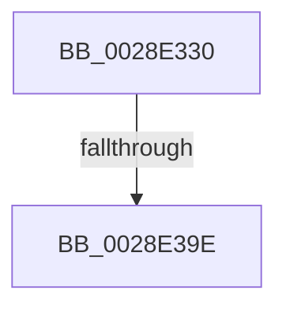

# MiLockStealSystemVm

- RVA: `0x0028E330`–`0x0028E3BA` (길이 `138` bytes)
- VA: `0x000000014028E330`
- 실행 섹션: `.text`
- PDB 이름 있음: `예`; PDB Function 태그: `아니요`
- unwind 정보 RVA: `0x0006707C`
- 디코드: `35`개 명령, `138/138` bytes 표시
- 미해석 바이트: `0` (있으면 어셈블리에 `.byte`로 보존)

> 이 문서는 커널 이미지의 기계어와 PDB 기호를 분석해 생성했습니다. 4번과 5번은 함수 원형과 자료형을 바이너리 사용 방식에서 추정한 C 해석이며 원본 소스 복구 결과는 아닙니다.

## 1. Dependencies

- 직접 호출 지점: **0**; 고유 호출 대상: **0**
- 직접 호출자로 확인된 함수: **1**
- RIP 상대 이미지 참조: **2**

### Outgoing calls
- 직접 디코드된 call 명령이 없습니다.

### Direct callers
- [MiStealPage](../2B/MiStealPage_function_002B28D0.md) at `0x002B335F`

### Static image references
- `0x0028E34A` → RVA `0x00E30088` (`.data`; read)
- `0x0028E3A1` → RVA `0x00E38AA8` (`.data`; read)

## 2. Other-region calls and transfers

- 다른 실행 섹션으로 향하는 call: **0**
- call이 아닌 외부 분기/꼬리 이동: **1**
  - `0x0028E398` → [sub_0028E4E4](Unknown_function_0028E4E4.md) (`tail-transfer`)

## 3. Assembly (complete function range)

```asm
0028E330  4C 89 44 24 18                  mov qword ptr [rsp + 0x18], r8
0028E335  53                              push rbx
0028E336  55                              push rbp
0028E337  56                              push rsi
0028E338  57                              push rdi
0028E339  41 55                           push r13
0028E33B  41 56                           push r14
0028E33D  41 57                           push r15
0028E33F  48 83 EC 30                     sub rsp, 0x30
0028E343  48 8B 41 28                     mov rax, qword ptr [rcx + 0x28]
0028E347  49 8B F0                        mov rsi, r8
0028E34A  4C 8B 15 37 1D BA 00            mov r10, qword ptr [rip + 0xba1d37]
0028E351  4D 8B F9                        mov r15, r9
0028E354  48 C1 E8 2B                     shr rax, 0x2b
0028E358  48 8B F9                        mov rdi, rcx
0028E35B  25 FF 03 00 00                  and eax, 0x3ff
0028E360  0F B6 EA                        movzx ebp, dl
0028E363  48 C1 E6 19                     shl rsi, 0x19
0028E367  48 BA 00 00 00 00 80 F6 FF FF   movabs rdx, 0xfffff68000000000
0028E371  49 8B 04 C2                     mov rax, qword ptr [r10 + rax*8]
0028E375  48 89 44 24 70                  mov qword ptr [rsp + 0x70], rax
0028E37A  48 8B C2                        mov rax, rdx
0028E37D  48 C1 E0 19                     shl rax, 0x19
0028E381  45 33 F6                        xor r14d, r14d
0028E384  48 2B F0                        sub rsi, rax
0028E387  48 B8 00 00 00 00 00 80 FF FF   movabs rax, 0xffff800000000000
0028E391  48 C1 FE 10                     sar rsi, 0x10
0028E395  48 3B F0                        cmp rsi, rax
0028E398  0F 82 46 01 00 00               jb 0x14028e4e4
0028E39E  48 8B C6                        mov rax, rsi
0028E3A1  48 8D 0D 00 A7 BA 00            lea rcx, [rip + 0xbaa700]
0028E3A8  48 C1 E8 27                     shr rax, 0x27
0028E3AC  25 FF 01 00 00                  and eax, 0x1ff
0028E3B1  2D 00 01 00 00                  sub eax, 0x100
0028E3B6  0F B6 1C 08                     movzx ebx, byte ptr [rax + rcx]
```

## 4. C-style interpretation (structured pseudocode)

```c
__int64 __fastcall MiLockStealSystemVm(__int64 a1, unsigned __int8 a2, __int64 a3, __int64 a4)
{
    __int64 result;
    __int64 v_r14;
    __int64 v_rsi;
    __int64 v_rsp;
    unsigned __int64 v_stack_p18;
    unsigned __int64 v_stack_p8;

    v_stack_p18 = a3;
    v_rsp = (v_rsp) - (48);
    result = (*(unsigned __int64 *)(a1 + 40)) >> (43);
    result = (unsigned int)((result) & (0x3FFULL));
    v_rsi = (a3) << (25);
    v_stack_p8 = *(unsigned __int64 *)(*(unsigned __int64 *)(v_rip + 12197175) + result * 8);
    result = (a2) << (25);
    v_r14 = 0;
    v_rsi = (v_rsi) - (result);
    v_rsi = (v_rsi) >> (16);
    result = (v_rsi) >> (39);
    result = (unsigned int)((result) & (511));
    result = (unsigned int)((result) - (256));
    return result;
}
```

## 5. (Beta) C Style

```c
int64_t MiLockStealSystemVm(void *Arg1, uint8_t Arg2, int64_t Arg3, int64_t Arg4)
{
    uint8_t *arg1 = (uint8_t *)Arg1;

    int64_t result;
    int64_t local_r14;
    int64_t local_rsi;
    int64_t local_rsp;
    uint64_t v_stack_p18;
    uint64_t v_stack_p8;

    v_stack_p18 = Arg3;
    local_rsp = (local_rsp) - (48);
    result = (*(uint64_t *)(arg1 + 0x28)) >> (43);
    result = (uint32_t)((result) & (0x3FFULL));
    local_rsi = (Arg3) << (25);
    v_stack_p8 = *(uint64_t *)(*(uint64_t *)(v_rip + 0xBA1D37) + result * 8);
    result = (Arg2) << (25);
    local_r14 = 0;
    local_rsi = (local_rsi) - (result);
    local_rsi = (local_rsi) >> (16);
    result = (local_rsi) >> (39);
    result = (uint32_t)((result) & (511));
    result = (uint32_t)((result) - (256));
    return result;
}
```

### 관측된 메모리 오프셋

구조체 형식이 확인되지 않은 접근은 인자 기준의 오프셋으로만 기록했습니다.

| 기준 인자 | 오프셋 표현 | 폭 (bit) | 접근 |
|---|---:|---:|---|
| `Arg1` | `+ 0x28` | `64` | `R` |

## 6. Execution-region graph

[열기: 2D/3D 그래프와 함수 탐색 컨트롤 패널](../../../control-panel.html?section=text&rva=0x0028E330&view=graph)

- 2D 그래프는 위에서 아래로 흐르고, 3D 그래프는 빈 공간을 드래그해 회전합니다. Shift+드래그는 이동, 휠은 확대·축소, 함수 노드 선택은 대상 보고서 이동입니다.

### Static fallback


