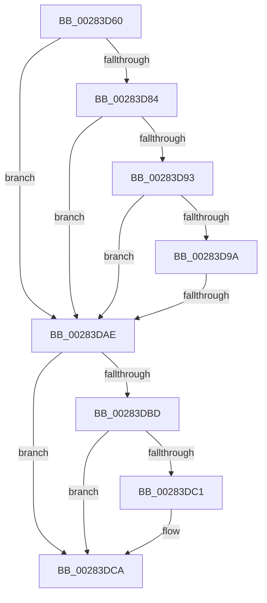

# MiMakeTransitionPteValid

- RVA: `0x00283D60`–`0x00283DD8` (길이 `120` bytes)
- VA: `0x0000000140283D60`
- 실행 섹션: `.text`
- PDB 이름 있음: `예`; PDB Function 태그: `아니요`
- unwind 정보 RVA: `0x000668CC`
- 디코드: `33`개 명령, `120/120` bytes 표시
- 미해석 바이트: `0` (있으면 어셈블리에 `.byte`로 보존)

> 이 문서는 커널 이미지의 기계어와 PDB 기호를 분석해 생성했습니다. 4번과 5번은 함수 원형과 자료형을 바이너리 사용 방식에서 추정한 C 해석이며 원본 소스 복구 결과는 아닙니다.

## 1. Dependencies

- 직접 호출 지점: **0**; 고유 호출 대상: **0**
- 직접 호출자로 확인된 함수: **6**
- RIP 상대 이미지 참조: **2**

### Outgoing calls
- 직접 디코드된 call 명령이 없습니다.

### Direct callers
- [MiResolveProtoCombine](../22/MiResolveProtoCombine_function_0022CD00.md) at `0x0022D00A`
- [MiResolveTransitionFault](MiResolveTransitionFault_function_00282940.md) at `0x00282B2E`
- [MiCompleteProtoPteFault](../34/MiCompleteProtoPteFault_function_00345710.md) at `0x00346261`
- [MiMakeFaultPfnActive](../36/MiMakeFaultPfnActive_function_00361D00.md) at `0x00361DFD`
- [MiIssueHardFault](../38/MiIssueHardFault_function_00380074.md) at `0x003803CF`
- [MiProtectAweRegion](../4C/MiProtectAweRegion_function_004CE62C.md) at `0x004CECEC`

### Static image references
- `0x00283DAE` → RVA `0x00E2DC80` (`.data`; read)
- `0x00283DCE` → RVA `0x00010990` (`.rdata`; read)

## 2. Other-region calls and transfers

- 다른 실행 섹션으로 향하는 call: **0**
- call이 아닌 외부 분기/꼬리 이동: **1**
  - `0x00283DA8` → [sub_00283EED](Unknown_function_00283EED.md) (`tail-transfer`)

## 3. Assembly (complete function range)

```asm
00283D60  48 89 5C 24 10                  mov qword ptr [rsp + 0x10], rbx
00283D65  48 89 74 24 18                  mov qword ptr [rsp + 0x18], rsi
00283D6A  57                              push rdi
00283D6B  48 83 EC 20                     sub rsp, 0x20
00283D6F  48 8B 01                        mov rax, qword ptr [rcx]
00283D72  48 8B F9                        mov rdi, rcx
00283D75  48 B9 00 D0 BE 7D FB F6 FF FF   movabs rcx, 0xfffff6fb7dbed000
00283D7F  48 3B F9                        cmp rdi, rcx
00283D82  72 2A                           jb 0x140283dae
00283D84  48 B9 F8 D7 BE 7D FB F6 FF FF   movabs rcx, 0xfffff6fb7dbed7f8
00283D8E  48 3B F9                        cmp rdi, rcx
00283D91  77 1B                           ja 0x140283dae
00283D93  48 8B D0                        mov rdx, rax
00283D96  A8 01                           test al, 1
00283D98  74 14                           je 0x140283dae
00283D9A  A8 42                           test al, 0x42
00283D9C  41 0F 95 C0                     setne r8b
00283DA0  A8 20                           test al, 0x20
00283DA2  0F 95 C1                        setne cl
00283DA5  44 84 C1                        test cl, r8b
00283DA8  0F 84 3F 01 00 00               je 0x140283eed
00283DAE  48 8B 15 CB 9E BA 00            mov rdx, qword ptr [rip + 0xba9ecb]
00283DB5  48 8B C8                        mov rcx, rax
00283DB8  48 85 D2                        test rdx, rdx
00283DBB  74 0D                           je 0x140283dca
00283DBD  A8 10                           test al, 0x10
00283DBF  75 09                           jne 0x140283dca
00283DC1  48 8B CA                        mov rcx, rdx
00283DC4  48 F7 D1                        not rcx
00283DC7  48 23 C8                        and rcx, rax
00283DCA  48 C1 E8 05                     shr rax, 5
00283DCE  48 8D 1D BB CB D8 FF            lea rbx, [rip - 0x273445]
00283DD5  83 E0 1F                        and eax, 0x1f
```

## 4. C-style interpretation (structured pseudocode)

```c
__int64 __fastcall MiMakeTransitionPteValid(__int64 a1)
{
    __int64 result;
    __int64 v_rsp;
    unsigned __int64 v_stack_p10;
    unsigned __int64 v_stack_p18;

    v_stack_p10 = v_rbx;
    v_stack_p18 = v_rsi;
    v_rsp = (v_rsp) - (32);
    if (a1 < a1) goto loc_00283DAE;
    if (a1 > a1) goto loc_00283DAE;
    if ((((unsigned __int8)(*(unsigned __int64 *)(a1))) & (1)) == 0) goto loc_00283DAE;
    a3 = ((((unsigned __int8)(*(unsigned __int64 *)(a1))) & (66)) != 0) ? 1 : 0;
    a1 = ((((unsigned __int8)(*(unsigned __int64 *)(a1))) & (32)) != 0) ? 1 : 0;
loc_00283DAE:
    if (*(unsigned __int64 *)(v_rip + 12230347) == 0) goto loc_00283DCA;
    if ((((unsigned __int8)(*(unsigned __int64 *)(a1))) & (16)) == 0) {
        a1 = *(unsigned __int64 *)(v_rip + 12230347);
        a1 = ~(a1);
        a1 = (a1) & (*(unsigned __int64 *)(a1));
    }
    result = (*(unsigned __int64 *)(a1)) >> (5);
    result = (unsigned int)((result) & (31));
    return result;
}
```

## 5. (Beta) C Style

```c
int64_t MiMakeTransitionPteValid(void *Arg1)
{
    uint8_t *arg1 = (uint8_t *)Arg1;

    int64_t result;
    int64_t local_rsp;
    uint64_t v_stack_p10;
    uint64_t v_stack_p18;

    v_stack_p10 = local_rbx;
    v_stack_p18 = local_rsi;
    local_rsp = (local_rsp) - (32);
    if (Arg1 < Arg1) goto loc_00283DAE;
    if (Arg1 > Arg1) goto loc_00283DAE;
    if ((((uint8_t)(*(uint64_t *)(arg1))) & (1)) == 0) goto loc_00283DAE;
    a3 = ((((uint8_t)(*(uint64_t *)(arg1))) & (66)) != 0) ? 1 : 0;
    Arg1 = ((((uint8_t)(*(uint64_t *)(arg1))) & (32)) != 0) ? 1 : 0;
loc_00283DAE:
    if (*(uint64_t *)(v_rip + 0xBA9ECB) == 0) goto loc_00283DCA;
    if ((((uint8_t)(*(uint64_t *)(arg1))) & (16)) == 0) {
        Arg1 = *(uint64_t *)(v_rip + 0xBA9ECB);
        Arg1 = ~(Arg1);
        Arg1 = (Arg1) & (*(uint64_t *)(arg1));
    }
    result = (*(uint64_t *)(arg1)) >> (5);
    result = (uint32_t)((result) & (31));
    return result;
}
```

### 관측된 메모리 오프셋

구조체 형식이 확인되지 않은 접근은 인자 기준의 오프셋으로만 기록했습니다.

| 기준 인자 | 오프셋 표현 | 폭 (bit) | 접근 |
|---|---:|---:|---|
| `Arg1` | `+ 0x0` | `64` | `R` |

## 6. Execution-region graph

[열기: 2D/3D 그래프와 함수 탐색 컨트롤 패널](../../../control-panel.html?section=text&rva=0x00283D60&view=graph)

- 2D 그래프는 위에서 아래로 흐르고, 3D 그래프는 빈 공간을 드래그해 회전합니다. Shift+드래그는 이동, 휠은 확대·축소, 함수 노드 선택은 대상 보고서 이동입니다.

### Static fallback


