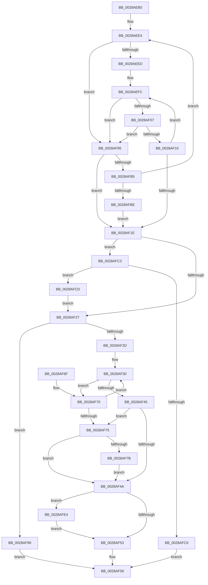

# MiObtainFaultCharges

- RVA: `0x0028AEB0`–`0x0028AFFA` (길이 `330` bytes)
- VA: `0x000000014028AEB0`
- 실행 섹션: `.text`
- PDB 이름 있음: `예`; PDB Function 태그: `아니요`
- unwind 정보 RVA: `0x00066F24`
- 디코드: `90`개 명령, `330/330` bytes 표시
- 미해석 바이트: `0` (있으면 어셈블리에 `.byte`로 보존)

> 이 문서는 커널 이미지의 기계어와 PDB 기호를 분석해 생성했습니다. 4번과 5번은 함수 원형과 자료형을 바이너리 사용 방식에서 추정한 C 해석이며 원본 소스 복구 결과는 아닙니다.

## 1. Dependencies

- 직접 호출 지점: **5**; 고유 호출 대상: **4**
- 직접 호출자로 확인된 함수: **10**
- RIP 상대 이미지 참조: **1**

### Outgoing calls
- `0x0028AF3C` → [MiChargeCommit](MiChargeCommit_function_00286EB0.md) (function, `0x00286EB0`)
- `0x0028AF89` → [MiChargeCommit](MiChargeCommit_function_00286EB0.md) (function, `0x00286EB0`)
- `0x0028AFA8` → [MiChargePartitionResidentAvailable](MiChargePartitionResidentAvailable_function_0028B000.md) (function, `0x0028B000`)
- `0x0028AFDA` → [MiChargeResident](MiChargeResident_function_0028A0F0.md) (function, `0x0028A0F0`)
- `0x0028AFF0` → [MiReturnFaultCharges](../36/MiReturnFaultCharges_function_0036D928.md) (function, `0x0036D928`)

### Direct callers
- [MiMigratePfn](MiMigratePfn_function_0028DBB0.md) at `0x0028DD28`
- [MiGetPageForHeader](../2A/MiGetPageForHeader_function_002AC120.md) at `0x002AC152`
- [MiPrivateFixup](../36/MiPrivateFixup_function_003693E8.md) at `0x00369520`
- [MiResolveMappedFileFault](../36/MiResolveMappedFileFault_function_0036B640.md) at `0x0036B964`
- [MiPickClusterForMappedFileFault](../36/MiPickClusterForMappedFileFault_function_0036C0C0.md) at `0x0036C182`
- [MiResolvePageFileFault](../36/MiResolvePageFileFault_function_0036D968.md) at `0x0036DD66`
- [MiPrefetchPagesViable](../45/MiPrefetchPagesViable_function_0045A644.md) at `0x0045A6A9`
- [MiSwitchToTransition](../4C/MiSwitchToTransition_function_004C0F5C.md) at `0x004C109B`
- [MiPfPrepareReadList](../../page/93/MiPfPrepareReadList_function_0093CD5C.md) at `0x0093D1C1`
- [MiPfPrepareSequentialReadList](../../page/93/MiPfPrepareSequentialReadList_function_0093D8E8.md) at `0x0093DD61`

### Static image references
- `0x0028AECB` → RVA `0x00E38D00` (`.data`; read)

## 2. Other-region calls and transfers

- 다른 실행 섹션으로 향하는 call: **0**
- 별도 외부 분기/꼬리 이동을 확인하지 못했습니다.

## 3. Assembly (complete function range)

```asm
0028AEB0  48 89 5C 24 08                  mov qword ptr [rsp + 8], rbx
0028AEB5  48 89 6C 24 10                  mov qword ptr [rsp + 0x10], rbp
0028AEBA  48 89 74 24 18                  mov qword ptr [rsp + 0x18], rsi
0028AEBF  57                              push rdi
0028AEC0  41 56                           push r14
0028AEC2  41 57                           push r15
0028AEC4  48 83 EC 20                     sub rsp, 0x20
0028AEC8  41 8B E8                        mov ebp, r8d
0028AECB  48 8D 3D 2E DE BA 00            lea rdi, [rip + 0xbade2e]
0028AED2  48 8B DA                        mov rbx, rdx
0028AED5  48 8B F1                        mov rsi, rcx
0028AED8  41 BE FF FF FF FF               mov r14d, 0xffffffff
0028AEDE  41 BF 00 04 00 00               mov r15d, 0x400
0028AEE4  48 3B F7                        cmp rsi, rdi
0028AEE7  0F 85 A8 00 00 00               jne 0x14028af95
0028AEED  65 48 8B 14 25 20 00 00 00      mov rdx, qword ptr gs:[0x20]
0028AEF6  8B 82 9C 8B 00 00               mov eax, dword ptr [rdx + 0x8b9c]
0028AEFC  8B C8                           mov ecx, eax
0028AEFE  48 3B D9                        cmp rbx, rcx
0028AF01  0F 87 8E 00 00 00               ja 0x14028af95
0028AF07  41 3B C6                        cmp eax, r14d
0028AF0A  0F 84 85 00 00 00               je 0x14028af95
0028AF10  8B C8                           mov ecx, eax
0028AF12  2B CB                           sub ecx, ebx
0028AF14  F0 0F B1 8A 9C 8B 00 00         lock cmpxchg dword ptr [rdx + 0x8b9c], ecx
0028AF1C  75 DE                           jne 0x14028aefc
0028AF1E  48 85 DB                        test rbx, rbx
0028AF21  0F 84 9C 00 00 00               je 0x14028afc3
0028AF27  40 F6 C5 01                     test bpl, 1
0028AF2B  74 63                           je 0x14028af90
0028AF2D  48 8B FB                        mov rdi, rbx
0028AF30  41 B8 01 00 00 00               mov r8d, 1
0028AF36  48 8B D7                        mov rdx, rdi
0028AF39  48 8B CE                        mov rcx, rsi
0028AF3C  E8 6F BF FF FF                  call 0x140286eb0
0028AF41  85 C0                           test eax, eax
0028AF43  74 2B                           je 0x14028af70
0028AF45  48 85 FF                        test rdi, rdi
0028AF48  74 2B                           je 0x14028af75
0028AF4A  48 3B FB                        cmp rdi, rbx
0028AF4D  0F 85 91 00 00 00               jne 0x14028afe4
0028AF53  48 8B C7                        mov rax, rdi
0028AF56  48 8B 5C 24 40                  mov rbx, qword ptr [rsp + 0x40]
0028AF5B  48 8B 6C 24 48                  mov rbp, qword ptr [rsp + 0x48]
0028AF60  48 8B 74 24 50                  mov rsi, qword ptr [rsp + 0x50]
0028AF65  48 83 C4 20                     add rsp, 0x20
0028AF69  41 5F                           pop r15
0028AF6B  41 5E                           pop r14
0028AF6D  5F                              pop rdi
0028AF6E  C3                              ret
0028AF6F  CC                              int3
0028AF70  48 D1 EF                        shr rdi, 1
0028AF73  75 BB                           jne 0x14028af30
0028AF75  40 F6 C5 02                     test bpl, 2
0028AF79  74 CF                           je 0x14028af4a
0028AF7B  BF 01 00 00 00                  mov edi, 1
0028AF80  48 8B CE                        mov rcx, rsi
0028AF83  8B D7                           mov edx, edi
0028AF85  44 8D 47 03                     lea r8d, [rdi + 3]
0028AF89  E8 22 BF FF FF                  call 0x140286eb0
0028AF8E  EB BA                           jmp 0x14028af4a
0028AF90  48 8B C3                        mov rax, rbx
0028AF93  EB C1                           jmp 0x14028af56
0028AF95  41 B8 01 00 00 00               mov r8d, 1
0028AF9B  48 8B D3                        mov rdx, rbx
0028AF9E  49 3B D8                        cmp rbx, r8
0028AFA1  48 8B CE                        mov rcx, rsi
0028AFA4  4D 0F 45 C7                     cmovne r8, r15
0028AFA8  E8 53 00 00 00                  call 0x14028b000
0028AFAD  85 C0                           test eax, eax
0028AFAF  0F 85 69 FF FF FF               jne 0x14028af1e
0028AFB5  48 D1 EB                        shr rbx, 1
0028AFB8  0F 85 26 FF FF FF               jne 0x14028aee4
0028AFBE  E9 5B FF FF FF                  jmp 0x14028af1e
0028AFC3  40 F6 C5 02                     test bpl, 2
0028AFC7  75 04                           jne 0x14028afcd
0028AFC9  33 C0                           xor eax, eax
0028AFCB  EB 89                           jmp 0x14028af56
0028AFCD  BB 01 00 00 00                  mov ebx, 1
0028AFD2  4D 8B C6                        mov r8, r14
0028AFD5  8B D3                           mov edx, ebx
0028AFD7  48 8B CE                        mov rcx, rsi
0028AFDA  E8 11 F1 FF FF                  call 0x14028a0f0
0028AFDF  E9 43 FF FF FF                  jmp 0x14028af27
0028AFE4  48 2B DF                        sub rbx, rdi
0028AFE7  45 33 C0                        xor r8d, r8d
0028AFEA  48 8B D3                        mov rdx, rbx
0028AFED  48 8B CE                        mov rcx, rsi
0028AFF0  E8 33 29 0E 00                  call 0x14036d928
0028AFF5  E9 59 FF FF FF                  jmp 0x14028af53
```

## 4. C-style interpretation (structured pseudocode)

```c
__int64 __fastcall MiObtainFaultCharges(__int64 a1, __int64 a2, int a3)
{
    __int64 result;
    __int64 v_rbx;
    __int64 v_rdi;
    __int64 v_rsp;
    unsigned __int64 v_stack_p10;
    unsigned __int64 v_stack_p18;
    unsigned __int64 v_stack_p8;

    v_stack_p8 = v_rbx;
    v_stack_p10 = v_rbp;
    v_stack_p18 = v_rsi;
    v_rsp = (v_rsp) - (32);
loc_0028AEE4:
    if (a1 != (v_rip + 12246574)) goto loc_0028AF95;
loc_0028AEFC:
    if (a2 > ((unsigned int)((unsigned int)((unsigned int)(*(unsigned int *)(*(unsigned __int64 *)(gs_base + (0 + 32)) + 35740)))))) goto loc_0028AF95;
    if (((unsigned int)((unsigned int)(*(unsigned int *)(*(unsigned __int64 *)(gs_base + (0 + 32)) + 35740)))) == ((unsigned int)((unsigned int)(0xFFFFFFFFULL)))) goto loc_0028AF95;
    a1 = (unsigned int)(((unsigned int)((unsigned int)((unsigned int)(*(unsigned int *)(*(unsigned __int64 *)(gs_base + (0 + 32)) + 35740))))) - ((unsigned int)(a2)));
    if (condition_is_not_equal) goto loc_0028AEFC;
loc_0028AF1E:
    if (a2 == 0) goto loc_0028AFC3;
loc_0028AF27:
    if ((((unsigned __int8)((unsigned int)(a3))) & (1)) == 0) goto loc_0028AF90;
loc_0028AF30:
    result = MiChargeCommit(a1, a2, 1, a4);
    if ((unsigned int)(result) == 0) goto loc_0028AF70;
    if (a2 == 0) goto loc_0028AF75;
loc_0028AF4A:
    if (a2 != a2) goto loc_0028AFE4;
loc_0028AF53:
loc_0028AF56:
    v_rsp = (v_rsp) + (32);
    return a2;
loc_0028AF70:
    v_rdi = (a2) >> (1);
    if (condition_is_not_equal) goto loc_0028AF30;
loc_0028AF75:
    if ((((unsigned __int8)(v_stack_p10)) & (2)) == 0) goto loc_0028AF4A;
    result = MiChargeCommit(v_stack_p18, 1, 1 + 3, a4);
    goto loc_0028AF4A;
loc_0028AF90:
    goto loc_0028AF56;
loc_0028AF95:
    a3 = 1;
    if (v_stack_p8 != 1) { a3 = (unsigned int)(0x400ULL); }
    result = MiChargePartitionResidentAvailable(v_stack_p18, v_stack_p8, a3, a4);
    if ((unsigned int)(result) != 0) goto loc_0028AF1E;
    v_rbx = (v_stack_p8) >> (1);
    if (condition_is_not_equal) goto loc_0028AEE4;
    goto loc_0028AF1E;
loc_0028AFC3:
    if ((((unsigned __int8)(v_stack_p10)) & (2)) != 0) goto loc_0028AFCD;
    result = 0;
    goto loc_0028AF56;
loc_0028AFCD:
    result = MiChargeResident(v_stack_p18, 1, (unsigned int)(0xFFFFFFFFULL), a4);
    goto loc_0028AF27;
loc_0028AFE4:
    v_rbx = (1) - (1);
    a3 = 0;
    result = MiReturnFaultCharges(v_stack_p18, v_rbx, a3, a4);
    goto loc_0028AF53;
}
```

## 5. (Beta) C Style

```c
int64_t MiObtainFaultCharges(int64_t Arg1, int64_t Arg2, int32_t Arg3)
{
    int64_t result;
    int64_t local_rbx;
    int64_t local_rdi;
    int64_t local_rsp;
    uint64_t v_stack_p10;
    uint64_t v_stack_p18;
    uint64_t v_stack_p8;

    v_stack_p8 = local_rbx;
    v_stack_p10 = local_rbp;
    v_stack_p18 = local_rsi;
    local_rsp = (local_rsp) - (32);
loc_0028AEE4:
    if (Arg1 != (v_rip + 12246574)) goto loc_0028AF95;
loc_0028AEFC:
    if (Arg2 > ((uint32_t)((uint32_t)((uint32_t)(*(uint32_t *)(*(uint64_t *)(gs_base + (0 + 0x20)) + 0x8B9C)))))) goto loc_0028AF95;
    if (((uint32_t)((uint32_t)(*(uint32_t *)(*(uint64_t *)(gs_base + (0 + 0x20)) + 0x8B9C)))) == ((uint32_t)((uint32_t)(0xFFFFFFFFULL)))) goto loc_0028AF95;
    Arg1 = (uint32_t)(((uint32_t)((uint32_t)((uint32_t)(*(uint32_t *)(*(uint64_t *)(gs_base + (0 + 0x20)) + 0x8B9C))))) - ((uint32_t)(Arg2)));
    if (condition_is_not_equal) goto loc_0028AEFC;
loc_0028AF1E:
    if (Arg2 == 0) goto loc_0028AFC3;
loc_0028AF27:
    if ((((uint8_t)((uint32_t)(Arg3))) & (1)) == 0) goto loc_0028AF90;
loc_0028AF30:
    result = MiChargeCommit(Arg1, Arg2, 1, a4);
    if ((uint32_t)(result) == 0) goto loc_0028AF70;
    if (Arg2 == 0) goto loc_0028AF75;
loc_0028AF4A:
    if (Arg2 != Arg2) goto loc_0028AFE4;
loc_0028AF53:
loc_0028AF56:
    local_rsp = (local_rsp) + (32);
    return Arg2;
loc_0028AF70:
    local_rdi = (Arg2) >> (1);
    if (condition_is_not_equal) goto loc_0028AF30;
loc_0028AF75:
    if ((((uint8_t)(v_stack_p10)) & (2)) == 0) goto loc_0028AF4A;
    result = MiChargeCommit(v_stack_p18, 1, 1 + 3, a4);
    goto loc_0028AF4A;
loc_0028AF90:
    goto loc_0028AF56;
loc_0028AF95:
    Arg3 = 1;
    if (v_stack_p8 != 1) { Arg3 = (uint32_t)(0x400ULL); }
    result = MiChargePartitionResidentAvailable(v_stack_p18, v_stack_p8, Arg3, a4);
    if ((uint32_t)(result) != 0) goto loc_0028AF1E;
    local_rbx = (v_stack_p8) >> (1);
    if (condition_is_not_equal) goto loc_0028AEE4;
    goto loc_0028AF1E;
loc_0028AFC3:
    if ((((uint8_t)(v_stack_p10)) & (2)) != 0) goto loc_0028AFCD;
    result = 0;
    goto loc_0028AF56;
loc_0028AFCD:
    result = MiChargeResident(v_stack_p18, 1, (uint32_t)(0xFFFFFFFFULL), a4);
    goto loc_0028AF27;
loc_0028AFE4:
    local_rbx = (1) - (1);
    Arg3 = 0;
    result = MiReturnFaultCharges(v_stack_p18, local_rbx, Arg3, a4);
    goto loc_0028AF53;
}
```

## 6. Execution-region graph

[열기: 2D/3D 그래프와 함수 탐색 컨트롤 패널](../../../control-panel.html?section=text&rva=0x0028AEB0&view=graph)

- 2D 그래프는 위에서 아래로 흐르고, 3D 그래프는 빈 공간을 드래그해 회전합니다. Shift+드래그는 이동, 휠은 확대·축소, 함수 노드 선택은 대상 보고서 이동입니다.

### Static fallback


