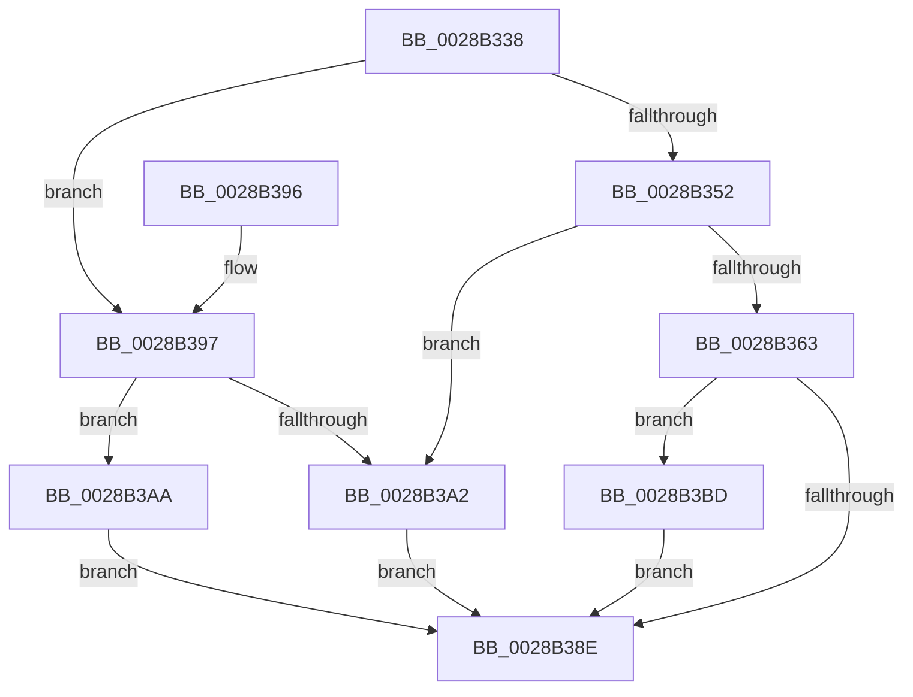

# MiPreemptivePageDemoteAmount

- RVA: `0x0028B338`–`0x0028B3C2` (길이 `138` bytes)
- VA: `0x000000014028B338`
- 실행 섹션: `.text`
- PDB 이름 있음: `예`; PDB Function 태그: `아니요`
- unwind 정보 RVA: `0x00066F5C`
- 디코드: `41`개 명령, `138/138` bytes 표시
- 미해석 바이트: `0` (있으면 어셈블리에 `.byte`로 보존)

> 이 문서는 커널 이미지의 기계어와 PDB 기호를 분석해 생성했습니다. 4번과 5번은 함수 원형과 자료형을 바이너리 사용 방식에서 추정한 C 해석이며 원본 소스 복구 결과는 아닙니다.

## 1. Dependencies

- 직접 호출 지점: **1**; 고유 호출 대상: **1**
- 직접 호출자로 확인된 함수: **1**
- RIP 상대 이미지 참조: **1**

### Outgoing calls
- `0x0028B35A` → [MiCacheAttributeHasValue](MiCacheAttributeHasValue_function_0028A14C.md) (function, `0x0028A14C`)

### Direct callers
- [MiDemoteLocalLargePage](MiDemoteLocalLargePage_function_0028A4F0.md) at `0x0028A589`

### Static image references
- `0x0028B363` → RVA `0x00E2DCCC` (`.data`; read)

## 2. Other-region calls and transfers

- 다른 실행 섹션으로 향하는 call: **0**
- 별도 외부 분기/꼬리 이동을 확인하지 못했습니다.

## 3. Assembly (complete function range)

```asm
0028B338  48 83 EC 28                     sub rsp, 0x28
0028B33C  4C 8B C9                        mov r9, rcx
0028B33F  8B C2                           mov eax, edx
0028B341  B9 00 00 03 00                  mov ecx, 0x30000
0028B346  41 B8 01 00 00 00               mov r8d, 1
0028B34C  23 C1                           and eax, ecx
0028B34E  3B C1                           cmp eax, ecx
0028B350  75 45                           jne 0x14028b397
0028B352  C1 EA 12                        shr edx, 0x12
0028B355  83 E2 03                        and edx, 3
0028B358  8B CA                           mov ecx, edx
0028B35A  E8 ED ED FF FF                  call 0x14028a14c
0028B35F  85 C0                           test eax, eax
0028B361  74 3F                           je 0x14028b3a2
0028B363  8B 0D 63 29 BA 00               mov ecx, dword ptr [rip + 0xba2963]
0028B369  BA 10 00 00 00                  mov edx, 0x10
0028B36E  49 8B 81 88 3A 00 00            mov rax, qword ptr [r9 + 0x3a88]
0028B375  4C 63 80 50 42 00 00            movsxd r8, dword ptr [rax + 0x4250]
0028B37C  4C 3B C2                        cmp r8, rdx
0028B37F  FF C9                           dec ecx
0028B381  4C 0F 43 C2                     cmovae r8, rdx
0028B385  4C 0F AF C1                     imul r8, rcx
0028B389  4C 3B C2                        cmp r8, rdx
0028B38C  72 2F                           jb 0x14028b3bd
0028B38E  49 8B C0                        mov rax, r8
0028B391  48 83 C4 28                     add rsp, 0x28
0028B395  C3                              ret
0028B396  CC                              int3
0028B397  8B C2                           mov eax, edx
0028B399  23 C1                           and eax, ecx
0028B39B  3D 00 00 02 00                  cmp eax, 0x20000
0028B3A0  75 08                           jne 0x14028b3aa
0028B3A2  41 B8 10 00 00 00               mov r8d, 0x10
0028B3A8  EB E4                           jmp 0x14028b38e
0028B3AA  23 D1                           and edx, ecx
0028B3AC  B8 04 00 00 00                  mov eax, 4
0028B3B1  81 FA 00 00 01 00               cmp edx, 0x10000
0028B3B7  4C 0F 44 C0                     cmove r8, rax
0028B3BB  EB D1                           jmp 0x14028b38e
0028B3BD  4C 8B C2                        mov r8, rdx
0028B3C0  EB CC                           jmp 0x14028b38e
```

## 4. C-style interpretation (structured pseudocode)

```c
__int64 __fastcall MiPreemptivePageDemoteAmount(__int64 a1, int a2)
{
    __int64 result;
    __int64 v_rsp;

    v_rsp = (v_rsp) - (40);
    result = (unsigned int)(((unsigned int)(a2)) & ((unsigned int)((unsigned int)(0x30000ULL))));
    if (((unsigned int)(result)) != ((unsigned int)((unsigned int)(0x30000ULL)))) goto loc_0028B397;
    a2 = (unsigned int)((a2) >> (18));
    a2 = (unsigned int)((a2) & (3));
    result = MiCacheAttributeHasValue((unsigned int)(a2), a2, 1, a1);
    if ((unsigned int)(result) == 0) goto loc_0028B3A2;
    a1 = (unsigned int)(((unsigned int)(*(unsigned int *)(v_rip + 12200291))) - 1);
    a3 = (int)(*(unsigned int *)(*(unsigned __int64 *)(a1 + 14984) + 16976));
    if (((int)(*(unsigned int *)(*(unsigned __int64 *)(a1 + 14984) + 16976))) >= 16) { a3 = 16; }
    a3 = (a3) * (a1);
    if (a3 < 16) goto loc_0028B3BD;
loc_0028B38E:
    v_rsp = (v_rsp) + (40);
    return a3;
loc_0028B397:
    result = (unsigned int)((16) & ((unsigned int)(a1)));
    if (((unsigned int)(result)) != 0x20000ULL) goto loc_0028B3AA;
loc_0028B3A2:
    goto loc_0028B38E;
loc_0028B3AA:
    a2 = (unsigned int)((16) & ((unsigned int)(a1)));
    a3 = 16;
    if (a2 == 0x10000ULL) { a3 = 4; }
    goto loc_0028B38E;
loc_0028B3BD:
    goto loc_0028B38E;
}
```

## 5. (Beta) C Style

```c
int64_t MiPreemptivePageDemoteAmount(int64_t Arg1, int32_t Arg2)
{
    int64_t result;
    int64_t local_rsp;

    local_rsp = (local_rsp) - (40);
    result = (uint32_t)(((uint32_t)(Arg2)) & ((uint32_t)((uint32_t)(0x30000ULL))));
    if (((uint32_t)(result)) != ((uint32_t)((uint32_t)(0x30000ULL)))) goto loc_0028B397;
    Arg2 = (uint32_t)((Arg2) >> (18));
    Arg2 = (uint32_t)((Arg2) & (3));
    result = MiCacheAttributeHasValue((uint32_t)(Arg2), Arg2, 1, Arg1);
    if ((uint32_t)(result) == 0) goto loc_0028B3A2;
    Arg1 = (uint32_t)(((uint32_t)(*(uint32_t *)(v_rip + 0xBA2963))) - 1);
    a3 = (int32_t)(*(uint32_t *)(*(uint64_t *)(Arg1 + 0x3A88) + 0x4250));
    if (((int32_t)(*(uint32_t *)(*(uint64_t *)(Arg1 + 0x3A88) + 0x4250))) >= 16) { a3 = 16; }
    a3 = (a3) * (Arg1);
    if (a3 < 16) goto loc_0028B3BD;
loc_0028B38E:
    local_rsp = (local_rsp) + (40);
    return a3;
loc_0028B397:
    result = (uint32_t)((16) & ((uint32_t)(Arg1)));
    if (((uint32_t)(result)) != 0x20000ULL) goto loc_0028B3AA;
loc_0028B3A2:
    goto loc_0028B38E;
loc_0028B3AA:
    Arg2 = (uint32_t)((16) & ((uint32_t)(Arg1)));
    a3 = 16;
    if (Arg2 == 0x10000ULL) { a3 = 4; }
    goto loc_0028B38E;
loc_0028B3BD:
    goto loc_0028B38E;
}
```

## 6. Execution-region graph

[열기: 2D/3D 그래프와 함수 탐색 컨트롤 패널](../../../control-panel.html?section=text&rva=0x0028B338&view=graph)

- 2D 그래프는 위에서 아래로 흐르고, 3D 그래프는 빈 공간을 드래그해 회전합니다. Shift+드래그는 이동, 휠은 확대·축소, 함수 노드 선택은 대상 보고서 이동입니다.

### Static fallback


