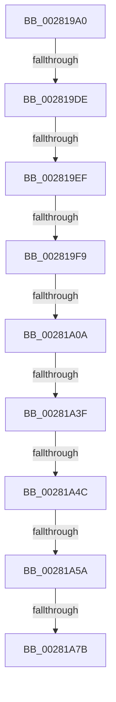

# MiReacquireWalkLocks

- RVA: `0x002819A0`–`0x00281A81` (길이 `225` bytes)
- VA: `0x00000001402819A0`
- 실행 섹션: `.text`
- PDB 이름 있음: `예`; PDB Function 태그: `예`
- unwind 정보 RVA: `0x00066730`
- 디코드: `53`개 명령, `225/225` bytes 표시
- 미해석 바이트: `0` (있으면 어셈블리에 `.byte`로 보존)

> 이 문서는 커널 이미지의 기계어와 PDB 기호를 분석해 생성했습니다. 4번과 5번은 함수 원형과 자료형을 바이너리 사용 방식에서 추정한 C 해석이며 원본 소스 복구 결과는 아닙니다.

## 1. Dependencies

- 직접 호출 지점: **1**; 고유 호출 대상: **1**
- 직접 호출자로 확인된 함수: **4**
- RIP 상대 이미지 참조: **4**

### Outgoing calls
- `0x00281A61` → [ExpAcquireSpinLockSharedAtDpcLevelInstrumented](../27/ExpAcquireSpinLockSharedAtDpcLevelInstrumented_function_0027CD20.md) (function, `0x0027CD20`)

### Direct callers
- [MiWalkPageTablesRecursively](../27/MiWalkPageTablesRecursively_function_002796C0.md) at `0x0027A299`
- [MiWalkPageTablesRecursively](../27/MiWalkPageTablesRecursively_function_002796C0.md) at `0x0027A739`
- [MiWalkPageTables](../2C/MiWalkPageTables_function_002C2710.md) at `0x002C29AD`
- [MiQueryVpabAccessedState](../42/MiQueryVpabAccessedState_function_00428E70.md) at `0x00428EF0`
- [MiProtectDriverSectionPte](../67/MiProtectDriverSectionPte_function_006706C0.md) at `0x006707E1`
- [MiProtectDriverSectionPte](../67/MiProtectDriverSectionPte_function_006706C0.md) at `0x00670929`

### Static image references
- `0x00281A0A` → RVA `0x00E38840` (`.data`; read)
- `0x00281A32` → RVA `0x00FC6D20` (`ALMOSTRO`; read)
- `0x00281A3F` → RVA `0x00FC6B06` (`ALMOSTRO`; read)
- `0x00281A4C` → RVA `0x00F0DE58` (`.data`; read)

## 2. Other-region calls and transfers

- 다른 실행 섹션으로 향하는 call: **0**
- call이 아닌 외부 분기/꼬리 이동: **8**
  - `0x002819D8` → [sub_00281A81](Unknown_function_00281A81.md) (`tail-transfer`)
  - `0x002819E9` → [sub_00281DA7](Unknown_function_00281DA7.md) (`tail-transfer`)
  - `0x002819F3` → [sub_00282541](Unknown_function_00282541.md) (`tail-transfer`)
  - `0x00281A04` → [sub_00282696](Unknown_function_00282696.md) (`tail-transfer`)
  - `0x00281A39` → [sub_0028229A](Unknown_function_0028229A.md) (`tail-transfer`)
  - `0x00281A46` → [sub_00282144](Unknown_function_00282144.md) (`tail-transfer`)
  - `0x00281A54` → [sub_00282144](Unknown_function_00282144.md) (`tail-transfer`)
  - `0x00281A79` → [sub_00281A81](Unknown_function_00281A81.md) (`tail-transfer`)

## 3. Assembly (complete function range)

```asm
002819A0  44 89 44 24 18                  mov dword ptr [rsp + 0x18], r8d
002819A5  48 89 54 24 10                  mov qword ptr [rsp + 0x10], rdx
002819AA  48 89 4C 24 08                  mov qword ptr [rsp + 8], rcx
002819AF  53                              push rbx
002819B0  55                              push rbp
002819B1  56                              push rsi
002819B2  57                              push rdi
002819B3  41 54                           push r12
002819B5  41 56                           push r14
002819B7  41 57                           push r15
002819B9  48 81 EC 80 00 00 00            sub rsp, 0x80
002819C0  4C 8B 71 20                     mov r14, qword ptr [rcx + 0x20]
002819C4  48 8B EA                        mov rbp, rdx
002819C7  4C 89 74 24 48                  mov qword ptr [rsp + 0x48], r14
002819CC  4C 8B E1                        mov r12, rcx
002819CF  41 BF 02 00 00 00               mov r15d, 2
002819D5  45 85 C0                        test r8d, r8d
002819D8  0F 85 A3 00 00 00               jne 0x140281a81
002819DE  80 79 09 11                     cmp byte ptr [rcx + 9], 0x11
002819E2  41 8B 86 B8 00 00 00            mov eax, dword ptr [r14 + 0xb8]
002819E9  0F 84 B8 03 00 00               je 0x140281da7
002819EF  24 0F                           and al, 0xf
002819F1  3C 06                           cmp al, 6
002819F3  0F 83 48 0B 00 00               jae 0x140282541
002819F9  41 8B 86 B8 00 00 00            mov eax, dword ptr [r14 + 0xb8]
00281A00  24 0F                           and al, 0xf
00281A02  3C 01                           cmp al, 1
00281A04  0F 85 8C 0C 00 00               jne 0x140282696
00281A0A  48 8D 05 2F 6E BB 00            lea rax, [rip + 0xbb6e2f]
00281A11  65 8B 1C 25 A4 01 00 00         mov ebx, dword ptr gs:[0x1a4]
00281A19  48 8B 00                        mov rax, qword ptr [rax]
00281A1C  D1 EB                           shr ebx, 1
00281A1E  83 E3 03                        and ebx, 3
00281A21  8B FB                           mov edi, ebx
00281A23  48 C1 E7 06                     shl rdi, 6
00281A27  48 03 F8                        add rdi, rax
00281A2A  44 0F 20 C6                     mov rsi, cr8
00281A2E  45 0F 22 C7                     mov cr8, r15
00281A32  83 3D E7 52 D4 00 00            cmp dword ptr [rip + 0xd452e7], 0
00281A39  0F 85 5B 08 00 00               jne 0x14028229a
00281A3F  F6 05 C0 50 D4 00 21            test byte ptr [rip + 0xd450c0], 0x21
00281A46  0F 84 F8 06 00 00               je 0x140282144
00281A4C  8B 05 06 C4 C8 00               mov eax, dword ptr [rip + 0xc8c406]
00281A52  85 C0                           test eax, eax
00281A54  0F 85 EA 06 00 00               jne 0x140282144
00281A5A  40 0F B6 D6                     movzx edx, sil
00281A5E  48 8B CF                        mov rcx, rdi
00281A61  E8 BA B2 FF FF                  call 0x14027cd20
00281A66  65 48 8B 04 25 20 00 00 00      mov rax, qword ptr gs:[0x20]
00281A6F  48 8B 88 38 88 00 00            mov rcx, qword ptr [rax + 0x8838]
00281A76  48 85 C9                        test rcx, rcx
00281A79  74 06                           je 0x140281a81
00281A7B  89 99 44 01 00 00               mov dword ptr [rcx + 0x144], ebx
```

## 4. C-style interpretation (structured pseudocode)

```c
__int64 __fastcall MiReacquireWalkLocks(__int64 a1, __int64 a2, int a3)
{
    __int64 result;
    __int64 v_rbx;
    __int64 v_rdi;
    __int64 v_rsp;
    unsigned __int64 v_stack_m70;
    unsigned __int64 v_stack_p10;
    unsigned int v_stack_p18;
    unsigned __int64 v_stack_p8;

    v_stack_p18 = a3;
    v_stack_p10 = a2;
    v_stack_p8 = a1;
    v_rsp = (v_rsp) - (128);
    v_stack_m70 = *(unsigned __int64 *)(a1 + 32);
    result = (unsigned __int8)(((unsigned int)(*(unsigned int *)(*(unsigned __int64 *)(a1 + 32) + 184))) & (15));
    result = (unsigned __int8)(((unsigned int)(*(unsigned int *)(*(unsigned __int64 *)(a1 + 32) + 184))) & (15));
    v_rbx = (unsigned int)(((unsigned int)(*(unsigned int *)(gs_base + (0 + 420)))) >> (1));
    v_rbx = (unsigned int)((v_rbx) & (3));
    v_rdi = ((unsigned int)((unsigned int)(v_rbx))) << (6);
    v_rdi = (v_rdi) + (*(unsigned __int64 *)(v_rip + 12283439));
    result = ExpAcquireSpinLockSharedAtDpcLevelInstrumented(v_rdi, (unsigned __int8)(v_cr8), a3, a4);
    *(unsigned int *)(*(unsigned __int64 *)(*(unsigned __int64 *)(gs_base + (0 + 32)) + 34872) + 324) = (unsigned int)(v_rbx);
    return *(unsigned __int64 *)(gs_base + (0 + 32));
}
```

## 5. (Beta) C Style

```c
int64_t MiReacquireWalkLocks(void *Arg1, int64_t Arg2, int32_t Arg3)
{
    uint8_t *arg1 = (uint8_t *)Arg1;

    int64_t result;
    int64_t local_rbx;
    int64_t local_rdi;
    int64_t local_rsp;
    uint64_t v_stack_m70;
    uint64_t v_stack_p10;
    uint32_t v_stack_p18;
    uint64_t v_stack_p8;

    v_stack_p18 = Arg3;
    v_stack_p10 = Arg2;
    v_stack_p8 = Arg1;
    local_rsp = (local_rsp) - (128);
    v_stack_m70 = *(uint64_t *)(arg1 + 0x20);
    result = (uint8_t)(((uint32_t)(*(uint32_t *)(*(uint64_t *)(arg1 + 0x20) + 0xB8))) & (15));
    result = (uint8_t)(((uint32_t)(*(uint32_t *)(*(uint64_t *)(arg1 + 0x20) + 0xB8))) & (15));
    local_rbx = (uint32_t)(((uint32_t)(*(uint32_t *)(gs_base + (0 + 0x1A4)))) >> (1));
    local_rbx = (uint32_t)((local_rbx) & (3));
    local_rdi = ((uint32_t)((uint32_t)(local_rbx))) << (6);
    local_rdi = (local_rdi) + (*(uint64_t *)(v_rip + 0xBB6E2F));
    result = ExpAcquireSpinLockSharedAtDpcLevelInstrumented(local_rdi, (uint8_t)(v_cr8), Arg3, a4);
    *(uint32_t *)(*(uint64_t *)(*(uint64_t *)(gs_base + (0 + 0x20)) + 0x8838) + 0x144) = (uint32_t)(local_rbx);
    return *(uint64_t *)(gs_base + (0 + 0x20));
}
```

### 관측된 메모리 오프셋

구조체 형식이 확인되지 않은 접근은 인자 기준의 오프셋으로만 기록했습니다.

| 기준 인자 | 오프셋 표현 | 폭 (bit) | 접근 |
|---|---:|---:|---|
| `Arg1` | `+ 0x9` | `8` | `R` |
| `Arg1` | `+ 0x20` | `64` | `R` |

## 6. Execution-region graph

[열기: 2D/3D 그래프와 함수 탐색 컨트롤 패널](../../../control-panel.html?section=text&rva=0x002819A0&view=graph)

- 2D 그래프는 위에서 아래로 흐르고, 3D 그래프는 빈 공간을 드래그해 회전합니다. Shift+드래그는 이동, 휠은 확대·축소, 함수 노드 선택은 대상 보고서 이동입니다.

### Static fallback


