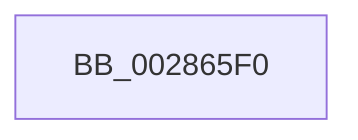

# MiReleaseControlAreaWaiters

- RVA: `0x002865F0`–`0x00286600` (길이 `16` bytes)
- VA: `0x00000001402865F0`
- 실행 섹션: `.text`
- PDB 이름 있음: `예`; PDB Function 태그: `아니요`
- unwind 정보 RVA: `0x00066BDC`
- 디코드: `4`개 명령, `16/16` bytes 표시
- 미해석 바이트: `0` (있으면 어셈블리에 `.byte`로 보존)

> 이 문서는 커널 이미지의 기계어와 PDB 기호를 분석해 생성했습니다. 4번과 5번은 함수 원형과 자료형을 바이너리 사용 방식에서 추정한 C 해석이며 원본 소스 복구 결과는 아닙니다.

## 1. Dependencies

- 직접 호출 지점: **0**; 고유 호출 대상: **0**
- 직접 호출자로 확인된 함수: **21**
- RIP 상대 이미지 참조: **0**

### Outgoing calls
- 직접 디코드된 call 명령이 없습니다.

### Direct callers
- [MiCheckControlArea](MiCheckControlArea_function_002861B0.md) at `0x00286380`
- [MiDeleteCachedSubsection](../29/MiDeleteCachedSubsection_function_00297888.md) at `0x00297BF1`
- [MiEntireSubsectionIsPurged](../29/MiEntireSubsectionIsPurged_function_00297C04.md) at `0x00297D05`
- [MiTrimSharedPage](../29/MiTrimSharedPage_function_00297D14.md) at `0x00297E17`
- [MiTrimSharedPage](../29/MiTrimSharedPage_function_00297D14.md) at `0x00297FBD`
- [MiTrimSharedPage](../29/MiTrimSharedPage_function_00297D14.md) at `0x00297FFD`
- [MiFlushComplete](../29/MiFlushComplete_function_002980A0.md) at `0x00298175`
- [sub_002BBACF](../2B/Unknown_function_002BBACF.md) at `0x002BBB68`
- [MiReferenceControlArea](../2B/MiReferenceControlArea_function_002BC198.md) at `0x002BC2E3`
- [MiReferenceExistingControlArea](../2B/MiReferenceExistingControlArea_function_002BDE64.md) at `0x002BDF55`
- [MiPrepareToFlushSubsection](../36/MiPrepareToFlushSubsection_function_00369094.md) at `0x0036919F`
- [MiReservePageFileSpace](../38/MiReservePageFileSpace_function_00383ED8.md) at `0x00384291`
- [MiUnlockFlushMdl](../40/MiUnlockFlushMdl_function_00404874.md) at `0x00404908`
- [MiWriteComplete](../40/MiWriteComplete_function_004069B0.md) at `0x00406F2A`
- [MiBuildReservationCluster](../40/MiBuildReservationCluster_function_004071A0.md) at `0x004078D7`
- [MiReleasePageFileSectionInfo](../4A/MiReleasePageFileSectionInfo_function_004A9A44.md) at `0x004A9A70`
- [MiDecrementLargeSubsections](../4D/MiDecrementLargeSubsections_function_004D2BE0.md) at `0x004D2CEF`
- [MiIncrementLargeSubsections](../4D/MiIncrementLargeSubsections_function_004D3410.md) at `0x004D3501`
- [MiLocateSharedPageViews](../67/MiLocateSharedPageViews_function_0067F1E4.md) at `0x0067F429`
- [MiPurgeBadFileOnlyPages](../68/MiPurgeBadFileOnlyPages_function_00681ADC.md) at `0x00681BD2`
- [MiPurgeBadFileOnlyPages](../68/MiPurgeBadFileOnlyPages_function_00681ADC.md) at `0x00681C31`
- [sub_009848DC](../../page/98/Unknown_function_009848DC.md) at `0x00984AE2`
- [MiCreateNewSection](../../page/98/MiCreateNewSection_function_00985DB0.md) at `0x00985F31`
- [MiSegmentDelete](../../page/A1/MiSegmentDelete_function_00A1FBB4.md) at `0x00A1FCD4`

### Static image references
- 디코드된 RIP-relative 메모리 참조가 없습니다.

## 2. Other-region calls and transfers

- 다른 실행 섹션으로 향하는 call: **0**
- call이 아닌 외부 분기/꼬리 이동: **1**
  - `0x002865FA` → [sub_0028671A](Unknown_function_0028671A.md) (`tail-transfer`)

## 3. Assembly (complete function range)

```asm
002865F0  48 8B C4                        mov rax, rsp
002865F3  48 83 EC 58                     sub rsp, 0x58
002865F7  48 85 C9                        test rcx, rcx
002865FA  0F 84 1A 01 00 00               je 0x14028671a
```

## 4. C-style interpretation (structured pseudocode)

```c
__int64 __fastcall MiReleaseControlAreaWaiters(__int64 a1)
{
    __int64 v_rsp;

    v_rsp = (v_rsp) - (88);
}
```

## 5. (Beta) C Style

```c
int64_t MiReleaseControlAreaWaiters(int64_t Arg1)
{
    int64_t local_rsp;

    local_rsp = (local_rsp) - (88);
}
```

## 6. Execution-region graph

[열기: 2D/3D 그래프와 함수 탐색 컨트롤 패널](../../../control-panel.html?section=text&rva=0x002865F0&view=graph)

- 2D 그래프는 위에서 아래로 흐르고, 3D 그래프는 빈 공간을 드래그해 회전합니다. Shift+드래그는 이동, 휠은 확대·축소, 함수 노드 선택은 대상 보고서 이동입니다.

### Static fallback


