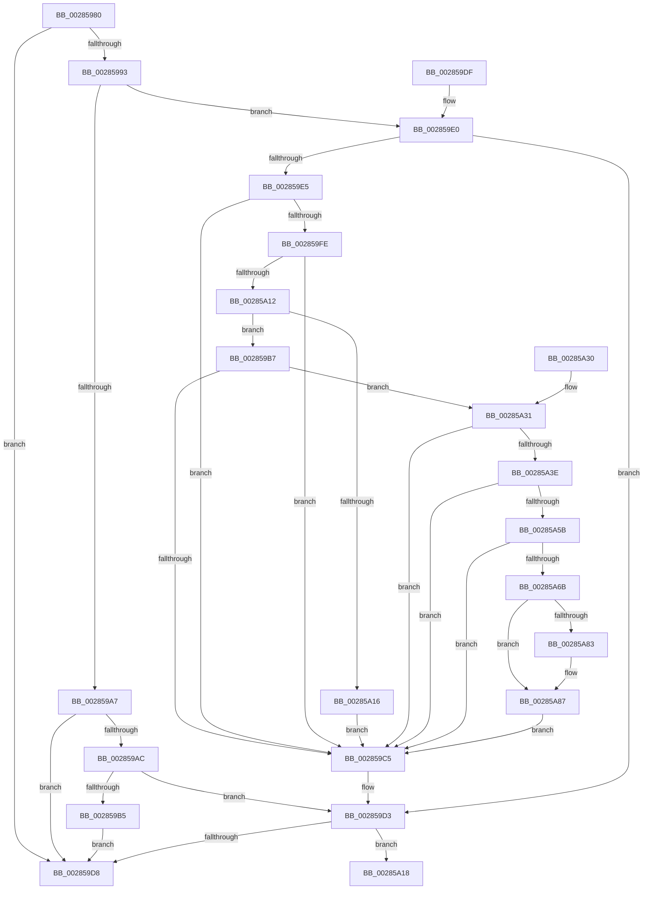

# MiReleasePageFileSpace

- RVA: `0x00285980`–`0x00285A9A` (길이 `282` bytes)
- VA: `0x0000000140285980`
- 실행 섹션: `.text`
- PDB 이름 있음: `예`; PDB Function 태그: `아니요`
- unwind 정보 RVA: `0x00066AB8`
- 디코드: `75`개 명령, `282/282` bytes 표시
- 미해석 바이트: `0` (있으면 어셈블리에 `.byte`로 보존)

> 이 문서는 커널 이미지의 기계어와 PDB 기호를 분석해 생성했습니다. 4번과 5번은 함수 원형과 자료형을 바이너리 사용 방식에서 추정한 C 해석이며 원본 소스 복구 결과는 아닙니다.

## 1. Dependencies

- 직접 호출 지점: **1**; 고유 호출 대상: **1**
- 직접 호출자로 확인된 함수: **5**
- RIP 상대 이미지 참조: **1**

### Outgoing calls
- `0x00285A21` → [MiReleasePageFileInfo](MiReleasePageFileInfo_function_00283FD0.md) (function, `0x00283FD0`)

### Direct callers
- [MiDecommitHandleTransitionPte](../24/MiDecommitHandleTransitionPte_function_0024037C.md) at `0x00240735`
- [MiDecommitHandlePageFileFormatPte](../24/MiDecommitHandlePageFileFormatPte_function_00242A5C.md) at `0x00242AF3`
- [MiZeroCfgSystemWideBitmapWorker](../36/MiZeroCfgSystemWideBitmapWorker_function_00367060.md) at `0x00367351`
- [MiPurgeSubsection](../37/MiPurgeSubsection_function_003712F0.md) at `0x00371AD9`
- [MiDeletePerSessionProtos](../4A/MiDeletePerSessionProtos_function_004A0840.md) at `0x004A099E`

### Static image references
- `0x00285A31` → RVA `0x00FC6A88` (`ALMOSTRO`; read)

## 2. Other-region calls and transfers

- 다른 실행 섹션으로 향하는 call: **0**
- 별도 외부 분기/꼬리 이동을 확인하지 못했습니다.

## 3. Assembly (complete function range)

```asm
00285980  48 89 54 24 10                  mov qword ptr [rsp + 0x10], rdx
00285985  48 83 EC 38                     sub rsp, 0x38
00285989  4C 8B C9                        mov r9, rcx
0028598C  48 0F BA E2 0A                  bt rdx, 0xa
00285991  72 45                           jb 0x1402859d8
00285993  48 8B 54 24 48                  mov rdx, qword ptr [rsp + 0x48]
00285998  0F B6 C2                        movzx eax, dl
0028599B  48 89 54 24 20                  mov qword ptr [rsp + 0x20], rdx
002859A0  C0 E8 02                        shr al, 2
002859A3  A8 01                           test al, 1
002859A5  75 39                           jne 0x1402859e0
002859A7  45 85 C0                        test r8d, r8d
002859AA  74 2C                           je 0x1402859d8
002859AC  0F B6 C2                        movzx eax, dl
002859AF  D0 E8                           shr al, 1
002859B1  A8 01                           test al, 1
002859B3  75 1E                           jne 0x1402859d3
002859B5  EB 21                           jmp 0x1402859d8
002859B7  A8 42                           test al, 0x42
002859B9  0F 95 C2                        setne dl
002859BC  A8 20                           test al, 0x20
002859BE  0F 95 C1                        setne cl
002859C1  84 D1                           test cl, dl
002859C3  74 6C                           je 0x140285a31
002859C5  48 83 E0 FD                     and rax, 0xfffffffffffffffd
002859C9  48 89 44 24 20                  mov qword ptr [rsp + 0x20], rax
002859CE  48 8B 54 24 20                  mov rdx, qword ptr [rsp + 0x20]
002859D3  48 85 D2                        test rdx, rdx
002859D6  75 40                           jne 0x140285a18
002859D8  33 C0                           xor eax, eax
002859DA  48 83 C4 38                     add rsp, 0x38
002859DE  C3                              ret
002859DF  CC                              int3
002859E0  45 85 C0                        test r8d, r8d
002859E3  75 EE                           jne 0x1402859d3
002859E5  48 8B 44 24 20                  mov rax, qword ptr [rsp + 0x20]
002859EA  48 BA 00 D0 BE 7D FB F6 FF FF   movabs rdx, 0xfffff6fb7dbed000
002859F4  48 8D 4C 24 20                  lea rcx, [rsp + 0x20]
002859F9  48 3B CA                        cmp rcx, rdx
002859FC  72 C7                           jb 0x1402859c5
002859FE  48 BA F8 D7 BE 7D FB F6 FF FF   movabs rdx, 0xfffff6fb7dbed7f8
00285A08  48 8D 4C 24 20                  lea rcx, [rsp + 0x20]
00285A0D  48 3B CA                        cmp rcx, rdx
00285A10  77 B3                           ja 0x1402859c5
00285A12  A8 01                           test al, 1
00285A14  75 A1                           jne 0x1402859b7
00285A16  EB AD                           jmp 0x1402859c5
00285A18  41 B8 01 00 00 00               mov r8d, 1
00285A1E  49 8B C9                        mov rcx, r9
00285A21  E8 AA E5 FF FF                  call 0x140283fd0
00285A26  B8 01 00 00 00                  mov eax, 1
00285A2B  48 83 C4 38                     add rsp, 0x38
00285A2F  C3                              ret
00285A30  CC                              int3
00285A31  48 F7 05 4C 10 D4 00 00 00 60 00  test qword ptr [rip + 0xd4104c], 0x600000
00285A3C  74 87                           je 0x1402859c5
00285A3E  65 48 8B 0C 25 88 01 00 00      mov rcx, qword ptr gs:[0x188]
00285A47  48 8B 91 B8 00 00 00            mov rdx, qword ptr [rcx + 0xb8]
00285A4E  80 BA 60 01 00 00 01            cmp byte ptr [rdx + 0x160], 1
00285A55  0F 84 6A FF FF FF               je 0x1402859c5
00285A5B  4C 8B 82 08 05 00 00            mov r8, qword ptr [rdx + 0x508]
00285A62  4D 85 C0                        test r8, r8
00285A65  0F 84 5A FF FF FF               je 0x1402859c5
00285A6B  48 8D 4C 24 20                  lea rcx, [rsp + 0x20]
00285A70  48 C1 E9 03                     shr rcx, 3
00285A74  81 E1 FF 01 00 00               and ecx, 0x1ff
00285A7A  49 8B 0C C8                     mov rcx, qword ptr [r8 + rcx*8]
00285A7E  F6 C1 20                        test cl, 0x20
00285A81  74 04                           je 0x140285a87
00285A83  48 83 C8 20                     or rax, 0x20
00285A87  48 8B D0                        mov rdx, rax
00285A8A  48 83 C8 42                     or rax, 0x42
00285A8E  F6 C1 42                        test cl, 0x42
00285A91  48 0F 44 C2                     cmove rax, rdx
00285A95  E9 2B FF FF FF                  jmp 0x1402859c5
```

## 4. C-style interpretation (structured pseudocode)

```c
__int64 __fastcall MiReleasePageFileSpace(__int64 a1, __int64 a2, int a3)
{
    __int64 result;
    __int64 v_rsp;
    unsigned __int64 v_stack_m18;
    unsigned __int64 v_stack_p10;
    unsigned __int64 v_stack_p20;
    unsigned __int64 v_stack_p58;

    v_stack_p10 = a2;
    v_rsp = (v_rsp) - (56);
    if (condition_is_below) goto loc_002859D8;
    v_stack_m18 = v_stack_p10;
    result = (unsigned __int8)(((unsigned __int8)(v_stack_p10)) >> (2));
    if ((((unsigned __int8)(result)) & (1)) != 0) goto loc_002859E0;
    if (a3 == 0) goto loc_002859D8;
    result = (unsigned __int8)(((unsigned __int8)(v_stack_p10)) >> (1));
    if ((((unsigned __int8)(result)) & (1)) != 0) goto loc_002859D3;
    goto loc_002859D8;
loc_002859B7:
    a2 = ((((unsigned __int8)(result)) & (66)) != 0) ? 1 : 0;
    a1 = ((((unsigned __int8)(result)) & (32)) != 0) ? 1 : 0;
    if ((((unsigned __int8)(a1)) & ((unsigned __int8)(a2))) == 0) goto loc_00285A31;
loc_002859C5:
    result = (result) & (-3);
    v_stack_m18 = result;
loc_002859D3:
    if (v_stack_m18 != 0) goto loc_00285A18;
loc_002859D8:
    result = 0;
    v_rsp = (v_rsp) + (56);
    return result;
loc_002859E0:
    if (a3 != 0) goto loc_002859D3;
    if (v_stack_p20 < v_stack_m18) goto loc_002859C5;
    if (v_stack_p20 > v_stack_m18) goto loc_002859C5;
    if ((((unsigned __int8)(v_stack_p20)) & (1)) != 0) goto loc_002859B7;
    goto loc_002859C5;
loc_00285A18:
    result = MiReleasePageFileInfo(a1, v_stack_m18, 1, a1);
    v_rsp = (v_rsp) + (56);
    return 1;
loc_00285A31:
    if (((*(unsigned __int64 *)(v_rip + 13897804)) & (0x600000ULL)) == 0) goto loc_002859C5;
    if ((*(unsigned __int8 *)(*(unsigned __int64 *)(*(unsigned __int64 *)(gs_base + (0 + 392)) + 184) + 352)) == 1) goto loc_002859C5;
    if (*(unsigned __int64 *)(*(unsigned __int64 *)(*(unsigned __int64 *)(gs_base + (0 + 392)) + 184) + 1288) == 0) goto loc_002859C5;
    a1 = (v_stack_p58) >> (3);
    a1 = (unsigned int)((a1) & (511));
    result = 1;
    if ((((unsigned __int8)(*(unsigned __int64 *)(*(unsigned __int64 *)(*(unsigned __int64 *)(*(unsigned __int64 *)(gs_base + (0 + 392)) + 184) + 1288) + a1 * 8))) & (32)) != 0) {
        result = (1) | (32);
    }
    result = (result) | (66);
    if ((((unsigned __int8)(*(unsigned __int64 *)(*(unsigned __int64 *)(*(unsigned __int64 *)(*(unsigned __int64 *)(gs_base + (0 + 392)) + 184) + 1288) + a1 * 8))) & (66)) == 0) { result = result; }
    goto loc_002859C5;
}
```

## 5. (Beta) C Style

```c
int64_t MiReleasePageFileSpace(int64_t Arg1, int64_t Arg2, int32_t Arg3)
{
    int64_t result;
    int64_t local_rsp;
    uint64_t v_stack_m18;
    uint64_t v_stack_p10;
    uint64_t v_stack_p20;
    uint64_t v_stack_p58;

    v_stack_p10 = Arg2;
    local_rsp = (local_rsp) - (56);
    if (condition_is_below) goto loc_002859D8;
    v_stack_m18 = v_stack_p10;
    result = (uint8_t)(((uint8_t)(v_stack_p10)) >> (2));
    if ((((uint8_t)(result)) & (1)) != 0) goto loc_002859E0;
    if (Arg3 == 0) goto loc_002859D8;
    result = (uint8_t)(((uint8_t)(v_stack_p10)) >> (1));
    if ((((uint8_t)(result)) & (1)) != 0) goto loc_002859D3;
    goto loc_002859D8;
loc_002859B7:
    Arg2 = ((((uint8_t)(result)) & (66)) != 0) ? 1 : 0;
    Arg1 = ((((uint8_t)(result)) & (32)) != 0) ? 1 : 0;
    if ((((uint8_t)(Arg1)) & ((uint8_t)(Arg2))) == 0) goto loc_00285A31;
loc_002859C5:
    result = (result) & (-3);
    v_stack_m18 = result;
loc_002859D3:
    if (v_stack_m18 != 0) goto loc_00285A18;
loc_002859D8:
    result = 0;
    local_rsp = (local_rsp) + (56);
    return result;
loc_002859E0:
    if (Arg3 != 0) goto loc_002859D3;
    if (v_stack_p20 < v_stack_m18) goto loc_002859C5;
    if (v_stack_p20 > v_stack_m18) goto loc_002859C5;
    if ((((uint8_t)(v_stack_p20)) & (1)) != 0) goto loc_002859B7;
    goto loc_002859C5;
loc_00285A18:
    result = MiReleasePageFileInfo(Arg1, v_stack_m18, 1, Arg1);
    local_rsp = (local_rsp) + (56);
    return 1;
loc_00285A31:
    if (((*(uint64_t *)(v_rip + 0xD4104C)) & (0x600000ULL)) == 0) goto loc_002859C5;
    if ((*(uint8_t *)(*(uint64_t *)(*(uint64_t *)(gs_base + (0 + 0x188)) + 0xB8) + 0x160)) == 1) goto loc_002859C5;
    if (*(uint64_t *)(*(uint64_t *)(*(uint64_t *)(gs_base + (0 + 0x188)) + 0xB8) + 0x508) == 0) goto loc_002859C5;
    Arg1 = (v_stack_p58) >> (3);
    Arg1 = (uint32_t)((Arg1) & (511));
    result = 1;
    if ((((uint8_t)(*(uint64_t *)(*(uint64_t *)(*(uint64_t *)(*(uint64_t *)(gs_base + (0 + 0x188)) + 0xB8) + 0x508) + Arg1 * 8))) & (32)) != 0) {
        result = (1) | (32);
    }
    result = (result) | (66);
    if ((((uint8_t)(*(uint64_t *)(*(uint64_t *)(*(uint64_t *)(*(uint64_t *)(gs_base + (0 + 0x188)) + 0xB8) + 0x508) + Arg1 * 8))) & (66)) == 0) { result = result; }
    goto loc_002859C5;
}
```

## 6. Execution-region graph

[열기: 2D/3D 그래프와 함수 탐색 컨트롤 패널](../../../control-panel.html?section=text&rva=0x00285980&view=graph)

- 2D 그래프는 위에서 아래로 흐르고, 3D 그래프는 빈 공간을 드래그해 회전합니다. Shift+드래그는 이동, 휠은 확대·축소, 함수 노드 선택은 대상 보고서 이동입니다.

### Static fallback


