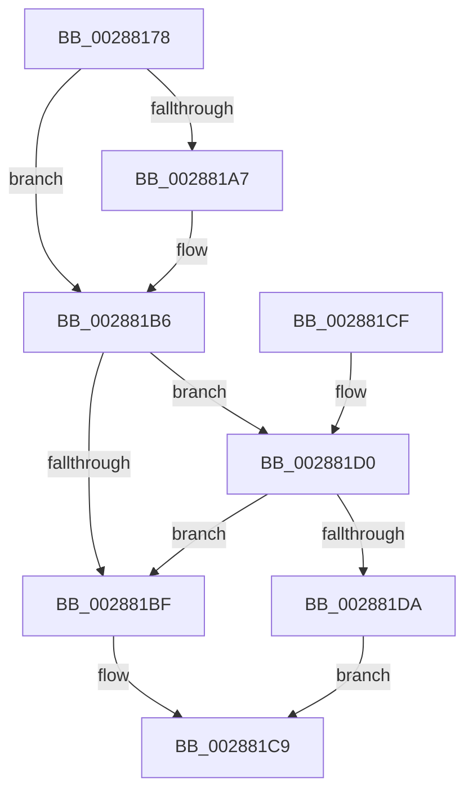

# MiRemoveDecayClusterTimer

- RVA: `0x00288178`–`0x002881ED` (길이 `117` bytes)
- VA: `0x0000000140288178`
- 실행 섹션: `.text`
- PDB 이름 있음: `예`; PDB Function 태그: `아니요`
- unwind 정보 RVA: `0x0006084C`
- 디코드: `29`개 명령, `117/117` bytes 표시
- 미해석 바이트: `0` (있으면 어셈블리에 `.byte`로 보존)

> 이 문서는 커널 이미지의 기계어와 PDB 기호를 분석해 생성했습니다. 4번과 5번은 함수 원형과 자료형을 바이너리 사용 방식에서 추정한 C 해석이며 원본 소스 복구 결과는 아닙니다.

## 1. Dependencies

- 직접 호출 지점: **3**; 고유 호출 대상: **3**
- 직접 호출자로 확인된 함수: **2**
- RIP 상대 이미지 참조: **4**

### Outgoing calls
- `0x0028818F` → [ExAcquireSpinLockExclusiveAtDpcLevel](../24/ExAcquireSpinLockExclusiveAtDpcLevel_function_00248E80.md) (function, `0x00248E80`)
- `0x002881B1` → [MiUnlinkDecayClusterTimer](../45/MiUnlinkDecayClusterTimer_function_00458384.md) (function, `0x00458384`)
- `0x002881E6` → [ExpReleaseSpinLockExclusiveFromDpcLevelInstrumented](../2C/ExpReleaseSpinLockExclusiveFromDpcLevelInstrumented_function_002C0F44.md) (function, `0x002C0F44`)

### Direct callers
- [sub_00287A62](Unknown_function_00287A62.md) at `0x00287ADA`
- [MiDecayNodeNowEmpty](../33/MiDecayNodeNowEmpty_function_0033C938.md) at `0x0033C971`

### Static image references
- `0x00288188` → RVA `0x00E35C20` (`.data`; read)
- `0x002881B6` → RVA `0x00FC6B06` (`ALMOSTRO`; read)
- `0x002881BF` → RVA `0x00E35C20` (`.data`; write)
- `0x002881D0` → RVA `0x00F0DE58` (`.data`; read)

## 2. Other-region calls and transfers

- 다른 실행 섹션으로 향하는 call: **0**
- 별도 외부 분기/꼬리 이동을 확인하지 못했습니다.

## 3. Assembly (complete function range)

```asm
00288178  40 53                           push rbx
0028817A  48 83 EC 20                     sub rsp, 0x20
0028817E  8B 41 20                        mov eax, dword ptr [rcx + 0x20]
00288181  48 8B D9                        mov rbx, rcx
00288184  48 8B 41 28                     mov rax, qword ptr [rcx + 0x28]
00288188  48 8D 0D 91 DA BA 00            lea rcx, [rip + 0xbada91]
0028818F  E8 EC 0C FC FF                  call 0x140248e80
00288194  48 8B 43 08                     mov rax, qword ptr [rbx + 8]
00288198  48 B9 00 00 00 00 01 00 00 00   movabs rcx, 0x100000000
002881A2  48 85 C1                        test rcx, rax
002881A5  75 0F                           jne 0x1402881b6
002881A7  48 0B C1                        or rax, rcx
002881AA  48 8B CB                        mov rcx, rbx
002881AD  48 89 43 08                     mov qword ptr [rbx + 8], rax
002881B1  E8 CE 01 1D 00                  call 0x140458384
002881B6  F6 05 49 E9 D3 00 01            test byte ptr [rip + 0xd3e949], 1
002881BD  75 11                           jne 0x1402881d0
002881BF  C7 05 57 DA BA 00 00 00 00 00   mov dword ptr [rip + 0xbada57], 0
002881C9  48 83 C4 20                     add rsp, 0x20
002881CD  5B                              pop rbx
002881CE  C3                              ret
002881CF  CC                              int3
002881D0  8B 05 82 5C C8 00               mov eax, dword ptr [rip + 0xc85c82]
002881D6  85 C0                           test eax, eax
002881D8  75 E5                           jne 0x1402881bf
002881DA  48 8B 54 24 28                  mov rdx, qword ptr [rsp + 0x28]
002881DF  48 8D 0D 3A DA BA 00            lea rcx, [rip + 0xbada3a]
002881E6  E8 59 8D 03 00                  call 0x1402c0f44
002881EB  EB DC                           jmp 0x1402881c9
```

## 4. C-style interpretation (structured pseudocode)

```c
__int64 __fastcall MiRemoveDecayClusterTimer(__int64 a1)
{
    __int64 result;
    __int64 v_rsp;
    unsigned __int64 v_stack_p28;

    v_rsp = (v_rsp) - (32);
    result = ExAcquireSpinLockExclusiveAtDpcLevel(v_rip + 12245649, a2, a3, a4);
    result = *(unsigned __int64 *)(a1 + 8);
    if (((v_rip + 12245649) & (*(unsigned __int64 *)(a1 + 8))) == 0) {
        result = (*(unsigned __int64 *)(a1 + 8)) | (v_rip + 12245649);
        a1 = a1;
        *(unsigned __int64 *)(a1 + 8) = result;
        result = MiUnlinkDecayClusterTimer(a1, a2, a3, a4);
    }
    if (((*(unsigned __int8 *)(v_rip + 13887817)) & (1)) != 0) goto loc_002881D0;
loc_002881BF:
    *(unsigned int *)(v_rip + 12245591) = 0;
loc_002881C9:
    v_rsp = (v_rsp) + (32);
    return result;
loc_002881D0:
    if ((unsigned int)((unsigned int)(*(unsigned int *)(v_rip + 13130882))) != 0) goto loc_002881BF;
    result = ExpReleaseSpinLockExclusiveFromDpcLevelInstrumented(v_rip + 12245562, v_stack_p28, a3, a4);
    goto loc_002881C9;
}
```

## 5. (Beta) C Style

```c
int64_t MiRemoveDecayClusterTimer(void *Arg1)
{
    uint8_t *arg1 = (uint8_t *)Arg1;

    int64_t result;
    int64_t local_rsp;
    uint64_t v_stack_p28;

    local_rsp = (local_rsp) - (32);
    result = ExAcquireSpinLockExclusiveAtDpcLevel(v_rip + 12245649, a2, a3, a4);
    result = *(uint64_t *)(arg1 + 0x8);
    if (((v_rip + 12245649) & (*(uint64_t *)(arg1 + 0x8))) == 0) {
        result = (*(uint64_t *)(arg1 + 0x8)) | (v_rip + 12245649);
        Arg1 = Arg1;
        *(uint64_t *)(arg1 + 0x8) = result;
        result = MiUnlinkDecayClusterTimer(Arg1, a2, a3, a4);
    }
    if (((*(uint8_t *)(v_rip + 0xD3E949)) & (1)) != 0) goto loc_002881D0;
loc_002881BF:
    *(uint32_t *)(v_rip + 0xBADA57) = 0;
loc_002881C9:
    local_rsp = (local_rsp) + (32);
    return result;
loc_002881D0:
    if ((uint32_t)((uint32_t)(*(uint32_t *)(v_rip + 0xC85C82))) != 0) goto loc_002881BF;
    result = ExpReleaseSpinLockExclusiveFromDpcLevelInstrumented(v_rip + 12245562, v_stack_p28, a3, a4);
    goto loc_002881C9;
}
```

### 관측된 메모리 오프셋

구조체 형식이 확인되지 않은 접근은 인자 기준의 오프셋으로만 기록했습니다.

| 기준 인자 | 오프셋 표현 | 폭 (bit) | 접근 |
|---|---:|---:|---|
| `Arg1` | `+ 0x8` | `64` | `R` |
| `Arg1` | `+ 0x8` | `64` | `W` |
| `Arg1` | `+ 0x20` | `32` | `R` |
| `Arg1` | `+ 0x28` | `64` | `R` |

## 6. Execution-region graph

[열기: 2D/3D 그래프와 함수 탐색 컨트롤 패널](../../../control-panel.html?section=text&rva=0x00288178&view=graph)

- 2D 그래프는 위에서 아래로 흐르고, 3D 그래프는 빈 공간을 드래그해 회전합니다. Shift+드래그는 이동, 휠은 확대·축소, 함수 노드 선택은 대상 보고서 이동입니다.

### Static fallback


