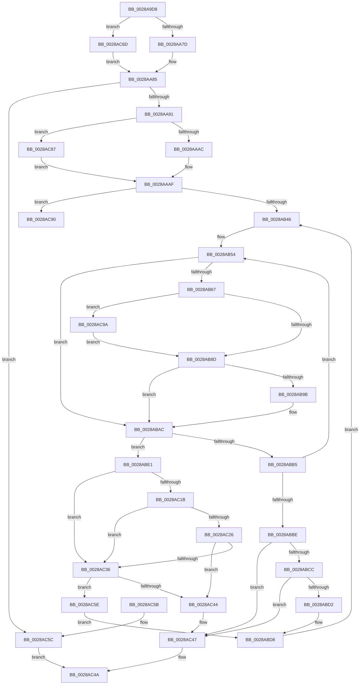

# MiRemovePageAnyColor

- RVA: `0x0028A9D8`–`0x0028ACA8` (길이 `720` bytes)
- VA: `0x000000014028A9D8`
- 실행 섹션: `.text`
- PDB 이름 있음: `예`; PDB Function 태그: `예`
- unwind 정보 RVA: `0x00066ED4`
- 디코드: `207`개 명령, `720/720` bytes 표시
- 미해석 바이트: `0` (있으면 어셈블리에 `.byte`로 보존)

> 이 문서는 커널 이미지의 기계어와 PDB 기호를 분석해 생성했습니다. 4번과 5번은 함수 원형과 자료형을 바이너리 사용 방식에서 추정한 C 해석이며 원본 소스 복구 결과는 아닙니다.

## 1. Dependencies

- 직접 호출 지점: **3**; 고유 호출 대상: **3**
- 직접 호출자로 확인된 함수: **2**
- RIP 상대 이미지 참조: **4**

### Outgoing calls
- `0x0028AC1D` → [MiColorHasSlists](MiColorHasSlists_function_0028B1D0.md) (function, `0x0028B1D0`)
- `0x0028AC2C` → [MiSlistGetFreePage](MiSlistGetFreePage_function_0028A170.md) (function, `0x0028A170`)
- `0x0028AC3A` → [MiGetPerfectColorHeadPage](MiGetPerfectColorHeadPage_function_00289CA8.md) (function, `0x00289CA8`)

### Direct callers
- [MiGetPage](MiGetPage_function_002884C0.md) at `0x00288A3A`
- [MiGetPage](MiGetPage_function_002884C0.md) at `0x00288A81`
- [MiGetPage](MiGetPage_function_002884C0.md) at `0x002893BE`
- [MiGetFreeOrZeroPageAnyColor](../43/MiGetFreeOrZeroPageAnyColor_function_004352D8.md) at `0x00435342`
- [MiGetFreeOrZeroPageAnyColor](../43/MiGetFreeOrZeroPageAnyColor_function_004352D8.md) at `0x0043537B`

### Static image references
- `0x0028A9F4` → RVA `0x00010860` (`.rdata`; read)
- `0x0028AA10` → RVA `0x00011038` (`.rdata`; read)
- `0x0028AA70` → RVA `0x00FC5002` (`ALMOSTRO`; read)
- `0x0028AB15` → RVA `0x00E2CB40` (`.data`; read)

## 2. Other-region calls and transfers

- 다른 실행 섹션으로 향하는 call: **0**
- call이 아닌 외부 분기/꼬리 이동: **1**
  - `0x0028AC95` → [sub_006DA3C8](../6D/Unknown_function_006DA3C8.md) (`tail-transfer`)

## 3. Assembly (complete function range)

```asm
0028A9D8  44 89 4C 24 20                  mov dword ptr [rsp + 0x20], r9d
0028A9DD  55                              push rbp
0028A9DE  53                              push rbx
0028A9DF  56                              push rsi
0028A9E0  57                              push rdi
0028A9E1  41 54                           push r12
0028A9E3  41 55                           push r13
0028A9E5  41 56                           push r14
0028A9E7  41 57                           push r15
0028A9E9  48 8B EC                        mov rbp, rsp
0028A9EC  48 83 EC 68                     sub rsp, 0x68
0028A9F0  4C 8B 51 10                     mov r10, qword ptr [rcx + 0x10]
0028A9F4  48 8D 05 65 5E D8 FF            lea rax, [rip - 0x27a19b]
0028A9FB  33 F6                           xor esi, esi
0028A9FD  8B DA                           mov ebx, edx
0028A9FF  41 8B F8                        mov edi, r8d
0028AA02  89 75 E4                        mov dword ptr [rbp - 0x1c], esi
0028AA05  44 8B C2                        mov r8d, edx
0028AA08  48 89 75 E8                     mov qword ptr [rbp - 0x18], rsi
0028AA0C  41 C1 E8 10                     shr r8d, 0x10
0028AA10  48 8D 0D 21 66 D8 FF            lea rcx, [rip - 0x2799df]
0028AA17  41 83 E0 03                     and r8d, 3
0028AA1B  44 8B E2                        mov r12d, edx
0028AA1E  44 8B FA                        mov r15d, edx
0028AA21  45 8B E8                        mov r13d, r8d
0028AA24  41 C1 EF 0F                     shr r15d, 0xf
0028AA28  45 8B F1                        mov r14d, r9d
0028AA2B  41 83 E7 01                     and r15d, 1
0028AA2F  44 8B CA                        mov r9d, edx
0028AA32  0F BA E7 04                     bt edi, 4
0028AA36  4E 8D 1C 85 00 00 00 00         lea r11, [r8*4]
0028AA3E  48 0F 43 C1                     cmovae rax, rcx
0028AA42  4D 03 DD                        add r11, r13
0028AA45  48 89 45 D0                     mov qword ptr [rbp - 0x30], rax
0028AA49  49 C1 E3 08                     shl r11, 8
0028AA4D  8B C2                           mov eax, edx
0028AA4F  48 C1 E8 09                     shr rax, 9
0028AA53  83 E0 3F                        and eax, 0x3f
0028AA56  48 69 C8 80 DF 00 00            imul rcx, rax, 0xdf80
0028AA5D  4C 03 D1                        add r10, rcx
0028AA60  8B CE                           mov ecx, esi
0028AA62  4D 03 DA                        add r11, r10
0028AA65  0F BA E7 04                     bt edi, 4
0028AA69  0F 93 C1                        setae cl
0028AA6C  41 C1 E9 08                     shr r9d, 8
0028AA70  80 3D 8B A5 D3 00 01            cmp byte ptr [rip + 0xd3a58b], 1
0028AA77  0F 87 F0 01 00 00               ja 0x14028ac6d
0028AA7D  48 8D 41 01                     lea rax, [rcx + 1]
0028AA81  49 8D 04 C3                     lea rax, [r11 + rax*8]
0028AA85  48 8B 00                        mov rax, qword ptr [rax]
0028AA88  48 85 C0                        test rax, rax
0028AA8B  0F 84 CB 01 00 00               je 0x14028ac5c
0028AA91  80 3D 6A A5 D3 00 01            cmp byte ptr [rip + 0xd3a56a], 1
0028AA98  4C 89 55 C0                     mov qword ptr [rbp - 0x40], r10
0028AA9C  44 89 75 D8                     mov dword ptr [rbp - 0x28], r14d
0028AAA0  89 7D E0                        mov dword ptr [rbp - 0x20], edi
0028AAA3  89 5D DC                        mov dword ptr [rbp - 0x24], ebx
0028AAA6  0F 87 DB 01 00 00               ja 0x14028ac87
0028AAAC  4C 8B CE                        mov r9, rsi
0028AAAF  48 8B 45 D0                     mov rax, qword ptr [rbp - 0x30]
0028AAB3  4C 8B F6                        mov r14, rsi
0028AAB6  89 75 50                        mov dword ptr [rbp + 0x50], esi
0028AAB9  48 89 75 48                     mov qword ptr [rbp + 0x48], rsi
0028AABD  48 63 10                        movsxd rdx, dword ptr [rax]
0028AAC0  4A 8D 04 85 00 00 00 00         lea rax, [r8*4]
0028AAC8  49 03 C5                        add rax, r13
0028AACB  49 8D 0C 47                     lea rcx, [r15 + rax*2]
0028AACF  48 8D 04 4A                     lea rax, [rdx + rcx*2]
0028AAD3  49 8D 0C 41                     lea rcx, [r9 + rax*2]
0028AAD7  8B C3                           mov eax, ebx
0028AAD9  48 C1 E8 12                     shr rax, 0x12
0028AADD  83 E0 03                        and eax, 3
0028AAE0  48 8D 04 88                     lea rax, [rax + rcx*4]
0028AAE4  49 8B 8C C2 E0 03 00 00         mov rcx, qword ptr [r10 + rax*8 + 0x3e0]
0028AAEC  49 8B C4                        mov rax, r12
0028AAEF  48 C1 E8 12                     shr rax, 0x12
0028AAF3  4C 8B D6                        mov r10, rsi
0028AAF6  83 E0 03                        and eax, 3
0028AAF9  49 C1 EC 10                     shr r12, 0x10
0028AAFD  48 89 4D C8                     mov qword ptr [rbp - 0x38], rcx
0028AB01  41 83 E4 03                     and r12d, 3
0028AB05  4A 8D 04 B8                     lea rax, [rax + r15*4]
0028AB09  48 8D 40 04                     lea rax, [rax + 4]
0028AB0D  48 8D 0C 42                     lea rcx, [rdx + rax*2]
0028AB11  48 C1 E1 04                     shl rcx, 4
0028AB15  48 8D 05 24 20 BA 00            lea rax, [rip + 0xba2024]
0028AB1C  42 8B 94 A0 80 11 00 00         mov edx, dword ptr [rax + r12*4 + 0x1180]
0028AB24  49 03 CB                        add rcx, r11
0028AB27  0F B6 C3                        movzx eax, bl
0028AB2A  44 8B EA                        mov r13d, edx
0028AB2D  48 89 4D B8                     mov qword ptr [rbp - 0x48], rcx
0028AB31  44 8B F8                        mov r15d, eax
0028AB34  89 55 58                        mov dword ptr [rbp + 0x58], edx
0028AB37  4C 8B E6                        mov r12, rsi
0028AB3A  89 45 50                        mov dword ptr [rbp + 0x50], eax
0028AB3D  83 E7 40                        and edi, 0x40
0028AB40  0F 85 4A 01 00 00               jne 0x14028ac90
0028AB46  4C 8B 59 08                     mov r11, qword ptr [rcx + 8]
0028AB4A  45 8B C5                        mov r8d, r13d
0028AB4D  41 83 E0 3F                     and r8d, 0x3f
0028AB51  45 8B CD                        mov r9d, r13d
0028AB54  41 8B C7                        mov eax, r15d
0028AB57  48 C1 E8 06                     shr rax, 6
0028AB5B  41 8B D7                        mov edx, r15d
0028AB5E  49 8D 0C C3                     lea rcx, [r11 + rax*8]
0028AB62  4C 3B D1                        cmp r10, rcx
0028AB65  74 45                           je 0x14028abac
0028AB67  4C 8B D1                        mov r10, rcx
0028AB6A  48 89 4D 48                     mov qword ptr [rbp + 0x48], rcx
0028AB6E  8A CA                           mov cl, dl
0028AB70  41 BE 01 00 00 00               mov r14d, 1
0028AB76  80 E1 3F                        and cl, 0x3f
0028AB79  49 D3 E6                        shl r14, cl
0028AB7C  49 FF CE                        dec r14
0028AB7F  49 F7 D6                        not r14
0028AB82  4D 23 32                        and r14, qword ptr [r10]
0028AB85  85 FF                           test edi, edi
0028AB87  0F 85 0D 01 00 00               jne 0x14028ac9a
0028AB8D  49 8B C1                        mov rax, r9
0028AB90  48 33 C2                        xor rax, rdx
0028AB93  48 A9 C0 FF FF FF               test rax, -0x40
0028AB99  75 11                           jne 0x14028abac
0028AB9B  49 8B C8                        mov rcx, r8
0028AB9E  B8 01 00 00 00                  mov eax, 1
0028ABA3  48 D3 E0                        shl rax, cl
0028ABA6  48 FF C8                        dec rax
0028ABA9  4C 23 F0                        and r14, rax
0028ABAC  41 83 E7 C0                     and r15d, 0xffffffc0
0028ABB0  4D 85 F6                        test r14, r14
0028ABB3  75 2C                           jne 0x14028abe1
0028ABB5  41 83 C7 40                     add r15d, 0x40
0028ABB9  45 3B FD                        cmp r15d, r13d
0028ABBC  72 96                           jb 0x14028ab54
0028ABBE  8B 45 50                        mov eax, dword ptr [rbp + 0x50]
0028ABC1  4C 8B D6                        mov r10, rsi
0028ABC4  48 89 75 48                     mov qword ptr [rbp + 0x48], rsi
0028ABC8  85 C0                           test eax, eax
0028ABCA  74 7B                           je 0x14028ac47
0028ABCC  44 3B 6D 58                     cmp r13d, dword ptr [rbp + 0x58]
0028ABD0  75 75                           jne 0x14028ac47
0028ABD2  44 8B E8                        mov r13d, eax
0028ABD5  44 8B FE                        mov r15d, esi
0028ABD8  48 8B 4D B8                     mov rcx, qword ptr [rbp - 0x48]
0028ABDC  E9 65 FF FF FF                  jmp 0x14028ab46
0028ABE1  4D 0F BC C6                     bsf r8, r14
0028ABE5  33 D2                           xor edx, edx
0028ABE7  4C 8D 0D 52 1F BA 00            lea r9, [rip + 0xba1f52]
0028ABEE  8B CB                           mov ecx, ebx
0028ABF0  45 03 F8                        add r15d, r8d
0028ABF3  48 C1 E9 10                     shr rcx, 0x10
0028ABF7  41 8B C7                        mov eax, r15d
0028ABFA  83 E1 03                        and ecx, 3
0028ABFD  41 F7 B4 89 80 11 00 00         div dword ptr [r9 + rcx*4 + 0x1180]
0028AC05  33 D3                           xor edx, ebx
0028AC07  0F B6 C2                        movzx eax, dl
0028AC0A  33 D8                           xor ebx, eax
0028AC0C  41 8B C0                        mov eax, r8d
0028AC0F  49 0F B3 C6                     btr r14, rax
0028AC13  89 5D DC                        mov dword ptr [rbp - 0x24], ebx
0028AC16  39 75 60                        cmp dword ptr [rbp + 0x60], esi
0028AC19  75 1B                           jne 0x14028ac36
0028AC1B  8B CB                           mov ecx, ebx
0028AC1D  E8 AE 05 00 00                  call 0x14028b1d0
0028AC22  85 C0                           test eax, eax
0028AC24  74 10                           je 0x14028ac36
0028AC26  33 D2                           xor edx, edx
0028AC28  48 8D 4D C0                     lea rcx, [rbp - 0x40]
0028AC2C  E8 3F F5 FF FF                  call 0x14028a170
0028AC31  48 85 C0                        test rax, rax
0028AC34  75 0E                           jne 0x14028ac44
0028AC36  48 8D 4D C0                     lea rcx, [rbp - 0x40]
0028AC3A  E8 69 F0 FF FF                  call 0x140289ca8
0028AC3F  48 85 C0                        test rax, rax
0028AC42  74 1A                           je 0x14028ac5e
0028AC44  48 8B F0                        mov rsi, rax
0028AC47  48 8B C6                        mov rax, rsi
0028AC4A  48 83 C4 68                     add rsp, 0x68
0028AC4E  41 5F                           pop r15
0028AC50  41 5E                           pop r14
0028AC52  41 5D                           pop r13
0028AC54  41 5C                           pop r12
0028AC56  5F                              pop rdi
0028AC57  5E                              pop rsi
0028AC58  5B                              pop rbx
0028AC59  5D                              pop rbp
0028AC5A  C3                              ret
0028AC5B  CC                              int3
0028AC5C  EB EC                           jmp 0x14028ac4a
0028AC5E  8B 45 D8                        mov eax, dword ptr [rbp - 0x28]
0028AC61  4C 8B 55 48                     mov r10, qword ptr [rbp + 0x48]
0028AC65  89 45 60                        mov dword ptr [rbp + 0x60], eax
0028AC68  E9 6B FF FF FF                  jmp 0x14028abd8
0028AC6D  41 0F B6 C1                     movzx eax, r9b
0028AC71  83 E0 01                        and eax, 1
0028AC74  48 05 B3 03 00 00               add rax, 0x3b3
0028AC7A  48 8D 04 41                     lea rax, [rcx + rax*2]
0028AC7E  49 8D 04 C2                     lea rax, [r10 + rax*8]
0028AC82  E9 FE FD FF FF                  jmp 0x14028aa85
0028AC87  41 83 E1 01                     and r9d, 1
0028AC8B  E9 1F FE FF FF                  jmp 0x14028aaaf
0028AC90  8B CB                           mov ecx, ebx
0028AC92  83 E1 0F                        and ecx, 0xf
0028AC95  E9 2E F7 44 00                  jmp 0x1406da3c8
0028AC9A  49 8B C4                        mov rax, r12
0028AC9D  48 F7 D0                        not rax
0028ACA0  4C 23 F0                        and r14, rax
0028ACA3  E9 E5 FE FF FF                  jmp 0x14028ab8d
```

## 4. C-style interpretation (structured pseudocode)

```c
__int64 __fastcall MiRemovePageAnyColor(__int64 a1, int a2, int a3, int a4)
{
    __int64 result;
    __int64 v_r10;
    __int64 v_r11;
    __int64 v_r12;
    __int64 v_r14;
    __int64 v_r15;
    __int64 v_rbx;
    __int64 v_rdi;
    __int64 v_rsi;
    __int64 v_rsp;
    unsigned __int64 v_stack_m58;
    unsigned int v_stack_m5C;
    unsigned int v_stack_m60;
    unsigned int v_stack_m64;
    unsigned int v_stack_m68;
    unsigned __int64 v_stack_m70;
    unsigned __int64 v_stack_m78;
    unsigned __int64 v_stack_m80;
    unsigned __int64 v_stack_m88;
    unsigned int v_stack_p10;
    unsigned int v_stack_p18;
    unsigned int v_stack_p20;
    unsigned __int64 v_stack_p8;

    v_stack_p20 = a4;
    v_rsp = (v_rsp) - (104);
    v_rsi = 0;
    v_stack_m5C = 0;
    v_stack_m58 = 0;
    a3 = (unsigned int)(((unsigned int)(a2)) >> (16));
    a3 = (unsigned int)((a3) & (3));
    v_r15 = (unsigned int)(((unsigned int)(a2)) >> (15));
    v_r15 = (unsigned int)((v_r15) & (1));
    result = v_rip - 2597275;
    if (condition_is_above_or_equal) { result = v_rip - 2595295; }
    v_r11 = (a3 * 4) + ((unsigned int)(a3));
    v_stack_m70 = result;
    v_r11 = (v_r11) << (8);
    result = ((unsigned int)(a2)) >> (9);
    result = (unsigned int)((result) & (63));
    a1 = (v_rip - 2595295) * (result);
    v_r10 = (*(unsigned __int64 *)(a1 + 16)) + (a1);
    v_r11 = (v_r11) + (v_r10);
    a1 = (condition_is_above_or_equal) ? 1 : 0;
    a4 = (unsigned int)(((unsigned int)(a2)) >> (8));
    if ((*(unsigned __int8 *)(v_rip + 13870475)) > 1) goto loc_0028AC6D;
loc_0028AA85:
    if (*(unsigned __int64 *)(v_r11 + a1 + 1 * 8) == 0) goto loc_0028AC5C;
    v_stack_m80 = v_r10;
    v_stack_m68 = (unsigned int)((unsigned int)(a4));
    v_stack_m60 = (unsigned int)((unsigned int)(a3));
    v_stack_m64 = (unsigned int)((unsigned int)(a2));
    if ((*(unsigned __int8 *)(v_rip + 13870442)) > 1) goto loc_0028AC87;
loc_0028AAAF:
    v_stack_p10 = 0;
    v_stack_p8 = 0;
    result = (a3 * 4) + ((unsigned int)(a3));
    result = ((unsigned int)((unsigned int)((unsigned int)(a2)))) >> (18);
    result = (unsigned int)((result) & (3));
    result = ((unsigned int)(a2)) >> (18);
    result = (unsigned int)((result) & (3));
    v_r12 = ((unsigned int)(a2)) >> (16);
    v_stack_m78 = *(unsigned __int64 *)(v_r10 + result + 0 + (int)(*(unsigned int *)(v_stack_m70)) + v_r15 + result * 2 * 2 * 2 * 4 * 8 + 992);
    v_r12 = (unsigned int)((v_r12) & (3));
    a1 = ((int)(*(unsigned int *)(v_stack_m70)) + result + v_r15 * 4 + 4 * 2) << (4);
    a1 = (a1) + (v_r11);
    v_stack_m88 = a1;
    v_stack_p18 = (unsigned int)((unsigned int)(*(unsigned int *)(v_rip + 12197924 + v_r12 * 4 + 4480)));
    v_stack_p10 = (unsigned int)((unsigned __int8)((unsigned int)(a2)));
    v_rdi = (unsigned int)(((unsigned int)(a3)) & (64));
    if (condition_is_not_equal) goto loc_0028AC90;
loc_0028AB46:
    a3 = (unsigned int)(((unsigned int)((unsigned int)((unsigned int)((unsigned int)((unsigned int)(*(unsigned int *)(v_rip + 12197924 + v_r12 * 4 + 4480))))))) & (63));
loc_0028AB54:
    result = ((unsigned int)((unsigned int)((unsigned int)((unsigned int)((unsigned __int8)((unsigned int)(a2))))))) >> (6);
    if (0 == (*(unsigned __int64 *)(a1 + 8) + result * 8)) goto loc_0028ABAC;
    v_stack_p8 = *(unsigned __int64 *)(a1 + 8) + result * 8;
    a1 = (unsigned __int8)(((unsigned __int8)((unsigned int)((unsigned int)((unsigned int)((unsigned int)((unsigned __int8)((unsigned int)(a2)))))))) & (63));
    v_r14 = (1) << ((unsigned __int8)(a1));
    v_r14 = (v_r14) - 1;
    v_r14 = ~(v_r14);
    v_r14 = (v_r14) & (*(unsigned __int64 *)(*(unsigned __int64 *)(a1 + 8) + result * 8));
    if ((unsigned int)(v_rdi) != 0) goto loc_0028AC9A;
loc_0028AB8D:
    result = ((unsigned int)((unsigned int)((unsigned int)((unsigned int)((unsigned int)(*(unsigned int *)(v_rip + 12197924 + v_r12 * 4 + 4480))))))) ^ ((unsigned int)((unsigned int)((unsigned int)((unsigned int)((unsigned __int8)((unsigned int)(a2)))))));
    if (((result) & (-64)) == 0) {
        a1 = a3;
        result = 1;
        result = (result) << ((unsigned __int8)(a1));
        result = (result) - 1;
        v_r14 = (v_r14) & (result);
    }
    v_r15 = (unsigned int)(((unsigned int)((unsigned int)((unsigned __int8)((unsigned int)(a2))))) & (0xFFFFFFC0ULL));
    if (v_r14 != 0) goto loc_0028ABE1;
    v_r15 = (unsigned int)((v_r15) + (64));
    if (((unsigned int)(v_r15)) < ((unsigned int)((unsigned int)((unsigned int)((unsigned int)(*(unsigned int *)(v_rip + 12197924 + v_r12 * 4 + 4480))))))) goto loc_0028AB54;
    v_stack_p8 = 0;
    if ((unsigned int)((unsigned int)(v_stack_p10)) == 0) goto loc_0028AC47;
    if (((unsigned int)((unsigned int)((unsigned int)((unsigned int)(*(unsigned int *)(v_rip + 12197924 + v_r12 * 4 + 4480)))))) != v_stack_p18) goto loc_0028AC47;
loc_0028ABD8:
    goto loc_0028AB46;
loc_0028ABE1:
    a2 = 0;
    v_r15 = (unsigned int)((0) + (a3));
    a1 = ((unsigned int)((unsigned int)((unsigned int)(a2)))) >> (16);
    a1 = (unsigned int)((a1) & (3));
    a2 = (unsigned int)((a2) ^ ((unsigned int)((unsigned int)(a2))));
    v_rbx = (unsigned int)(((unsigned int)(a2)) ^ ((unsigned int)((unsigned __int8)(a2))));
    v_stack_m64 = (unsigned int)(v_rbx);
    if (v_stack_p20 != 0) goto loc_0028AC36;
    result = MiColorHasSlists((unsigned int)((unsigned int)(v_rbx)), a2, a3, v_rip + 12197714);
    if ((unsigned int)(result) == 0) goto loc_0028AC36;
    a2 = 0;
    result = MiSlistGetFreePage(v_stack_m80, a2, a3, v_rip + 12197714);
    if (result != 0) goto loc_0028AC44;
loc_0028AC36:
    result = MiGetPerfectColorHeadPage(v_stack_m80, a2, a3, v_rip + 12197714);
    if (result == 0) goto loc_0028AC5E;
loc_0028AC44:
loc_0028AC47:
loc_0028AC4A:
    v_rsp = (v_rsp) + (104);
    return result;
loc_0028AC5C:
    goto loc_0028AC4A;
loc_0028AC5E:
    v_stack_p20 = (unsigned int)((unsigned int)(v_stack_m68));
    goto loc_0028ABD8;
loc_0028AC6D:
    result = (unsigned int)(((unsigned __int8)(v_rip + 12197714)) & (1));
    result = (result) + (947);
    goto loc_0028AA85;
loc_0028AC87:
    a4 = (unsigned int)((v_rip + 12197714) & (1));
    goto loc_0028AAAF;
loc_0028AC90:
    a1 = (unsigned int)(((unsigned int)((unsigned int)(v_rbx))) & (15));
loc_0028AC9A:
    result = ~(0);
    v_r14 = (v_r14) & (result);
    goto loc_0028AB8D;
}
```

## 5. (Beta) C Style

```c
int64_t MiRemovePageAnyColor(void *Arg1, int32_t Arg2, int32_t Arg3, int32_t Arg4)
{
    uint8_t *arg1 = (uint8_t *)Arg1;

    int64_t result;
    int64_t local_r10;
    int64_t local_r11;
    int64_t local_r12;
    int64_t local_r14;
    int64_t local_r15;
    int64_t local_rbx;
    int64_t local_rdi;
    int64_t local_rsi;
    int64_t local_rsp;
    uint64_t v_stack_m58;
    uint32_t v_stack_m5C;
    uint32_t v_stack_m60;
    uint32_t v_stack_m64;
    uint32_t v_stack_m68;
    uint64_t v_stack_m70;
    uint64_t v_stack_m78;
    uint64_t v_stack_m80;
    uint64_t v_stack_m88;
    uint32_t v_stack_p10;
    uint32_t v_stack_p18;
    uint32_t v_stack_p20;
    uint64_t v_stack_p8;

    v_stack_p20 = Arg4;
    local_rsp = (local_rsp) - (104);
    local_rsi = 0;
    v_stack_m5C = 0;
    v_stack_m58 = 0;
    Arg3 = (uint32_t)(((uint32_t)(Arg2)) >> (16));
    Arg3 = (uint32_t)((Arg3) & (3));
    local_r15 = (uint32_t)(((uint32_t)(Arg2)) >> (15));
    local_r15 = (uint32_t)((local_r15) & (1));
    result = v_rip - 2597275;
    if (condition_is_above_or_equal) { result = v_rip - 2595295; }
    local_r11 = (Arg3 * 4) + ((uint32_t)(Arg3));
    v_stack_m70 = result;
    local_r11 = (local_r11) << (8);
    result = ((uint32_t)(Arg2)) >> (9);
    result = (uint32_t)((result) & (63));
    Arg1 = (v_rip - 2595295) * (result);
    local_r10 = (*(uint64_t *)(arg1 + 0x10)) + (Arg1);
    local_r11 = (local_r11) + (local_r10);
    Arg1 = (condition_is_above_or_equal) ? 1 : 0;
    Arg4 = (uint32_t)(((uint32_t)(Arg2)) >> (8));
    if ((*(uint8_t *)(v_rip + 0xD3A58B)) > 1) goto loc_0028AC6D;
loc_0028AA85:
    if (*(uint64_t *)(local_r11 + arg1 + 0x1 * 8) == 0) goto loc_0028AC5C;
    v_stack_m80 = local_r10;
    v_stack_m68 = (uint32_t)((uint32_t)(Arg4));
    v_stack_m60 = (uint32_t)((uint32_t)(Arg3));
    v_stack_m64 = (uint32_t)((uint32_t)(Arg2));
    if ((*(uint8_t *)(v_rip + 0xD3A56A)) > 1) goto loc_0028AC87;
loc_0028AAAF:
    v_stack_p10 = 0;
    v_stack_p8 = 0;
    result = (Arg3 * 4) + ((uint32_t)(Arg3));
    result = ((uint32_t)((uint32_t)((uint32_t)(Arg2)))) >> (18);
    result = (uint32_t)((result) & (3));
    result = ((uint32_t)(Arg2)) >> (18);
    result = (uint32_t)((result) & (3));
    local_r12 = ((uint32_t)(Arg2)) >> (16);
    v_stack_m78 = *(uint64_t *)(local_r10 + result + 0x0 + (int32_t)(*(uint32_t *)(v_stack_m70)) + local_r15 + result * 2 * 2 * 2 * 4 * 8 + 0x3E0);
    local_r12 = (uint32_t)((local_r12) & (3));
    Arg1 = ((int32_t)(*(uint32_t *)(v_stack_m70)) + result + local_r15 * 4 + 4 * 2) << (4);
    Arg1 = (Arg1) + (local_r11);
    v_stack_m88 = Arg1;
    v_stack_p18 = (uint32_t)((uint32_t)(*(uint32_t *)(v_rip + 0xBA2024 + local_r12 * 4 + 0x1180)));
    v_stack_p10 = (uint32_t)((uint8_t)((uint32_t)(Arg2)));
    local_rdi = (uint32_t)(((uint32_t)(Arg3)) & (64));
    if (condition_is_not_equal) goto loc_0028AC90;
loc_0028AB46:
    Arg3 = (uint32_t)(((uint32_t)((uint32_t)((uint32_t)((uint32_t)((uint32_t)(*(uint32_t *)(v_rip + 0xBA2024 + local_r12 * 4 + 0x1180))))))) & (63));
loc_0028AB54:
    result = ((uint32_t)((uint32_t)((uint32_t)((uint32_t)((uint8_t)((uint32_t)(Arg2))))))) >> (6);
    if (0 == (*(uint64_t *)(arg1 + 0x8) + result * 8)) goto loc_0028ABAC;
    v_stack_p8 = *(uint64_t *)(arg1 + 0x8) + result * 8;
    Arg1 = (uint8_t)(((uint8_t)((uint32_t)((uint32_t)((uint32_t)((uint32_t)((uint8_t)((uint32_t)(Arg2)))))))) & (63));
    local_r14 = (1) << ((uint8_t)(Arg1));
    local_r14 = (local_r14) - 1;
    local_r14 = ~(local_r14);
    local_r14 = (local_r14) & (*(uint64_t *)(*(uint64_t *)(arg1 + 0x8) + result * 8));
    if ((uint32_t)(local_rdi) != 0) goto loc_0028AC9A;
loc_0028AB8D:
    result = ((uint32_t)((uint32_t)((uint32_t)((uint32_t)((uint32_t)(*(uint32_t *)(v_rip + 0xBA2024 + local_r12 * 4 + 0x1180))))))) ^ ((uint32_t)((uint32_t)((uint32_t)((uint32_t)((uint8_t)((uint32_t)(Arg2)))))));
    if (((result) & (-64)) == 0) {
        Arg1 = Arg3;
        result = 1;
        result = (result) << ((uint8_t)(Arg1));
        result = (result) - 1;
        local_r14 = (local_r14) & (result);
    }
    local_r15 = (uint32_t)(((uint32_t)((uint32_t)((uint8_t)((uint32_t)(Arg2))))) & (0xFFFFFFC0ULL));
    if (local_r14 != 0) goto loc_0028ABE1;
    local_r15 = (uint32_t)((local_r15) + (64));
    if (((uint32_t)(local_r15)) < ((uint32_t)((uint32_t)((uint32_t)((uint32_t)(*(uint32_t *)(v_rip + 0xBA2024 + local_r12 * 4 + 0x1180))))))) goto loc_0028AB54;
    v_stack_p8 = 0;
    if ((uint32_t)((uint32_t)(v_stack_p10)) == 0) goto loc_0028AC47;
    if (((uint32_t)((uint32_t)((uint32_t)((uint32_t)(*(uint32_t *)(v_rip + 0xBA2024 + local_r12 * 4 + 0x1180)))))) != v_stack_p18) goto loc_0028AC47;
loc_0028ABD8:
    goto loc_0028AB46;
loc_0028ABE1:
    Arg2 = 0;
    local_r15 = (uint32_t)((0) + (Arg3));
    Arg1 = ((uint32_t)((uint32_t)((uint32_t)(Arg2)))) >> (16);
    Arg1 = (uint32_t)((Arg1) & (3));
    Arg2 = (uint32_t)((Arg2) ^ ((uint32_t)((uint32_t)(Arg2))));
    local_rbx = (uint32_t)(((uint32_t)(Arg2)) ^ ((uint32_t)((uint8_t)(Arg2))));
    v_stack_m64 = (uint32_t)(local_rbx);
    if (v_stack_p20 != 0) goto loc_0028AC36;
    result = MiColorHasSlists((uint32_t)((uint32_t)(local_rbx)), Arg2, Arg3, v_rip + 12197714);
    if ((uint32_t)(result) == 0) goto loc_0028AC36;
    Arg2 = 0;
    result = MiSlistGetFreePage(v_stack_m80, Arg2, Arg3, v_rip + 12197714);
    if (result != 0) goto loc_0028AC44;
loc_0028AC36:
    result = MiGetPerfectColorHeadPage(v_stack_m80, Arg2, Arg3, v_rip + 12197714);
    if (result == 0) goto loc_0028AC5E;
loc_0028AC44:
loc_0028AC47:
loc_0028AC4A:
    local_rsp = (local_rsp) + (104);
    return result;
loc_0028AC5C:
    goto loc_0028AC4A;
loc_0028AC5E:
    v_stack_p20 = (uint32_t)((uint32_t)(v_stack_m68));
    goto loc_0028ABD8;
loc_0028AC6D:
    result = (uint32_t)(((uint8_t)(v_rip + 12197714)) & (1));
    result = (result) + (947);
    goto loc_0028AA85;
loc_0028AC87:
    Arg4 = (uint32_t)((v_rip + 12197714) & (1));
    goto loc_0028AAAF;
loc_0028AC90:
    Arg1 = (uint32_t)(((uint32_t)((uint32_t)(local_rbx))) & (15));
loc_0028AC9A:
    result = ~(0);
    local_r14 = (local_r14) & (result);
    goto loc_0028AB8D;
}
```

### 관측된 메모리 오프셋

구조체 형식이 확인되지 않은 접근은 인자 기준의 오프셋으로만 기록했습니다.

| 기준 인자 | 오프셋 표현 | 폭 (bit) | 접근 |
|---|---:|---:|---|
| `Arg1` | `+ 0x10` | `64` | `R` |

## 6. Execution-region graph

[열기: 2D/3D 그래프와 함수 탐색 컨트롤 패널](../../../control-panel.html?section=text&rva=0x0028A9D8&view=graph)

- 2D 그래프는 위에서 아래로 흐르고, 3D 그래프는 빈 공간을 드래그해 회전합니다. Shift+드래그는 이동, 휠은 확대·축소, 함수 노드 선택은 대상 보고서 이동입니다.

### Static fallback


