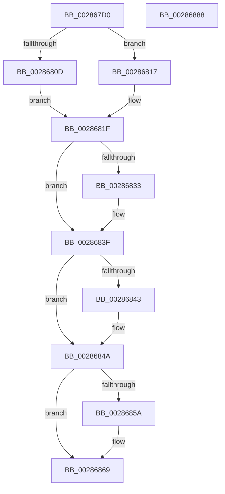

# MiReturnCrossPartitionCharges

- RVA: `0x002867D0`–`0x00286889` (길이 `185` bytes)
- VA: `0x00000001402867D0`
- 실행 섹션: `.text`
- PDB 이름 있음: `예`; PDB Function 태그: `아니요`
- unwind 정보 RVA: `0x0005FEF8`
- 디코드: `55`개 명령, `185/185` bytes 표시
- 미해석 바이트: `0` (있으면 어셈블리에 `.byte`로 보존)

> 이 문서는 커널 이미지의 기계어와 PDB 기호를 분석해 생성했습니다. 4번과 5번은 함수 원형과 자료형을 바이너리 사용 방식에서 추정한 C 해석이며 원본 소스 복구 결과는 아닙니다.

## 1. Dependencies

- 직접 호출 지점: **6**; 고유 호출 대상: **5**
- 직접 호출자로 확인된 함수: **13**
- RIP 상대 이미지 참조: **0**

### Outgoing calls
- `0x00286810` → [ExAcquireSpinLockExclusiveAtDpcLevel](../24/ExAcquireSpinLockExclusiveAtDpcLevel_function_00248E80.md) (function, `0x00248E80`)
- `0x00286817` → [ExAcquireSpinLockExclusive](../24/ExAcquireSpinLockExclusive_function_00248690.md) (function, `0x00248690`)
- `0x00286828` → [MiReturnCrossPartitionCharge](../4D/MiReturnCrossPartitionCharge_function_004D8E24.md) (function, `0x004D8E24`)
- `0x0028683A` → [MiReturnCrossPartitionCharge](../4D/MiReturnCrossPartitionCharge_function_004D8E24.md) (function, `0x004D8E24`)
- `0x00286850` → [MiReleaseSpinLockExclusive](../24/MiReleaseSpinLockExclusive_function_002482C0.md) (function, `0x002482C0`)
- `0x00286864` → [KeSetEvent](../33/KeSetEvent_function_0033F310.md) (function, `0x0033F310`)

### Direct callers
- [sub_002860AF](Unknown_function_002860AF.md) at `0x00286183`
- [MiCheckControlArea](MiCheckControlArea_function_002861B0.md) at `0x002863C0`
- [MiFreeLargePages](../2A/MiFreeLargePages_function_002A99D0.md) at `0x002A9BC1`
- [MiReferenceActiveSubsection](../32/MiReferenceActiveSubsection_function_00325060.md) at `0x0032554C`
- [MiReferenceActiveSubsection](../32/MiReferenceActiveSubsection_function_00325060.md) at `0x00325673`
- [MiCommitExistingVad](../32/MiCommitExistingVad_function_0032A860.md) at `0x0032B56B`
- [MiReturnCloneCharges](../37/MiReturnCloneCharges_function_00370F50.md) at `0x00370FC8`
- [MiCreateLargePfnList](../3D/MiCreateLargePfnList_function_003D2DA8.md) at `0x003D301C`
- [MiReturnCrossPartitionSectionCharges](../4B/MiReturnCrossPartitionSectionCharges_function_004BA61C.md) at `0x004BA64D`
- [MiFreeContiguousLargePageRun](../68/MiFreeContiguousLargePageRun_function_00688A34.md) at `0x00688C22`
- [sub_006E1B8C](../6E/Unknown_function_006E1B8C.md) at `0x006E1BC0`
- [sub_006F1BC0](../6F/Unknown_function_006F1BC0.md) at `0x006F1BF5`
- [MiDeleteAweInfoPages](../../page/80/MiDeleteAweInfoPages_function_0080AA40.md) at `0x0080ABE5`
- [MiDeleteAweInfoPages](../../page/80/MiDeleteAweInfoPages_function_0080AA40.md) at `0x0080AC88`
- [NtFreeUserPhysicalPages](../../page/80/NtFreeUserPhysicalPages_function_0080AF30.md) at `0x0080B324`

### Static image references
- 디코드된 RIP-relative 메모리 참조가 없습니다.

## 2. Other-region calls and transfers

- 다른 실행 섹션으로 향하는 call: **0**
- 별도 외부 분기/꼬리 이동을 확인하지 못했습니다.

## 3. Assembly (complete function range)

```asm
002867D0  48 8B C4                        mov rax, rsp
002867D3  48 89 58 08                     mov qword ptr [rax + 8], rbx
002867D7  48 89 68 10                     mov qword ptr [rax + 0x10], rbp
002867DB  48 89 70 18                     mov qword ptr [rax + 0x18], rsi
002867DF  48 89 78 20                     mov qword ptr [rax + 0x20], rdi
002867E3  41 54                           push r12
002867E5  41 56                           push r14
002867E7  41 57                           push r15
002867E9  48 83 EC 20                     sub rsp, 0x20
002867ED  4D 8B F1                        mov r14, r9
002867F0  45 8B E0                        mov r12d, r8d
002867F3  44 8B FA                        mov r15d, edx
002867F6  48 8B F1                        mov rsi, rcx
002867F9  33 DB                           xor ebx, ebx
002867FB  44 0F 20 C0                     mov rax, cr8
002867FF  48 8D B9 C0 06 00 00            lea rdi, [rcx + 0x6c0]
00286806  48 8B CF                        mov rcx, rdi
00286809  3C 02                           cmp al, 2
0028680B  75 0A                           jne 0x140286817
0028680D  40 B5 11                        mov bpl, 0x11
00286810  E8 6B 26 FC FF                  call 0x140248e80
00286815  EB 08                           jmp 0x14028681f
00286817  E8 74 1E FC FF                  call 0x140248690
0028681C  40 8A E8                        mov bpl, al
0028681F  4D 8B C6                        mov r8, r14
00286822  41 8B D7                        mov edx, r15d
00286825  48 8B CE                        mov rcx, rsi
00286828  E8 F7 25 25 00                  call 0x1404d8e24
0028682D  41 F6 C4 01                     test r12b, 1
00286831  74 0C                           je 0x14028683f
00286833  41 8D 57 01                     lea edx, [r15 + 1]
00286837  48 8B CE                        mov rcx, rsi
0028683A  E8 E5 25 25 00                  call 0x1404d8e24
0028683F  85 C0                           test eax, eax
00286841  74 07                           je 0x14028684a
00286843  48 8B 9E D8 0A 00 00            mov rbx, qword ptr [rsi + 0xad8]
0028684A  40 8A D5                        mov dl, bpl
0028684D  48 8B CF                        mov rcx, rdi
00286850  E8 6B 1A FC FF                  call 0x1402482c0
00286855  48 85 DB                        test rbx, rbx
00286858  74 0F                           je 0x140286869
0028685A  45 33 C0                        xor r8d, r8d
0028685D  48 8B CB                        mov rcx, rbx
00286860  41 8D 50 01                     lea edx, [r8 + 1]
00286864  E8 A7 8A 0B 00                  call 0x14033f310
00286869  48 8B 5C 24 40                  mov rbx, qword ptr [rsp + 0x40]
0028686E  48 8B 6C 24 48                  mov rbp, qword ptr [rsp + 0x48]
00286873  48 8B 74 24 50                  mov rsi, qword ptr [rsp + 0x50]
00286878  48 8B 7C 24 58                  mov rdi, qword ptr [rsp + 0x58]
0028687D  48 83 C4 20                     add rsp, 0x20
00286881  41 5F                           pop r15
00286883  41 5E                           pop r14
00286885  41 5C                           pop r12
00286887  C3                              ret
00286888  CC                              int3
```

## 4. C-style interpretation (structured pseudocode)

```c
__int64 __fastcall MiReturnCrossPartitionCharges(__int64 a1, int a2, int a3, __int64 a4)
{
    __int64 result;
    __int64 v_rbx;
    __int64 v_rsp;
    unsigned __int64 v_stack_p10;
    unsigned __int64 v_stack_p18;
    unsigned __int64 v_stack_p20;
    unsigned __int64 v_stack_p8;

    *(unsigned __int64 *)(v_rsp + 8) = v_rbx;
    *(unsigned __int64 *)(v_rsp + 16) = v_rbp;
    *(unsigned __int64 *)(v_rsp + 24) = v_rsi;
    *(unsigned __int64 *)(v_rsp + 32) = v_rdi;
    v_rsp = (v_rsp) - (32);
    v_rbx = 0;
    if (((unsigned __int8)(v_cr8)) != 2) goto loc_00286817;
    result = ExAcquireSpinLockExclusiveAtDpcLevel(a1 + 1728, a2, a3, a4);
    goto loc_0028681F;
loc_00286817:
    result = ExAcquireSpinLockExclusive(a1 + 1728, a2, a3, a4);
loc_0028681F:
    result = MiReturnCrossPartitionCharge(a1, (unsigned int)((unsigned int)((unsigned int)(a2))), a4, a4);
    if ((((unsigned __int8)((unsigned int)(a3))) & (1)) != 0) {
        a2 = (unsigned int)(a2) + 1;
        a1 = a1;
        result = MiReturnCrossPartitionCharge(a1, a2, a4, a4);
    }
    if ((unsigned int)(result) != 0) {
        v_rbx = *(unsigned __int64 *)(a1 + 2776);
    }
    result = MiReleaseSpinLockExclusive(a1 + 1728, (unsigned __int8)((unsigned __int8)(result)), a4, a4);
    if (v_rbx != 0) {
        a3 = 0;
        a1 = v_rbx;
        a2 = a3 + 1;
        result = KeSetEvent(a1, a2, a3, a4);
    }
    v_rsp = (v_rsp) + (32);
    return result;
}
```

## 5. (Beta) C Style

```c
int64_t MiReturnCrossPartitionCharges(void *Arg1, void *Arg2, int32_t Arg3, int64_t Arg4)
{
    uint8_t *arg1 = (uint8_t *)Arg1;
    uint8_t *arg2 = (uint8_t *)Arg2;

    int64_t result;
    int64_t local_rbx;
    int64_t local_rsp;
    uint64_t v_stack_p10;
    uint64_t v_stack_p18;
    uint64_t v_stack_p20;
    uint64_t v_stack_p8;

    *(uint64_t *)(local_rsp + 0x8) = local_rbx;
    *(uint64_t *)(local_rsp + 0x10) = local_rbp;
    *(uint64_t *)(local_rsp + 0x18) = local_rsi;
    *(uint64_t *)(local_rsp + 0x20) = local_rdi;
    local_rsp = (local_rsp) - (32);
    local_rbx = 0;
    if (((uint8_t)(v_cr8)) != 2) goto loc_00286817;
    result = ExAcquireSpinLockExclusiveAtDpcLevel(Arg1 + 1728, Arg2, Arg3, Arg4);
    goto loc_0028681F;
loc_00286817:
    result = ExAcquireSpinLockExclusive(Arg1 + 1728, Arg2, Arg3, Arg4);
loc_0028681F:
    result = MiReturnCrossPartitionCharge(Arg1, (uint32_t)((uint32_t)((uint32_t)(Arg2))), Arg4, Arg4);
    if ((((uint8_t)((uint32_t)(Arg3))) & (1)) != 0) {
        Arg2 = (uint32_t)(Arg2) + 1;
        Arg1 = Arg1;
        result = MiReturnCrossPartitionCharge(Arg1, Arg2, Arg4, Arg4);
    }
    if ((uint32_t)(result) != 0) {
        local_rbx = *(uint64_t *)(arg1 + 0xAD8);
    }
    result = MiReleaseSpinLockExclusive(Arg1 + 1728, (uint8_t)((uint8_t)(result)), Arg4, Arg4);
    if (local_rbx != 0) {
        Arg3 = 0;
        Arg1 = local_rbx;
        Arg2 = Arg3 + 1;
        result = KeSetEvent(Arg1, Arg2, Arg3, Arg4);
    }
    local_rsp = (local_rsp) + (32);
    return result;
}
```

### 관측된 메모리 오프셋

구조체 형식이 확인되지 않은 접근은 인자 기준의 오프셋으로만 기록했습니다.

| 기준 인자 | 오프셋 표현 | 폭 (bit) | 접근 |
|---|---:|---:|---|
| `Arg1` | `+ 0x6C0` | `64` | `R` |
| `Arg1` | `+ 0xAD8` | `64` | `R` |
| `Arg2` | `+ 0x1` | `32` | `R` |

## 6. Execution-region graph

[열기: 2D/3D 그래프와 함수 탐색 컨트롤 패널](../../../control-panel.html?section=text&rva=0x002867D0&view=graph)

- 2D 그래프는 위에서 아래로 흐르고, 3D 그래프는 빈 공간을 드래그해 회전합니다. Shift+드래그는 이동, 휠은 확대·축소, 함수 노드 선택은 대상 보고서 이동입니다.

### Static fallback


