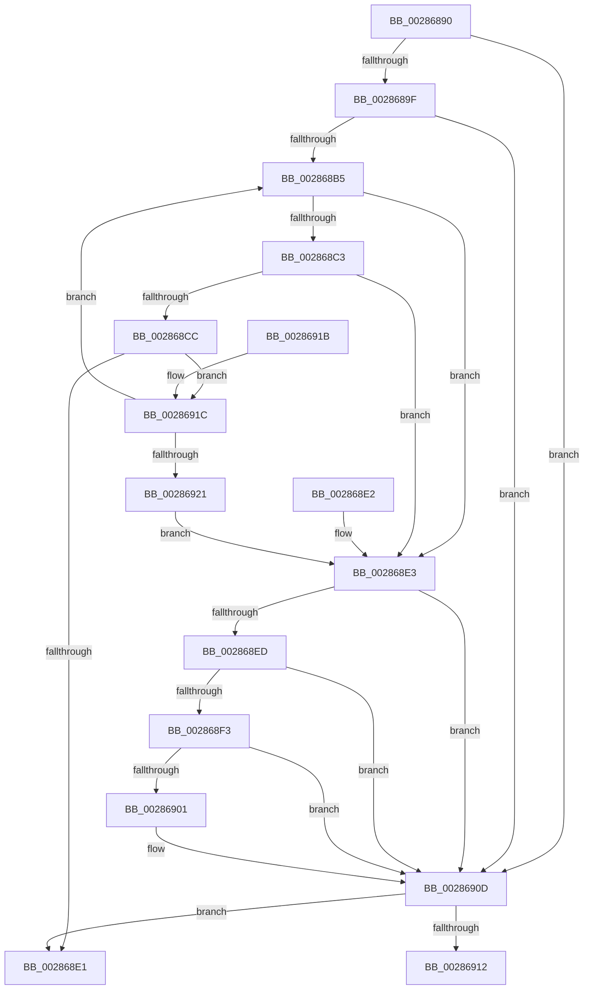

# MiReturnResident

- RVA: `0x00286890`–`0x00286923` (길이 `147` bytes)
- VA: `0x0000000140286890`
- 실행 섹션: `.text`
- PDB 이름 있음: `예`; PDB Function 태그: `아니요`
- unwind 정보 RVA: `0x000DB714`
- 디코드: `40`개 명령, `147/147` bytes 표시
- 미해석 바이트: `0` (있으면 어셈블리에 `.byte`로 보존)

> 이 문서는 커널 이미지의 기계어와 PDB 기호를 분석해 생성했습니다. 4번과 5번은 함수 원형과 자료형을 바이너리 사용 방식에서 추정한 C 해석이며 원본 소스 복구 결과는 아닙니다.

## 1. Dependencies

- 직접 호출 지점: **0**; 고유 호출 대상: **0**
- 직접 호출자로 확인된 함수: **47**
- RIP 상대 이미지 참조: **1**

### Outgoing calls
- 직접 디코드된 call 명령이 없습니다.

### Direct callers
- [sub_002067E0](../20/Unknown_function_002067E0.md) at `0x00206807`
- [MiGetCloneCharges](../22/MiGetCloneCharges_function_0022CB5C.md) at `0x0022CC4E`
- [sub_0023E278](../23/Unknown_function_0023E278.md) at `0x0023E44F`
- [sub_0023E278](../23/Unknown_function_0023E278.md) at `0x0023E4AC`
- [sub_00285C73](Unknown_function_00285C73.md) at `0x00285CC1`
- [sub_00285D83](Unknown_function_00285D83.md) at `0x00285DB5`
- [sub_002860AF](Unknown_function_002860AF.md) at `0x00286173`
- [MiCheckControlArea](MiCheckControlArea_function_002861B0.md) at `0x002863B0`
- [MmChargeResources](MmChargeResources_function_002880E0.md) at `0x00288132`
- [MiChargePartitionResidentAvailable](MiChargePartitionResidentAvailable_function_0028B000.md) at `0x0028B0D2`
- [MmFreeIndependentPages](../2A/MmFreeIndependentPages_function_002A2510.md) at `0x002A2712`
- [MiDeletePartialVad](../2A/MiDeletePartialVad_function_002A7A30.md) at `0x002A7B6A`
- [MiDeleteKernelStackPages](../2D/MiDeleteKernelStackPages_function_002D9938.md) at `0x002D99DC`
- [MiReferenceActiveSubsection](../32/MiReferenceActiveSubsection_function_00325060.md) at `0x00325537`
- [MiDeleteSegmentPages](../32/MiDeleteSegmentPages_function_003261D4.md) at `0x00326333`
- [MiCommitExistingVad](../32/MiCommitExistingVad_function_0032A860.md) at `0x0032B38F`
- [MiReturnPoolCharges](../36/MiReturnPoolCharges_function_003679B4.md) at `0x003679F5`
- [MiReturnSystemCharges](../36/MiReturnSystemCharges_function_00367A48.md) at `0x00367A8C`
- [MiResolveMappedFileFault](../36/MiResolveMappedFileFault_function_0036B640.md) at `0x0036BBA5`
- [MiReturnFaultCharges](../36/MiReturnFaultCharges_function_0036D928.md) at `0x0036D93B`
- [MiReturnCloneCharges](../37/MiReturnCloneCharges_function_00370F50.md) at `0x00370FB6`
- [MiCreateLargePfnList](../3D/MiCreateLargePfnList_function_003D2DA8.md) at `0x003D3131`
- [MiReleaseNonPagedResourcesNotExposed](../3F/MiReleaseNonPagedResourcesNotExposed_function_003F8258.md) at `0x003F8279`
- [MiWriteComplete](../40/MiWriteComplete_function_004069B0.md) at `0x00406E18`
- [MiReleaseWriteInProgressCharges](../40/MiReleaseWriteInProgressCharges_function_00407B4C.md) at `0x00407CB2`
- [MmAdjustWorkingSetSizeEx](../47/MmAdjustWorkingSetSizeEx_function_0047D8D4.md) at `0x0047DA8A`
- [MiReturnCrossPartitionSectionCharges](../4B/MiReturnCrossPartitionSectionCharges_function_004BA61C.md) at `0x004BA63D`
- [MiSwitchToTransition](../4C/MiSwitchToTransition_function_004C0F5C.md) at `0x004C1551`
- [MiIdealClusterPage](../4D/MiIdealClusterPage_function_004DB964.md) at `0x004DC146`
- [MiEnableNewPfns](../67/MiEnableNewPfns_function_00671DD0.md) at `0x00672043`
- [MiMarkBootGuardPage](../68/MiMarkBootGuardPage_function_0068643C.md) at `0x0068655D`
- [MiAllocateLargeProcessPagesFromCache](../69/MiAllocateLargeProcessPagesFromCache_function_0069818C.md) at `0x00698606`
- [sub_006F4BA0](../6F/Unknown_function_006F4BA0.md) at `0x006F4BB2`
- [MiFreeAweView](../../page/6F/MiFreeAweView_function_006FE7A4.md) at `0x006FE7FE`
- [MiChargeLargeProtoSubsection](../../page/80/MiChargeLargeProtoSubsection_function_00800A24.md) at `0x00800A4E`
- [MiDeletePartitionResources](../../page/80/MiDeletePartitionResources_function_0080D074.md) at `0x0080D0BA`
- [MiFreePartitionPhysicalPages](../../page/80/MiFreePartitionPhysicalPages_function_0080D42C.md) at `0x0080D561`
- [MiReturnVadCharges](../../page/88/MiReturnVadCharges_function_008875B8.md) at `0x0088760D`
- [MiCreatePagingFileMap](../../page/98/MiCreatePagingFileMap_function_009852F8.md) at `0x009858D3`
- [MiRemoveVadCharges](../../page/9B/MiRemoveVadCharges_function_009BAEC4.md) at `0x009BB05E`
- [MmCleanProcessAddressSpace](../../page/A1/MmCleanProcessAddressSpace_function_00A17EC0.md) at `0x00A180B4`
- [MiCleanEmbryonicProcess](../../page/A1/MiCleanEmbryonicProcess_function_00A1816C.md) at `0x00A181E3`
- [MmCreateProcessAddressSpace](../../page/A5/MmCreateProcessAddressSpace_function_00A5EE5C.md) at `0x00A5F09B`
- [MiUnloadSystemImage](../../page/AA/MiUnloadSystemImage_function_00AA2FD4.md) at `0x00AA3408`
- [MiUnmapReturnCharges](../../page/AA/MiUnmapReturnCharges_function_00AA6C40.md) at `0x00AA6C53`
- [MmDeleteProcessAddressSpace](../../page/AC/MmDeleteProcessAddressSpace_function_00AC804C.md) at `0x00AC816C`
- [MmReturnChargesToLockPagedPool](../../page/AD/MmReturnChargesToLockPagedPool_function_00AD3A00.md) at `0x00AD3A77`
- [MiInitializeBootShadowStackPage](../../init/C6/MiInitializeBootShadowStackPage_function_00C67D8C.md) at `0x00C67F1F`

### Static image references
- `0x00286890` → RVA `0x00E38D00` (`.data`; read)

## 2. Other-region calls and transfers

- 다른 실행 섹션으로 향하는 call: **0**
- 별도 외부 분기/꼬리 이동을 확인하지 못했습니다.

## 3. Assembly (complete function range)

```asm
00286890  48 8D 05 69 24 BB 00            lea rax, [rip + 0xbb2469]
00286897  4C 8B D1                        mov r10, rcx
0028689A  48 3B C8                        cmp rcx, rax
0028689D  75 6E                           jne 0x14028690d
0028689F  65 4C 8B 0C 25 20 00 00 00      mov r9, qword ptr gs:[0x20]
002868A8  45 8B 81 9C 8B 00 00            mov r8d, dword ptr [r9 + 0x8b9c]
002868AF  41 83 F8 FF                     cmp r8d, -1
002868B3  74 58                           je 0x14028690d
002868B5  49 63 C0                        movsxd rax, r8d
002868B8  48 03 C2                        add rax, rdx
002868BB  48 3D 00 01 00 00               cmp rax, 0x100
002868C1  77 20                           ja 0x1402868e3
002868C3  48 81 FA 00 00 08 00            cmp rdx, 0x80000
002868CA  73 17                           jae 0x1402868e3
002868CC  42 8D 0C 02                     lea ecx, [rdx + r8]
002868D0  41 8B C0                        mov eax, r8d
002868D3  F0 41 0F B1 89 9C 8B 00 00      lock cmpxchg dword ptr [r9 + 0x8b9c], ecx
002868DC  44 8B C0                        mov r8d, eax
002868DF  75 3B                           jne 0x14028691c
002868E1  C3                              ret
002868E2  CC                              int3
002868E3  B9 C0 00 00 00                  mov ecx, 0xc0
002868E8  44 3B C1                        cmp r8d, ecx
002868EB  7E 20                           jle 0x14028690d
002868ED  41 83 F8 FF                     cmp r8d, -1
002868F1  74 1A                           je 0x14028690d
002868F3  41 8B C0                        mov eax, r8d
002868F6  F0 41 0F B1 89 9C 8B 00 00      lock cmpxchg dword ptr [r9 + 0x8b9c], ecx
002868FF  75 0C                           jne 0x14028690d
00286901  41 8D 80 40 FF FF FF            lea eax, [r8 - 0xc0]
00286908  48 98                           cdqe
0028690A  48 03 D0                        add rdx, rax
0028690D  48 85 D2                        test rdx, rdx
00286910  74 CF                           je 0x1402868e1
00286912  F0 49 01 92 40 49 00 00         lock add qword ptr [r10 + 0x4940], rdx
0028691A  C3                              ret
0028691B  CC                              int3
0028691C  83 F8 FF                        cmp eax, -1
0028691F  75 94                           jne 0x1402868b5
00286921  EB C0                           jmp 0x1402868e3
```

## 4. C-style interpretation (structured pseudocode)

```c
__int64 __fastcall MiReturnResident(__int64 a1, __int64 a2)
{
    __int64 result;

    if (a1 != (v_rip + 12264553)) goto loc_0028690D;
    if (((unsigned int)((unsigned int)(*(unsigned int *)(*(unsigned __int64 *)(gs_base + (0 + 32)) + 35740)))) == -1) goto loc_0028690D;
loc_002868B5:
    result = ((int)((unsigned int)((unsigned int)(*(unsigned int *)(*(unsigned __int64 *)(gs_base + (0 + 32)) + 35740))))) + (a2);
    if (result > 256) goto loc_002868E3;
    if (a2 >= 0x80000ULL) goto loc_002868E3;
    if (a2 != 0x80000ULL) goto loc_0028691C;
loc_002868E1:
    return (unsigned int)((unsigned int)((unsigned int)(*(unsigned int *)(*(unsigned __int64 *)(gs_base + (0 + 32)) + 35740))));
loc_002868E3:
    if (((unsigned int)((unsigned int)((unsigned int)((unsigned int)((unsigned int)((unsigned int)(*(unsigned int *)(*(unsigned __int64 *)(gs_base + (0 + 32)) + 35740)))))))) <= 192) goto loc_0028690D;
    if (((unsigned int)((unsigned int)((unsigned int)((unsigned int)((unsigned int)((unsigned int)(*(unsigned int *)(*(unsigned __int64 *)(gs_base + (0 + 32)) + 35740)))))))) == -1) goto loc_0028690D;
    result = (unsigned int)((unsigned int)((unsigned int)((unsigned int)((unsigned int)((unsigned int)((unsigned int)(*(unsigned int *)(*(unsigned __int64 *)(gs_base + (0 + 32)) + 35740))))))));
    if (((unsigned int)((unsigned int)((unsigned int)((unsigned int)((unsigned int)((unsigned int)(*(unsigned int *)(*(unsigned __int64 *)(gs_base + (0 + 32)) + 35740)))))))) == -1) {
        result = (unsigned int)((unsigned int)((unsigned int)((unsigned int)((unsigned int)(*(unsigned int *)(*(unsigned __int64 *)(gs_base + (0 + 32)) + 35740)))))) - 192;
        a2 = (a2) + (result);
    }
    if (a2 == 0) goto loc_002868E1;
    return result;
loc_0028691C:
    if (((unsigned int)(result)) != -1) goto loc_002868B5;
    goto loc_002868E3;
}
```

## 5. (Beta) C Style

```c
int64_t MiReturnResident(void *Arg1, int64_t Arg2)
{
    uint8_t *arg1 = (uint8_t *)Arg1;

    int64_t result;

    if (Arg1 != (v_rip + 12264553)) goto loc_0028690D;
    if (((uint32_t)((uint32_t)(*(uint32_t *)(*(uint64_t *)(gs_base + (0 + 0x20)) + 0x8B9C)))) == -1) goto loc_0028690D;
loc_002868B5:
    result = ((int32_t)((uint32_t)((uint32_t)(*(uint32_t *)(*(uint64_t *)(gs_base + (0 + 0x20)) + 0x8B9C))))) + (Arg2);
    if (result > 256) goto loc_002868E3;
    if (Arg2 >= 0x80000ULL) goto loc_002868E3;
    if (Arg2 != 0x80000ULL) goto loc_0028691C;
loc_002868E1:
    return (uint32_t)((uint32_t)((uint32_t)(*(uint32_t *)(*(uint64_t *)(gs_base + (0 + 0x20)) + 0x8B9C))));
loc_002868E3:
    if (((uint32_t)((uint32_t)((uint32_t)((uint32_t)((uint32_t)((uint32_t)(*(uint32_t *)(*(uint64_t *)(gs_base + (0 + 0x20)) + 0x8B9C)))))))) <= 192) goto loc_0028690D;
    if (((uint32_t)((uint32_t)((uint32_t)((uint32_t)((uint32_t)((uint32_t)(*(uint32_t *)(*(uint64_t *)(gs_base + (0 + 0x20)) + 0x8B9C)))))))) == -1) goto loc_0028690D;
    result = (uint32_t)((uint32_t)((uint32_t)((uint32_t)((uint32_t)((uint32_t)((uint32_t)(*(uint32_t *)(*(uint64_t *)(gs_base + (0 + 0x20)) + 0x8B9C))))))));
    if (((uint32_t)((uint32_t)((uint32_t)((uint32_t)((uint32_t)((uint32_t)(*(uint32_t *)(*(uint64_t *)(gs_base + (0 + 0x20)) + 0x8B9C)))))))) == -1) {
        result = (uint32_t)((uint32_t)((uint32_t)((uint32_t)((uint32_t)(*(uint32_t *)(*(uint64_t *)(gs_base + (0 + 0x20)) + 0x8B9C)))))) - 192;
        Arg2 = (Arg2) + (result);
    }
    if (Arg2 == 0) goto loc_002868E1;
    return result;
loc_0028691C:
    if (((uint32_t)(result)) != -1) goto loc_002868B5;
    goto loc_002868E3;
}
```

### 관측된 메모리 오프셋

구조체 형식이 확인되지 않은 접근은 인자 기준의 오프셋으로만 기록했습니다.

| 기준 인자 | 오프셋 표현 | 폭 (bit) | 접근 |
|---|---:|---:|---|
| `Arg1` | `+ 0x4940` | `64` | `R/W` |

## 6. Execution-region graph

[열기: 2D/3D 그래프와 함수 탐색 컨트롤 패널](../../../control-panel.html?section=text&rva=0x00286890&view=graph)

- 2D 그래프는 위에서 아래로 흐르고, 3D 그래프는 빈 공간을 드래그해 회전합니다. Shift+드래그는 이동, 휠은 확대·축소, 함수 노드 선택은 대상 보고서 이동입니다.

### Static fallback


