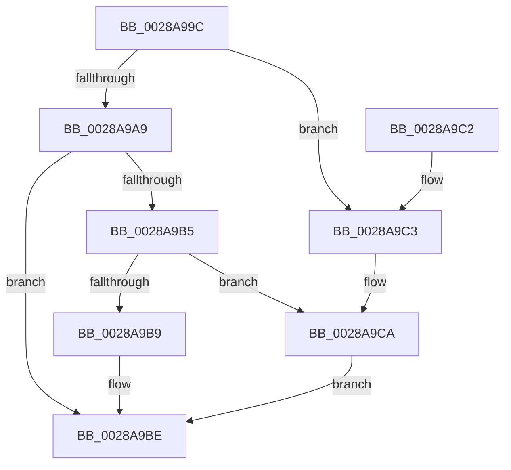

# MiSetOriginalPtePfnFromFreeList

- RVA: `0x0028A99C`–`0x0028A9CF` (길이 `51` bytes)
- VA: `0x000000014028A99C`
- 실행 섹션: `.text`
- PDB 이름 있음: `예`; PDB Function 태그: `아니요`
- unwind 정보 RVA: `0x000DB714`
- 디코드: `16`개 명령, `51/51` bytes 표시
- 미해석 바이트: `0` (있으면 어셈블리에 `.byte`로 보존)

> 이 문서는 커널 이미지의 기계어와 PDB 기호를 분석해 생성했습니다. 4번과 5번은 함수 원형과 자료형을 바이너리 사용 방식에서 추정한 C 해석이며 원본 소스 복구 결과는 아닙니다.

## 1. Dependencies

- 직접 호출 지점: **0**; 고유 호출 대상: **0**
- 직접 호출자로 확인된 함수: **29**
- RIP 상대 이미지 참조: **1**

### Outgoing calls
- 직접 디코드된 call 명령이 없습니다.

### Direct callers
- [MiCombineInitialInstance](../22/MiCombineInitialInstance_function_0022BC0C.md) at `0x0022BE64`
- [MiGetPage](MiGetPage_function_002884C0.md) at `0x00289050`
- [MiGetPerfectFreeOrZeroPage](MiGetPerfectFreeOrZeroPage_function_002898E0.md) at `0x00289ABB`
- [MiTradeTransitionPage](MiTradeTransitionPage_function_0028B9AC.md) at `0x0028BC46`
- [MiTradePage](MiTradePage_function_0028D160.md) at `0x0028D42F`
- [MiSwapStackPageNoDpc](../2A/MiSwapStackPageNoDpc_function_002A0270.md) at `0x002A04A9`
- [MiChangePageAttribute](../33/MiChangePageAttribute_function_00332ECC.md) at `0x0033327A`
- [MiRemoveLowestPriorityStandbyPage](../33/MiRemoveLowestPriorityStandbyPage_function_00334600.md) at `0x003348CD`
- [MiCoalesceFreeSmallPages](../33/MiCoalesceFreeSmallPages_function_00336340.md) at `0x003367DC`
- [MiWalkEntireImage](../36/MiWalkEntireImage_function_00365D70.md) at `0x00366FC9`
- [MiLockCode](../36/MiLockCode_function_0036F91C.md) at `0x0036FEC9`
- [MiZeroAndReleasePages](../37/MiZeroAndReleasePages_function_003748D0.md) at `0x00374C9B`
- [MiReInitializeFreeSlabPfn](../37/MiReInitializeFreeSlabPfn_function_003758D8.md) at `0x00375927`
- [MiWaitForInPageComplete](../38/MiWaitForInPageComplete_function_00380AB8.md) at `0x00381005`
- [MiReplaceLockedPage](../38/MiReplaceLockedPage_function_0038351C.md) at `0x003836A4`
- [MiSwapNumaStandbyPage](../38/MiSwapNumaStandbyPage_function_00385144.md) at `0x00385540`
- [MiHandleSpecialPurposeMemoryCachedFault](../44/MiHandleSpecialPurposeMemoryCachedFault_function_0044C740.md) at `0x0044CA33`
- [MiReuseStandbyPage](../44/MiReuseStandbyPage_function_0044CA90.md) at `0x0044CAE8`
- [MiCompleteSecureProcessFault](../46/MiCompleteSecureProcessFault_function_0046710C.md) at `0x00467325`
- [MiSwitchToTransition](../4C/MiSwitchToTransition_function_004C0F5C.md) at `0x004C118D`
- [MiPreInitializeSystemImagePage](../4D/MiPreInitializeSystemImagePage_function_004D621C.md) at `0x004D6295`
- [MiFreeLargeInitializationCodePages](../67/MiFreeLargeInitializationCodePages_function_00670080.md) at `0x0067011C`
- [MiProtectDriverSectionPte](../67/MiProtectDriverSectionPte_function_006706C0.md) at `0x00670985`
- [MiPreparePfnDatabasePageForFree](../67/MiPreparePfnDatabasePageForFree_function_00673AA8.md) at `0x00673B6B`
- [MiInsertPossiblyBadPage](../68/MiInsertPossiblyBadPage_function_00689DF0.md) at `0x00689EFB`
- [MiMakeVaRangePhysicallyContiguous](../69/MiMakeVaRangePhysicallyContiguous_function_006936E0.md) at `0x006938D6`
- [MiAllocateLargeProcessPagesFromCache](../69/MiAllocateLargeProcessPagesFromCache_function_0069818C.md) at `0x00698756`
- [sub_006DB77C](../6D/Unknown_function_006DB77C.md) at `0x006DB91F`
- [sub_006F9D5A](../6F/Unknown_function_006F9D5A.md) at `0x006F9E27`

### Static image references
- `0x0028A9A9` → RVA `0x00E2DC80` (`.data`; read)

## 2. Other-region calls and transfers

- 다른 실행 섹션으로 향하는 call: **0**
- 별도 외부 분기/꼬리 이동을 확인하지 못했습니다.

## 3. Assembly (complete function range)

```asm
0028A99C  48 8B 11                        mov rdx, qword ptr [rcx]
0028A99F  B8 80 00 00 00                  mov eax, 0x80
0028A9A4  48 85 D2                        test rdx, rdx
0028A9A7  75 1A                           jne 0x14028a9c3
0028A9A9  48 8B 15 D0 32 BA 00            mov rdx, qword ptr [rip + 0xba32d0]
0028A9B0  48 85 D2                        test rdx, rdx
0028A9B3  74 09                           je 0x14028a9be
0028A9B5  84 D0                           test al, dl
0028A9B7  74 11                           je 0x14028a9ca
0028A9B9  B8 90 00 00 00                  mov eax, 0x90
0028A9BE  48 89 01                        mov qword ptr [rcx], rax
0028A9C1  C3                              ret
0028A9C2  CC                              int3
0028A9C3  48 81 E2 9F FC FF FF            and rdx, 0xfffffffffffffc9f
0028A9CA  48 0B C2                        or rax, rdx
0028A9CD  EB EF                           jmp 0x14028a9be
```

## 4. C-style interpretation (structured pseudocode)

```c
__int64 __fastcall MiSetOriginalPtePfnFromFreeList(__int64 a1)
{
    __int64 result;

    if (*(unsigned __int64 *)(a1) != 0) goto loc_0028A9C3;
    if (*(unsigned __int64 *)(v_rip + 12202704) == 0) goto loc_0028A9BE;
    if (((128) & ((unsigned __int8)(*(unsigned __int64 *)(v_rip + 12202704)))) == 0) goto loc_0028A9CA;
loc_0028A9BE:
    *(unsigned __int64 *)(a1) = 144;
    return 144;
loc_0028A9C3:
    a2 = (*(unsigned __int64 *)(v_rip + 12202704)) & (-865);
loc_0028A9CA:
    result = (144) | (a2);
    goto loc_0028A9BE;
}
```

## 5. (Beta) C Style

```c
int64_t MiSetOriginalPtePfnFromFreeList(void *Arg1)
{
    uint8_t *arg1 = (uint8_t *)Arg1;

    int64_t result;

    if (*(uint64_t *)(arg1) != 0) goto loc_0028A9C3;
    if (*(uint64_t *)(v_rip + 0xBA32D0) == 0) goto loc_0028A9BE;
    if (((128) & ((uint8_t)(*(uint64_t *)(v_rip + 0xBA32D0)))) == 0) goto loc_0028A9CA;
loc_0028A9BE:
    *(uint64_t *)(arg1) = 144;
    return 144;
loc_0028A9C3:
    a2 = (*(uint64_t *)(v_rip + 0xBA32D0)) & (-865);
loc_0028A9CA:
    result = (144) | (a2);
    goto loc_0028A9BE;
}
```

### 관측된 메모리 오프셋

구조체 형식이 확인되지 않은 접근은 인자 기준의 오프셋으로만 기록했습니다.

| 기준 인자 | 오프셋 표현 | 폭 (bit) | 접근 |
|---|---:|---:|---|
| `Arg1` | `+ 0x0` | `64` | `R` |
| `Arg1` | `+ 0x0` | `64` | `W` |

## 6. Execution-region graph

[열기: 2D/3D 그래프와 함수 탐색 컨트롤 패널](../../../control-panel.html?section=text&rva=0x0028A99C&view=graph)

- 2D 그래프는 위에서 아래로 흐르고, 3D 그래프는 빈 공간을 드래그해 회전합니다. Shift+드래그는 이동, 휠은 확대·축소, 함수 노드 선택은 대상 보고서 이동입니다.

### Static fallback


