# MiSlistGetFreePage

- RVA: `0x0028A170`–`0x0028A4EA` (길이 `890` bytes)
- VA: `0x000000014028A170`
- 실행 섹션: `.text`
- PDB 이름 있음: `예`; PDB Function 태그: `아니요`
- unwind 정보 RVA: `0x00066E98`
- 디코드: `236`개 명령, `890/890` bytes 표시
- 미해석 바이트: `0` (있으면 어셈블리에 `.byte`로 보존)

> 이 문서는 커널 이미지의 기계어와 PDB 기호를 분석해 생성했습니다. 4번과 5번은 함수 원형과 자료형을 바이너리 사용 방식에서 추정한 C 해석이며 원본 소스 복구 결과는 아닙니다.

## 1. Dependencies

- 직접 호출 지점: **6**; 고유 호출 대상: **4**
- 직접 호출자로 확인된 함수: **2**
- RIP 상대 이미지 참조: **7**

### Outgoing calls
- `0x0028A1DB` → [ExpInterlockedPopEntrySList](../6B/ExpInterlockedPopEntrySList_function_006BA570.md) (function, `0x006BA570`)
- `0x0028A28C` → [ExpInterlockedPopEntrySList](../6B/ExpInterlockedPopEntrySList_function_006BA570.md) (function, `0x006BA570`)
- `0x0028A2B6` → [KiLowerIrqlProcessIrqlFlags](../4F/KiLowerIrqlProcessIrqlFlags_function_004F5698.md) (function, `0x004F5698`)
- `0x0028A332` → [KiRaiseIrqlProcessIrqlFlags](../4F/KiRaiseIrqlProcessIrqlFlags_function_004F56FC.md) (function, `0x004F56FC`)
- `0x0028A3AE` → [KiLowerIrqlProcessIrqlFlags](../4F/KiLowerIrqlProcessIrqlFlags_function_004F5698.md) (function, `0x004F5698`)
- `0x0028A417` → [MiArePageContentsZero](../4D/MiArePageContentsZero_function_004D4278.md) (function, `0x004D4278`)

### Direct callers
- [MiRemovePageAnyColor](MiRemovePageAnyColor_function_0028A9D8.md) at `0x0028AC2C`
- [MiGetPageSlist](MiGetPageSlist_function_0028B79C.md) at `0x0028B956`

### Static image references
- `0x0028A1E8` → RVA `0x00010880` (`.rdata`; read)
- `0x0028A1FB` → RVA `0x00FC6A88` (`ALMOSTRO`; read)
- `0x0028A2A7` → RVA `0x00FC6D20` (`ALMOSTRO`; read)
- `0x0028A2E2` → RVA `0x00E2DC80` (`.data`; read)
- `0x0028A3D6` → RVA `0x00E30270` (`.data`; read)
- `0x0028A3DE` → RVA `0x00FC5054` (`ALMOSTRO`; reference)
- `0x0028A3E4` → RVA `0x00E30270` (`.data`; write)

## 2. Other-region calls and transfers

- 다른 실행 섹션으로 향하는 call: **0**
- 별도 외부 분기/꼬리 이동을 확인하지 못했습니다.

## 3. Assembly (complete function range)

```asm
0028A170  40 53                           push rbx
0028A172  55                              push rbp
0028A173  56                              push rsi
0028A174  41 54                           push r12
0028A176  41 56                           push r14
0028A178  41 57                           push r15
0028A17A  48 83 EC 28                     sub rsp, 0x28
0028A17E  48 8B 41 10                     mov rax, qword ptr [rcx + 0x10]
0028A182  44 8B E2                        mov r12d, edx
0028A185  8B 69 1C                        mov ebp, dword ptr [rcx + 0x1c]
0028A188  4C 8B F9                        mov r15, rcx
0028A18B  48 89 7C 24 68                  mov qword ptr [rsp + 0x68], rdi
0028A190  40 0F B6 ED                     movzx ebp, bpl
0028A194  8B 30                           mov esi, dword ptr [rax]
0028A196  4C 89 6C 24 20                  mov qword ptr [rsp + 0x20], r13
0028A19B  4D 8B 07                        mov r8, qword ptr [r15]
0028A19E  48 63 D6                        movsxd rdx, esi
0028A1A1  48 8B DA                        mov rbx, rdx
0028A1A4  48 C1 E3 04                     shl rbx, 4
0028A1A8  49 03 D8                        add rbx, r8
0028A1AB  45 85 E4                        test r12d, r12d
0028A1AE  75 11                           jne 0x14028a1c1
0028A1B0  48 8B 83 08 3A 00 00            mov rax, qword ptr [rbx + 0x3a08]
0028A1B7  48 0F A3 28                     bt qword ptr [rax], rbp
0028A1BB  0F 83 01 01 00 00               jae 0x14028a2c2
0028A1C1  49 8B 84 D0 60 3A 00 00         mov rax, qword ptr [r8 + rdx*8 + 0x3a60]
0028A1C9  48 8B CD                        mov rcx, rbp
0028A1CC  48 C1 E1 04                     shl rcx, 4
0028A1D0  4C 8B ED                        mov r13, rbp
0028A1D3  48 03 C8                        add rcx, rax
0028A1D6  48 89 44 24 70                  mov qword ptr [rsp + 0x70], rax
0028A1DB  E8 90 03 43 00                  call 0x1406ba570
0028A1E0  48 8B F8                        mov rdi, rax
0028A1E3  48 85 C0                        test rax, rax
0028A1E6  74 45                           je 0x14028a22d
0028A1E8  48 8B 05 91 66 D8 FF            mov rax, qword ptr [rip - 0x27996f]
0028A1EF  48 89 47 10                     mov qword ptr [rdi + 0x10], rax
0028A1F3  85 F6                           test esi, esi
0028A1F5  0F 85 D9 00 00 00               jne 0x14028a2d4
0028A1FB  0F B6 05 86 C8 D3 00            movzx eax, byte ptr [rip + 0xd3c886]
0028A202  84 C0                           test al, al
0028A204  0F 88 CC 01 00 00               js 0x14028a3d6
0028A20A  48 C7 07 00 00 00 00            mov qword ptr [rdi], 0
0028A211  48 8B C7                        mov rax, rdi
0028A214  4C 8B 6C 24 20                  mov r13, qword ptr [rsp + 0x20]
0028A219  48 8B 7C 24 68                  mov rdi, qword ptr [rsp + 0x68]
0028A21E  48 83 C4 28                     add rsp, 0x28
0028A222  41 5F                           pop r15
0028A224  41 5E                           pop r14
0028A226  41 5C                           pop r12
0028A228  5E                              pop rsi
0028A229  5D                              pop rbp
0028A22A  5B                              pop rbx
0028A22B  C3                              ret
0028A22C  CC                              int3
0028A22D  41 8B 47 20                     mov eax, dword ptr [r15 + 0x20]
0028A231  8B C8                           mov ecx, eax
0028A233  D1 E9                           shr ecx, 1
0028A235  0B C8                           or ecx, eax
0028A237  F6 C1 01                        test cl, 1
0028A23A  0F 84 D0 00 00 00               je 0x14028a310
0028A240  B1 11                           mov cl, 0x11
0028A242  48 89 4C 24 60                  mov qword ptr [rsp + 0x60], rcx
0028A247  48 8B 83 08 3A 00 00            mov rax, qword ptr [rbx + 0x3a08]
0028A24E  49 8B D5                        mov rdx, r13
0028A251  48 C1 EA 05                     shr rdx, 5
0028A255  41 83 E5 1F                     and r13d, 0x1f
0028A259  B9 01 00 00 00                  mov ecx, 1
0028A25E  4C 8D 04 90                     lea r8, [rax + rdx*4]
0028A262  49 8D 45 01                     lea rax, [r13 + 1]
0028A266  48 83 F8 20                     cmp rax, 0x20
0028A26A  0F 87 CC 00 00 00               ja 0x14028a33c
0028A270  41 8B CD                        mov ecx, r13d
0028A273  B8 01 00 00 00                  mov eax, 1
0028A278  D3 E0                           shl eax, cl
0028A27A  F7 D0                           not eax
0028A27C  F0 41 21 00                     lock and dword ptr [r8], eax
0028A280  48 8B CD                        mov rcx, rbp
0028A283  48 C1 E1 04                     shl rcx, 4
0028A287  48 03 4C 24 70                  add rcx, qword ptr [rsp + 0x70]
0028A28C  E8 DF 02 43 00                  call 0x1406ba570
0028A291  48 8B F8                        mov rdi, rax
0028A294  48 85 C0                        test rax, rax
0028A297  0F 85 C0 00 00 00               jne 0x14028a35d
0028A29D  48 8B 5C 24 60                  mov rbx, qword ptr [rsp + 0x60]
0028A2A2  80 FB 11                        cmp bl, 0x11
0028A2A5  74 1B                           je 0x14028a2c2
0028A2A7  39 05 73 CA D3 00               cmp dword ptr [rip + 0xd3ca73], eax
0028A2AD  74 0C                           je 0x14028a2bb
0028A2AF  44 0F 20 C1                     mov rcx, cr8
0028A2B3  0F B6 D3                        movzx edx, bl
0028A2B6  E8 DD B3 26 00                  call 0x1404f5698
0028A2BB  0F B6 C3                        movzx eax, bl
0028A2BE  44 0F 22 C0                     mov cr8, rax
0028A2C2  49 8B 47 10                     mov rax, qword ptr [r15 + 0x10]
0028A2C6  8B 48 04                        mov ecx, dword ptr [rax + 4]
0028A2C9  3B F1                           cmp esi, ecx
0028A2CB  74 3C                           je 0x14028a309
0028A2CD  8B F1                           mov esi, ecx
0028A2CF  E9 C7 FE FF FF                  jmp 0x14028a19b
0028A2D4  48 8B 4F 10                     mov rcx, qword ptr [rdi + 0x10]
0028A2D8  B8 80 00 00 00                  mov eax, 0x80
0028A2DD  48 85 C9                        test rcx, rcx
0028A2E0  75 6F                           jne 0x14028a351
0028A2E2  48 8B 15 97 39 BA 00            mov rdx, qword ptr [rip + 0xba3997]
0028A2E9  48 85 D2                        test rdx, rdx
0028A2EC  74 12                           je 0x14028a300
0028A2EE  48 8B CA                        mov rcx, rdx
0028A2F1  48 0B C8                        or rcx, rax
0028A2F4  B8 90 00 00 00                  mov eax, 0x90
0028A2F9  F6 C2 80                        test dl, 0x80
0028A2FC  48 0F 44 C1                     cmove rax, rcx
0028A300  48 89 47 10                     mov qword ptr [rdi + 0x10], rax
0028A304  E9 01 FF FF FF                  jmp 0x14028a20a
0028A309  33 C0                           xor eax, eax
0028A30B  E9 04 FF FF FF                  jmp 0x14028a214
0028A310  44 0F 20 C1                     mov rcx, cr8
0028A314  48 89 4C 24 60                  mov qword ptr [rsp + 0x60], rcx
0028A319  B8 02 00 00 00                  mov eax, 2
0028A31E  44 0F 22 C0                     mov cr8, rax
0028A322  83 3D F7 C9 D3 00 00            cmp dword ptr [rip + 0xd3c9f7], 0
0028A329  0F 84 18 FF FF FF               je 0x14028a247
0028A32F  0F B6 D0                        movzx edx, al
0028A332  E8 C5 B3 26 00                  call 0x1404f56fc
0028A337  E9 0B FF FF FF                  jmp 0x14028a247
0028A33C  4D 85 ED                        test r13, r13
0028A33F  0F 85 DC 00 00 00               jne 0x14028a421
0028A345  B8 FF FF FF FF                  mov eax, 0xffffffff
0028A34A  D3 E0                           shl eax, cl
0028A34C  E9 2B FF FF FF                  jmp 0x14028a27c
0028A351  48 81 E1 9F FC FF FF            and rcx, 0xfffffffffffffc9f
0028A358  48 0B C1                        or rax, rcx
0028A35B  EB A3                           jmp 0x14028a300
0028A35D  48 8B 83 08 3A 00 00            mov rax, qword ptr [rbx + 0x3a08]
0028A364  48 8B CD                        mov rcx, rbp
0028A367  48 C1 E9 05                     shr rcx, 5
0028A36B  41 B9 01 00 00 00               mov r9d, 1
0028A371  4C 8B C5                        mov r8, rbp
0028A374  48 8D 14 88                     lea rdx, [rax + rcx*4]
0028A378  48 8B CD                        mov rcx, rbp
0028A37B  83 E1 1F                        and ecx, 0x1f
0028A37E  48 8D 41 01                     lea rax, [rcx + 1]
0028A382  48 83 F8 20                     cmp rax, 0x20
0028A386  77 37                           ja 0x14028a3bf
0028A388  41 8B C1                        mov eax, r9d
0028A38B  D3 E0                           shl eax, cl
0028A38D  F0 09 02                        lock or dword ptr [rdx], eax
0028A390  48 8B 5C 24 60                  mov rbx, qword ptr [rsp + 0x60]
0028A395  80 FB 11                        cmp bl, 0x11
0028A398  0F 84 4A FE FF FF               je 0x14028a1e8
0028A39E  83 3D 7B C9 D3 00 00            cmp dword ptr [rip + 0xd3c97b], 0
0028A3A5  74 0C                           je 0x14028a3b3
0028A3A7  44 0F 20 C1                     mov rcx, cr8
0028A3AB  0F B6 D3                        movzx edx, bl
0028A3AE  E8 E5 B2 26 00                  call 0x1404f5698
0028A3B3  0F B6 C3                        movzx eax, bl
0028A3B6  44 0F 22 C0                     mov cr8, rax
0028A3BA  E9 29 FE FF FF                  jmp 0x14028a1e8
0028A3BF  48 85 C9                        test rcx, rcx
0028A3C2  0F 85 BC 00 00 00               jne 0x14028a484
0028A3C8  49 8B C9                        mov rcx, r9
0028A3CB  B8 01 00 00 00                  mov eax, 1
0028A3D0  D3 E0                           shl eax, cl
0028A3D2  FF C8                           dec eax
0028A3D4  EB B7                           jmp 0x14028a38d
0028A3D6  8B 05 94 5E BA 00               mov eax, dword ptr [rip + 0xba5e94]
0028A3DC  FF C0                           inc eax
0028A3DE  85 05 70 AC D3 00               test dword ptr [rip + 0xd3ac70], eax
0028A3E4  89 05 86 5E BA 00               mov dword ptr [rip + 0xba5e86], eax
0028A3EA  0F 85 1A FE FF FF               jne 0x14028a20a
0028A3F0  48 B8 00 00 00 00 00 DE FF FF   movabs rax, 0xffffde0000000000
0028A3FA  48 8B CF                        mov rcx, rdi
0028A3FD  BA 01 00 00 00                  mov edx, 1
0028A402  48 2B C8                        sub rcx, rax
0028A405  48 B8 AB AA AA AA AA AA AA AA   movabs rax, 0xaaaaaaaaaaaaaaab
0028A40F  48 C1 F9 04                     sar rcx, 4
0028A413  48 0F AF C8                     imul rcx, rax
0028A417  E8 5C 9E 24 00                  call 0x1404d4278
0028A41C  E9 E9 FD FF FF                  jmp 0x14028a20a
0028A421  8B C5                           mov eax, ebp
0028A423  BA 20 00 00 00                  mov edx, 0x20
0028A428  83 E0 1F                        and eax, 0x1f
0028A42B  2B D0                           sub edx, eax
0028A42D  B8 01 00 00 00                  mov eax, 1
0028A432  8B CA                           mov ecx, edx
0028A434  D3 E0                           shl eax, cl
0028A436  49 8B CD                        mov rcx, r13
0028A439  FF C8                           dec eax
0028A43B  D3 E0                           shl eax, cl
0028A43D  F7 D0                           not eax
0028A43F  F0 41 21 00                     lock and dword ptr [r8], eax
0028A443  8B C2                           mov eax, edx
0028A445  B9 01 00 00 00                  mov ecx, 1
0028A44A  48 2B C8                        sub rcx, rax
0028A44D  49 83 C0 04                     add r8, 4
0028A451  48 83 F9 20                     cmp rcx, 0x20
0028A455  72 1F                           jb 0x14028a476
0028A457  48 8B D1                        mov rdx, rcx
0028A45A  48 C1 EA 05                     shr rdx, 5
0028A45E  48 6B C2 E0                     imul rax, rdx, -0x20
0028A462  48 03 C8                        add rcx, rax
0028A465  41 C7 00 00 00 00 00            mov dword ptr [r8], 0
0028A46C  49 83 C0 04                     add r8, 4
0028A470  48 83 EA 01                     sub rdx, 1
0028A474  75 EF                           jne 0x14028a465
0028A476  48 85 C9                        test rcx, rcx
0028A479  0F 84 01 FE FF FF               je 0x14028a280
0028A47F  E9 C1 FE FF FF                  jmp 0x14028a345
0028A484  83 E5 1F                        and ebp, 0x1f
0028A487  41 B9 20 00 00 00               mov r9d, 0x20
0028A48D  44 2B CD                        sub r9d, ebp
0028A490  B8 01 00 00 00                  mov eax, 1
0028A495  41 8B C9                        mov ecx, r9d
0028A498  D3 E0                           shl eax, cl
0028A49A  41 0F B6 C8                     movzx ecx, r8b
0028A49E  80 E1 1F                        and cl, 0x1f
0028A4A1  FF C8                           dec eax
0028A4A3  D3 E0                           shl eax, cl
0028A4A5  F0 09 02                        lock or dword ptr [rdx], eax
0028A4A8  41 8B C1                        mov eax, r9d
0028A4AB  48 83 C2 04                     add rdx, 4
0028A4AF  41 B9 01 00 00 00               mov r9d, 1
0028A4B5  4C 2B C8                        sub r9, rax
0028A4B8  49 83 F9 20                     cmp r9, 0x20
0028A4BC  72 1E                           jb 0x14028a4dc
0028A4BE  49 8B C9                        mov rcx, r9
0028A4C1  48 C1 E9 05                     shr rcx, 5
0028A4C5  48 6B C1 E0                     imul rax, rcx, -0x20
0028A4C9  4C 03 C8                        add r9, rax
0028A4CC  C7 02 FF FF FF FF               mov dword ptr [rdx], 0xffffffff
0028A4D2  48 83 C2 04                     add rdx, 4
0028A4D6  48 83 E9 01                     sub rcx, 1
0028A4DA  75 F0                           jne 0x14028a4cc
0028A4DC  4D 85 C9                        test r9, r9
0028A4DF  0F 84 AB FE FF FF               je 0x14028a390
0028A4E5  E9 DE FE FF FF                  jmp 0x14028a3c8
```

## 4. C-style interpretation (structured pseudocode)

```c
__int64 __fastcall MiSlistGetFreePage(__int64 a1, int a2)
{
    __int64 result;
    __int64 v_r13;
    __int64 v_rbp;
    __int64 v_rbx;
    __int64 v_rsp;
    unsigned __int64 v_stack_m38;
    unsigned __int64 v_stack_p10;
    unsigned __int64 v_stack_p18;
    unsigned __int64 v_stack_p60;
    unsigned __int64 v_stack_p70;

    v_rsp = (v_rsp) - (40);
    v_stack_p10 = v_rdi;
    v_stack_m38 = v_r13;
loc_0028A19B:
    v_rbx = ((int)((unsigned int)((unsigned int)(*(unsigned int *)(*(unsigned __int64 *)(a1 + 16)))))) << (4);
    v_rbx = (v_rbx) + (*(unsigned __int64 *)(a1));
    if ((unsigned int)((unsigned int)(a2)) != 0) goto loc_0028A1C1;
    if (condition_is_above_or_equal) goto loc_0028A2C2;
loc_0028A1C1:
    a1 = ((unsigned __int8)((unsigned int)(*(unsigned int *)(a1 + 28)))) << (4);
    a1 = (a1) + (*(unsigned __int64 *)(*(unsigned __int64 *)(a1) + (int)((unsigned int)((unsigned int)(*(unsigned int *)(*(unsigned __int64 *)(a1 + 16))))) * 8 + 14944));
    v_stack_p18 = *(unsigned __int64 *)(*(unsigned __int64 *)(a1) + (int)((unsigned int)((unsigned int)(*(unsigned int *)(*(unsigned __int64 *)(a1 + 16))))) * 8 + 14944);
    result = ExpInterlockedPopEntrySList(a1, (int)((unsigned int)((unsigned int)(*(unsigned int *)(*(unsigned __int64 *)(a1 + 16))))), *(unsigned __int64 *)(a1), a4);
    if (result == 0) goto loc_0028A22D;
loc_0028A1E8:
    *(unsigned __int64 *)(result + 16) = *(unsigned __int64 *)(v_rip - 2595183);
    if ((unsigned int)((unsigned int)(*(unsigned int *)(*(unsigned __int64 *)(a1 + 16)))) != 0) goto loc_0028A2D4;
    if (sign_flag) goto loc_0028A3D6;
loc_0028A20A:
    *(unsigned __int64 *)(result) = 0;
loc_0028A214:
    v_rsp = (v_rsp) + (40);
    return result;
loc_0028A22D:
    a1 = (unsigned int)(((unsigned int)((unsigned int)((unsigned int)(*(unsigned int *)(a1 + 32))))) >> (1));
    a1 = (unsigned int)((a1) | ((unsigned int)((unsigned int)(*(unsigned int *)(a1 + 32)))));
    if ((((unsigned __int8)(a1)) & (1)) == 0) goto loc_0028A310;
    v_stack_p60 = 17;
loc_0028A247:
    a2 = (v_stack_m38) >> (5);
    v_r13 = (unsigned int)((v_stack_m38) & (31));
    if ((v_r13 + 1) > 32) goto loc_0028A33C;
    result = (unsigned int)((1) << ((unsigned __int8)((unsigned int)((unsigned int)(v_r13)))));
    result = (unsigned int)(~(result));
loc_0028A27C:
loc_0028A280:
    a1 = ((unsigned __int8)((unsigned int)(*(unsigned int *)(a1 + 28)))) << (4);
    a1 = (a1) + (v_stack_p70);
    result = ExpInterlockedPopEntrySList(a1, a2, *(unsigned __int64 *)(v_rbx + 14856) + a2 * 4, a4);
    if (result != 0) goto loc_0028A35D;
    if (((unsigned __int8)(v_stack_p60)) == 17) goto loc_0028A2C2;
    if ((*(unsigned int *)(v_rip + 13879923)) != ((unsigned int)(result))) {
        a1 = v_cr8;
        a2 = (unsigned __int8)(v_stack_p60);
        result = KiLowerIrqlProcessIrqlFlags(a1, a2, *(unsigned __int64 *)(v_rbx + 14856) + a2 * 4, a4);
    }
loc_0028A2C2:
    if (((unsigned int)((unsigned int)(*(unsigned int *)(*(unsigned __int64 *)(a1 + 16))))) == ((unsigned int)((unsigned int)(*(unsigned int *)(*(unsigned __int64 *)(a1 + 16) + 4))))) goto loc_0028A309;
    goto loc_0028A19B;
loc_0028A2D4:
    if (*(unsigned __int64 *)(result + 16) != 0) goto loc_0028A351;
    result = 128;
    if (*(unsigned __int64 *)(v_rip + 12204439) != 0) {
        a1 = *(unsigned __int64 *)(v_rip + 12204439);
        a1 = (a1) | (128);
        result = 144;
        if ((((unsigned __int8)(*(unsigned __int64 *)(v_rip + 12204439))) & (128)) == 0) { result = a1; }
    }
    *(unsigned __int64 *)(result + 16) = result;
    goto loc_0028A20A;
loc_0028A309:
    result = 0;
    goto loc_0028A214;
loc_0028A310:
    v_stack_p60 = (unsigned __int8)(v_stack_p60);
    if ((*(unsigned int *)(v_rip + 13879799)) == 0) goto loc_0028A247;
    result = KiRaiseIrqlProcessIrqlFlags((unsigned __int8)(v_stack_p60), 2, *(unsigned __int64 *)(v_rbx + 14856) + a2 * 4, a4);
    goto loc_0028A247;
loc_0028A33C:
    if (v_r13 != 0) goto loc_0028A421;
loc_0028A345:
    result = (unsigned int)(((unsigned int)(0xFFFFFFFFULL)) << ((unsigned __int8)((unsigned __int8)(v_stack_p60))));
    goto loc_0028A27C;
loc_0028A351:
    a1 = ((unsigned __int8)(v_stack_p60)) & (-865);
    result = (result) | (a1);
    goto loc_0028A300;
loc_0028A35D:
    a1 = ((unsigned __int8)((unsigned int)(*(unsigned int *)(a1 + 28)))) >> (5);
    a1 = (unsigned int)(((unsigned __int8)((unsigned int)(*(unsigned int *)(a1 + 28)))) & (31));
    if ((a1 + 1) > 32) goto loc_0028A3BF;
    result = (unsigned int)((1) << ((unsigned __int8)(a1)));
loc_0028A38D:
loc_0028A390:
    if (((unsigned __int8)(v_stack_p60)) == 17) goto loc_0028A1E8;
    if ((*(unsigned int *)(v_rip + 13879675)) != 0) {
        a1 = 2;
        a2 = (unsigned __int8)(v_stack_p60);
        result = KiLowerIrqlProcessIrqlFlags(a1, a2, (unsigned __int8)((unsigned int)(*(unsigned int *)(a1 + 28))), 1);
    }
    goto loc_0028A1E8;
loc_0028A3BF:
    if (a1 != 0) goto loc_0028A484;
loc_0028A3C8:
    result = (unsigned int)((1) << (1));
    result = (unsigned int)((result) - 1);
    goto loc_0028A38D;
loc_0028A3D6:
    result = (unsigned int)(((unsigned int)(*(unsigned int *)(v_rip + 12213908))) + 1);
    *(unsigned int *)(v_rip + 12213894) = (unsigned int)(result);
    if (((*(unsigned int *)(v_rip + 13872240)) & ((unsigned int)(result))) != 0) goto loc_0028A20A;
    a1 = (result) - (result);
    a1 = (a1) >> (4);
    a1 = (a1) * (result);
    result = MiArePageContentsZero(a1, 1, (unsigned __int8)((unsigned int)(*(unsigned int *)(a1 + 28))), 1);
    goto loc_0028A20A;
loc_0028A421:
    result = (unsigned int)(((unsigned int)((unsigned int)((unsigned __int8)((unsigned int)(*(unsigned int *)(a1 + 28)))))) & (31));
    a2 = (unsigned int)((32) - ((unsigned int)(result)));
    result = (unsigned int)((1) << ((unsigned __int8)((unsigned int)(a2))));
    result = (unsigned int)((result) - 1);
    result = (unsigned int)((result) << ((unsigned __int8)(v_r13)));
    result = (unsigned int)(~(result));
    a1 = (1) - ((unsigned int)(a2));
    a3 = ((unsigned __int8)((unsigned int)(*(unsigned int *)(a1 + 28)))) + (4);
    if (a1 < 32) goto loc_0028A476;
    a2 = (a1) >> (5);
    result = ((unsigned int)(a2)) * (a2);
    a1 = (a1) + (result);
loc_0028A465:
    *(unsigned int *)(a3) = 0;
    a3 = (a3) + (4);
    a2 = (a2) - (1);
    if (condition_is_not_equal) goto loc_0028A465;
loc_0028A476:
    if (a1 == 0) goto loc_0028A280;
    goto loc_0028A345;
loc_0028A484:
    v_rbp = (unsigned int)(((unsigned __int8)((unsigned int)(*(unsigned int *)(a1 + 28)))) & (31));
    a4 = (unsigned int)((32) - ((unsigned int)(v_rbp)));
    result = (unsigned int)((1) << ((unsigned __int8)((unsigned int)((unsigned int)(a4)))));
    a1 = (unsigned __int8)(((unsigned __int8)(a3)) & (31));
    result = (unsigned int)((result) - 1);
    result = (unsigned int)((result) << ((unsigned __int8)(a1)));
    a2 = (a2) + (4);
    a4 = (1) - ((unsigned int)((unsigned int)(a4)));
    if (a4 < 32) goto loc_0028A4DC;
    a1 = (a4) >> (5);
    result = ((unsigned int)((unsigned int)(a4))) * (a1);
    a4 = (a4) + (result);
loc_0028A4CC:
    *(unsigned int *)(a2) = 0xFFFFFFFFULL;
    a2 = (a2) + (4);
    a1 = (a1) - (1);
    if (condition_is_not_equal) goto loc_0028A4CC;
loc_0028A4DC:
    if (a4 == 0) goto loc_0028A390;
    goto loc_0028A3C8;
}
```

## 5. (Beta) C Style

```c
int64_t MiSlistGetFreePage(void *Arg1, int32_t Arg2)
{
    uint8_t *arg1 = (uint8_t *)Arg1;

    int64_t result;
    int64_t local_r13;
    int64_t local_rbp;
    int64_t local_rbx;
    int64_t local_rsp;
    uint64_t v_stack_m38;
    uint64_t v_stack_p10;
    uint64_t v_stack_p18;
    uint64_t v_stack_p60;
    uint64_t v_stack_p70;

    local_rsp = (local_rsp) - (40);
    v_stack_p10 = local_rdi;
    v_stack_m38 = local_r13;
loc_0028A19B:
    local_rbx = ((int32_t)((uint32_t)((uint32_t)(*(uint32_t *)(*(uint64_t *)(arg1 + 0x10)))))) << (4);
    local_rbx = (local_rbx) + (*(uint64_t *)(arg1));
    if ((uint32_t)((uint32_t)(Arg2)) != 0) goto loc_0028A1C1;
    if (condition_is_above_or_equal) goto loc_0028A2C2;
loc_0028A1C1:
    Arg1 = ((uint8_t)((uint32_t)(*(uint32_t *)(arg1 + 0x1C)))) << (4);
    Arg1 = (Arg1) + (*(uint64_t *)(*(uint64_t *)(arg1) + (int32_t)((uint32_t)((uint32_t)(*(uint32_t *)(*(uint64_t *)(arg1 + 0x10))))) * 8 + 0x3A60));
    v_stack_p18 = *(uint64_t *)(*(uint64_t *)(arg1) + (int32_t)((uint32_t)((uint32_t)(*(uint32_t *)(*(uint64_t *)(arg1 + 0x10))))) * 8 + 0x3A60);
    result = ExpInterlockedPopEntrySList(Arg1, (int32_t)((uint32_t)((uint32_t)(*(uint32_t *)(*(uint64_t *)(arg1 + 0x10))))), *(uint64_t *)(arg1), a4);
    if (result == 0) goto loc_0028A22D;
loc_0028A1E8:
    *(uint64_t *)(result + 0x10) = *(uint64_t *)(v_rip - 0x27996F);
    if ((uint32_t)((uint32_t)(*(uint32_t *)(*(uint64_t *)(arg1 + 0x10)))) != 0) goto loc_0028A2D4;
    if (sign_flag) goto loc_0028A3D6;
loc_0028A20A:
    *(uint64_t *)(result) = 0;
loc_0028A214:
    local_rsp = (local_rsp) + (40);
    return result;
loc_0028A22D:
    Arg1 = (uint32_t)(((uint32_t)((uint32_t)((uint32_t)(*(uint32_t *)(arg1 + 0x20))))) >> (1));
    Arg1 = (uint32_t)((Arg1) | ((uint32_t)((uint32_t)(*(uint32_t *)(arg1 + 0x20)))));
    if ((((uint8_t)(Arg1)) & (1)) == 0) goto loc_0028A310;
    v_stack_p60 = 17;
loc_0028A247:
    Arg2 = (v_stack_m38) >> (5);
    local_r13 = (uint32_t)((v_stack_m38) & (31));
    if ((local_r13 + 1) > 32) goto loc_0028A33C;
    result = (uint32_t)((1) << ((uint8_t)((uint32_t)((uint32_t)(local_r13)))));
    result = (uint32_t)(~(result));
loc_0028A27C:
loc_0028A280:
    Arg1 = ((uint8_t)((uint32_t)(*(uint32_t *)(arg1 + 0x1C)))) << (4);
    Arg1 = (Arg1) + (v_stack_p70);
    result = ExpInterlockedPopEntrySList(Arg1, Arg2, *(uint64_t *)(local_rbx + 0x3A08) + Arg2 * 4, a4);
    if (result != 0) goto loc_0028A35D;
    if (((uint8_t)(v_stack_p60)) == 17) goto loc_0028A2C2;
    if ((*(uint32_t *)(v_rip + 0xD3CA73)) != ((uint32_t)(result))) {
        Arg1 = v_cr8;
        Arg2 = (uint8_t)(v_stack_p60);
        result = KiLowerIrqlProcessIrqlFlags(Arg1, Arg2, *(uint64_t *)(local_rbx + 0x3A08) + Arg2 * 4, a4);
    }
loc_0028A2C2:
    if (((uint32_t)((uint32_t)(*(uint32_t *)(*(uint64_t *)(arg1 + 0x10))))) == ((uint32_t)((uint32_t)(*(uint32_t *)(*(uint64_t *)(arg1 + 0x10) + 0x4))))) goto loc_0028A309;
    goto loc_0028A19B;
loc_0028A2D4:
    if (*(uint64_t *)(result + 0x10) != 0) goto loc_0028A351;
    result = 128;
    if (*(uint64_t *)(v_rip + 0xBA3997) != 0) {
        Arg1 = *(uint64_t *)(v_rip + 0xBA3997);
        Arg1 = (Arg1) | (128);
        result = 144;
        if ((((uint8_t)(*(uint64_t *)(v_rip + 0xBA3997))) & (128)) == 0) { result = Arg1; }
    }
    *(uint64_t *)(result + 0x10) = result;
    goto loc_0028A20A;
loc_0028A309:
    result = 0;
    goto loc_0028A214;
loc_0028A310:
    v_stack_p60 = (uint8_t)(v_stack_p60);
    if ((*(uint32_t *)(v_rip + 0xD3C9F7)) == 0) goto loc_0028A247;
    result = KiRaiseIrqlProcessIrqlFlags((uint8_t)(v_stack_p60), 2, *(uint64_t *)(local_rbx + 0x3A08) + Arg2 * 4, a4);
    goto loc_0028A247;
loc_0028A33C:
    if (local_r13 != 0) goto loc_0028A421;
loc_0028A345:
    result = (uint32_t)(((uint32_t)(0xFFFFFFFFULL)) << ((uint8_t)((uint8_t)(v_stack_p60))));
    goto loc_0028A27C;
loc_0028A351:
    Arg1 = ((uint8_t)(v_stack_p60)) & (-865);
    result = (result) | (Arg1);
    goto loc_0028A300;
loc_0028A35D:
    Arg1 = ((uint8_t)((uint32_t)(*(uint32_t *)(arg1 + 0x1C)))) >> (5);
    Arg1 = (uint32_t)(((uint8_t)((uint32_t)(*(uint32_t *)(arg1 + 0x1C)))) & (31));
    if ((Arg1 + 1) > 32) goto loc_0028A3BF;
    result = (uint32_t)((1) << ((uint8_t)(Arg1)));
loc_0028A38D:
loc_0028A390:
    if (((uint8_t)(v_stack_p60)) == 17) goto loc_0028A1E8;
    if ((*(uint32_t *)(v_rip + 0xD3C97B)) != 0) {
        Arg1 = 2;
        Arg2 = (uint8_t)(v_stack_p60);
        result = KiLowerIrqlProcessIrqlFlags(Arg1, Arg2, (uint8_t)((uint32_t)(*(uint32_t *)(arg1 + 0x1C))), 1);
    }
    goto loc_0028A1E8;
loc_0028A3BF:
    if (Arg1 != NULL) goto loc_0028A484;
loc_0028A3C8:
    result = (uint32_t)((1) << (1));
    result = (uint32_t)((result) - 1);
    goto loc_0028A38D;
loc_0028A3D6:
    result = (uint32_t)(((uint32_t)(*(uint32_t *)(v_rip + 0xBA5E94))) + 1);
    *(uint32_t *)(v_rip + 0xBA5E86) = (uint32_t)(result);
    if (((*(uint32_t *)(v_rip + 0xD3AC70)) & ((uint32_t)(result))) != 0) goto loc_0028A20A;
    Arg1 = (result) - (result);
    Arg1 = (Arg1) >> (4);
    Arg1 = (Arg1) * (result);
    result = MiArePageContentsZero(Arg1, 1, (uint8_t)((uint32_t)(*(uint32_t *)(arg1 + 0x1C))), 1);
    goto loc_0028A20A;
loc_0028A421:
    result = (uint32_t)(((uint32_t)((uint32_t)((uint8_t)((uint32_t)(*(uint32_t *)(arg1 + 0x1C)))))) & (31));
    Arg2 = (uint32_t)((32) - ((uint32_t)(result)));
    result = (uint32_t)((1) << ((uint8_t)((uint32_t)(Arg2))));
    result = (uint32_t)((result) - 1);
    result = (uint32_t)((result) << ((uint8_t)(local_r13)));
    result = (uint32_t)(~(result));
    Arg1 = (1) - ((uint32_t)(Arg2));
    a3 = ((uint8_t)((uint32_t)(*(uint32_t *)(arg1 + 0x1C)))) + (4);
    if (Arg1 < 32) goto loc_0028A476;
    Arg2 = (Arg1) >> (5);
    result = ((uint32_t)(Arg2)) * (Arg2);
    Arg1 = (Arg1) + (result);
loc_0028A465:
    *(uint32_t *)(a3) = 0;
    a3 = (a3) + (4);
    Arg2 = (Arg2) - (1);
    if (condition_is_not_equal) goto loc_0028A465;
loc_0028A476:
    if (Arg1 == NULL) goto loc_0028A280;
    goto loc_0028A345;
loc_0028A484:
    local_rbp = (uint32_t)(((uint8_t)((uint32_t)(*(uint32_t *)(arg1 + 0x1C)))) & (31));
    a4 = (uint32_t)((32) - ((uint32_t)(local_rbp)));
    result = (uint32_t)((1) << ((uint8_t)((uint32_t)((uint32_t)(a4)))));
    Arg1 = (uint8_t)(((uint8_t)(a3)) & (31));
    result = (uint32_t)((result) - 1);
    result = (uint32_t)((result) << ((uint8_t)(Arg1)));
    Arg2 = (Arg2) + (4);
    a4 = (1) - ((uint32_t)((uint32_t)(a4)));
    if (a4 < 32) goto loc_0028A4DC;
    Arg1 = (a4) >> (5);
    result = ((uint32_t)((uint32_t)(a4))) * (Arg1);
    a4 = (a4) + (result);
loc_0028A4CC:
    *(uint32_t *)(Arg2) = 0xFFFFFFFFULL;
    Arg2 = (Arg2) + (4);
    Arg1 = (Arg1) - (1);
    if (condition_is_not_equal) goto loc_0028A4CC;
loc_0028A4DC:
    if (a4 == 0) goto loc_0028A390;
    goto loc_0028A3C8;
}
```

### 관측된 메모리 오프셋

구조체 형식이 확인되지 않은 접근은 인자 기준의 오프셋으로만 기록했습니다.

| 기준 인자 | 오프셋 표현 | 폭 (bit) | 접근 |
|---|---:|---:|---|
| `Arg1` | `+ 0x0` | `64` | `R` |
| `Arg1` | `+ 0x10` | `64` | `R` |
| `Arg1` | `+ 0x1C` | `32` | `R` |
| `Arg1` | `+ 0x20` | `32` | `R` |

## 6. Execution-region graph

[열기: 2D/3D 그래프와 함수 탐색 컨트롤 패널](../../../control-panel.html?section=text&rva=0x0028A170&view=graph)

- 2D 그래프는 위에서 아래로 흐르고, 3D 그래프는 빈 공간을 드래그해 회전합니다. Shift+드래그는 이동, 휠은 확대·축소, 함수 노드 선택은 대상 보고서 이동입니다.

### Static fallback

```mermaid
flowchart TD
  bb_0028A170[BB_0028A170]
  bb_0028A19B[BB_0028A19B]
  bb_0028A1B0[BB_0028A1B0]
  bb_0028A1C1[BB_0028A1C1]
  bb_0028A1E8[BB_0028A1E8]
  bb_0028A1FB[BB_0028A1FB]
  bb_0028A20A[BB_0028A20A]
  bb_0028A214[BB_0028A214]
  bb_0028A22C[BB_0028A22C]
  bb_0028A22D[BB_0028A22D]
  bb_0028A240[BB_0028A240]
  bb_0028A247[BB_0028A247]
  bb_0028A270[BB_0028A270]
  bb_0028A27C[BB_0028A27C]
  bb_0028A280[BB_0028A280]
  bb_0028A29D[BB_0028A29D]
  bb_0028A2A7[BB_0028A2A7]
  bb_0028A2AF[BB_0028A2AF]
  bb_0028A2BB[BB_0028A2BB]
  bb_0028A2C2[BB_0028A2C2]
  bb_0028A2CD[BB_0028A2CD]
  bb_0028A2D4[BB_0028A2D4]
  bb_0028A2E2[BB_0028A2E2]
  bb_0028A2EE[BB_0028A2EE]
  bb_0028A300[BB_0028A300]
  bb_0028A309[BB_0028A309]
  bb_0028A310[BB_0028A310]
  bb_0028A32F[BB_0028A32F]
  bb_0028A33C[BB_0028A33C]
  bb_0028A345[BB_0028A345]
  bb_0028A351[BB_0028A351]
  bb_0028A35D[BB_0028A35D]
  bb_0028A388[BB_0028A388]
  bb_0028A38D[BB_0028A38D]
  bb_0028A390[BB_0028A390]
  bb_0028A39E[BB_0028A39E]
  bb_0028A3A7[BB_0028A3A7]
  bb_0028A3B3[BB_0028A3B3]
  bb_0028A3BF[BB_0028A3BF]
  bb_0028A3C8[BB_0028A3C8]
  bb_0028A3D6[BB_0028A3D6]
  bb_0028A3F0[BB_0028A3F0]
  bb_0028A421[BB_0028A421]
  bb_0028A457[BB_0028A457]
  bb_0028A465[BB_0028A465]
  bb_0028A476[BB_0028A476]
  bb_0028A47F[BB_0028A47F]
  bb_0028A484[BB_0028A484]
  bb_0028A4BE[BB_0028A4BE]
  bb_0028A4CC[BB_0028A4CC]
  bb_0028A4DC[BB_0028A4DC]
  bb_0028A4E5[BB_0028A4E5]
  bb_0028A170 -->|flow| bb_0028A19B
  bb_0028A19B -->|branch| bb_0028A1C1
  bb_0028A19B -->|fallthrough| bb_0028A1B0
  bb_0028A1B0 -->|branch| bb_0028A2C2
  bb_0028A1B0 -->|fallthrough| bb_0028A1C1
  bb_0028A1C1 -->|branch| bb_0028A22D
  bb_0028A1C1 -->|fallthrough| bb_0028A1E8
  bb_0028A1E8 -->|branch| bb_0028A2D4
  bb_0028A1E8 -->|fallthrough| bb_0028A1FB
  bb_0028A1FB -->|branch| bb_0028A3D6
  bb_0028A1FB -->|fallthrough| bb_0028A20A
  bb_0028A20A -->|flow| bb_0028A214
  bb_0028A22C -->|flow| bb_0028A22D
  bb_0028A22D -->|branch| bb_0028A310
  bb_0028A22D -->|fallthrough| bb_0028A240
  bb_0028A240 -->|flow| bb_0028A247
  bb_0028A247 -->|branch| bb_0028A33C
  bb_0028A247 -->|fallthrough| bb_0028A270
  bb_0028A270 -->|flow| bb_0028A27C
  bb_0028A27C -->|flow| bb_0028A280
  bb_0028A280 -->|branch| bb_0028A35D
  bb_0028A280 -->|fallthrough| bb_0028A29D
  bb_0028A29D -->|branch| bb_0028A2C2
  bb_0028A29D -->|fallthrough| bb_0028A2A7
  bb_0028A2A7 -->|branch| bb_0028A2BB
  bb_0028A2A7 -->|fallthrough| bb_0028A2AF
  bb_0028A2AF -->|flow| bb_0028A2BB
  bb_0028A2BB -->|flow| bb_0028A2C2
  bb_0028A2C2 -->|branch| bb_0028A309
  bb_0028A2C2 -->|fallthrough| bb_0028A2CD
  bb_0028A2CD -->|branch| bb_0028A19B
  bb_0028A2D4 -->|branch| bb_0028A351
  bb_0028A2D4 -->|fallthrough| bb_0028A2E2
  bb_0028A2E2 -->|branch| bb_0028A300
  bb_0028A2E2 -->|fallthrough| bb_0028A2EE
  bb_0028A2EE -->|flow| bb_0028A300
  bb_0028A300 -->|branch| bb_0028A20A
  bb_0028A309 -->|branch| bb_0028A214
  bb_0028A310 -->|branch| bb_0028A247
  bb_0028A310 -->|fallthrough| bb_0028A32F
  bb_0028A32F -->|branch| bb_0028A247
  bb_0028A33C -->|branch| bb_0028A421
  bb_0028A33C -->|fallthrough| bb_0028A345
  bb_0028A345 -->|branch| bb_0028A27C
  bb_0028A351 -->|branch| bb_0028A300
  bb_0028A35D -->|branch| bb_0028A3BF
  bb_0028A35D -->|fallthrough| bb_0028A388
  bb_0028A388 -->|flow| bb_0028A38D
  bb_0028A38D -->|flow| bb_0028A390
  bb_0028A390 -->|branch| bb_0028A1E8
  bb_0028A390 -->|fallthrough| bb_0028A39E
  bb_0028A39E -->|branch| bb_0028A3B3
  bb_0028A39E -->|fallthrough| bb_0028A3A7
  bb_0028A3A7 -->|flow| bb_0028A3B3
  bb_0028A3B3 -->|branch| bb_0028A1E8
  bb_0028A3BF -->|branch| bb_0028A484
  bb_0028A3BF -->|fallthrough| bb_0028A3C8
  bb_0028A3C8 -->|branch| bb_0028A38D
  bb_0028A3D6 -->|branch| bb_0028A20A
  bb_0028A3D6 -->|fallthrough| bb_0028A3F0
  bb_0028A3F0 -->|branch| bb_0028A20A
  bb_0028A421 -->|branch| bb_0028A476
  bb_0028A421 -->|fallthrough| bb_0028A457
  bb_0028A457 -->|flow| bb_0028A465
  bb_0028A465 -->|branch| bb_0028A465
  bb_0028A465 -->|fallthrough| bb_0028A476
  bb_0028A476 -->|branch| bb_0028A280
  bb_0028A476 -->|fallthrough| bb_0028A47F
  bb_0028A47F -->|branch| bb_0028A345
  bb_0028A484 -->|branch| bb_0028A4DC
  bb_0028A484 -->|fallthrough| bb_0028A4BE
  bb_0028A4BE -->|flow| bb_0028A4CC
  bb_0028A4CC -->|branch| bb_0028A4CC
  bb_0028A4CC -->|fallthrough| bb_0028A4DC
  bb_0028A4DC -->|branch| bb_0028A390
  bb_0028A4DC -->|fallthrough| bb_0028A4E5
  bb_0028A4E5 -->|branch| bb_0028A3C8
```


