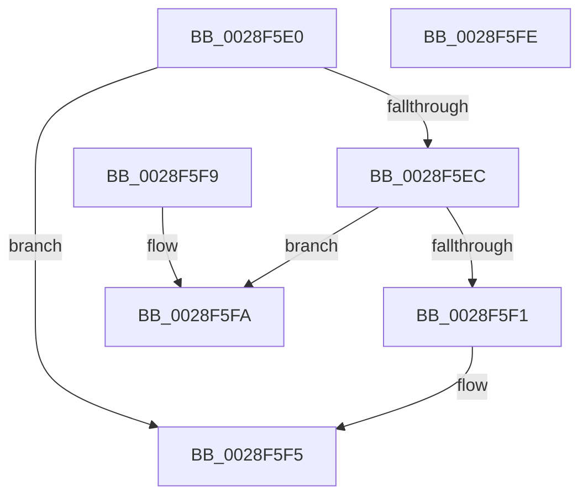

# MiSwizzleInvalidPte

- RVA: `0x0028F5E0`–`0x0028F5FF` (길이 `31` bytes)
- VA: `0x000000014028F5E0`
- 실행 섹션: `.text`
- PDB 이름 있음: `예`; PDB Function 태그: `아니요`
- unwind 정보 RVA: `0x000DB714`
- 디코드: `12`개 명령, `31/31` bytes 표시
- 미해석 바이트: `0` (있으면 어셈블리에 `.byte`로 보존)

> 이 문서는 커널 이미지의 기계어와 PDB 기호를 분석해 생성했습니다. 4번과 5번은 함수 원형과 자료형을 바이너리 사용 방식에서 추정한 C 해석이며 원본 소스 복구 결과는 아닙니다.

## 1. Dependencies

- 직접 호출 지점: **0**; 고유 호출 대상: **0**
- 직접 호출자로 확인된 함수: **18**
- RIP 상대 이미지 참조: **1**

### Outgoing calls
- 직접 디코드된 call 명령이 없습니다.

### Direct callers
- [MiWsleFlush](../23/MiWsleFlush_function_0023FB30.md) at `0x0023FC9C`
- [MiActOnPte](../24/MiActOnPte_function_00244C90.md) at `0x00244E73`
- [MiReleasePageFileInfo](MiReleasePageFileInfo_function_00283FD0.md) at `0x002843EA`
- [MiReleasePageFileInfo](MiReleasePageFileInfo_function_00283FD0.md) at `0x002844F7`
- [MiTrimUnusedPageFileRegionsWorker](../2A/MiTrimUnusedPageFileRegionsWorker_function_002AA320.md) at `0x002AA689`
- [MiReplaceTransitionPage](../2B/MiReplaceTransitionPage_function_002B1120.md) at `0x002B1678`
- [MiInitializeReadInProgressPfn](../2B/MiInitializeReadInProgressPfn_function_002B6990.md) at `0x002B6D7E`
- [MiCreateDecayPfn](../2B/MiCreateDecayPfn_function_002B8764.md) at `0x002B8939`
- [MiPrepareDecayNodeForReuse](../2B/MiPrepareDecayNodeForReuse_function_002B8ADC.md) at `0x002B8B10`
- [MiCompletePrivateZeroFault](../33/MiCompletePrivateZeroFault_function_00330CC0.md) at `0x00331965`
- [MiDecayNodeNowEmpty](../33/MiDecayNodeNowEmpty_function_0033C938.md) at `0x0033C991`
- [MiResolvePageFileFault](../36/MiResolvePageFileFault_function_0036D968.md) at `0x0036DFA6`
- [MiResolvePageFileFault](../36/MiResolvePageFileFault_function_0036D968.md) at `0x0036E3E6`
- [MiUpdatePfnBackingStore](../44/MiUpdatePfnBackingStore_function_004442B4.md) at `0x00444388`
- [MI_CLEAR_RESET_PTE](../46/MI_CLEAR_RESET_PTE_function_00464460.md) at `0x00464490`
- [MiClearResetPfn](../47/MiClearResetPfn_function_00473B3C.md) at `0x00473B69`
- [MiMakeSubsectionPte](../47/MiMakeSubsectionPte_function_0047B4F0.md) at `0x0047B509`
- [MiMakeGlobalSubsectionPte](../4D/MiMakeGlobalSubsectionPte_function_004DFEA8.md) at `0x004DFEFD`
- [MiInitializeNewPfns](../67/MiInitializeNewPfns_function_00670E94.md) at `0x00670F77`
- [MiFillFileOnlyProtoAsBad](../68/MiFillFileOnlyProtoAsBad_function_00680DB8.md) at `0x00680DE4`

### Static image references
- `0x0028F5E0` → RVA `0x00E2DC80` (`.data`; read)

## 2. Other-region calls and transfers

- 다른 실행 섹션으로 향하는 call: **0**
- 별도 외부 분기/꼬리 이동을 확인하지 못했습니다.

## 3. Assembly (complete function range)

```asm
0028F5E0  48 8B 05 99 E6 B9 00            mov rax, qword ptr [rip + 0xb9e699]
0028F5E7  48 85 C0                        test rax, rax
0028F5EA  74 09                           je 0x14028f5f5
0028F5EC  48 85 C1                        test rcx, rax
0028F5EF  74 09                           je 0x14028f5fa
0028F5F1  48 83 C9 10                     or rcx, 0x10
0028F5F5  48 8B C1                        mov rax, rcx
0028F5F8  C3                              ret
0028F5F9  CC                              int3
0028F5FA  48 0B C1                        or rax, rcx
0028F5FD  C3                              ret
0028F5FE  CC                              int3
```

## 4. C-style interpretation (structured pseudocode)

```c
__int64 __fastcall MiSwizzleInvalidPte(__int64 a1)
{
    __int64 result;

    if (*(unsigned __int64 *)(v_rip + 12183193) == 0) goto loc_0028F5F5;
    if (((a1) & (*(unsigned __int64 *)(v_rip + 12183193))) == 0) goto loc_0028F5FA;
    a1 = (a1) | (16);
loc_0028F5F5:
    return a1;
loc_0028F5FA:
    result = (a1) | (a1);
    return result;
}
```

## 5. (Beta) C Style

```c
int64_t MiSwizzleInvalidPte(int64_t Arg1)
{
    int64_t result;

    if (*(uint64_t *)(v_rip + 0xB9E699) == 0) goto loc_0028F5F5;
    if (((Arg1) & (*(uint64_t *)(v_rip + 0xB9E699))) == 0) goto loc_0028F5FA;
    Arg1 = (Arg1) | (16);
loc_0028F5F5:
    return Arg1;
loc_0028F5FA:
    result = (Arg1) | (Arg1);
    return result;
}
```

## 6. Execution-region graph

[열기: 2D/3D 그래프와 함수 탐색 컨트롤 패널](../../../control-panel.html?section=text&rva=0x0028F5E0&view=graph)

- 2D 그래프는 위에서 아래로 흐르고, 3D 그래프는 빈 공간을 드래그해 회전합니다. Shift+드래그는 이동, 휠은 확대·축소, 함수 노드 선택은 대상 보고서 이동입니다.

### Static fallback


