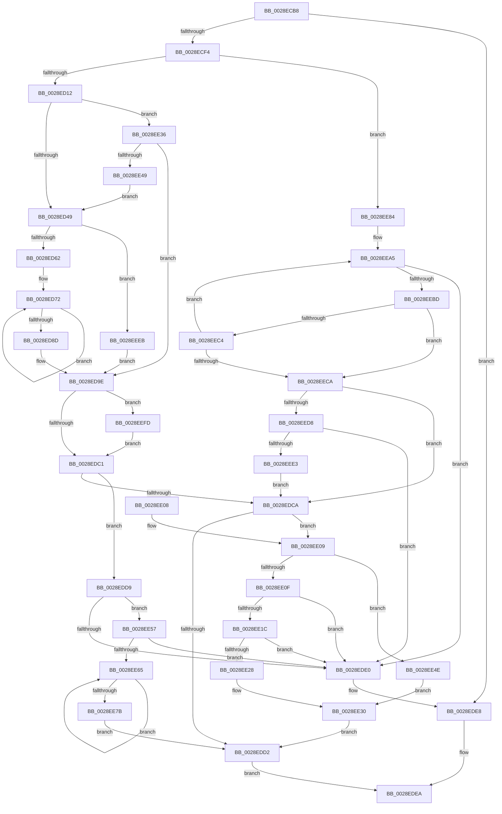

# MiSynchronizeSystemVa

- RVA: `0x0028ECB8`–`0x0028EF2F` (길이 `631` bytes)
- VA: `0x000000014028ECB8`
- 실행 섹션: `.text`
- PDB 이름 있음: `예`; PDB Function 태그: `아니요`
- unwind 정보 RVA: `0x00067110`
- 디코드: `167`개 명령, `631/631` bytes 표시
- 미해석 바이트: `0` (있으면 어셈블리에 `.byte`로 보존)

> 이 문서는 커널 이미지의 기계어와 PDB 기호를 분석해 생성했습니다. 4번과 5번은 함수 원형과 자료형을 바이너리 사용 방식에서 추정한 C 해석이며 원본 소스 복구 결과는 아닙니다.

## 1. Dependencies

- 직접 호출 지점: **9**; 고유 호출 대상: **9**
- 직접 호출자로 확인된 함수: **4**
- RIP 상대 이미지 참조: **1**

### Outgoing calls
- `0x0028ED17` → [MiLockWorkingSetShared](../27/MiLockWorkingSetShared_function_0027CBF0.md) (function, `0x0027CBF0`)
- `0x0028ED52` → [MiFastLockLeafPageTable](../27/MiFastLockLeafPageTable_function_00276340.md) (function, `0x00276340`)
- `0x0028EDE3` → [MiUnlockSystemVa](../34/MiUnlockSystemVa_function_0034B800.md) (function, `0x0034B800`)
- `0x0028EE12` → [MiGetSystemCacheReverseMap](../29/MiGetSystemCacheReverseMap_function_00294BF0.md) (function, `0x00294BF0`)
- `0x0028EE2B` → [MiGetMultiplexedVm](../34/MiGetMultiplexedVm_function_003479B0.md) (function, `0x003479B0`)
- `0x0028EE89` → [MiLockWorkingSetExclusive](../32/MiLockWorkingSetExclusive_function_003238A0.md) (function, `0x003238A0`)
- `0x0028EE98` → [MiFillPteHierarchy](../3F/MiFillPteHierarchy_function_003F7F90.md) (function, `0x003F7F90`)
- `0x0028EEB0` → [MI_READ_PTE_LOCK_FREE](MI_READ_PTE_LOCK_FREE_function_002828A0.md) (function, `0x002828A0`)
- `0x0028EF0A` → [MiLockLowestValidPageTableEx](MiLockLowestValidPageTableEx_function_00280D10.md) (function, `0x00280D10`)

### Direct callers
- [MiTranslatePageForCopy](../22/MiTranslatePageForCopy_function_00228960.md) at `0x00228AC2`
- [sub_0028E4EC](Unknown_function_0028E4EC.md) at `0x0028E55B`
- [MiTrimSharedPageFromViews](../2E/MiTrimSharedPageFromViews_function_002E16F8.md) at `0x002E1B32`
- [MiSystemFault](../34/MiSystemFault_function_0034AA64.md) at `0x0034ABEF`

### Static image references
- `0x0028EE4E` → RVA `0x00E3D680` (`.data`; read)

## 2. Other-region calls and transfers

- 다른 실행 섹션으로 향하는 call: **0**
- 별도 외부 분기/꼬리 이동을 확인하지 못했습니다.

## 3. Assembly (complete function range)

```asm
0028ECB8  48 89 5C 24 08                  mov qword ptr [rsp + 8], rbx
0028ECBD  48 89 74 24 10                  mov qword ptr [rsp + 0x10], rsi
0028ECC2  48 89 7C 24 18                  mov qword ptr [rsp + 0x18], rdi
0028ECC7  55                              push rbp
0028ECC8  41 54                           push r12
0028ECCA  41 55                           push r13
0028ECCC  41 56                           push r14
0028ECCE  41 57                           push r15
0028ECD0  48 8B EC                        mov rbp, rsp
0028ECD3  48 83 EC 50                     sub rsp, 0x50
0028ECD7  0F 57 C0                        xorps xmm0, xmm0
0028ECDA  45 33 F6                        xor r14d, r14d
0028ECDD  4C 8B FA                        mov r15, rdx
0028ECE0  4C 8B E9                        mov r13, rcx
0028ECE3  0F 11 45 D8                     movups xmmword ptr [rbp - 0x28], xmm0
0028ECE7  0F 11 45 E8                     movups xmmword ptr [rbp - 0x18], xmm0
0028ECEB  45 85 C0                        test r8d, r8d
0028ECEE  0F 84 F4 00 00 00               je 0x14028ede8
0028ECF4  48 8B 7D 50                     mov rdi, qword ptr [rbp + 0x50]
0028ECF8  44 89 77 10                     mov dword ptr [rdi + 0x10], r14d
0028ECFC  48 89 4F 18                     mov qword ptr [rdi + 0x18], rcx
0028ED00  8B 99 B8 00 00 00               mov ebx, dword ptr [rcx + 0xb8]
0028ED06  8A 47 25                        mov al, byte ptr [rdi + 0x25]
0028ED09  45 85 C9                        test r9d, r9d
0028ED0C  0F 85 72 01 00 00               jne 0x14028ee84
0028ED12  24 FE                           and al, 0xfe
0028ED14  88 47 25                        mov byte ptr [rdi + 0x25], al
0028ED17  E8 D4 DE FE FF                  call 0x14027cbf0
0028ED1C  88 47 24                        mov byte ptr [rdi + 0x24], al
0028ED1F  41 8B CE                        mov ecx, r14d
0028ED22  4C 89 75 D0                     mov qword ptr [rbp - 0x30], r14
0028ED26  45 8B E6                        mov r12d, r14d
0028ED29  48 BE 00 00 00 00 80 F6 FF FF   movabs rsi, 0xfffff68000000000
0028ED33  48 8B C6                        mov rax, rsi
0028ED36  49 B8 F8 FF FF FF 7F 00 00 00   movabs r8, 0x7ffffffff8
0028ED40  4C 3B F8                        cmp r15, rax
0028ED43  0F 83 ED 00 00 00               jae 0x14028ee36
0028ED49  45 33 C0                        xor r8d, r8d
0028ED4C  49 8B D7                        mov rdx, r15
0028ED4F  49 8B CD                        mov rcx, r13
0028ED52  E8 E9 75 FE FF                  call 0x140276340
0028ED57  4C 63 C0                        movsxd r8, eax
0028ED5A  85 C0                           test eax, eax
0028ED5C  0F 84 89 01 00 00               je 0x14028eeeb
0028ED62  49 8B CF                        mov rcx, r15
0028ED65  49 8B D6                        mov rdx, r14
0028ED68  49 B9 F8 FF FF FF 7F 00 00 00   movabs r9, 0x7ffffffff8
0028ED72  48 C1 E9 09                     shr rcx, 9
0028ED76  49 23 C9                        and rcx, r9
0028ED79  48 8B C6                        mov rax, rsi
0028ED7C  48 03 C8                        add rcx, rax
0028ED7F  48 89 4C D5 D8                  mov qword ptr [rbp + rdx*8 - 0x28], rcx
0028ED84  48 FF C2                        inc rdx
0028ED87  48 83 FA 04                     cmp rdx, 4
0028ED8B  7C E5                           jl 0x14028ed72
0028ED8D  4E 8B 64 C5 D0                  mov r12, qword ptr [rbp + r8*8 - 0x30]
0028ED92  4A 8B 4C C5 D8                  mov rcx, qword ptr [rbp + r8*8 - 0x28]
0028ED97  4D 8B C1                        mov r8, r9
0028ED9A  4C 89 65 D0                     mov qword ptr [rbp - 0x30], r12
0028ED9E  49 8B F7                        mov rsi, r15
0028EDA1  48 BA 00 00 00 00 80 F6 FF FF   movabs rdx, 0xfffff68000000000
0028EDAB  48 C1 EE 09                     shr rsi, 9
0028EDAF  49 23 F0                        and rsi, r8
0028EDB2  48 8B C2                        mov rax, rdx
0028EDB5  48 03 F0                        add rsi, rax
0028EDB8  48 85 C9                        test rcx, rcx
0028EDBB  0F 84 3C 01 00 00               je 0x14028eefd
0028EDC1  48 89 4F 28                     mov qword ptr [rdi + 0x28], rcx
0028EDC5  4C 3B E6                        cmp r12, rsi
0028EDC8  75 0F                           jne 0x14028edd9
0028EDCA  80 E3 0F                        and bl, 0xf
0028EDCD  80 FB 01                        cmp bl, 1
0028EDD0  74 37                           je 0x14028ee09
0028EDD2  B8 01 00 00 00                  mov eax, 1
0028EDD7  EB 11                           jmp 0x14028edea
0028EDD9  8B 47 04                        mov eax, dword ptr [rdi + 4]
0028EDDC  A8 04                           test al, 4
0028EDDE  75 77                           jne 0x14028ee57
0028EDE0  48 8B CF                        mov rcx, rdi
0028EDE3  E8 18 CA 0B 00                  call 0x14034b800
0028EDE8  33 C0                           xor eax, eax
0028EDEA  4C 8D 5C 24 50                  lea r11, [rsp + 0x50]
0028EDEF  49 8B 5B 30                     mov rbx, qword ptr [r11 + 0x30]
0028EDF3  49 8B 73 38                     mov rsi, qword ptr [r11 + 0x38]
0028EDF7  49 8B 7B 40                     mov rdi, qword ptr [r11 + 0x40]
0028EDFB  49 8B E3                        mov rsp, r11
0028EDFE  41 5F                           pop r15
0028EE00  41 5E                           pop r14
0028EE02  41 5D                           pop r13
0028EE04  41 5C                           pop r12
0028EE06  5D                              pop rbp
0028EE07  C3                              ret
0028EE08  CC                              int3
0028EE09  83 7F 30 03                     cmp dword ptr [rdi + 0x30], 3
0028EE0D  74 3F                           je 0x14028ee4e
0028EE0F  49 8B CF                        mov rcx, r15
0028EE12  E8 D9 5D 00 00                  call 0x140294bf0
0028EE17  48 85 C0                        test rax, rax
0028EE1A  74 C4                           je 0x14028ede0
0028EE1C  48 8B 40 20                     mov rax, qword ptr [rax + 0x20]
0028EE20  48 C1 E8 3E                     shr rax, 0x3e
0028EE24  3C 03                           cmp al, 3
0028EE26  75 B8                           jne 0x14028ede0
0028EE28  49 8B D7                        mov rdx, r15
0028EE2B  E8 80 8B 0B 00                  call 0x1403479b0
0028EE30  48 89 47 18                     mov qword ptr [rdi + 0x18], rax
0028EE34  EB 9C                           jmp 0x14028edd2
0028EE36  48 B8 FF FF FF FF FF F6 FF FF   movabs rax, 0xfffff6ffffffffff
0028EE40  4C 3B F8                        cmp r15, rax
0028EE43  0F 86 55 FF FF FF               jbe 0x14028ed9e
0028EE49  E9 FB FE FF FF                  jmp 0x14028ed49
0028EE4E  48 8D 05 2B E8 BA 00            lea rax, [rip + 0xbae82b]
0028EE55  EB D9                           jmp 0x14028ee30
0028EE57  49 8B 04 24                     mov rax, qword ptr [r12]
0028EE5B  24 81                           and al, 0x81
0028EE5D  3C 81                           cmp al, 0x81
0028EE5F  0F 85 7B FF FF FF               jne 0x14028ede0
0028EE65  48 C1 EE 09                     shr rsi, 9
0028EE69  49 23 F0                        and rsi, r8
0028EE6C  48 8B CA                        mov rcx, rdx
0028EE6F  48 03 F1                        add rsi, rcx
0028EE72  41 FF C6                        inc r14d
0028EE75  48 3B 75 D0                     cmp rsi, qword ptr [rbp - 0x30]
0028EE79  75 EA                           jne 0x14028ee65
0028EE7B  44 89 77 10                     mov dword ptr [rdi + 0x10], r14d
0028EE7F  E9 4E FF FF FF                  jmp 0x14028edd2
0028EE84  0C 01                           or al, 1
0028EE86  88 47 25                        mov byte ptr [rdi + 0x25], al
0028EE89  E8 12 4A 09 00                  call 0x1403238a0
0028EE8E  48 8D 55 D8                     lea rdx, [rbp - 0x28]
0028EE92  88 47 24                        mov byte ptr [rdi + 0x24], al
0028EE95  49 8B CF                        mov rcx, r15
0028EE98  E8 F3 90 16 00                  call 0x1403f7f90
0028EE9D  BE 04 00 00 00                  mov esi, 4
0028EEA2  44 8B EE                        mov r13d, esi
0028EEA5  48 8B 4C F5 D0                  mov rcx, qword ptr [rbp + rsi*8 - 0x30]
0028EEAA  48 FF CE                        dec rsi
0028EEAD  41 FF CD                        dec r13d
0028EEB0  E8 EB 39 FF FF                  call 0x1402828a0
0028EEB5  A8 01                           test al, 1
0028EEB7  0F 84 23 FF FF FF               je 0x14028ede0
0028EEBD  25 80 00 00 00                  and eax, 0x80
0028EEC2  75 06                           jne 0x14028eeca
0028EEC4  48 83 FE 01                     cmp rsi, 1
0028EEC8  75 DB                           jne 0x14028eea5
0028EECA  48 F7 D8                        neg rax
0028EECD  1B C9                           sbb ecx, ecx
0028EECF  41 23 CD                        and ecx, r13d
0028EED2  0F 84 F2 FE FF FF               je 0x14028edca
0028EED8  8B 47 04                        mov eax, dword ptr [rdi + 4]
0028EEDB  A8 04                           test al, 4
0028EEDD  0F 84 FD FE FF FF               je 0x14028ede0
0028EEE3  89 4F 10                        mov dword ptr [rdi + 0x10], ecx
0028EEE6  E9 DF FE FF FF                  jmp 0x14028edca
0028EEEB  49 8B CE                        mov rcx, r14
0028EEEE  49 B8 F8 FF FF FF 7F 00 00 00   movabs r8, 0x7ffffffff8
0028EEF8  E9 A1 FE FF FF                  jmp 0x14028ed9e
0028EEFD  45 33 C9                        xor r9d, r9d
0028EF00  4C 8D 45 D0                     lea r8, [rbp - 0x30]
0028EF04  48 8B D6                        mov rdx, rsi
0028EF07  49 8B CD                        mov rcx, r13
0028EF0A  E8 01 1E FF FF                  call 0x140280d10
0028EF0F  4C 8B 65 D0                     mov r12, qword ptr [rbp - 0x30]
0028EF13  48 8B C8                        mov rcx, rax
0028EF16  48 BA 00 00 00 00 80 F6 FF FF   movabs rdx, 0xfffff68000000000
0028EF20  49 B8 F8 FF FF FF 7F 00 00 00   movabs r8, 0x7ffffffff8
0028EF2A  E9 92 FE FF FF                  jmp 0x14028edc1
```

## 4. C-style interpretation (structured pseudocode)

```c
__int64 __fastcall MiSynchronizeSystemVa(__int64 a1, __int64 a2, int a3, int a4, __int64 a5)
{
    __int64 result;
    __int64 v_r13;
    __int64 v_r14;
    __int64 v_rbx;
    __int64 v_rsi;
    __int64 v_rsp;
    unsigned __int64 v_stack_m28;
    unsigned __int64 v_stack_m40;
    unsigned __int64 v_stack_m50;
    unsigned __int64 v_stack_m58;
    unsigned __int64 v_stack_p10;
    unsigned __int64 v_stack_p18;
    unsigned __int64 v_stack_p8;

    v_stack_p8 = v_rbx;
    v_stack_p10 = v_rsi;
    v_stack_p18 = v_rdi;
    v_rsp = (v_rsp) - (80);
    v_r14 = 0;
    v_stack_m50 = v_xmm0;
    v_stack_m40 = v_xmm0;
    if (a3 == 0) goto loc_0028EDE8;
    *(unsigned int *)(a5 + 16) = 0;
    *(unsigned __int64 *)(a5 + 24) = a1;
    if (a4 != 0) goto loc_0028EE84;
    result = (unsigned __int8)((*(unsigned __int8 *)(a5 + 37)) & (254));
    *(unsigned __int8 *)(a5 + 37) = (unsigned __int8)(result);
    result = MiLockWorkingSetShared(a1, a2, a3, a4);
    *(unsigned __int8 *)(a5 + 36) = (unsigned __int8)(result);
    v_stack_m58 = 0;
    if (a2 >= v_rsi) goto loc_0028EE36;
loc_0028ED49:
    a3 = 0;
    result = MiFastLockLeafPageTable(a1, a2, a3, a4);
    if ((unsigned int)(result) == 0) goto loc_0028EEEB;
loc_0028ED72:
    a1 = (a2) >> (9);
    a1 = (a1) & (a4);
    a1 = (a1) + (v_rsi);
    *(unsigned __int64 *)(v_rsp + 0 * 8 - 40) = a1;
    a2 = (0) + 1;
    if (a2 < 4) goto loc_0028ED72;
    v_stack_m58 = *(unsigned __int64 *)(v_rsp + (int)((unsigned int)(result)) * 8 - 48);
loc_0028ED9E:
    v_rsi = (a2) >> (9);
    v_rsi = (v_rsi) & (a4);
    v_rsi = (v_rsi) + (a2);
    if (*(unsigned __int64 *)(v_rsp + (int)((unsigned int)(result)) * 8 - 40) == 0) goto loc_0028EEFD;
loc_0028EDC1:
    *(unsigned __int64 *)(a5 + 40) = *(unsigned __int64 *)(v_rsp + (int)((unsigned int)(result)) * 8 - 40);
    if ((*(unsigned __int64 *)(v_rsp + (int)((unsigned int)(result)) * 8 - 48)) != v_rsi) goto loc_0028EDD9;
loc_0028EDCA:
    v_rbx = (unsigned __int8)(((unsigned int)(*(unsigned int *)(a1 + 184))) & (15));
    if (((unsigned __int8)(v_rbx)) == 1) goto loc_0028EE09;
loc_0028EDD2:
    goto loc_0028EDEA;
loc_0028EDD9:
    if ((((unsigned __int8)((unsigned int)(*(unsigned int *)(a5 + 4)))) & (4)) != 0) goto loc_0028EE57;
loc_0028EDE0:
    result = MiUnlockSystemVa(a5, a2, a4, a4);
loc_0028EDE8:
    result = 0;
loc_0028EDEA:
    return result;
loc_0028EE09:
    if ((*(unsigned int *)(*(unsigned __int64 *)(v_stack_m28 + 64) + 48)) == 3) goto loc_0028EE4E;
    result = MiGetSystemCacheReverseMap(a2, a2, a4, a4);
    if (result == 0) goto loc_0028EDE0;
    result = (*(unsigned __int64 *)(result + 32)) >> (62);
    if (((unsigned __int8)(result)) != 3) goto loc_0028EDE0;
    result = MiGetMultiplexedVm(a2, a2, a4, a4);
loc_0028EE30:
    *(unsigned __int64 *)(*(unsigned __int64 *)(v_stack_m28 + 64) + 24) = result;
    goto loc_0028EDD2;
loc_0028EE36:
    if (a2 <= result) goto loc_0028ED9E;
    goto loc_0028ED49;
loc_0028EE4E:
    goto loc_0028EE30;
loc_0028EE57:
    result = (unsigned __int8)((*(unsigned __int64 *)(*(unsigned __int64 *)(v_rsp + (int)((unsigned int)(result)) * 8 - 48))) & (129));
    if (((unsigned __int8)(result)) != 129) goto loc_0028EDE0;
loc_0028EE65:
    v_rsi = (*(unsigned __int64 *)(v_stack_m28 + 56)) >> (9);
    v_rsi = (v_rsi) & (a4);
    v_rsi = (v_rsi) + (a2);
    v_r14 = (unsigned int)((v_r14) + 1);
    if (v_rsi != v_stack_m58) goto loc_0028EE65;
    *(unsigned int *)(*(unsigned __int64 *)(v_stack_m28 + 64) + 16) = (unsigned int)(v_r14);
    goto loc_0028EDD2;
loc_0028EE84:
    result = (unsigned __int8)((result) | (1));
    *(unsigned __int8 *)(*(unsigned __int64 *)(v_stack_m28 + 64) + 37) = (unsigned __int8)(result);
    result = MiLockWorkingSetExclusive(a2, a2, a4, a4);
    *(unsigned __int8 *)(*(unsigned __int64 *)(v_stack_m28 + 64) + 36) = (unsigned __int8)(result);
    result = MiFillPteHierarchy(a2, v_stack_m50, a4, a4);
loc_0028EEA5:
    v_rsi = (4) - 1;
    v_r13 = (unsigned int)((4) - 1);
    result = MI_READ_PTE_LOCK_FREE(*(unsigned __int64 *)(v_rsp + 4 * 8 - 48), v_stack_m50, a4, a4);
    if ((((unsigned __int8)(result)) & (1)) == 0) goto loc_0028EDE0;
    result = (unsigned int)((result) & (128));
    if (condition_is_not_equal) goto loc_0028EECA;
    if (v_rsi != 1) goto loc_0028EEA5;
loc_0028EECA:
    result = -(result);
    a1 = (unsigned int)((*(unsigned __int64 *)(v_rsp + 4 * 8 - 48)) & ((unsigned int)(v_r13)));
    if (condition_is_equal) goto loc_0028EDCA;
    if ((((unsigned __int8)((unsigned int)(*(unsigned int *)(*(unsigned __int64 *)(v_stack_m28 + 64) + 4)))) & (4)) == 0) goto loc_0028EDE0;
    *(unsigned int *)(*(unsigned __int64 *)(v_stack_m28 + 64) + 16) = (unsigned int)(a1);
    goto loc_0028EDCA;
loc_0028EEEB:
    goto loc_0028ED9E;
loc_0028EEFD:
    a4 = 0;
    result = MiLockLowestValidPageTableEx(v_r13, v_rsi, v_stack_m58, a4);
    goto loc_0028EDC1;
}
```

## 5. (Beta) C Style

```c
int64_t MiSynchronizeSystemVa(void *Arg1, int64_t Arg2, int32_t Arg3, int32_t Arg4, void *Arg5)
{
    uint8_t *arg1 = (uint8_t *)Arg1;
    uint8_t *arg5 = (uint8_t *)Arg5;

    int64_t result;
    int64_t local_r13;
    int64_t local_r14;
    int64_t local_rbx;
    int64_t local_rsi;
    int64_t local_rsp;
    uint64_t v_stack_m28;
    uint64_t v_stack_m40;
    uint64_t v_stack_m50;
    uint64_t v_stack_m58;
    uint64_t v_stack_p10;
    uint64_t v_stack_p18;
    uint64_t v_stack_p8;

    v_stack_p8 = local_rbx;
    v_stack_p10 = local_rsi;
    v_stack_p18 = local_rdi;
    local_rsp = (local_rsp) - (80);
    local_r14 = 0;
    v_stack_m50 = v_xmm0;
    v_stack_m40 = v_xmm0;
    if (Arg3 == 0) goto loc_0028EDE8;
    *(uint32_t *)(arg5 + 0x10) = 0;
    *(void **)(arg5 + 0x18) = Arg1;
    if (Arg4 != 0) goto loc_0028EE84;
    result = (uint8_t)((*(uint8_t *)(arg5 + 0x25)) & (254));
    *(uint8_t *)(arg5 + 0x25) = (uint8_t)(result);
    result = MiLockWorkingSetShared(Arg1, Arg2, Arg3, Arg4);
    *(uint8_t *)(arg5 + 0x24) = (uint8_t)(result);
    v_stack_m58 = 0;
    if (Arg2 >= local_rsi) goto loc_0028EE36;
loc_0028ED49:
    Arg3 = 0;
    result = MiFastLockLeafPageTable(Arg1, Arg2, Arg3, Arg4);
    if ((uint32_t)(result) == 0) goto loc_0028EEEB;
loc_0028ED72:
    Arg1 = (Arg2) >> (9);
    Arg1 = (Arg1) & (Arg4);
    Arg1 = (Arg1) + (local_rsi);
    *(void **)(local_rsp + 0x0 * 8 - 0x28) = Arg1;
    Arg2 = (0) + 1;
    if (Arg2 < 4) goto loc_0028ED72;
    v_stack_m58 = *(uint64_t *)(local_rsp + (int32_t)((uint32_t)(result)) * 8 - 0x30);
loc_0028ED9E:
    local_rsi = (Arg2) >> (9);
    local_rsi = (local_rsi) & (Arg4);
    local_rsi = (local_rsi) + (Arg2);
    if (*(uint64_t *)(local_rsp + (int32_t)((uint32_t)(result)) * 8 - 0x28) == 0) goto loc_0028EEFD;
loc_0028EDC1:
    *(uint64_t *)(arg5 + 0x28) = *(uint64_t *)(local_rsp + (int32_t)((uint32_t)(result)) * 8 - 0x28);
    if ((*(uint64_t *)(local_rsp + (int32_t)((uint32_t)(result)) * 8 - 0x30)) != local_rsi) goto loc_0028EDD9;
loc_0028EDCA:
    local_rbx = (uint8_t)(((uint32_t)(*(uint32_t *)(arg1 + 0xB8))) & (15));
    if (((uint8_t)(local_rbx)) == 1) goto loc_0028EE09;
loc_0028EDD2:
    goto loc_0028EDEA;
loc_0028EDD9:
    if ((((uint8_t)((uint32_t)(*(uint32_t *)(arg5 + 0x4)))) & (4)) != 0) goto loc_0028EE57;
loc_0028EDE0:
    result = MiUnlockSystemVa(Arg5, Arg2, Arg4, Arg4);
loc_0028EDE8:
    result = 0;
loc_0028EDEA:
    return result;
loc_0028EE09:
    if ((*(uint32_t *)(*(uint64_t *)(v_stack_m28 + 0x40) + 0x30)) == 3) goto loc_0028EE4E;
    result = MiGetSystemCacheReverseMap(Arg2, Arg2, Arg4, Arg4);
    if (result == 0) goto loc_0028EDE0;
    result = (*(uint64_t *)(result + 0x20)) >> (62);
    if (((uint8_t)(result)) != 3) goto loc_0028EDE0;
    result = MiGetMultiplexedVm(Arg2, Arg2, Arg4, Arg4);
loc_0028EE30:
    *(uint64_t *)(*(uint64_t *)(v_stack_m28 + 0x40) + 0x18) = result;
    goto loc_0028EDD2;
loc_0028EE36:
    if (Arg2 <= result) goto loc_0028ED9E;
    goto loc_0028ED49;
loc_0028EE4E:
    goto loc_0028EE30;
loc_0028EE57:
    result = (uint8_t)((*(uint64_t *)(*(uint64_t *)(local_rsp + (int32_t)((uint32_t)(result)) * 8 - 0x30))) & (129));
    if (((uint8_t)(result)) != 129) goto loc_0028EDE0;
loc_0028EE65:
    local_rsi = (*(uint64_t *)(v_stack_m28 + 0x38)) >> (9);
    local_rsi = (local_rsi) & (Arg4);
    local_rsi = (local_rsi) + (Arg2);
    local_r14 = (uint32_t)((local_r14) + 1);
    if (local_rsi != v_stack_m58) goto loc_0028EE65;
    *(uint32_t *)(*(uint64_t *)(v_stack_m28 + 0x40) + 0x10) = (uint32_t)(local_r14);
    goto loc_0028EDD2;
loc_0028EE84:
    result = (uint8_t)((result) | (1));
    *(uint8_t *)(*(uint64_t *)(v_stack_m28 + 0x40) + 0x25) = (uint8_t)(result);
    result = MiLockWorkingSetExclusive(Arg2, Arg2, Arg4, Arg4);
    *(uint8_t *)(*(uint64_t *)(v_stack_m28 + 0x40) + 0x24) = (uint8_t)(result);
    result = MiFillPteHierarchy(Arg2, v_stack_m50, Arg4, Arg4);
loc_0028EEA5:
    local_rsi = (4) - 1;
    local_r13 = (uint32_t)((4) - 1);
    result = MI_READ_PTE_LOCK_FREE(*(uint64_t *)(local_rsp + 0x4 * 8 - 0x30), v_stack_m50, Arg4, Arg4);
    if ((((uint8_t)(result)) & (1)) == 0) goto loc_0028EDE0;
    result = (uint32_t)((result) & (128));
    if (condition_is_not_equal) goto loc_0028EECA;
    if (local_rsi != 1) goto loc_0028EEA5;
loc_0028EECA:
    result = -(result);
    Arg1 = (uint32_t)((*(uint64_t *)(local_rsp + 0x4 * 8 - 0x30)) & ((uint32_t)(local_r13)));
    if (condition_is_equal) goto loc_0028EDCA;
    if ((((uint8_t)((uint32_t)(*(uint32_t *)(*(uint64_t *)(v_stack_m28 + 0x40) + 0x4)))) & (4)) == 0) goto loc_0028EDE0;
    *(uint32_t *)(*(uint64_t *)(v_stack_m28 + 0x40) + 0x10) = (uint32_t)(Arg1);
    goto loc_0028EDCA;
loc_0028EEEB:
    goto loc_0028ED9E;
loc_0028EEFD:
    Arg4 = 0;
    result = MiLockLowestValidPageTableEx(local_r13, local_rsi, v_stack_m58, Arg4);
    goto loc_0028EDC1;
}
```

### 관측된 메모리 오프셋

구조체 형식이 확인되지 않은 접근은 인자 기준의 오프셋으로만 기록했습니다.

| 기준 인자 | 오프셋 표현 | 폭 (bit) | 접근 |
|---|---:|---:|---|
| `Arg1` | `+ 0xB8` | `32` | `R` |
| `Arg5` | `+ 0x4` | `32` | `R` |
| `Arg5` | `+ 0x10` | `32` | `W` |
| `Arg5` | `+ 0x18` | `64` | `W` |
| `Arg5` | `+ 0x24` | `8` | `W` |
| `Arg5` | `+ 0x25` | `8` | `R` |
| `Arg5` | `+ 0x25` | `8` | `W` |
| `Arg5` | `+ 0x28` | `64` | `W` |
| `Arg5` | `+ 0x30` | `32` | `R` |

## 6. Execution-region graph

[열기: 2D/3D 그래프와 함수 탐색 컨트롤 패널](../../../control-panel.html?section=text&rva=0x0028ECB8&view=graph)

- 2D 그래프는 위에서 아래로 흐르고, 3D 그래프는 빈 공간을 드래그해 회전합니다. Shift+드래그는 이동, 휠은 확대·축소, 함수 노드 선택은 대상 보고서 이동입니다.

### Static fallback


