# MiSystemVaTypeToVm

- RVA: `0x0028EB50`–`0x0028EC6C` (길이 `284` bytes)
- VA: `0x000000014028EB50`
- 실행 섹션: `.text`
- PDB 이름 있음: `예`; PDB Function 태그: `아니요`
- unwind 정보 RVA: `0x000670F4`
- 디코드: `96`개 명령, `284/284` bytes 표시
- 미해석 바이트: `1` (있으면 어셈블리에 `.byte`로 보존)

> 이 문서는 커널 이미지의 기계어와 PDB 기호를 분석해 생성했습니다. 4번과 5번은 함수 원형과 자료형을 바이너리 사용 방식에서 추정한 C 해석이며 원본 소스 복구 결과는 아닙니다.

## 1. Dependencies

- 직접 호출 지점: **1**; 고유 호출 대상: **1**
- 직접 호출자로 확인된 함수: **14**
- RIP 상대 이미지 참조: **10**

### Outgoing calls
- `0x0028EC11` → [MiGetAnyMultiplexedVm](../44/MiGetAnyMultiplexedVm_function_00448BD0.md) (function, `0x00448BD0`)

### Direct callers
- [MiTranslatePageForCopy](../22/MiTranslatePageForCopy_function_00228960.md) at `0x00228A9E`
- [sub_0028E3BA](Unknown_function_0028E3BA.md) at `0x0028E3E3`
- [MiFlushSingleTbEntry](MiFlushSingleTbEntry_function_0028E730.md) at `0x0028E806`
- [MiCheckLinearProtectedPteAccessedBit](../29/MiCheckLinearProtectedPteAccessedBit_function_00292D80.md) at `0x00292DD0`
- [MiDecommitSystemPageTables](../2C/MiDecommitSystemPageTables_function_002C1054.md) at `0x002C10C5`
- [MiTrimSharedPageFromViews](../2E/MiTrimSharedPageFromViews_function_002E16F8.md) at `0x002E1B0F`
- [MiVaToFlushVm](../31/MiVaToFlushVm_function_0031AD84.md) at `0x0031ADBF`
- [MiSystemFault](../34/MiSystemFault_function_0034AA64.md) at `0x0034ABC9`
- [MiMakeZeroedPageTablesEx](../3B/MiMakeZeroedPageTablesEx_function_003B59FC.md) at `0x003B5AF5`
- [MiFreedUnusedPfnPagesDpc](../67/MiFreedUnusedPfnPagesDpc_function_00672378.md) at `0x00672392`
- [MiGetFileOnlyRanges](../67/MiGetFileOnlyRanges_function_00672684.md) at `0x006726D3`
- [MiGetNextNonGapPfnPage](../67/MiGetNextNonGapPfnPage_function_006728D8.md) at `0x006729A4`
- [MmAddRangeToCrashDump](../67/MmAddRangeToCrashDump_function_0067D8B0.md) at `0x0067D95B`
- [MiInitNucleus](../../init/C5/MiInitNucleus_function_00C5FD38.md) at `0x00C5FEB8`

### Static image references
- `0x0028EB6D` → RVA `0x00000000` (`image boundary/outside`; read)
- `0x0028EBA4` → RVA `0x00E38200` (`.data`; read)
- `0x0028EBB1` → RVA `0x00E380C0` (`.data`; read)
- `0x0028EBBE` → RVA `0x00E3D680` (`.data`; read)
- `0x0028EBCB` → RVA `0x00E37F80` (`.data`; read)
- `0x0028EBD8` → RVA `0x00E38480` (`.data`; read)
- `0x0028EBE5` → RVA `0x00E38340` (`.data`; read)
- `0x0028EBF2` → RVA `0x00E37E40` (`.data`; read)
- `0x0028EBFF` → RVA `0x00E38700` (`.data`; read)
- `0x0028EC18` → RVA `0x00E2F240` (`.data`; read)

## 2. Other-region calls and transfers

- 다른 실행 섹션으로 향하는 call: **0**
- call이 아닌 외부 분기/꼬리 이동: **7**
  - `0x0028EC4D` → `0x0028EC77` (`tail-transfer`)
  - `0x0028EC51` → `0x0028EC7B` (`tail-transfer`)
  - `0x0028EC55` → `0x0028EC7F` (`tail-transfer`)
  - `0x0028EC59` → [MiGetSystemRegionType + 0x3](MiGetSystemRegionType_function_0028EC80.md) (`tail-transfer`)
  - `0x0028EC61` → [MiGetSystemRegionType + 0xB](MiGetSystemRegionType_function_0028EC80.md) (`tail-transfer`)
  - `0x0028EC65` → [MiGetSystemRegionType + 0xF](MiGetSystemRegionType_function_0028EC80.md) (`tail-transfer`)
  - `0x0028EC69` → [MiGetSystemRegionType + 0x13](MiGetSystemRegionType_function_0028EC80.md) (`tail-transfer`)

## 3. Assembly (complete function range)

```asm
0028EB50  48 83 EC 28                     sub rsp, 0x28
0028EB54  33 C0                           xor eax, eax
0028EB56  83 F9 01                        cmp ecx, 1
0028EB59  74 2D                           je 0x14028eb88
0028EB5B  83 F9 05                        cmp ecx, 5
0028EB5E  74 51                           je 0x14028ebb1
0028EB60  83 F9 07                        cmp ecx, 7
0028EB63  74 59                           je 0x14028ebbe
0028EB65  83 C1 FE                        add ecx, -2
0028EB68  83 F9 11                        cmp ecx, 0x11
0028EB6B  77 31                           ja 0x14028eb9e
0028EB6D  4C 8D 05 8C 14 D7 FF            lea r8, [rip - 0x28eb74]
0028EB74  48 63 C9                        movsxd rcx, ecx
0028EB77  41 8B 94 88 24 EC 28 00         mov edx, dword ptr [r8 + rcx*4 + 0x28ec24]
0028EB7F  49 03 D0                        add rdx, r8
0028EB82  FF E2                           jmp rdx
0028EB84  CC                              int3
0028EB85  CC                              int3
0028EB86  CC                              int3
0028EB87  CC                              int3
0028EB88  65 48 8B 04 25 88 01 00 00      mov rax, qword ptr gs:[0x188]
0028EB91  48 8B 80 B8 00 00 00            mov rax, qword ptr [rax + 0xb8]
0028EB98  48 05 00 04 00 00               add rax, 0x400
0028EB9E  48 83 C4 28                     add rsp, 0x28
0028EBA2  C3                              ret
0028EBA3  CC                              int3
0028EBA4  48 8D 05 55 96 BA 00            lea rax, [rip + 0xba9655]
0028EBAB  48 83 C4 28                     add rsp, 0x28
0028EBAF  C3                              ret
0028EBB0  CC                              int3
0028EBB1  48 8D 05 08 95 BA 00            lea rax, [rip + 0xba9508]
0028EBB8  48 83 C4 28                     add rsp, 0x28
0028EBBC  C3                              ret
0028EBBD  CC                              int3
0028EBBE  48 8D 05 BB EA BA 00            lea rax, [rip + 0xbaeabb]
0028EBC5  48 83 C4 28                     add rsp, 0x28
0028EBC9  C3                              ret
0028EBCA  CC                              int3
0028EBCB  48 8D 05 AE 93 BA 00            lea rax, [rip + 0xba93ae]
0028EBD2  48 83 C4 28                     add rsp, 0x28
0028EBD6  C3                              ret
0028EBD7  CC                              int3
0028EBD8  48 8D 05 A1 98 BA 00            lea rax, [rip + 0xba98a1]
0028EBDF  48 83 C4 28                     add rsp, 0x28
0028EBE3  C3                              ret
0028EBE4  CC                              int3
0028EBE5  48 8D 05 54 97 BA 00            lea rax, [rip + 0xba9754]
0028EBEC  48 83 C4 28                     add rsp, 0x28
0028EBF0  C3                              ret
0028EBF1  CC                              int3
0028EBF2  48 8D 05 47 92 BA 00            lea rax, [rip + 0xba9247]
0028EBF9  48 83 C4 28                     add rsp, 0x28
0028EBFD  C3                              ret
0028EBFE  CC                              int3
0028EBFF  48 8D 05 FA 9A BA 00            lea rax, [rip + 0xba9afa]
0028EC06  48 83 C4 28                     add rsp, 0x28
0028EC0A  C3                              ret
0028EC0B  CC                              int3
0028EC0C  B9 02 00 00 00                  mov ecx, 2
0028EC11  E8 BA 9F 1B 00                  call 0x140448bd0
0028EC16  EB 86                           jmp 0x14028eb9e
0028EC18  48 8D 05 21 06 BA 00            lea rax, [rip + 0xba0621]
0028EC1F  E9 7A FF FF FF                  jmp 0x14028eb9e
0028EC24  F2 EB 28                        bnd jmp 0x14028ec4f
0028EC27  00 0C EC                        add byte ptr [rsp + rbp*8], cl
0028EC2A  28 00                           sub byte ptr [rax], al
0028EC2C  D8 EB                           fsubr st(3)
0028EC2E  28 00                           sub byte ptr [rax], al
0028EC30  9E                              sahf
0028EC31  EB 28                           jmp 0x14028ec5b
0028EC33  00 A4 EB 28 00 9E EB            add byte ptr [rbx + rbp*8 - 0x1461ffd8], ah
0028EC3A  28 00                           sub byte ptr [rax], al
0028EC3C  A4                              movsb byte ptr [rdi], byte ptr [rsi]
0028EC3D  EB 28                           jmp 0x14028ec67
0028EC3F  00 D8                           add al, bl
0028EC41  EB 28                           jmp 0x14028ec6b
0028EC43  00 A4 EB 28 00 F2 EB            add byte ptr [rbx + rbp*8 - 0x140dffd8], ah
0028EC4A  28 00                           sub byte ptr [rax], al
0028EC4C  A4                              movsb byte ptr [rdi], byte ptr [rsi]
0028EC4D  EB 28                           jmp 0x14028ec77
0028EC4F  00 E5                           add ch, ah
0028EC51  EB 28                           jmp 0x14028ec7b
0028EC53  00 D8                           add al, bl
0028EC55  EB 28                           jmp 0x14028ec7f
0028EC57  00 FF                           add bh, bh
0028EC59  EB 28                           jmp 0x14028ec83
0028EC5B  00 18                           add byte ptr [rax], bl
0028EC5D  EC                              in al, dx
0028EC5E  28 00                           sub byte ptr [rax], al
0028EC60  CB                              retf
0028EC61  EB 28                           jmp 0x14028ec8b
0028EC63  00 FF                           add bh, bh
0028EC65  EB 28                           jmp 0x14028ec8f
0028EC67  00 D8                           add al, bl
0028EC69  EB 28                           jmp 0x14028ec93
0028EC6B  00                              .byte 0x00
```

## 4. C-style interpretation (structured pseudocode)

```c
__int64 __fastcall MiSystemVaTypeToVm(int a1)
{
    __int64 result;
    __int64 v_rsp;

    v_rsp = (v_rsp) - (40);
    result = 0;
    if (a1 == 1) goto loc_0028EB88;
    if (a1 == 5) goto loc_0028EBB1;
    if (a1 == 7) goto loc_0028EBBE;
    a1 = (unsigned int)((a1) + (-2));
    if (a1 > 17) goto loc_0028EB9E;
    a2 = ((unsigned int)(*(unsigned int *)(v_rip - 2681716 + (int)(a1) * 4 + 2681892))) + (v_rip - 2681716);
loc_0028EB88:
    result = (*(unsigned __int64 *)(*(unsigned __int64 *)(gs_base + (0 + 392)) + 184)) + (0x400ULL);
loc_0028EB9E:
    v_rsp = (v_rsp) + (40);
    return result;
loc_0028EBB1:
    v_rsp = (v_rsp) + (40);
    return v_rip + 12227848;
loc_0028EBBE:
    v_rsp = (v_rsp) + (40);
    return v_rip + 12249787;
}
```

## 5. (Beta) C Style

```c
int64_t MiSystemVaTypeToVm(int32_t Arg1)
{
    int64_t result;
    int64_t local_rsp;

    local_rsp = (local_rsp) - (40);
    result = 0;
    if (Arg1 == 1) goto loc_0028EB88;
    if (Arg1 == 5) goto loc_0028EBB1;
    if (Arg1 == 7) goto loc_0028EBBE;
    Arg1 = (uint32_t)((Arg1) + (-2));
    if (Arg1 > 17) goto loc_0028EB9E;
    a2 = ((uint32_t)(*(uint32_t *)(v_rip - 0x28EB74 + (int32_t)(Arg1) * 4 + 0x28EC24))) + (v_rip - 2681716);
loc_0028EB88:
    result = (*(uint64_t *)(*(uint64_t *)(gs_base + (0 + 0x188)) + 0xB8)) + (0x400ULL);
loc_0028EB9E:
    local_rsp = (local_rsp) + (40);
    return result;
loc_0028EBB1:
    local_rsp = (local_rsp) + (40);
    return v_rip + 12227848;
loc_0028EBBE:
    local_rsp = (local_rsp) + (40);
    return v_rip + 12249787;
}
```

## 6. Execution-region graph

[열기: 2D/3D 그래프와 함수 탐색 컨트롤 패널](../../../control-panel.html?section=text&rva=0x0028EB50&view=graph)

- 2D 그래프는 위에서 아래로 흐르고, 3D 그래프는 빈 공간을 드래그해 회전합니다. Shift+드래그는 이동, 휠은 확대·축소, 함수 노드 선택은 대상 보고서 이동입니다.

### Static fallback

```mermaid
flowchart TD
  bb_0028EB50[BB_0028EB50]
  bb_0028EB5B[BB_0028EB5B]
  bb_0028EB60[BB_0028EB60]
  bb_0028EB65[BB_0028EB65]
  bb_0028EB6D[BB_0028EB6D]
  bb_0028EB84[BB_0028EB84]
  bb_0028EB88[BB_0028EB88]
  bb_0028EB9E[BB_0028EB9E]
  bb_0028EBA3[BB_0028EBA3]
  bb_0028EBB0[BB_0028EBB0]
  bb_0028EBB1[BB_0028EBB1]
  bb_0028EBBD[BB_0028EBBD]
  bb_0028EBBE[BB_0028EBBE]
  bb_0028EBCA[BB_0028EBCA]
  bb_0028EBD7[BB_0028EBD7]
  bb_0028EBE4[BB_0028EBE4]
  bb_0028EBF1[BB_0028EBF1]
  bb_0028EBFE[BB_0028EBFE]
  bb_0028EC0B[BB_0028EC0B]
  bb_0028EC18[BB_0028EC18]
  bb_0028EC24[BB_0028EC24]
  bb_0028EC27[BB_0028EC27]
  bb_0028EC33[BB_0028EC33]
  bb_0028EC3F[BB_0028EC3F]
  bb_0028EC43[BB_0028EC43]
  bb_0028EC4F[BB_0028EC4F]
  bb_0028EC53[BB_0028EC53]
  bb_0028EC57[BB_0028EC57]
  bb_0028EC5B[BB_0028EC5B]
  bb_0028EC61[BB_0028EC61]
  bb_0028EC63[BB_0028EC63]
  bb_0028EC67[BB_0028EC67]
  bb_0028EC6B[BB_0028EC6B]
  bb_0028EB50 -->|branch| bb_0028EB88
  bb_0028EB50 -->|fallthrough| bb_0028EB5B
  bb_0028EB5B -->|branch| bb_0028EBB1
  bb_0028EB5B -->|fallthrough| bb_0028EB60
  bb_0028EB60 -->|branch| bb_0028EBBE
  bb_0028EB60 -->|fallthrough| bb_0028EB65
  bb_0028EB65 -->|branch| bb_0028EB9E
  bb_0028EB65 -->|fallthrough| bb_0028EB6D
  bb_0028EB84 -->|flow| bb_0028EB88
  bb_0028EB88 -->|flow| bb_0028EB9E
  bb_0028EBB0 -->|flow| bb_0028EBB1
  bb_0028EBBD -->|flow| bb_0028EBBE
  bb_0028EC0B -->|branch| bb_0028EB9E
  bb_0028EC18 -->|branch| bb_0028EB9E
  bb_0028EC24 -->|branch| bb_0028EC4F
  bb_0028EC24 -->|fallthrough| bb_0028EC27
  bb_0028EC27 -->|branch| bb_0028EC5B
  bb_0028EC33 -->|branch| bb_0028EC67
  bb_0028EC3F -->|branch| bb_0028EC6B
```


