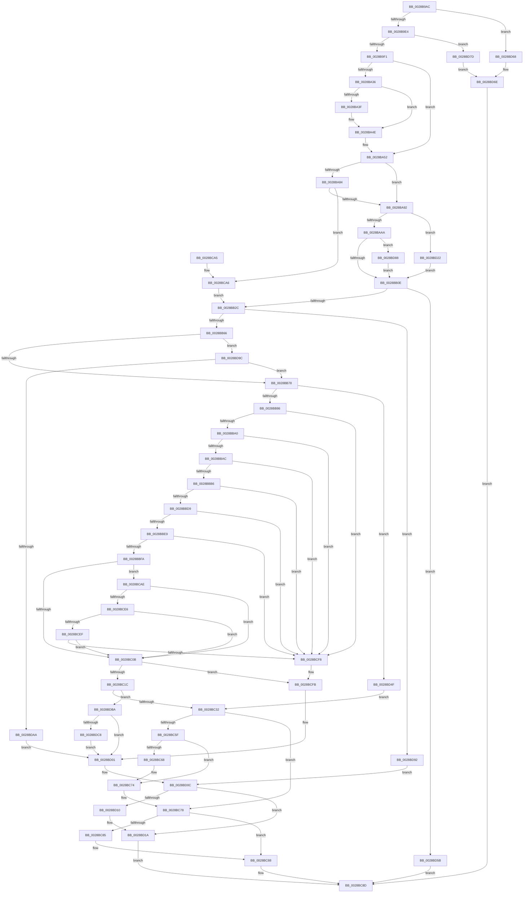

# MiTradeTransitionPage

- RVA: `0x0028B9AC`–`0x0028BDD0` (길이 `1,060` bytes)
- VA: `0x000000014028B9AC`
- 실행 섹션: `.text`
- PDB 이름 있음: `예`; PDB Function 태그: `아니요`
- unwind 정보 RVA: `0x00066FC4`
- 디코드: `257`개 명령, `1,060/1,060` bytes 표시
- 미해석 바이트: `0` (있으면 어셈블리에 `.byte`로 보존)

> 이 문서는 커널 이미지의 기계어와 PDB 기호를 분석해 생성했습니다. 4번과 5번은 함수 원형과 자료형을 바이너리 사용 방식에서 추정한 C 해석이며 원본 소스 복구 결과는 아닙니다.

## 1. Dependencies

- 직접 호출 지점: **16**; 고유 호출 대상: **11**
- 직접 호출자로 확인된 함수: **1**
- RIP 상대 이미지 참조: **12**

### Outgoing calls
- `0x0028B9E4` → [MiCanPageMove](../38/MiCanPageMove_function_00383710.md) (function, `0x00383710`)
- `0x0028BA46` → [KiLowerIrqlProcessIrqlFlags](../4F/KiLowerIrqlProcessIrqlFlags_function_004F5698.md) (function, `0x004F5698`)
- `0x0028BAB0` → [MiGetPfnChannel](../33/MiGetPfnChannel_function_0033BA90.md) (function, `0x0033BA90`)
- `0x0028BABB` → [MiPageToNode](../33/MiPageToNode_function_00338CD0.md) (function, `0x00338CD0`)
- `0x0028BB15` → [MiGetPage](MiGetPage_function_002884C0.md) (function, `0x002884C0`)
- `0x0028BB53` → [MiSafeLockPage](../32/MiSafeLockPage_function_00321620.md) (function, `0x00321620`)
- `0x0028BB89` → [MiGetPfnSlabType](MiGetPfnSlabType_function_0028E2D0.md) (function, `0x0028E2D0`)
- `0x0028BBDC` → [MiCanPageMove](../38/MiCanPageMove_function_00383710.md) (function, `0x00383710`)
- `0x0028BBEC` → [MiGetPfnSlabType](MiGetPfnSlabType_function_0028E2D0.md) (function, `0x0028E2D0`)
- `0x0028BBFD` → [MiGetPfnSlabType](MiGetPfnSlabType_function_0028E2D0.md) (function, `0x0028E2D0`)
- `0x0028BC22` → [MiReplaceTransitionPage](../2B/MiReplaceTransitionPage_function_002B1120.md) (function, `0x002B1120`)
- `0x0028BC46` → [MiSetOriginalPtePfnFromFreeList](MiSetOriginalPtePfnFromFreeList_function_0028A99C.md) (function, `0x0028A99C`)
- `0x0028BC6F` → [KiLowerIrqlProcessIrqlFlags](../4F/KiLowerIrqlProcessIrqlFlags_function_004F5698.md) (function, `0x004F5698`)
- `0x0028BD07` → [MiUnlockPage](../31/MiUnlockPage_function_0031A3E0.md) (function, `0x0031A3E0`)
- `0x0028BD15` → [MiReleaseFreshPage](../33/MiReleaseFreshPage_function_00334AE0.md) (function, `0x00334AE0`)
- `0x0028BD71` → [MiUnlockPage](../31/MiUnlockPage_function_0031A3E0.md) (function, `0x0031A3E0`)

### Direct callers
- [MiTradePage](MiTradePage_function_0028D160.md) at `0x0028D509`

### Static image references
- `0x0028B9F5` → RVA `0x00E30088` (`.data`; read)
- `0x0028BA36` → RVA `0x00FC6D20` (`ALMOSTRO`; read)
- `0x0028BA92` → RVA `0x00E2DCCC` (`.data`; read)
- `0x0028BC32` → RVA `0x00010880` (`.rdata`; read)
- `0x0028BC3D` → RVA `0x00EF5230` (`.data`; read/write)
- `0x0028BCAE` → RVA `0x00E3D240` (`.data`; read)
- `0x0028BCFB` → RVA `0x00EF5274` (`.data`; read/write)
- `0x0028BD25` → RVA `0x00E2DCC0` (`.data`; read)
- `0x0028BD5B` → RVA `0x00EF52A8` (`.data`; read/write)
- `0x0028BD7D` → RVA `0x00EF527C` (`.data`; read/write)
- `0x0028BDAA` → RVA `0x00EF5288` (`.data`; read/write)
- `0x0028BDBA` → RVA `0x00EF5278` (`.data`; read/write)

## 2. Other-region calls and transfers

- 다른 실행 섹션으로 향하는 call: **0**
- 별도 외부 분기/꼬리 이동을 확인하지 못했습니다.

## 3. Assembly (complete function range)

```asm
0028B9AC  48 89 5C 24 10                  mov qword ptr [rsp + 0x10], rbx
0028B9B1  48 89 74 24 18                  mov qword ptr [rsp + 0x18], rsi
0028B9B6  44 89 4C 24 20                  mov dword ptr [rsp + 0x20], r9d
0028B9BB  57                              push rdi
0028B9BC  41 54                           push r12
0028B9BE  41 55                           push r13
0028B9C0  41 56                           push r14
0028B9C2  41 57                           push r15
0028B9C4  48 83 EC 30                     sub rsp, 0x30
0028B9C8  8B 41 20                        mov eax, dword ptr [rcx + 0x20]
0028B9CB  41 8B D8                        mov ebx, r8d
0028B9CE  45 33 C0                        xor r8d, r8d
0028B9D1  44 0F B6 E2                     movzx r12d, dl
0028B9D5  41 8B F9                        mov edi, r9d
0028B9D8  48 8B F1                        mov rsi, rcx
0028B9DB  66 85 C0                        test ax, ax
0028B9DE  0F 85 84 03 00 00               jne 0x14028bd68
0028B9E4  E8 27 7D 0F 00                  call 0x140383710
0028B9E9  85 C0                           test eax, eax
0028B9EB  0F 84 8C 03 00 00               je 0x14028bd7d
0028B9F1  48 8B 46 28                     mov rax, qword ptr [rsi + 0x28]
0028B9F5  48 8B 0D 8C 46 BA 00            mov rcx, qword ptr [rip + 0xba468c]
0028B9FC  48 C1 E8 2B                     shr rax, 0x2b
0028BA00  25 FF 03 00 00                  and eax, 0x3ff
0028BA05  48 8B 04 C1                     mov rax, qword ptr [rcx + rax*8]
0028BA09  48 89 44 24 20                  mov qword ptr [rsp + 0x20], rax
0028BA0E  8B 46 20                        mov eax, dword ptr [rsi + 0x20]
0028BA11  C1 E8 10                        shr eax, 0x10
0028BA14  0F B6 C0                        movzx eax, al
0028BA17  C1 E8 06                        shr eax, 6
0028BA1A  89 44 24 60                     mov dword ptr [rsp + 0x60], eax
0028BA1E  48 B8 FF FF FF FF FF FF FF 7F   movabs rax, 0x7fffffffffffffff
0028BA28  F0 48 21 46 18                  lock and qword ptr [rsi + 0x18], rax
0028BA2D  45 8D 70 02                     lea r14d, [r8 + 2]
0028BA31  45 3A E6                        cmp r12b, r14b
0028BA34  73 1C                           jae 0x14028ba52
0028BA36  44 39 05 E3 B2 D3 00            cmp dword ptr [rip + 0xd3b2e3], r8d
0028BA3D  74 0F                           je 0x14028ba4e
0028BA3F  44 0F 20 C1                     mov rcx, cr8
0028BA43  41 8A D4                        mov dl, r12b
0028BA46  E8 4D 9C 26 00                  call 0x1404f5698
0028BA4B  45 33 C0                        xor r8d, r8d
0028BA4E  45 0F 22 C4                     mov cr8, r12
0028BA52  48 B8 00 00 00 00 00 DE FF FF   movabs rax, 0xffffde0000000000
0028BA5C  48 8B C0                        mov rax, rax
0028BA5F  4C 8B AC 24 80 00 00 00         mov r13, qword ptr [rsp + 0x80]
0028BA67  4C 8B FE                        mov r15, rsi
0028BA6A  4C 2B F8                        sub r15, rax
0028BA6D  48 B8 AB AA AA AA AA AA AA AA   movabs rax, 0xaaaaaaaaaaaaaaab
0028BA77  49 C1 FF 04                     sar r15, 4
0028BA7B  4C 0F AF F8                     imul r15, rax
0028BA7F  4D 85 ED                        test r13, r13
0028BA82  74 0E                           je 0x14028ba92
0028BA84  4D 8B 6D 00                     mov r13, qword ptr [r13]
0028BA88  49 83 FD FF                     cmp r13, -1
0028BA8C  0F 85 14 02 00 00               jne 0x14028bca6
0028BA92  8B 0D 34 22 BA 00               mov ecx, dword ptr [rip + 0xba2234]
0028BA98  33 D2                           xor edx, edx
0028BA9A  49 8B C7                        mov rax, r15
0028BA9D  48 F7 F1                        div rcx
0028BAA0  0F BA E7 0E                     bt edi, 0xe
0028BAA4  0F 82 78 02 00 00               jb 0x14028bd22
0028BAAA  48 8B CE                        mov rcx, rsi
0028BAAD  48 8B FA                        mov rdi, rdx
0028BAB0  E8 DB FF 0A 00                  call 0x14033ba90
0028BAB5  49 8B CF                        mov rcx, r15
0028BAB8  0F B6 D8                        movzx ebx, al
0028BABB  E8 10 D2 0A 00                  call 0x140338cd0
0028BAC0  8B 4C 24 60                     mov ecx, dword ptr [rsp + 0x60]
0028BAC4  83 E0 3F                        and eax, 0x3f
0028BAC7  C1 E1 09                        shl ecx, 9
0028BACA  83 E3 01                        and ebx, 1
0028BACD  0B C1                           or eax, ecx
0028BACF  40 0F B6 CF                     movzx ecx, dil
0028BAD3  0D 80 01 00 00                  or eax, 0x180
0028BAD8  03 C0                           add eax, eax
0028BADA  0B C3                           or eax, ebx
0028BADC  C1 E0 08                        shl eax, 8
0028BADF  0B C1                           or eax, ecx
0028BAE1  45 3A E6                        cmp r12b, r14b
0028BAE4  1B D2                           sbb edx, edx
0028BAE6  81 C2 01 00 02 00               add edx, 0x20001
0028BAEC  44 8B C2                        mov r8d, edx
0028BAEF  41 0F BA E8 0F                  bts r8d, 0xf
0028BAF4  F7 44 24 78 00 00 00 01         test dword ptr [rsp + 0x78], 0x1000000
0028BAFC  44 0F 44 C2                     cmove r8d, edx
0028BB00  F7 44 24 78 00 00 00 02         test dword ptr [rsp + 0x78], 0x2000000
0028BB08  0F 85 7A 02 00 00               jne 0x14028bd88
0028BB0E  48 8B 4C 24 20                  mov rcx, qword ptr [rsp + 0x20]
0028BB13  8B D0                           mov edx, eax
0028BB15  E8 A6 C9 FF FF                  call 0x1402884c0
0028BB1A  4C 8B E8                        mov r13, rax
0028BB1D  BB 01 00 00 00                  mov ebx, 1
0028BB22  48 83 F8 FF                     cmp rax, -1
0028BB26  0F 84 2F 02 00 00               je 0x14028bd5b
0028BB2C  4A 8D 3C 6D 00 00 00 00         lea rdi, [r13*2]
0028BB34  48 B8 00 00 00 00 00 DE FF FF   movabs rax, 0xffffde0000000000
0028BB3E  49 03 FD                        add rdi, r13
0028BB41  48 C1 E7 04                     shl rdi, 4
0028BB45  48 8B C0                        mov rax, rax
0028BB48  48 03 C7                        add rax, rdi
0028BB4B  49 8B CF                        mov rcx, r15
0028BB4E  48 89 44 24 60                  mov qword ptr [rsp + 0x60], rax
0028BB53  E8 C8 5A 09 00                  call 0x140321620
0028BB58  44 0F B6 E0                     movzx r12d, al
0028BB5C  41 80 FC 11                     cmp r12b, 0x11
0028BB60  0F 84 2C 02 00 00               je 0x14028bd92
0028BB66  8B 46 20                        mov eax, dword ptr [rsi + 0x20]
0028BB69  41 B3 40                        mov r11b, 0x40
0028BB6C  C1 E8 18                        shr eax, 0x18
0028BB6F  41 84 C3                        test r11b, al
0028BB72  0F 85 24 02 00 00               jne 0x14028bd9c
0028BB78  4C 8B 54 24 60                  mov r10, qword ptr [rsp + 0x60]
0028BB7D  4C 3B D6                        cmp r10, rsi
0028BB80  0F 84 C9 01 00 00               je 0x14028bd4f
0028BB86  48 8B CE                        mov rcx, rsi
0028BB89  E8 42 27 00 00                  call 0x14028e2d0
0028BB8E  45 33 C9                        xor r9d, r9d
0028BB91  44 8B C0                        mov r8d, eax
0028BB94  48 0F BA 66 28 35               bt qword ptr [rsi + 0x28], 0x35
0028BB9A  0F 82 58 01 00 00               jb 0x14028bcf8
0028BBA0  8B 4E 20                        mov ecx, dword ptr [rsi + 0x20]
0028BBA3  66 85 C9                        test cx, cx
0028BBA6  0F 85 4C 01 00 00               jne 0x14028bcf8
0028BBAC  44 38 4E 23                     cmp byte ptr [rsi + 0x23], r9b
0028BBB0  0F 8C 42 01 00 00               jl 0x14028bcf8
0028BBB6  48 8B 46 28                     mov rax, qword ptr [rsi + 0x28]
0028BBBA  48 8B 0D C7 44 BA 00            mov rcx, qword ptr [rip + 0xba44c7]
0028BBC1  48 8B 54 24 20                  mov rdx, qword ptr [rsp + 0x20]
0028BBC6  48 C1 E8 2B                     shr rax, 0x2b
0028BBCA  25 FF 03 00 00                  and eax, 0x3ff
0028BBCF  48 3B 14 C1                     cmp rdx, qword ptr [rcx + rax*8]
0028BBD3  0F 85 1F 01 00 00               jne 0x14028bcf8
0028BBD9  48 8B CE                        mov rcx, rsi
0028BBDC  E8 2F 7B 0F 00                  call 0x140383710
0028BBE1  85 C0                           test eax, eax
0028BBE3  0F 84 0F 01 00 00               je 0x14028bcf8
0028BBE9  49 8B CA                        mov rcx, r10
0028BBEC  E8 DF 26 00 00                  call 0x14028e2d0
0028BBF1  44 3B C0                        cmp r8d, eax
0028BBF4  0F 85 FE 00 00 00               jne 0x14028bcf8
0028BBFA  48 8B CE                        mov rcx, rsi
0028BBFD  E8 CE 26 00 00                  call 0x14028e2d0
0028BC02  83 F8 08                        cmp eax, 8
0028BC05  0F 84 A3 00 00 00               je 0x14028bcae
0028BC0B  8A 46 22                        mov al, byte ptr [rsi + 0x22]
0028BC0E  24 07                           and al, 7
0028BC10  41 2A C6                        sub al, r14b
0028BC13  41 3A C6                        cmp al, r14b
0028BC16  0F 87 DF 00 00 00               ja 0x14028bcfb
0028BC1C  49 8B D2                        mov rdx, r10
0028BC1F  48 8B CE                        mov rcx, rsi
0028BC22  E8 F9 54 02 00                  call 0x1402b1120
0028BC27  45 33 C0                        xor r8d, r8d
0028BC2A  85 C0                           test eax, eax
0028BC2C  0F 84 88 01 00 00               je 0x14028bdba
0028BC32  48 8B 05 47 4C D8 FF            mov rax, qword ptr [rip - 0x27b3b9]
0028BC39  48 8D 4E 10                     lea rcx, [rsi + 0x10]
0028BC3D  FF 05 ED 95 C6 00               inc dword ptr [rip + 0xc695ed]
0028BC43  48 89 01                        mov qword ptr [rcx], rax
0028BC46  E8 51 ED FF FF                  call 0x14028a99c
0028BC4B  48 B8 FF FF FF FF FF FF FF 7F   movabs rax, 0x7fffffffffffffff
0028BC55  F0 48 21 46 18                  lock and qword ptr [rsi + 0x18], rax
0028BC5A  45 3A E6                        cmp r12b, r14b
0028BC5D  73 19                           jae 0x14028bc78
0028BC5F  44 39 05 BA B0 D3 00            cmp dword ptr [rip + 0xd3b0ba], r8d
0028BC66  74 0C                           je 0x14028bc74
0028BC68  44 0F 20 C1                     mov rcx, cr8
0028BC6C  41 8A D4                        mov dl, r12b
0028BC6F  E8 24 9A 26 00                  call 0x1404f5698
0028BC74  45 0F 22 C4                     mov cr8, r12
0028BC78  48 8B 84 24 80 00 00 00         mov rax, qword ptr [rsp + 0x80]
0028BC80  48 85 C0                        test rax, rax
0028BC83  74 03                           je 0x14028bc88
0028BC85  4C 89 28                        mov qword ptr [rax], r13
0028BC88  B8 03 00 00 00                  mov eax, 3
0028BC8D  48 8B 5C 24 68                  mov rbx, qword ptr [rsp + 0x68]
0028BC92  48 8B 74 24 70                  mov rsi, qword ptr [rsp + 0x70]
0028BC97  48 83 C4 30                     add rsp, 0x30
0028BC9B  41 5F                           pop r15
0028BC9D  41 5E                           pop r14
0028BC9F  41 5D                           pop r13
0028BCA1  41 5C                           pop r12
0028BCA3  5F                              pop rdi
0028BCA4  C3                              ret
0028BCA5  CC                              int3
0028BCA6  41 8B D8                        mov ebx, r8d
0028BCA9  E9 7E FE FF FF                  jmp 0x14028bb2c
0028BCAE  48 8B 05 8B 15 BB 00            mov rax, qword ptr [rip + 0xbb158b]
0028BCB5  48 BA AB AA AA AA AA AA AA AA   movabs rdx, 0xaaaaaaaaaaaaaaab
0028BCBF  48 C1 FF 04                     sar rdi, 4
0028BCC3  48 0F AF FA                     imul rdi, rdx
0028BCC7  49 C1 EF 09                     shr r15, 9
0028BCCB  48 C1 EF 09                     shr rdi, 9
0028BCCF  42 8A 4C 78 01                  mov cl, byte ptr [rax + r15*2 + 1]
0028BCD4  8A 54 78 01                     mov dl, byte ptr [rax + rdi*2 + 1]
0028BCD8  80 E1 7F                        and cl, 0x7f
0028BCDB  80 E2 7F                        and dl, 0x7f
0028BCDE  3A CA                           cmp cl, dl
0028BCE0  0F 84 25 FF FF FF               je 0x14028bc0b
0028BCE6  41 3A CB                        cmp cl, r11b
0028BCE9  0F 83 1C FF FF FF               jae 0x14028bc0b
0028BCEF  41 3A D3                        cmp dl, r11b
0028BCF2  0F 83 13 FF FF FF               jae 0x14028bc0b
0028BCF8  45 8B F1                        mov r14d, r9d
0028BCFB  FF 05 73 95 C6 00               inc dword ptr [rip + 0xc69573]
0028BD01  41 8A D4                        mov dl, r12b
0028BD04  48 8B CE                        mov rcx, rsi
0028BD07  E8 D4 E6 08 00                  call 0x14031a3e0
0028BD0C  85 DB                           test ebx, ebx
0028BD0E  74 0A                           je 0x14028bd1a
0028BD10  48 8B 4C 24 60                  mov rcx, qword ptr [rsp + 0x60]
0028BD15  E8 C6 8D 0A 00                  call 0x140334ae0
0028BD1A  41 8B C6                        mov eax, r14d
0028BD1D  E9 6B FF FF FF                  jmp 0x14028bc8d
0028BD22  48 8B C2                        mov rax, rdx
0028BD25  4C 8D 0D 94 1F BA 00            lea r9, [rip + 0xba1f94]
0028BD2C  33 D2                           xor edx, edx
0028BD2E  44 8B C3                        mov r8d, ebx
0028BD31  49 C1 E8 10                     shr r8, 0x10
0028BD35  41 83 E0 03                     and r8d, 3
0028BD39  43 F7 34 81                     div dword ptr [r9 + r8*4]
0028BD3D  41 B8 00 30 00 00               mov r8d, 0x3000
0028BD43  33 D3                           xor edx, ebx
0028BD45  0F B6 C2                        movzx eax, dl
0028BD48  33 C3                           xor eax, ebx
0028BD4A  E9 BF FD FF FF                  jmp 0x14028bb0e
0028BD4F  49 83 CD FF                     or r13, 0xffffffffffffffff
0028BD53  45 33 C0                        xor r8d, r8d
0028BD56  E9 D7 FE FF FF                  jmp 0x14028bc32
0028BD5B  FF 05 47 95 C6 00               inc dword ptr [rip + 0xc69547]
0028BD61  8B C3                           mov eax, ebx
0028BD63  E9 25 FF FF FF                  jmp 0x14028bc8d
0028BD68  FF 05 06 95 C6 00               inc dword ptr [rip + 0xc69506]
0028BD6E  41 8A D4                        mov dl, r12b
0028BD71  E8 6A E6 08 00                  call 0x14031a3e0
0028BD76  33 C0                           xor eax, eax
0028BD78  E9 10 FF FF FF                  jmp 0x14028bc8d
0028BD7D  FF 05 F9 94 C6 00               inc dword ptr [rip + 0xc694f9]
0028BD83  48 8B CE                        mov rcx, rsi
0028BD86  EB E6                           jmp 0x14028bd6e
0028BD88  41 0F BA E8 0B                  bts r8d, 0xb
0028BD8D  E9 7C FD FF FF                  jmp 0x14028bb0e
0028BD92  33 C0                           xor eax, eax
0028BD94  44 8B F0                        mov r14d, eax
0028BD97  E9 70 FF FF FF                  jmp 0x14028bd0c
0028BD9C  F7 44 24 78 00 00 00 10         test dword ptr [rsp + 0x78], 0x10000000
0028BDA4  0F 85 CE FD FF FF               jne 0x14028bb78
0028BDAA  FF 05 D8 94 C6 00               inc dword ptr [rip + 0xc694d8]
0028BDB0  33 C0                           xor eax, eax
0028BDB2  44 8B F0                        mov r14d, eax
0028BDB5  E9 47 FF FF FF                  jmp 0x14028bd01
0028BDBA  FF 05 B8 94 C6 00               inc dword ptr [rip + 0xc694b8]
0028BDC0  85 DB                           test ebx, ebx
0028BDC2  0F 85 39 FF FF FF               jne 0x14028bd01
0028BDC8  45 8B F0                        mov r14d, r8d
0028BDCB  E9 31 FF FF FF                  jmp 0x14028bd01
```

## 4. C-style interpretation (structured pseudocode)

```c
__int64 __fastcall MiTradeTransitionPage(__int64 a1, unsigned __int8 a2, int a3, int a4, __int64 a5)
{
    __int64 result;
    __int64 v_r13;
    __int64 v_r15;
    __int64 v_rbx;
    __int64 v_rdi;
    __int64 v_rsp;
    unsigned __int64 v_stack_m38;
    unsigned __int64 v_stack_p10;
    unsigned __int64 v_stack_p18;
    unsigned int v_stack_p20;
    unsigned __int64 v_stack_p60;
    unsigned int v_stack_p78;
    unsigned int v_stack_p8;

    v_stack_p10 = v_rbx;
    v_stack_p18 = v_rsi;
    v_stack_p20 = a4;
    v_rsp = (v_rsp) - (48);
    a3 = 0;
    if ((unsigned __int16)((unsigned int)(*(unsigned int *)(a1 + 32))) != 0) goto loc_0028BD68;
    result = MiCanPageMove(a1, a2, a3, a4);
    if ((unsigned int)(result) == 0) goto loc_0028BD7D;
    result = (*(unsigned __int64 *)(a1 + 40)) >> (43);
    result = (unsigned int)((result) & (0x3FFULL));
    v_stack_m38 = *(unsigned __int64 *)(*(unsigned __int64 *)(v_rip + 12207756) + result * 8);
    result = (unsigned int)(((unsigned int)(*(unsigned int *)(a1 + 32))) >> (16));
    result = (unsigned int)(((unsigned __int8)(result)) >> (6));
    v_stack_p8 = (unsigned int)(result);
    if (a2 >= ((unsigned __int8)(a3 + 2))) goto loc_0028BA52;
    if ((*(unsigned int *)(v_rip + 13873891)) != 0) {
        a1 = v_cr8;
        a2 = a2;
        result = KiLowerIrqlProcessIrqlFlags(a1, a2, a3, a4);
        a3 = 0;
    }
loc_0028BA52:
    v_r15 = (a1) - (result);
    v_r15 = (v_r15) >> (4);
    v_r15 = (v_r15) * (result);
    if (a5 == 0) goto loc_0028BA92;
    if ((*(unsigned __int64 *)(a5)) != -1) goto loc_0028BCA6;
loc_0028BA92:
    a2 = 0;
    if (condition_is_below) goto loc_0028BD22;
    result = MiGetPfnChannel(a1, a2, a3, a4);
    result = MiPageToNode(v_r15, a2, a3, a4);
    result = (unsigned int)((result) & (63));
    a1 = (unsigned int)(((unsigned int)(v_stack_p8)) << (9));
    v_rbx = (unsigned int)(((unsigned __int8)(result)) & (1));
    result = (unsigned int)((result) | ((unsigned int)(a1)));
    result = (unsigned int)((result) | (384));
    result = (unsigned int)((result) + ((unsigned int)(result)));
    result = (unsigned int)((result) | ((unsigned int)(v_rbx)));
    result = (unsigned int)((result) << (8));
    result = (unsigned int)((result) | (0));
    a2 = (unsigned int)((a2) + (0x20001ULL));
    a3 = (unsigned int)(a2);
    if (((v_stack_p20) & (0x1000000ULL)) == 0) { a3 = a2; }
    if (((v_stack_p20) & (0x2000000ULL)) != 0) goto loc_0028BD88;
loc_0028BB0E:
    result = MiGetPage(v_stack_m38, (unsigned int)((unsigned int)(result)), a3, a4);
    if (result == -1) goto loc_0028BD5B;
loc_0028BB2C:
    v_rdi = (result * 2) + (result);
    v_rdi = (v_rdi) << (4);
    result = (result) + (v_rdi);
    v_stack_p8 = result;
    result = MiSafeLockPage(v_r15, (unsigned int)((unsigned int)(result)), a3, a4);
    if (((unsigned __int8)((unsigned __int8)(result))) == 17) goto loc_0028BD92;
    result = (unsigned int)(((unsigned int)(*(unsigned int *)(a1 + 32))) >> (24));
    if (((64) & ((unsigned __int8)(result))) != 0) goto loc_0028BD9C;
loc_0028BB78:
    if (v_stack_p8 == a1) goto loc_0028BD4F;
    result = MiGetPfnSlabType(a1, (unsigned int)((unsigned int)(result)), a3, a4);
    a4 = 0;
    if (condition_is_below) goto loc_0028BCF8;
    if ((unsigned __int16)((unsigned int)(*(unsigned int *)(a1 + 32))) != 0) goto loc_0028BCF8;
    if ((*(unsigned __int8 *)(a1 + 35)) < 0) goto loc_0028BCF8;
    result = (*(unsigned __int64 *)(a1 + 40)) >> (43);
    result = (unsigned int)((result) & (0x3FFULL));
    if (v_stack_m38 != (*(unsigned __int64 *)(*(unsigned __int64 *)(v_rip + 12207303) + result * 8))) goto loc_0028BCF8;
    result = MiCanPageMove(a1, v_stack_m38, (unsigned int)((unsigned int)(result)), a4);
    if ((unsigned int)(result) == 0) goto loc_0028BCF8;
    result = MiGetPfnSlabType(v_stack_p8, v_stack_m38, (unsigned int)((unsigned int)(result)), a4);
    if (((unsigned int)((unsigned int)((unsigned int)(result)))) != ((unsigned int)(result))) goto loc_0028BCF8;
    result = MiGetPfnSlabType(a1, v_stack_m38, (unsigned int)((unsigned int)(result)), a4);
    if (((unsigned int)(result)) == 8) goto loc_0028BCAE;
loc_0028BC0B:
    result = (unsigned __int8)((*(unsigned __int8 *)(a1 + 34)) & (7));
    result = (unsigned __int8)((result) - ((unsigned __int8)(a3 + 2)));
    if (((unsigned __int8)(result)) > ((unsigned __int8)(a3 + 2))) goto loc_0028BCFB;
    result = MiReplaceTransitionPage(a1, v_stack_p8, (unsigned int)((unsigned int)(result)), a4);
    a3 = 0;
    if ((unsigned int)(result) == 0) goto loc_0028BDBA;
loc_0028BC32:
    *(unsigned __int64 *)(a1 + 16) = *(unsigned __int64 *)(v_rip - 2601913);
    result = MiSetOriginalPtePfnFromFreeList(a1 + 16, v_stack_p8, a3, a4);
    if (((unsigned __int8)((unsigned __int8)(result))) >= ((unsigned __int8)(a3 + 2))) goto loc_0028BC78;
    if ((*(unsigned int *)(v_rip + 13873338)) != 0) {
        a1 = a2;
        a2 = (unsigned __int8)((unsigned __int8)(result));
        result = KiLowerIrqlProcessIrqlFlags(a1, a2, a3, a4);
    }
loc_0028BC78:
    if (a5 != 0) {
        *(unsigned __int64 *)(a5) = result;
    }
loc_0028BC8D:
    v_rsp = (v_rsp) + (48);
    return 3;
loc_0028BCA6:
    goto loc_0028BB2C;
loc_0028BCAE:
    v_rdi = (v_rdi) >> (4);
    v_rdi = (v_rdi) * (a2);
    v_r15 = (v_r15) >> (9);
    v_rdi = (v_rdi) >> (9);
    a1 = (unsigned __int8)((*(unsigned __int8 *)(*(unsigned __int64 *)(v_rip + 12260747) + v_r15 * 2 + 1)) & (127));
    a2 = (unsigned __int8)((*(unsigned __int8 *)(*(unsigned __int64 *)(v_rip + 12260747) + v_rdi * 2 + 1)) & (127));
    if (((unsigned __int8)(a1)) == a2) goto loc_0028BC0B;
    if (((unsigned __int8)(a1)) >= 64) goto loc_0028BC0B;
    if (a2 >= 64) goto loc_0028BC0B;
loc_0028BCF8:
loc_0028BCFB:
loc_0028BD01:
    result = MiUnlockPage(v_stack_p18, (unsigned __int8)((unsigned __int8)(result)), a3, a4);
loc_0028BD0C:
    if (0 != 0) {
        a1 = v_stack_p60;
        result = MiReleaseFreshPage(a1, (unsigned __int8)((unsigned __int8)(result)), a3, a4);
    }
    goto loc_0028BC8D;
loc_0028BD22:
    a2 = 0;
    a3 = (0) >> (16);
    a3 = (unsigned int)((a3) & (3));
    a2 = (unsigned int)((a2) ^ (0));
    result = (unsigned int)((a2) ^ (0));
    goto loc_0028BB0E;
loc_0028BD4F:
    v_r13 = (result) | (-1);
    a3 = 0;
    goto loc_0028BC32;
loc_0028BD5B:
    goto loc_0028BC8D;
loc_0028BD68:
loc_0028BD6E:
    result = MiUnlockPage(a1, (unsigned __int8)((unsigned __int8)(result)), a3, v_rip + 12197780);
    result = 0;
    goto loc_0028BC8D;
loc_0028BD7D:
    goto loc_0028BD6E;
loc_0028BD88:
    goto loc_0028BB0E;
loc_0028BD92:
    result = 0;
    goto loc_0028BD0C;
loc_0028BD9C:
    if (((v_stack_p78) & (0x10000000ULL)) != 0) goto loc_0028BB78;
    result = 0;
    goto loc_0028BD01;
loc_0028BDBA:
    if (0 != 0) goto loc_0028BD01;
    goto loc_0028BD01;
}
```

## 5. (Beta) C Style

```c
int64_t MiTradeTransitionPage(void *Arg1, uint8_t Arg2, int32_t Arg3, int32_t Arg4, int64_t Arg5)
{
    uint8_t *arg1 = (uint8_t *)Arg1;

    int64_t result;
    int64_t local_r13;
    int64_t local_r15;
    int64_t local_rbx;
    int64_t local_rdi;
    int64_t local_rsp;
    uint64_t v_stack_m38;
    uint64_t v_stack_p10;
    uint64_t v_stack_p18;
    uint32_t v_stack_p20;
    uint64_t v_stack_p60;
    uint32_t v_stack_p78;
    uint32_t v_stack_p8;

    v_stack_p10 = local_rbx;
    v_stack_p18 = local_rsi;
    v_stack_p20 = Arg4;
    local_rsp = (local_rsp) - (48);
    Arg3 = 0;
    if ((uint16_t)((uint32_t)(*(uint32_t *)(arg1 + 0x20))) != 0) goto loc_0028BD68;
    result = MiCanPageMove(Arg1, Arg2, Arg3, Arg4);
    if ((uint32_t)(result) == 0) goto loc_0028BD7D;
    result = (*(uint64_t *)(arg1 + 0x28)) >> (43);
    result = (uint32_t)((result) & (0x3FFULL));
    v_stack_m38 = *(uint64_t *)(*(uint64_t *)(v_rip + 0xBA468C) + result * 8);
    result = (uint32_t)(((uint32_t)(*(uint32_t *)(arg1 + 0x20))) >> (16));
    result = (uint32_t)(((uint8_t)(result)) >> (6));
    v_stack_p8 = (uint32_t)(result);
    if (Arg2 >= ((uint8_t)(Arg3 + 2))) goto loc_0028BA52;
    if ((*(uint32_t *)(v_rip + 0xD3B2E3)) != 0) {
        Arg1 = v_cr8;
        Arg2 = Arg2;
        result = KiLowerIrqlProcessIrqlFlags(Arg1, Arg2, Arg3, Arg4);
        Arg3 = 0;
    }
loc_0028BA52:
    local_r15 = (Arg1) - (result);
    local_r15 = (local_r15) >> (4);
    local_r15 = (local_r15) * (result);
    if (Arg5 == 0) goto loc_0028BA92;
    if ((*(uint64_t *)(Arg5)) != -1) goto loc_0028BCA6;
loc_0028BA92:
    Arg2 = 0;
    if (condition_is_below) goto loc_0028BD22;
    result = MiGetPfnChannel(Arg1, Arg2, Arg3, Arg4);
    result = MiPageToNode(local_r15, Arg2, Arg3, Arg4);
    result = (uint32_t)((result) & (63));
    Arg1 = (uint32_t)(((uint32_t)(v_stack_p8)) << (9));
    local_rbx = (uint32_t)(((uint8_t)(result)) & (1));
    result = (uint32_t)((result) | ((uint32_t)(Arg1)));
    result = (uint32_t)((result) | (384));
    result = (uint32_t)((result) + ((uint32_t)(result)));
    result = (uint32_t)((result) | ((uint32_t)(local_rbx)));
    result = (uint32_t)((result) << (8));
    result = (uint32_t)((result) | (0));
    Arg2 = (uint32_t)((Arg2) + (0x20001ULL));
    Arg3 = (uint32_t)(Arg2);
    if (((v_stack_p20) & (0x1000000ULL)) == 0) { Arg3 = Arg2; }
    if (((v_stack_p20) & (0x2000000ULL)) != 0) goto loc_0028BD88;
loc_0028BB0E:
    result = MiGetPage(v_stack_m38, (uint32_t)((uint32_t)(result)), Arg3, Arg4);
    if (result == -1) goto loc_0028BD5B;
loc_0028BB2C:
    local_rdi = (result * 2) + (result);
    local_rdi = (local_rdi) << (4);
    result = (result) + (local_rdi);
    v_stack_p8 = result;
    result = MiSafeLockPage(local_r15, (uint32_t)((uint32_t)(result)), Arg3, Arg4);
    if (((uint8_t)((uint8_t)(result))) == 17) goto loc_0028BD92;
    result = (uint32_t)(((uint32_t)(*(uint32_t *)(arg1 + 0x20))) >> (24));
    if (((64) & ((uint8_t)(result))) != 0) goto loc_0028BD9C;
loc_0028BB78:
    if (v_stack_p8 == Arg1) goto loc_0028BD4F;
    result = MiGetPfnSlabType(Arg1, (uint32_t)((uint32_t)(result)), Arg3, Arg4);
    Arg4 = 0;
    if (condition_is_below) goto loc_0028BCF8;
    if ((uint16_t)((uint32_t)(*(uint32_t *)(arg1 + 0x20))) != 0) goto loc_0028BCF8;
    if ((*(uint8_t *)(arg1 + 0x23)) < 0) goto loc_0028BCF8;
    result = (*(uint64_t *)(arg1 + 0x28)) >> (43);
    result = (uint32_t)((result) & (0x3FFULL));
    if (v_stack_m38 != (*(uint64_t *)(*(uint64_t *)(v_rip + 0xBA44C7) + result * 8))) goto loc_0028BCF8;
    result = MiCanPageMove(Arg1, v_stack_m38, (uint32_t)((uint32_t)(result)), Arg4);
    if ((uint32_t)(result) == 0) goto loc_0028BCF8;
    result = MiGetPfnSlabType(v_stack_p8, v_stack_m38, (uint32_t)((uint32_t)(result)), Arg4);
    if (((uint32_t)((uint32_t)((uint32_t)(result)))) != ((uint32_t)(result))) goto loc_0028BCF8;
    result = MiGetPfnSlabType(Arg1, v_stack_m38, (uint32_t)((uint32_t)(result)), Arg4);
    if (((uint32_t)(result)) == 8) goto loc_0028BCAE;
loc_0028BC0B:
    result = (uint8_t)((*(uint8_t *)(arg1 + 0x22)) & (7));
    result = (uint8_t)((result) - ((uint8_t)(Arg3 + 2)));
    if (((uint8_t)(result)) > ((uint8_t)(Arg3 + 2))) goto loc_0028BCFB;
    result = MiReplaceTransitionPage(Arg1, v_stack_p8, (uint32_t)((uint32_t)(result)), Arg4);
    Arg3 = 0;
    if ((uint32_t)(result) == 0) goto loc_0028BDBA;
loc_0028BC32:
    *(uint64_t *)(arg1 + 0x10) = *(uint64_t *)(v_rip - 0x27B3B9);
    result = MiSetOriginalPtePfnFromFreeList(Arg1 + 16, v_stack_p8, Arg3, Arg4);
    if (((uint8_t)((uint8_t)(result))) >= ((uint8_t)(Arg3 + 2))) goto loc_0028BC78;
    if ((*(uint32_t *)(v_rip + 0xD3B0BA)) != 0) {
        Arg1 = Arg2;
        Arg2 = (uint8_t)((uint8_t)(result));
        result = KiLowerIrqlProcessIrqlFlags(Arg1, Arg2, Arg3, Arg4);
    }
loc_0028BC78:
    if (Arg5 != 0) {
        *(uint64_t *)(Arg5) = result;
    }
loc_0028BC8D:
    local_rsp = (local_rsp) + (48);
    return 3;
loc_0028BCA6:
    goto loc_0028BB2C;
loc_0028BCAE:
    local_rdi = (local_rdi) >> (4);
    local_rdi = (local_rdi) * (Arg2);
    local_r15 = (local_r15) >> (9);
    local_rdi = (local_rdi) >> (9);
    Arg1 = (uint8_t)((*(uint8_t *)(*(uint64_t *)(v_rip + 0xBB158B) + local_r15 * 2 + 0x1)) & (127));
    Arg2 = (uint8_t)((*(uint8_t *)(*(uint64_t *)(v_rip + 0xBB158B) + local_rdi * 2 + 0x1)) & (127));
    if (((uint8_t)(Arg1)) == Arg2) goto loc_0028BC0B;
    if (((uint8_t)(Arg1)) >= 64) goto loc_0028BC0B;
    if (Arg2 >= 64) goto loc_0028BC0B;
loc_0028BCF8:
loc_0028BCFB:
loc_0028BD01:
    result = MiUnlockPage(v_stack_p18, (uint8_t)((uint8_t)(result)), Arg3, Arg4);
loc_0028BD0C:
    if (0 != 0) {
        Arg1 = v_stack_p60;
        result = MiReleaseFreshPage(Arg1, (uint8_t)((uint8_t)(result)), Arg3, Arg4);
    }
    goto loc_0028BC8D;
loc_0028BD22:
    Arg2 = 0;
    Arg3 = (0) >> (16);
    Arg3 = (uint32_t)((Arg3) & (3));
    Arg2 = (uint32_t)((Arg2) ^ (0));
    result = (uint32_t)((Arg2) ^ (0));
    goto loc_0028BB0E;
loc_0028BD4F:
    local_r13 = (result) | (-1);
    Arg3 = 0;
    goto loc_0028BC32;
loc_0028BD5B:
    goto loc_0028BC8D;
loc_0028BD68:
loc_0028BD6E:
    result = MiUnlockPage(Arg1, (uint8_t)((uint8_t)(result)), Arg3, v_rip + 12197780);
    result = 0;
    goto loc_0028BC8D;
loc_0028BD7D:
    goto loc_0028BD6E;
loc_0028BD88:
    goto loc_0028BB0E;
loc_0028BD92:
    result = 0;
    goto loc_0028BD0C;
loc_0028BD9C:
    if (((v_stack_p78) & (0x10000000ULL)) != 0) goto loc_0028BB78;
    result = 0;
    goto loc_0028BD01;
loc_0028BDBA:
    if (0 != 0) goto loc_0028BD01;
    goto loc_0028BD01;
}
```

### 관측된 메모리 오프셋

구조체 형식이 확인되지 않은 접근은 인자 기준의 오프셋으로만 기록했습니다.

| 기준 인자 | 오프셋 표현 | 폭 (bit) | 접근 |
|---|---:|---:|---|
| `Arg1` | `+ 0x0` | `64` | `W` |
| `Arg1` | `+ 0x10` | `64` | `R` |
| `Arg1` | `+ 0x18` | `64` | `R/W` |
| `Arg1` | `+ 0x20` | `32` | `R` |
| `Arg1` | `+ 0x22` | `8` | `R` |
| `Arg1` | `+ 0x23` | `8` | `R` |
| `Arg1` | `+ 0x28` | `64` | `R` |

## 6. Execution-region graph

[열기: 2D/3D 그래프와 함수 탐색 컨트롤 패널](../../../control-panel.html?section=text&rva=0x0028B9AC&view=graph)

- 2D 그래프는 위에서 아래로 흐르고, 3D 그래프는 빈 공간을 드래그해 회전합니다. Shift+드래그는 이동, 휠은 확대·축소, 함수 노드 선택은 대상 보고서 이동입니다.

### Static fallback


