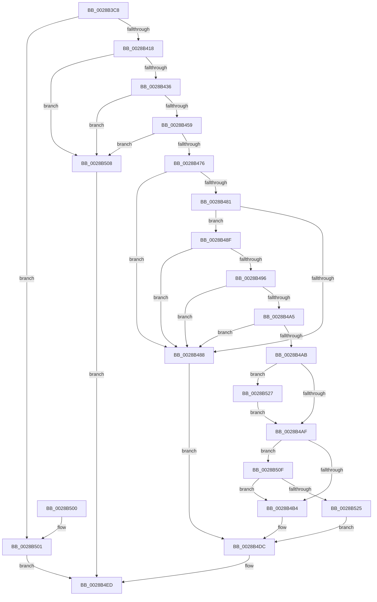

# MiTryLockProtoPoolPageAtDpc

- RVA: `0x0028B3C8`–`0x0028B53B` (길이 `371` bytes)
- VA: `0x000000014028B3C8`
- 실행 섹션: `.text`
- PDB 이름 있음: `예`; PDB Function 태그: `아니요`
- unwind 정보 RVA: `0x00066F68`
- 디코드: `97`개 명령, `371/371` bytes 표시
- 미해석 바이트: `0` (있으면 어셈블리에 `.byte`로 보존)

> 이 문서는 커널 이미지의 기계어와 PDB 기호를 분석해 생성했습니다. 4번과 5번은 함수 원형과 자료형을 바이너리 사용 방식에서 추정한 C 해석이며 원본 소스 복구 결과는 아닙니다.

## 1. Dependencies

- 직접 호출 지점: **3**; 고유 호출 대상: **3**
- 직접 호출자로 확인된 함수: **4**
- RIP 상대 이미지 참조: **1**

### Outgoing calls
- `0x0028B4BC` → [MiAddLockedPageCharge](MiAddLockedPageCharge_function_0028B550.md) (function, `0x0028B550`)
- `0x0028B51A` → [MiTryLockLeafPage](../37/MiTryLockLeafPage_function_003728DC.md) (function, `0x003728DC`)
- `0x0028B531` → [MiWriteValidPteVolatile](../29/MiWriteValidPteVolatile_function_00292B60.md) (function, `0x00292B60`)

### Direct callers
- [MiCopyDataPageToImagePage](../2A/MiCopyDataPageToImagePage_function_002AE818.md) at `0x002AE9F7`
- [sub_0032BD21](../32/Unknown_function_0032BD21.md) at `0x0032C041`
- [MiCopyFileOnlyGlobalSubsectionPage](../36/MiCopyFileOnlyGlobalSubsectionPage_function_0036A9EC.md) at `0x0036ABAF`
- [MiCopyHeaderIfResident](../48/MiCopyHeaderIfResident_function_00482184.md) at `0x004821FC`

### Static image references
- `0x0028B429` → RVA `0x00E2DCE0` (`.data`; read)

## 2. Other-region calls and transfers

- 다른 실행 섹션으로 향하는 call: **0**
- 별도 외부 분기/꼬리 이동을 확인하지 못했습니다.

## 3. Assembly (complete function range)

```asm
0028B3C8  48 89 5C 24 08                  mov qword ptr [rsp + 8], rbx
0028B3CD  48 89 6C 24 18                  mov qword ptr [rsp + 0x18], rbp
0028B3D2  89 54 24 10                     mov dword ptr [rsp + 0x10], edx
0028B3D6  56                              push rsi
0028B3D7  57                              push rdi
0028B3D8  41 56                           push r14
0028B3DA  48 83 EC 20                     sub rsp, 0x20
0028B3DE  49 83 20 00                     and qword ptr [r8], 0
0028B3E2  4C 8B D1                        mov r10, rcx
0028B3E5  49 C1 EA 09                     shr r10, 9
0028B3E9  48 B8 F8 FF FF FF 7F 00 00 00   movabs rax, 0x7ffffffff8
0028B3F3  4C 23 D0                        and r10, rax
0028B3F6  49 8B F1                        mov rsi, r9
0028B3F9  4D 8B F0                        mov r14, r8
0028B3FC  48 8B E9                        mov rbp, rcx
0028B3FF  48 B8 00 00 00 00 80 F6 FF FF   movabs rax, 0xfffff68000000000
0028B409  4C 03 D0                        add r10, rax
0028B40C  49 8B 12                        mov rdx, qword ptr [r10]
0028B40F  F6 C2 01                        test dl, 1
0028B412  0F 84 E9 00 00 00               je 0x14028b501
0028B418  48 C1 EA 0C                     shr rdx, 0xc
0028B41C  49 B8 FF FF FF FF FF 00 00 00   movabs r8, 0xffffffffff
0028B426  49 23 D0                        and rdx, r8
0028B429  48 3B 15 B0 28 BA 00            cmp rdx, qword ptr [rip + 0xba28b0]
0028B430  0F 87 D2 00 00 00               ja 0x14028b508
0028B436  48 8D 0C 52                     lea rcx, [rdx + rdx*2]
0028B43A  48 03 C9                        add rcx, rcx
0028B43D  48 B8 28 00 00 00 00 DE FF FF   movabs rax, 0xffffde0000000028
0028B447  48 8B 04 C8                     mov rax, qword ptr [rax + rcx*8]
0028B44B  48 C1 E8 36                     shr rax, 0x36
0028B44F  0F BA E0 00                     bt eax, 0
0028B453  0F 83 AF 00 00 00               jae 0x14028b508
0028B459  33 DB                           xor ebx, ebx
0028B45B  48 B8 00 00 00 00 00 DE FF FF   movabs rax, 0xffffde0000000000
0028B465  48 8D 3C C8                     lea rdi, [rax + rcx*8]
0028B469  F0 48 0F BA 6F 18 3F            lock bts qword ptr [rdi + 0x18], 0x3f
0028B470  0F 82 92 00 00 00               jb 0x14028b508
0028B476  48 8B 47 18                     mov rax, qword ptr [rdi + 0x18]
0028B47A  48 0F BA E0 3E                  bt rax, 0x3e
0028B47F  72 07                           jb 0x14028b488
0028B481  49 8B 02                        mov rax, qword ptr [r10]
0028B484  A8 01                           test al, 1
0028B486  75 07                           jne 0x14028b48f
0028B488  BB 55 00 00 C0                  mov ebx, 0xc0000055
0028B48D  EB 4D                           jmp 0x14028b4dc
0028B48F  48 0F BA E0 09                  bt rax, 9
0028B494  72 F2                           jb 0x14028b488
0028B496  48 8B C8                        mov rcx, rax
0028B499  48 C1 E9 0C                     shr rcx, 0xc
0028B49D  49 23 C8                        and rcx, r8
0028B4A0  48 3B D1                        cmp rdx, rcx
0028B4A3  75 E3                           jne 0x14028b488
0028B4A5  F6 47 22 20                     test byte ptr [rdi + 0x22], 0x20
0028B4A9  75 DD                           jne 0x14028b488
0028B4AB  A8 20                           test al, 0x20
0028B4AD  74 78                           je 0x14028b527
0028B4AF  48 85 F6                        test rsi, rsi
0028B4B2  75 5B                           jne 0x14028b50f
0028B4B4  BA 01 00 00 00                  mov edx, 1
0028B4B9  48 8B CF                        mov rcx, rdi
0028B4BC  E8 8F 00 00 00                  call 0x14028b550
0028B4C1  8B 4F 20                        mov ecx, dword ptr [rdi + 0x20]
0028B4C4  89 4C 24 48                     mov dword ptr [rsp + 0x48], ecx
0028B4C8  C1 E9 10                        shr ecx, 0x10
0028B4CB  80 C9 20                        or cl, 0x20
0028B4CE  49 89 3E                        mov qword ptr [r14], rdi
0028B4D1  88 4C 24 4A                     mov byte ptr [rsp + 0x4a], cl
0028B4D5  8B 44 24 48                     mov eax, dword ptr [rsp + 0x48]
0028B4D9  89 47 20                        mov dword ptr [rdi + 0x20], eax
0028B4DC  48 B8 FF FF FF FF FF FF FF 7F   movabs rax, 0x7fffffffffffffff
0028B4E6  F0 48 21 47 18                  lock and qword ptr [rdi + 0x18], rax
0028B4EB  8B C3                           mov eax, ebx
0028B4ED  48 8B 5C 24 40                  mov rbx, qword ptr [rsp + 0x40]
0028B4F2  48 8B 6C 24 50                  mov rbp, qword ptr [rsp + 0x50]
0028B4F7  48 83 C4 20                     add rsp, 0x20
0028B4FB  41 5E                           pop r14
0028B4FD  5F                              pop rdi
0028B4FE  5E                              pop rsi
0028B4FF  C3                              ret
0028B500  CC                              int3
0028B501  B8 33 33 03 C0                  mov eax, 0xc0033333
0028B506  EB E5                           jmp 0x14028b4ed
0028B508  B8 55 00 00 C0                  mov eax, 0xc0000055
0028B50D  EB DE                           jmp 0x14028b4ed
0028B50F  4C 8B C6                        mov r8, rsi
0028B512  BA 01 00 00 00                  mov edx, 1
0028B517  48 8B CD                        mov rcx, rbp
0028B51A  E8 BD 73 0E 00                  call 0x1403728dc
0028B51F  8B D8                           mov ebx, eax
0028B521  85 C0                           test eax, eax
0028B523  79 8F                           jns 0x14028b4b4
0028B525  EB B5                           jmp 0x14028b4dc
0028B527  45 33 C0                        xor r8d, r8d
0028B52A  49 8B CA                        mov rcx, r10
0028B52D  41 8D 50 01                     lea edx, [r8 + 1]
0028B531  E8 2A 76 00 00                  call 0x140292b60
0028B536  E9 74 FF FF FF                  jmp 0x14028b4af
```

## 4. C-style interpretation (structured pseudocode)

```c
__int64 __fastcall MiTryLockProtoPoolPageAtDpc(__int64 a1, int a2, __int64 a3, __int64 a4)
{
    __int64 result;
    __int64 v_r10;
    __int64 v_rbx;
    __int64 v_rsp;
    unsigned int v_stack_p10;
    unsigned __int8 v_stack_p12;
    unsigned __int64 v_stack_p18;
    unsigned __int64 v_stack_p8;

    v_stack_p8 = v_rbx;
    v_stack_p18 = v_rbp;
    v_stack_p10 = a2;
    v_rsp = (v_rsp) - (32);
    v_r10 = (a1) >> (9);
    v_r10 = (v_r10) & (result);
    v_r10 = (v_r10) + (result);
    if ((((unsigned __int8)(*(unsigned __int64 *)(v_r10))) & (1)) == 0) goto loc_0028B501;
    a2 = (*(unsigned __int64 *)(v_r10)) >> (12);
    a2 = (a2) & (a3);
    if (a2 > (*(unsigned __int64 *)(v_rip + 12200112))) goto loc_0028B508;
    a1 = (a2 + a2 * 2) + (a2 + a2 * 2);
    result = (*(unsigned __int64 *)(result + a1 * 8)) >> (54);
    if (condition_is_above_or_equal) goto loc_0028B508;
    v_rbx = 0;
    if (condition_is_below) goto loc_0028B508;
    if (condition_is_below) goto loc_0028B488;
    if ((((unsigned __int8)(*(unsigned __int64 *)(v_r10))) & (1)) != 0) goto loc_0028B48F;
loc_0028B488:
    goto loc_0028B4DC;
loc_0028B48F:
    if (condition_is_below) goto loc_0028B488;
    a1 = (*(unsigned __int64 *)(v_r10)) >> (12);
    a1 = (a1) & (a3);
    if (a2 != a1) goto loc_0028B488;
    if (((*(unsigned __int8 *)(result + a1 * 8 + 34)) & (32)) != 0) goto loc_0028B488;
    if ((((unsigned __int8)(*(unsigned __int64 *)(v_r10))) & (32)) == 0) goto loc_0028B527;
loc_0028B4AF:
    if (a4 != 0) goto loc_0028B50F;
loc_0028B4B4:
    result = MiAddLockedPageCharge(result + a1 * 8, 1, a3, a4);
    v_stack_p10 = (unsigned int)((unsigned int)(*(unsigned int *)(result + a1 * 8 + 32)));
    a1 = (unsigned int)(((unsigned int)(*(unsigned int *)(result + a1 * 8 + 32))) >> (16));
    a1 = (unsigned __int8)((a1) | (32));
    *(unsigned __int64 *)(a3) = result + a1 * 8;
    v_stack_p12 = (unsigned __int8)(a1);
    *(unsigned int *)(result + a1 * 8 + 32) = (unsigned int)((unsigned int)(v_stack_p10));
loc_0028B4DC:
loc_0028B4ED:
    v_rsp = (v_rsp) + (32);
    return (unsigned int)((unsigned int)((unsigned int)(0xC0000055ULL)));
loc_0028B501:
    goto loc_0028B4ED;
loc_0028B508:
    goto loc_0028B4ED;
loc_0028B50F:
    result = MiTryLockLeafPage(v_stack_p18, 1, a4, a4);
    if (!sign_flag) goto loc_0028B4B4;
    goto loc_0028B4DC;
loc_0028B527:
    a3 = 0;
    result = MiWriteValidPteVolatile(v_r10, a3 + 1, a3, a4);
    goto loc_0028B4AF;
}
```

## 5. (Beta) C Style

```c
int64_t MiTryLockProtoPoolPageAtDpc(int64_t Arg1, int32_t Arg2, void *Arg3, int64_t Arg4)
{
    uint8_t *arg3 = (uint8_t *)Arg3;

    int64_t result;
    int64_t local_r10;
    int64_t local_rbx;
    int64_t local_rsp;
    uint32_t v_stack_p10;
    uint8_t v_stack_p12;
    uint64_t v_stack_p18;
    uint64_t v_stack_p8;

    v_stack_p8 = local_rbx;
    v_stack_p18 = local_rbp;
    v_stack_p10 = Arg2;
    local_rsp = (local_rsp) - (32);
    local_r10 = (Arg1) >> (9);
    local_r10 = (local_r10) & (result);
    local_r10 = (local_r10) + (result);
    if ((((uint8_t)(*(uint64_t *)(local_r10))) & (1)) == 0) goto loc_0028B501;
    Arg2 = (*(uint64_t *)(local_r10)) >> (12);
    Arg2 = (Arg2) & (Arg3);
    if (Arg2 > (*(uint64_t *)(v_rip + 0xBA28B0))) goto loc_0028B508;
    Arg1 = (Arg2 + Arg2 * 2) + (Arg2 + Arg2 * 2);
    result = (*(uint64_t *)(result + Arg1 * 8)) >> (54);
    if (condition_is_above_or_equal) goto loc_0028B508;
    local_rbx = 0;
    if (condition_is_below) goto loc_0028B508;
    if (condition_is_below) goto loc_0028B488;
    if ((((uint8_t)(*(uint64_t *)(local_r10))) & (1)) != 0) goto loc_0028B48F;
loc_0028B488:
    goto loc_0028B4DC;
loc_0028B48F:
    if (condition_is_below) goto loc_0028B488;
    Arg1 = (*(uint64_t *)(local_r10)) >> (12);
    Arg1 = (Arg1) & (Arg3);
    if (Arg2 != Arg1) goto loc_0028B488;
    if (((*(uint8_t *)(result + Arg1 * 8 + 0x22)) & (32)) != 0) goto loc_0028B488;
    if ((((uint8_t)(*(uint64_t *)(local_r10))) & (32)) == 0) goto loc_0028B527;
loc_0028B4AF:
    if (Arg4 != 0) goto loc_0028B50F;
loc_0028B4B4:
    result = MiAddLockedPageCharge(result + Arg1 * 8, 1, Arg3, Arg4);
    v_stack_p10 = (uint32_t)((uint32_t)(*(uint32_t *)(result + Arg1 * 8 + 0x20)));
    Arg1 = (uint32_t)(((uint32_t)(*(uint32_t *)(result + Arg1 * 8 + 0x20))) >> (16));
    Arg1 = (uint8_t)((Arg1) | (32));
    *(uint64_t *)(arg3) = result + Arg1 * 8;
    v_stack_p12 = (uint8_t)(Arg1);
    *(uint32_t *)(result + Arg1 * 8 + 0x20) = (uint32_t)((uint32_t)(v_stack_p10));
loc_0028B4DC:
loc_0028B4ED:
    local_rsp = (local_rsp) + (32);
    return (uint32_t)((uint32_t)((uint32_t)(0xC0000055ULL)));
loc_0028B501:
    goto loc_0028B4ED;
loc_0028B508:
    goto loc_0028B4ED;
loc_0028B50F:
    result = MiTryLockLeafPage(v_stack_p18, 1, Arg4, Arg4);
    if (!sign_flag) goto loc_0028B4B4;
    goto loc_0028B4DC;
loc_0028B527:
    Arg3 = 0;
    result = MiWriteValidPteVolatile(local_r10, Arg3 + 1, Arg3, Arg4);
    goto loc_0028B4AF;
}
```

### 관측된 메모리 오프셋

구조체 형식이 확인되지 않은 접근은 인자 기준의 오프셋으로만 기록했습니다.

| 기준 인자 | 오프셋 표현 | 폭 (bit) | 접근 |
|---|---:|---:|---|
| `Arg3` | `+ 0x0` | `64` | `R/W` |
| `Arg3` | `+ 0x0` | `64` | `W` |

## 6. Execution-region graph

[열기: 2D/3D 그래프와 함수 탐색 컨트롤 패널](../../../control-panel.html?section=text&rva=0x0028B3C8&view=graph)

- 2D 그래프는 위에서 아래로 흐르고, 3D 그래프는 빈 공간을 드래그해 회전합니다. Shift+드래그는 이동, 휠은 확대·축소, 함수 노드 선택은 대상 보고서 이동입니다.

### Static fallback


