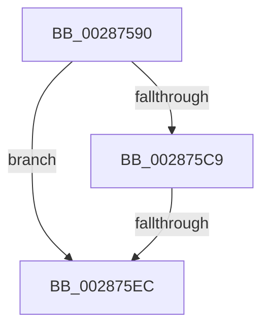

# MiUnlinkPageFromListEx

- RVA: `0x00287590`–`0x002875EF` (길이 `95` bytes)
- VA: `0x0000000140287590`
- 실행 섹션: `.text`
- PDB 이름 있음: `예`; PDB Function 태그: `아니요`
- unwind 정보 RVA: `0x00066CD0`
- 디코드: `25`개 명령, `95/95` bytes 표시
- 미해석 바이트: `0` (있으면 어셈블리에 `.byte`로 보존)

> 이 문서는 커널 이미지의 기계어와 PDB 기호를 분석해 생성했습니다. 4번과 5번은 함수 원형과 자료형을 바이너리 사용 방식에서 추정한 C 해석이며 원본 소스 복구 결과는 아닙니다.

## 1. Dependencies

- 직접 호출 지점: **0**; 고유 호출 대상: **0**
- 직접 호출자로 확인된 함수: **40**
- RIP 상대 이미지 참조: **2**

### Outgoing calls
- 직접 디코드된 call 명령이 없습니다.

### Direct callers
- [MiCombineWithStandbyExisting](../22/MiCombineWithStandbyExisting_function_00229E74.md) at `0x0022A0DA`
- [MiCombineInitialInstance](../22/MiCombineInitialInstance_function_0022BC0C.md) at `0x0022C59D`
- [MiResolveProtoCombine](../22/MiResolveProtoCombine_function_0022CD00.md) at `0x0022CF74`
- [MiHandleForkTransitionPte](../22/MiHandleForkTransitionPte_function_0022D34C.md) at `0x0022DBA5`
- [MiActOnPte](../24/MiActOnPte_function_00244C90.md) at `0x002455DF`
- [MiActOnPte](../24/MiActOnPte_function_00244C90.md) at `0x00245796`
- [sub_00283850](Unknown_function_00283850.md) at `0x0028391D`
- [MiAddPageToFlushMdl](MiAddPageToFlushMdl_function_00286930.md) at `0x00286B2D`
- [MiReplaceTransitionPage](../2B/MiReplaceTransitionPage_function_002B1120.md) at `0x002B1998`
- [MiPrepareDecayNodeForReuse](../2B/MiPrepareDecayNodeForReuse_function_002B8ADC.md) at `0x002B8B49`
- [MiRelinkStandbyPage](../2B/MiRelinkStandbyPage_function_002B9D30.md) at `0x002B9D4C`
- [MiUnlinkStandbyPfn](../2C/MiUnlinkStandbyPfn_function_002C3510.md) at `0x002C3585`
- [sub_002F6E32](../2F/Unknown_function_002F6E32.md) at `0x002F7080`
- [MiRemoveLowestPriorityStandbyPage](../33/MiRemoveLowestPriorityStandbyPage_function_00334600.md) at `0x003349D4`
- [MiWalkEntireImage](../36/MiWalkEntireImage_function_00365D70.md) at `0x003663F0`
- [MiZeroCfgSystemWideBitmapWorker](../36/MiZeroCfgSystemWideBitmapWorker_function_00367060.md) at `0x0036721F`
- [MiZeroCfgSystemWideBitmapWorker](../36/MiZeroCfgSystemWideBitmapWorker_function_00367060.md) at `0x00367659`
- [sub_00371C01](../37/Unknown_function_00371C01.md) at `0x00371C2B`
- [MiOutSwapWorkingSetPte](../37/MiOutSwapWorkingSetPte_function_00372190.md) at `0x0037254E`
- [MiDeleteSectionCluster](../37/MiDeleteSectionCluster_function_00373DF0.md) at `0x00373F6D`
- [MiGetRepurposedSlabStandbyPage](../37/MiGetRepurposedSlabStandbyPage_function_003755A8.md) at `0x0037565C`
- [MiReservePageFileSpaceForPage](../38/MiReservePageFileSpaceForPage_function_0038377C.md) at `0x00383C14`
- [MiReservePageFileSpaceForPage](../38/MiReservePageFileSpaceForPage_function_0038377C.md) at `0x00383C7A`
- [MiRepurposeStandbySlabPage](../38/MiRepurposeStandbySlabPage_function_00385780.md) at `0x00385929`
- [MiRepurposeDecayNode](../3D/MiRepurposeDecayNode_function_003D5774.md) at `0x003D578B`
- [MiGatherMappedPages](../40/MiGatherMappedPages_function_00404E80.md) at `0x00405300`
- [MiReferencePageForModifiedWrite](../40/MiReferencePageForModifiedWrite_function_00405DAC.md) at `0x00405E92`
- [MiBuildReservationCluster](../40/MiBuildReservationCluster_function_004071A0.md) at `0x00407748`
- [MiMakeOutswappedPageResident](../43/MiMakeOutswappedPageResident_function_00431AD0.md) at `0x00431EFA`
- [MiDecayPfnFullyInitialized](../44/MiDecayPfnFullyInitialized_function_00447748.md) at `0x00447937`
- [MiHandleSpecialPurposeMemoryCachedFault](../44/MiHandleSpecialPurposeMemoryCachedFault_function_0044C740.md) at `0x0044C9A6`
- [MiReuseStandbyPage](../44/MiReuseStandbyPage_function_0044CA90.md) at `0x0044CAA6`
- [MiUnlinkTransitionSlabPages](../44/MiUnlinkTransitionSlabPages_function_0044D140.md) at `0x0044D31E`
- [MiMirrorPerformBrownWrites](../45/MiMirrorPerformBrownWrites_function_0045C560.md) at `0x0045C961`
- [MiPurgeSlabEntry](../48/MiPurgeSlabEntry_function_0048D444.md) at `0x0048D4FD`
- [MiFreeModifiedReservations](../4F/MiFreeModifiedReservations_function_004FA318.md) at `0x004FA3E4`
- [MiWalkResetCommitPte](../66/MiWalkResetCommitPte_function_0066FD30.md) at `0x0066FD8A`
- [MiEnableLargeSubsection](../68/MiEnableLargeSubsection_function_00680BC4.md) at `0x00680CF6`
- [MiMarkFileOnlyPfnBad](../68/MiMarkFileOnlyPfnBad_function_006815C4.md) at `0x006816CD`
- [MiNoPagesLastChance](../68/MiNoPagesLastChance_function_0068B22C.md) at `0x0068B631`
- [MiRepointPteAtExtendedStandby](../68/MiRepointPteAtExtendedStandby_function_0068B6F4.md) at `0x0068B727`
- [MiMoveModifiedPagesToCompressList](../69/MiMoveModifiedPagesToCompressList_function_006925D8.md) at `0x0069263C`
- [sub_006EC390](../6E/Unknown_function_006EC390.md) at `0x006EC3AE`

### Static image references
- `0x0028759F` → RVA `0x00E0A740` (`.data`; read)
- `0x002875CD` → RVA `0x00E30088` (`.data`; read)

## 2. Other-region calls and transfers

- 다른 실행 섹션으로 향하는 call: **0**
- call이 아닌 외부 분기/꼬리 이동: **1**
  - `0x002875E6` → [sub_00287E6A](Unknown_function_00287E6A.md) (`tail-transfer`)

## 3. Assembly (complete function range)

```asm
00287590  40 53                           push rbx
00287592  56                              push rsi
00287593  57                              push rdi
00287594  41 54                           push r12
00287596  41 56                           push r14
00287598  48 81 EC D0 00 00 00            sub rsp, 0xd0
0028759F  48 8B 05 9A 31 B8 00            mov rax, qword ptr [rip + 0xb8319a]
002875A6  48 33 C4                        xor rax, rsp
002875A9  48 89 84 24 C0 00 00 00         mov qword ptr [rsp + 0xc0], rax
002875B1  45 33 E4                        xor r12d, r12d
002875B4  41 BE 09 00 00 00               mov r14d, 9
002875BA  44 89 74 24 34                  mov dword ptr [rsp + 0x34], r14d
002875BF  8B DA                           mov ebx, edx
002875C1  48 8B F9                        mov rdi, rcx
002875C4  F6 C2 04                        test dl, 4
002875C7  75 23                           jne 0x1402875ec
002875C9  48 8B 41 28                     mov rax, qword ptr [rcx + 0x28]
002875CD  48 8B 0D B4 8A BA 00            mov rcx, qword ptr [rip + 0xba8ab4]
002875D4  48 C1 E8 2B                     shr rax, 0x2b
002875D8  25 FF 03 00 00                  and eax, 0x3ff
002875DD  48 8B 04 C1                     mov rax, qword ptr [rcx + rax*8]
002875E1  8B 40 04                        mov eax, dword ptr [rax + 4]
002875E4  84 C0                           test al, al
002875E6  0F 88 7E 08 00 00               js 0x140287e6a
002875EC  8B 47 20                        mov eax, dword ptr [rdi + 0x20]
```

## 4. C-style interpretation (structured pseudocode)

```c
__int64 __fastcall MiUnlinkPageFromListEx(__int64 a1, int a2)
{
    __int64 result;
    __int64 v_r12;
    __int64 v_rsp;
    unsigned __int64 v_stack_m38;
    unsigned int v_stack_mC4;

    v_rsp = (v_rsp) - (208);
    result = (*(unsigned __int64 *)(v_rip + 12071322)) ^ (v_rsp);
    v_stack_m38 = result;
    v_r12 = 0;
    v_stack_mC4 = 9;
    if ((((unsigned __int8)(a2)) & (4)) != 0) goto loc_002875EC;
    result = (*(unsigned __int64 *)(a1 + 40)) >> (43);
    result = (unsigned int)((result) & (0x3FFULL));
loc_002875EC:
    return (unsigned int)(*(unsigned int *)(a1 + 32));
}
```

## 5. (Beta) C Style

```c
int64_t MiUnlinkPageFromListEx(void *Arg1, int32_t Arg2)
{
    uint8_t *arg1 = (uint8_t *)Arg1;

    int64_t result;
    int64_t local_r12;
    int64_t local_rsp;
    uint64_t v_stack_m38;
    uint32_t v_stack_mC4;

    local_rsp = (local_rsp) - (208);
    result = (*(uint64_t *)(v_rip + 0xB8319A)) ^ (local_rsp);
    v_stack_m38 = result;
    local_r12 = 0;
    v_stack_mC4 = 9;
    if ((((uint8_t)(Arg2)) & (4)) != 0) goto loc_002875EC;
    result = (*(uint64_t *)(arg1 + 0x28)) >> (43);
    result = (uint32_t)((result) & (0x3FFULL));
loc_002875EC:
    return (uint32_t)(*(uint32_t *)(arg1 + 0x20));
}
```

### 관측된 메모리 오프셋

구조체 형식이 확인되지 않은 접근은 인자 기준의 오프셋으로만 기록했습니다.

| 기준 인자 | 오프셋 표현 | 폭 (bit) | 접근 |
|---|---:|---:|---|
| `Arg1` | `+ 0x20` | `32` | `R` |
| `Arg1` | `+ 0x28` | `64` | `R` |

## 6. Execution-region graph

[열기: 2D/3D 그래프와 함수 탐색 컨트롤 패널](../../../control-panel.html?section=text&rva=0x00287590&view=graph)

- 2D 그래프는 위에서 아래로 흐르고, 3D 그래프는 빈 공간을 드래그해 회전합니다. Shift+드래그는 이동, 휠은 확대·축소, 함수 노드 선택은 대상 보고서 이동입니다.

### Static fallback


