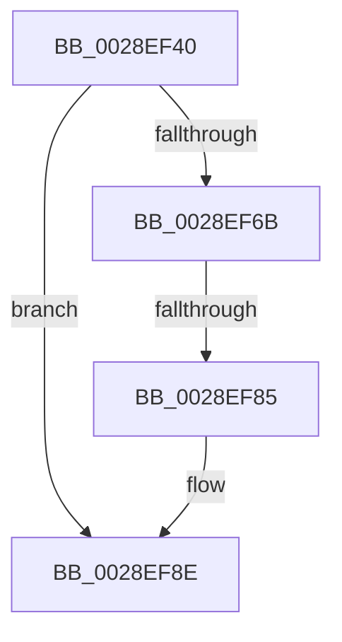

# MiUnlockStealVm

- RVA: `0x0028EF40`–`0x0028EF98` (길이 `88` bytes)
- VA: `0x000000014028EF40`
- 실행 섹션: `.text`
- PDB 이름 있음: `예`; PDB Function 태그: `아니요`
- unwind 정보 RVA: `0x00067130`
- 디코드: `23`개 명령, `88/88` bytes 표시
- 미해석 바이트: `0` (있으면 어셈블리에 `.byte`로 보존)

> 이 문서는 커널 이미지의 기계어와 PDB 기호를 분석해 생성했습니다. 4번과 5번은 함수 원형과 자료형을 바이너리 사용 방식에서 추정한 C 해석이며 원본 소스 복구 결과는 아닙니다.

## 1. Dependencies

- 직접 호출 지점: **2**; 고유 호출 대상: **2**
- 직접 호출자로 확인된 함수: **3**
- RIP 상대 이미지 참조: **1**

### Outgoing calls
- `0x0028EF6F` → [MiUnlockFaultPageTable](../27/MiUnlockFaultPageTable_function_0027D870.md) (function, `0x0027D870`)
- `0x0028EF85` → [MiUnlockWorkingSetShared](../27/MiUnlockWorkingSetShared_function_0027D690.md) (function, `0x0027D690`)

### Direct callers
- [sub_0028E4EC](Unknown_function_0028E4EC.md) at `0x0028E661`
- [MiStealPage](../2B/MiStealPage_function_002B28D0.md) at `0x002B316F`
- [MiLockStealUserVm](../2B/MiLockStealUserVm_function_002B3EDC.md) at `0x002B430E`

### Static image references
- `0x0028EF4D` → RVA `0x00E0A740` (`.data`; read)

## 2. Other-region calls and transfers

- 다른 실행 섹션으로 향하는 call: **0**
- call이 아닌 외부 분기/꼬리 이동: **2**
  - `0x0028EF7F` → [sub_0028F35E](Unknown_function_0028F35E.md) (`tail-transfer`)
  - `0x0028EF92` → [sub_0028F111](Unknown_function_0028F111.md) (`tail-transfer`)

## 3. Assembly (complete function range)

```asm
0028EF40  40 53                           push rbx
0028EF42  56                              push rsi
0028EF43  57                              push rdi
0028EF44  41 56                           push r14
0028EF46  48 81 EC 88 00 00 00            sub rsp, 0x88
0028EF4D  48 8B 05 EC B7 B7 00            mov rax, qword ptr [rip + 0xb7b7ec]
0028EF54  48 33 C4                        xor rax, rsp
0028EF57  48 89 44 24 70                  mov qword ptr [rsp + 0x70], rax
0028EF5C  48 8B 79 18                     mov rdi, qword ptr [rcx + 0x18]
0028EF60  45 33 F6                        xor r14d, r14d
0028EF63  48 8B F1                        mov rsi, rcx
0028EF66  48 85 FF                        test rdi, rdi
0028EF69  74 23                           je 0x14028ef8e
0028EF6B  48 83 C1 18                     add rcx, 0x18
0028EF6F  E8 FC E8 FE FF                  call 0x14027d870
0028EF74  F6 46 25 01                     test byte ptr [rsi + 0x25], 1
0028EF78  48 8B CF                        mov rcx, rdi
0028EF7B  0F B6 56 24                     movzx edx, byte ptr [rsi + 0x24]
0028EF7F  0F 85 D9 03 00 00               jne 0x14028f35e
0028EF85  E8 06 E7 FE FF                  call 0x14027d690
0028EF8A  4C 89 76 18                     mov qword ptr [rsi + 0x18], r14
0028EF8E  4C 39 76 38                     cmp qword ptr [rsi + 0x38], r14
0028EF92  0F 84 79 01 00 00               je 0x14028f111
```

## 4. C-style interpretation (structured pseudocode)

```c
__int64 __fastcall MiUnlockStealVm(__int64 a1)
{
    __int64 result;
    __int64 v_r14;
    __int64 v_rsp;
    unsigned __int64 v_stack_m38;

    v_rsp = (v_rsp) - (136);
    result = (*(unsigned __int64 *)(v_rip + 12040172)) ^ (v_rsp);
    v_stack_m38 = result;
    v_r14 = 0;
    if (*(unsigned __int64 *)(a1 + 24) == 0) goto loc_0028EF8E;
    a1 = (a1) + (24);
    result = MiUnlockFaultPageTable(a1, a2, a3, a4);
    result = MiUnlockWorkingSetShared(*(unsigned __int64 *)(a1 + 24), *(unsigned __int8 *)(a1 + 36), a3, a4);
    *(unsigned __int64 *)(a1 + 24) = 0;
loc_0028EF8E:
}
```

## 5. (Beta) C Style

```c
int64_t MiUnlockStealVm(void *Arg1)
{
    uint8_t *arg1 = (uint8_t *)Arg1;

    int64_t result;
    int64_t local_r14;
    int64_t local_rsp;
    uint64_t v_stack_m38;

    local_rsp = (local_rsp) - (136);
    result = (*(uint64_t *)(v_rip + 0xB7B7EC)) ^ (local_rsp);
    v_stack_m38 = result;
    local_r14 = 0;
    if (*(uint64_t *)(arg1 + 0x18) == 0) goto loc_0028EF8E;
    Arg1 = (Arg1) + (24);
    result = MiUnlockFaultPageTable(Arg1, a2, a3, a4);
    result = MiUnlockWorkingSetShared(*(uint64_t *)(arg1 + 0x18), *(uint8_t *)(arg1 + 0x24), a3, a4);
    *(uint64_t *)(arg1 + 0x18) = 0;
loc_0028EF8E:
}
```

### 관측된 메모리 오프셋

구조체 형식이 확인되지 않은 접근은 인자 기준의 오프셋으로만 기록했습니다.

| 기준 인자 | 오프셋 표현 | 폭 (bit) | 접근 |
|---|---:|---:|---|
| `Arg1` | `+ 0x18` | `64` | `R` |
| `Arg1` | `+ 0x18` | `64` | `W` |
| `Arg1` | `+ 0x24` | `8` | `R` |
| `Arg1` | `+ 0x25` | `8` | `R` |
| `Arg1` | `+ 0x38` | `64` | `R` |

## 6. Execution-region graph

[열기: 2D/3D 그래프와 함수 탐색 컨트롤 패널](../../../control-panel.html?section=text&rva=0x0028EF40&view=graph)

- 2D 그래프는 위에서 아래로 흐르고, 3D 그래프는 빈 공간을 드래그해 회전합니다. Shift+드래그는 이동, 휠은 확대·축소, 함수 노드 선택은 대상 보고서 이동입니다.

### Static fallback


