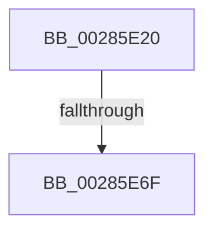

# MiUnmapViewSubsections

- RVA: `0x00285E20`–`0x00285E76` (길이 `86` bytes)
- VA: `0x0000000140285E20`
- 실행 섹션: `.text`
- PDB 이름 있음: `예`; PDB Function 태그: `아니요`
- unwind 정보 RVA: `0x00066B70`
- 디코드: `24`개 명령, `86/86` bytes 표시
- 미해석 바이트: `0` (있으면 어셈블리에 `.byte`로 보존)

> 이 문서는 커널 이미지의 기계어와 PDB 기호를 분석해 생성했습니다. 4번과 5번은 함수 원형과 자료형을 바이너리 사용 방식에서 추정한 C 해석이며 원본 소스 복구 결과는 아닙니다.

## 1. Dependencies

- 직접 호출 지점: **0**; 고유 호출 대상: **0**
- 직접 호출자로 확인된 함수: **1**
- RIP 상대 이미지 참조: **2**

### Outgoing calls
- 직접 디코드된 call 명령이 없습니다.

### Direct callers
- [MiDeleteVad](../../page/88/MiDeleteVad_function_00888C80.md) at `0x00888FF6`

### Static image references
- `0x00285E63` → RVA `0x00FC6D20` (`ALMOSTRO`; read)
- `0x00285E6F` → RVA `0x00FC6B06` (`ALMOSTRO`; read)

## 2. Other-region calls and transfers

- 다른 실행 섹션으로 향하는 call: **0**
- call이 아닌 외부 분기/꼬리 이동: **1**
  - `0x00285E69` → [sub_0028609E](Unknown_function_0028609E.md) (`tail-transfer`)

## 3. Assembly (complete function range)

```asm
00285E20  40 53                           push rbx
00285E22  55                              push rbp
00285E23  57                              push rdi
00285E24  41 54                           push r12
00285E26  41 55                           push r13
00285E28  41 56                           push r14
00285E2A  41 57                           push r15
00285E2C  48 83 EC 30                     sub rsp, 0x30
00285E30  48 8B 41 40                     mov rax, qword ptr [rcx + 0x40]
00285E34  33 ED                           xor ebp, ebp
00285E36  44 8B ED                        mov r13d, ebp
00285E39  48 89 84 24 88 00 00 00         mov qword ptr [rsp + 0x88], rax
00285E41  48 85 C0                        test rax, rax
00285E44  4D 8B F8                        mov r15, r8
00285E47  48 8B DA                        mov rbx, rdx
00285E4A  4C 8B F1                        mov r14, rcx
00285E4D  41 0F 95 C5                     setne r13b
00285E51  44 89 6C 24 70                  mov dword ptr [rsp + 0x70], r13d
00285E56  45 0F 20 C4                     mov r12, cr8
00285E5A  B8 02 00 00 00                  mov eax, 2
00285E5F  44 0F 22 C0                     mov cr8, rax
00285E63  39 2D B7 0E D4 00               cmp dword ptr [rip + 0xd40eb7], ebp
00285E69  0F 85 2F 02 00 00               jne 0x14028609e
00285E6F  F6 05 90 0C D4 00 21            test byte ptr [rip + 0xd40c90], 0x21
```

## 4. C-style interpretation (structured pseudocode)

```c
__int64 __fastcall MiUnmapViewSubsections(__int64 a1, __int64 a2, __int64 a3)
{
    __int64 v_r13;
    __int64 v_rbp;
    __int64 v_rsp;
    unsigned __int64 v_stack_p20;
    unsigned int v_stack_p8;

    v_rsp = (v_rsp) - (48);
    v_rbp = 0;
    v_stack_p20 = *(unsigned __int64 *)(a1 + 64);
    v_r13 = (*(unsigned __int64 *)(a1 + 64) != 0) ? 1 : 0;
    v_stack_p8 = (unsigned int)(v_r13);
    return 2;
}
```

## 5. (Beta) C Style

```c
int64_t MiUnmapViewSubsections(void *Arg1, int64_t Arg2, int64_t Arg3)
{
    uint8_t *arg1 = (uint8_t *)Arg1;

    int64_t local_r13;
    int64_t local_rbp;
    int64_t local_rsp;
    uint64_t v_stack_p20;
    uint32_t v_stack_p8;

    local_rsp = (local_rsp) - (48);
    local_rbp = 0;
    v_stack_p20 = *(uint64_t *)(arg1 + 0x40);
    local_r13 = (*(uint64_t *)(arg1 + 0x40) != 0) ? 1 : 0;
    v_stack_p8 = (uint32_t)(local_r13);
    return 2;
}
```

### 관측된 메모리 오프셋

구조체 형식이 확인되지 않은 접근은 인자 기준의 오프셋으로만 기록했습니다.

| 기준 인자 | 오프셋 표현 | 폭 (bit) | 접근 |
|---|---:|---:|---|
| `Arg1` | `+ 0x40` | `64` | `R` |

## 6. Execution-region graph

[열기: 2D/3D 그래프와 함수 탐색 컨트롤 패널](../../../control-panel.html?section=text&rva=0x00285E20&view=graph)

- 2D 그래프는 위에서 아래로 흐르고, 3D 그래프는 빈 공간을 드래그해 회전합니다. Shift+드래그는 이동, 휠은 확대·축소, 함수 노드 선택은 대상 보고서 이동입니다.

### Static fallback


