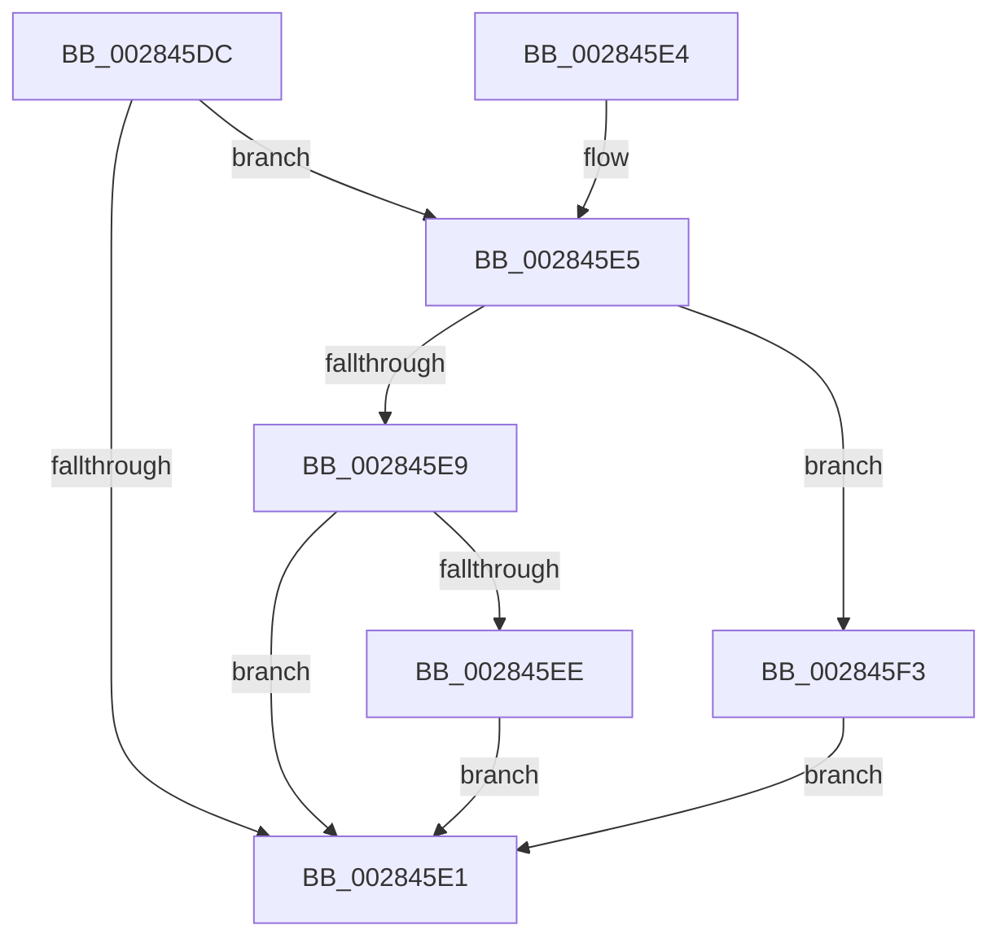

# MiUpdateProtectionMask

- RVA: `0x002845DC`–`0x002845F8` (길이 `28` bytes)
- VA: `0x00000001402845DC`
- 실행 섹션: `.text`
- PDB 이름 있음: `예`; PDB Function 태그: `아니요`
- unwind 정보 RVA: `0x000DB714`
- 디코드: `13`개 명령, `28/28` bytes 표시
- 미해석 바이트: `0` (있으면 어셈블리에 `.byte`로 보존)

> 이 문서는 커널 이미지의 기계어와 PDB 기호를 분석해 생성했습니다. 4번과 5번은 함수 원형과 자료형을 바이너리 사용 방식에서 추정한 C 해석이며 원본 소스 복구 결과는 아닙니다.

## 1. Dependencies

- 직접 호출 지점: **0**; 고유 호출 대상: **0**
- 직접 호출자로 확인된 함수: **8**
- RIP 상대 이미지 참조: **0**

### Outgoing calls
- 직접 디코드된 call 명령이 없습니다.

### Direct callers
- [MiResolveTransitionFault](MiResolveTransitionFault_function_00282940.md) at `0x00282B0D`
- [MiMakeProtoReadOnly](../49/MiMakeProtoReadOnly_function_004952F8.md) at `0x00495321`
- [MiSwitchToTransition](../4C/MiSwitchToTransition_function_004C0F5C.md) at `0x004C13ED`
- [MiHugePageOperation](../68/MiHugePageOperation_function_0068C490.md) at `0x0068C592`
- [MiUseProcessorHugeMappingAtDpc](../68/MiUseProcessorHugeMappingAtDpc_function_0068C894.md) at `0x0068C91C`
- [MiAllocateZeroCalibrationBuffer](../69/MiAllocateZeroCalibrationBuffer_function_00699844.md) at `0x0069987D`
- [MiAllocateFastAwePages](../../page/80/MiAllocateFastAwePages_function_0080969C.md) at `0x00809740`
- [MiMapLockedPagesInUserSpace](../../page/97/MiMapLockedPagesInUserSpace_function_0097FE04.md) at `0x0097FEA8`

### Static image references
- 디코드된 RIP-relative 메모리 참조가 없습니다.

## 2. Other-region calls and transfers

- 다른 실행 섹션으로 향하는 call: **0**
- 별도 외부 분기/꼬리 이동을 확인하지 못했습니다.

## 3. Assembly (complete function range)

```asm
002845DC  83 FA 01                        cmp edx, 1
002845DF  75 04                           jne 0x1402845e5
002845E1  8B C1                           mov eax, ecx
002845E3  C3                              ret
002845E4  CC                              int3
002845E5  85 D2                           test edx, edx
002845E7  74 0A                           je 0x1402845f3
002845E9  83 FA 02                        cmp edx, 2
002845EC  75 F3                           jne 0x1402845e1
002845EE  83 C9 18                        or ecx, 0x18
002845F1  EB EE                           jmp 0x1402845e1
002845F3  83 C9 08                        or ecx, 8
002845F6  EB E9                           jmp 0x1402845e1
```

## 4. C-style interpretation (structured pseudocode)

```c
__int64 __fastcall MiUpdateProtectionMask(int a1, int a2)
{
    if (a2 != 1) goto loc_002845E5;
loc_002845E1:
    return (unsigned int)(a1);
loc_002845E5:
    if (a2 == 0) goto loc_002845F3;
    if (a2 != 2) goto loc_002845E1;
    a1 = (unsigned int)((a1) | (24));
    goto loc_002845E1;
loc_002845F3:
    a1 = (unsigned int)((a1) | (8));
    goto loc_002845E1;
}
```

## 5. (Beta) C Style

```c
int64_t MiUpdateProtectionMask(int32_t Arg1, int32_t Arg2)
{
    if (Arg2 != 1) goto loc_002845E5;
loc_002845E1:
    return (uint32_t)(Arg1);
loc_002845E5:
    if (Arg2 == 0) goto loc_002845F3;
    if (Arg2 != 2) goto loc_002845E1;
    Arg1 = (uint32_t)((Arg1) | (24));
    goto loc_002845E1;
loc_002845F3:
    Arg1 = (uint32_t)((Arg1) | (8));
    goto loc_002845E1;
}
```

## 6. Execution-region graph

[열기: 2D/3D 그래프와 함수 탐색 컨트롤 패널](../../../control-panel.html?section=text&rva=0x002845DC&view=graph)

- 2D 그래프는 위에서 아래로 흐르고, 3D 그래프는 빈 공간을 드래그해 회전합니다. Shift+드래그는 이동, 휠은 확대·축소, 함수 노드 선택은 대상 보고서 이동입니다.

### Static fallback


