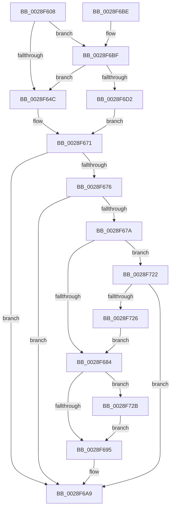

# MiUpdateWsleAge

- RVA: `0x0028F608`–`0x0028F73F` (길이 `311` bytes)
- VA: `0x000000014028F608`
- 실행 섹션: `.text`
- PDB 이름 있음: `예`; PDB Function 태그: `아니요`
- unwind 정보 RVA: `0x000672F8`
- 디코드: `77`개 명령, `311/311` bytes 표시
- 미해석 바이트: `0` (있으면 어셈블리에 `.byte`로 보존)

> 이 문서는 커널 이미지의 기계어와 PDB 기호를 분석해 생성했습니다. 4번과 5번은 함수 원형과 자료형을 바이너리 사용 방식에서 추정한 C 해석이며 원본 소스 복구 결과는 아닙니다.

## 1. Dependencies

- 직접 호출 지점: **5**; 고유 호출 대상: **3**
- 직접 호출자로 확인된 함수: **1**
- RIP 상대 이미지 참조: **0**

### Outgoing calls
- `0x0028F666` → [MI_READ_PTE_LOCK_FREE](MI_READ_PTE_LOCK_FREE_function_002828A0.md) (function, `0x002828A0`)
- `0x0028F687` → [MI_READ_PTE_LOCK_FREE](MI_READ_PTE_LOCK_FREE_function_002828A0.md) (function, `0x002828A0`)
- `0x0028F6A4` → [MiSetVaAgeList](../29/MiSetVaAgeList_function_00290A20.md) (function, `0x00290A20`)
- `0x0028F6EC` → [MI_READ_PTE_LOCK_FREE](MI_READ_PTE_LOCK_FREE_function_002828A0.md) (function, `0x002828A0`)
- `0x0028F735` → [MiWriteValidPteNewProtection](MiWriteValidPteNewProtection_function_00281810.md) (function, `0x00281810`)

### Direct callers
- [MiActOnPte](../24/MiActOnPte_function_00244C90.md) at `0x0024518C`

### Static image references
- 디코드된 RIP-relative 메모리 참조가 없습니다.

## 2. Other-region calls and transfers

- 다른 실행 섹션으로 향하는 call: **0**
- 별도 외부 분기/꼬리 이동을 확인하지 못했습니다.

## 3. Assembly (complete function range)

```asm
0028F608  48 89 5C 24 08                  mov qword ptr [rsp + 8], rbx
0028F60D  48 89 6C 24 10                  mov qword ptr [rsp + 0x10], rbp
0028F612  48 89 74 24 18                  mov qword ptr [rsp + 0x18], rsi
0028F617  57                              push rdi
0028F618  48 83 EC 20                     sub rsp, 0x20
0028F61C  48 8B DA                        mov rbx, rdx
0028F61F  48 8B F2                        mov rsi, rdx
0028F622  48 C1 E3 19                     shl rbx, 0x19
0028F626  41 8A F8                        mov dil, r8b
0028F629  48 8B E9                        mov rbp, rcx
0028F62C  48 BA 00 00 00 00 80 F6 FF FF   movabs rdx, 0xfffff68000000000
0028F636  48 8B C2                        mov rax, rdx
0028F639  48 C1 E0 19                     shl rax, 0x19
0028F63D  48 2B D8                        sub rbx, rax
0028F640  48 C1 FB 10                     sar rbx, 0x10
0028F644  48 8B C2                        mov rax, rdx
0028F647  48 3B D8                        cmp rbx, rax
0028F64A  73 73                           jae 0x14028f6bf
0028F64C  48 8B CB                        mov rcx, rbx
0028F64F  48 B8 F8 FF FF FF 7F 00 00 00   movabs rax, 0x7ffffffff8
0028F659  48 C1 E9 09                     shr rcx, 9
0028F65D  48 23 C8                        and rcx, rax
0028F660  48 8B C2                        mov rax, rdx
0028F663  48 03 C8                        add rcx, rax
0028F666  E8 35 32 FF FF                  call 0x1402828a0
0028F66B  48 C1 E8 38                     shr rax, 0x38
0028F66F  24 0F                           and al, 0xf
0028F671  40 3A F8                        cmp dil, al
0028F674  74 33                           je 0x14028f6a9
0028F676  3C 08                           cmp al, 8
0028F678  73 2F                           jae 0x14028f6a9
0028F67A  40 80 FF 07                     cmp dil, 7
0028F67E  0F 85 9E 00 00 00               jne 0x14028f722
0028F684  48 8B CE                        mov rcx, rsi
0028F687  E8 14 32 FF FF                  call 0x1402828a0
0028F68C  40 84 FF                        test dil, dil
0028F68F  0F 84 96 00 00 00               je 0x14028f72b
0028F695  44 8A CF                        mov r9b, dil
0028F698  41 B8 01 00 00 00               mov r8d, 1
0028F69E  48 8B D3                        mov rdx, rbx
0028F6A1  48 8B CD                        mov rcx, rbp
0028F6A4  E8 77 13 00 00                  call 0x140290a20
0028F6A9  48 8B 5C 24 30                  mov rbx, qword ptr [rsp + 0x30]
0028F6AE  48 8B 6C 24 38                  mov rbp, qword ptr [rsp + 0x38]
0028F6B3  48 8B 74 24 40                  mov rsi, qword ptr [rsp + 0x40]
0028F6B8  48 83 C4 20                     add rsp, 0x20
0028F6BC  5F                              pop rdi
0028F6BD  C3                              ret
0028F6BE  CC                              int3
0028F6BF  48 B8 FF FF FF FF FF F6 FF FF   movabs rax, 0xfffff6ffffffffff
0028F6C9  48 3B D8                        cmp rbx, rax
0028F6CC  0F 87 7A FF FF FF               ja 0x14028f64c
0028F6D2  48 8B CB                        mov rcx, rbx
0028F6D5  48 B8 F8 FF FF FF 7F 00 00 00   movabs rax, 0x7ffffffff8
0028F6DF  48 C1 E9 09                     shr rcx, 9
0028F6E3  48 23 C8                        and rcx, rax
0028F6E6  48 8B C2                        mov rax, rdx
0028F6E9  48 03 C8                        add rcx, rax
0028F6EC  E8 AF 31 FF FF                  call 0x1402828a0
0028F6F1  48 C1 E8 0C                     shr rax, 0xc
0028F6F5  48 B9 FF FF FF FF FF 00 00 00   movabs rcx, 0xffffffffff
0028F6FF  48 23 C1                        and rax, rcx
0028F702  48 8D 04 40                     lea rax, [rax + rax*2]
0028F706  48 03 C0                        add rax, rax
0028F709  48 B9 00 00 00 00 00 DE FF FF   movabs rcx, 0xffffde0000000000
0028F713  48 8B 04 C1                     mov rax, qword ptr [rcx + rax*8]
0028F717  48 C1 E8 2A                     shr rax, 0x2a
0028F71B  24 07                           and al, 7
0028F71D  E9 4F FF FF FF                  jmp 0x14028f671
0028F722  3C 07                           cmp al, 7
0028F724  75 83                           jne 0x14028f6a9
0028F726  E9 59 FF FF FF                  jmp 0x14028f684
0028F72B  48 83 C8 20                     or rax, 0x20
0028F72F  48 8B CE                        mov rcx, rsi
0028F732  48 8B D0                        mov rdx, rax
0028F735  E8 D6 20 FF FF                  call 0x140281810
0028F73A  E9 56 FF FF FF                  jmp 0x14028f695
```

## 4. C-style interpretation (structured pseudocode)

```c
__int64 __fastcall MiUpdateWsleAge(__int64 a1, __int64 a2, unsigned __int8 a3)
{
    __int64 result;
    __int64 v_rbx;
    __int64 v_rsp;
    unsigned __int64 v_stack_p10;
    unsigned __int64 v_stack_p18;
    unsigned __int64 v_stack_p8;

    v_stack_p8 = v_rbx;
    v_stack_p10 = v_rbp;
    v_stack_p18 = v_rsi;
    v_rsp = (v_rsp) - (32);
    v_rbx = (a2) << (25);
    result = (a2) << (25);
    v_rbx = (v_rbx) - (result);
    v_rbx = (v_rbx) >> (16);
    if (v_rbx >= a2) goto loc_0028F6BF;
loc_0028F64C:
    a1 = (v_rbx) >> (9);
    a1 = (a1) & (a2);
    a1 = (a1) + (a2);
    result = MI_READ_PTE_LOCK_FREE(a1, a2, a3, a4);
    result = (result) >> (56);
    result = (unsigned __int8)((result) & (15));
loc_0028F671:
    if (a3 == ((unsigned __int8)(result))) goto loc_0028F6A9;
    if (((unsigned __int8)(result)) >= 8) goto loc_0028F6A9;
    if (a3 != 7) goto loc_0028F722;
loc_0028F684:
    result = MI_READ_PTE_LOCK_FREE(a2, a2, a3, a4);
    if (a3 == 0) goto loc_0028F72B;
loc_0028F695:
    result = MiSetVaAgeList(a1, v_rbx, 1, a3);
loc_0028F6A9:
    v_rsp = (v_rsp) + (32);
    return result;
loc_0028F6BF:
    if (v_stack_p8 > result) goto loc_0028F64C;
    a1 = (v_stack_p8) >> (9);
    a1 = (a1) & (result);
    a1 = (a1) + (v_rbx);
    result = MI_READ_PTE_LOCK_FREE(a1, v_rbx, 1, a3);
    result = (result) >> (12);
    result = (result) & (a1);
    result = (result + result * 2) + (result + result * 2);
    result = (*(unsigned __int64 *)(a1 + result * 8)) >> (42);
    result = (unsigned __int8)((result) & (7));
    goto loc_0028F671;
loc_0028F722:
    if (((unsigned __int8)(result)) != 7) goto loc_0028F6A9;
    goto loc_0028F684;
loc_0028F72B:
    result = (result) | (32);
    result = MiWriteValidPteNewProtection(v_stack_p18, result, 1, a3);
    goto loc_0028F695;
}
```

## 5. (Beta) C Style

```c
int64_t MiUpdateWsleAge(int64_t Arg1, int64_t Arg2, uint8_t Arg3)
{
    int64_t result;
    int64_t local_rbx;
    int64_t local_rsp;
    uint64_t v_stack_p10;
    uint64_t v_stack_p18;
    uint64_t v_stack_p8;

    v_stack_p8 = local_rbx;
    v_stack_p10 = local_rbp;
    v_stack_p18 = local_rsi;
    local_rsp = (local_rsp) - (32);
    local_rbx = (Arg2) << (25);
    result = (Arg2) << (25);
    local_rbx = (local_rbx) - (result);
    local_rbx = (local_rbx) >> (16);
    if (local_rbx >= Arg2) goto loc_0028F6BF;
loc_0028F64C:
    Arg1 = (local_rbx) >> (9);
    Arg1 = (Arg1) & (Arg2);
    Arg1 = (Arg1) + (Arg2);
    result = MI_READ_PTE_LOCK_FREE(Arg1, Arg2, Arg3, a4);
    result = (result) >> (56);
    result = (uint8_t)((result) & (15));
loc_0028F671:
    if (Arg3 == ((uint8_t)(result))) goto loc_0028F6A9;
    if (((uint8_t)(result)) >= 8) goto loc_0028F6A9;
    if (Arg3 != 7) goto loc_0028F722;
loc_0028F684:
    result = MI_READ_PTE_LOCK_FREE(Arg2, Arg2, Arg3, a4);
    if (Arg3 == 0) goto loc_0028F72B;
loc_0028F695:
    result = MiSetVaAgeList(Arg1, local_rbx, 1, Arg3);
loc_0028F6A9:
    local_rsp = (local_rsp) + (32);
    return result;
loc_0028F6BF:
    if (v_stack_p8 > result) goto loc_0028F64C;
    Arg1 = (v_stack_p8) >> (9);
    Arg1 = (Arg1) & (result);
    Arg1 = (Arg1) + (local_rbx);
    result = MI_READ_PTE_LOCK_FREE(Arg1, local_rbx, 1, Arg3);
    result = (result) >> (12);
    result = (result) & (Arg1);
    result = (result + result * 2) + (result + result * 2);
    result = (*(uint64_t *)(Arg1 + result * 8)) >> (42);
    result = (uint8_t)((result) & (7));
    goto loc_0028F671;
loc_0028F722:
    if (((uint8_t)(result)) != 7) goto loc_0028F6A9;
    goto loc_0028F684;
loc_0028F72B:
    result = (result) | (32);
    result = MiWriteValidPteNewProtection(v_stack_p18, result, 1, Arg3);
    goto loc_0028F695;
}
```

## 6. Execution-region graph

[열기: 2D/3D 그래프와 함수 탐색 컨트롤 패널](../../../control-panel.html?section=text&rva=0x0028F608&view=graph)

- 2D 그래프는 위에서 아래로 흐르고, 3D 그래프는 빈 공간을 드래그해 회전합니다. Shift+드래그는 이동, 휠은 확대·축소, 함수 노드 선택은 대상 보고서 이동입니다.

### Static fallback


