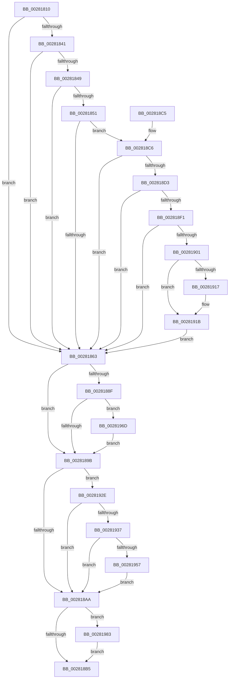

# MiWriteValidPteNewProtection

- RVA: `0x00281810`–`0x00281993` (길이 `387` bytes)
- VA: `0x0000000140281810`
- 실행 섹션: `.text`
- PDB 이름 있음: `예`; PDB Function 태그: `아니요`
- unwind 정보 RVA: `0x0006671C`
- 디코드: `89`개 명령, `387/387` bytes 표시
- 미해석 바이트: `0` (있으면 어셈블리에 `.byte`로 보존)

> 이 문서는 커널 이미지의 기계어와 PDB 기호를 분석해 생성했습니다. 4번과 5번은 함수 원형과 자료형을 바이너리 사용 방식에서 추정한 C 해석이며 원본 소스 복구 결과는 아닙니다.

## 1. Dependencies

- 직접 호출 지점: **3**; 고유 호출 대상: **3**
- 직접 호출자로 확인된 함수: **45**
- RIP 상대 이미지 참조: **1**

### Outgoing calls
- `0x00281963` → [MiCheckLinearProtectedPteAccessedBit](../29/MiCheckLinearProtectedPteAccessedBit_function_00292D80.md) (function, `0x00292D80`)
- `0x00281972` → [MiSanitizeShadowPxe](../29/MiSanitizeShadowPxe_function_00294B68.md) (function, `0x00294B68`)
- `0x00281989` → [MiWritePteShadow](../29/MiWritePteShadow_function_00294EAC.md) (function, `0x00294EAC`)

### Direct callers
- [MmProtectMdlSystemAddress](../22/MmProtectMdlSystemAddress_function_00227B50.md) at `0x00227D4E`
- [MiReplacePageTablePage](../22/MiReplacePageTablePage_function_00229184.md) at `0x0022968F`
- [MiDemoteCombinedPte](../22/MiDemoteCombinedPte_function_0022ABAC.md) at `0x0022AE6C`
- [MiBuildForkPte](../22/MiBuildForkPte_function_0022E32C.md) at `0x0022E682`
- [MmSetAddressRangeModifiedEx](../23/MmSetAddressRangeModifiedEx_function_00236F20.md) at `0x00237498`
- [MiDirtyPte](../23/MiDirtyPte_function_00237C5C.md) at `0x00237CAA`
- [MiUnlockNestedPageTableWritePte](../23/MiUnlockNestedPageTableWritePte_function_0023F4E4.md) at `0x0023F764`
- [MiActOnPte](../24/MiActOnPte_function_00244C90.md) at `0x00245109`
- [MmProtectPool](../26/MmProtectPool_function_002697AC.md) at `0x00269995`
- [MiMakeSystemAddressValid](../27/MiMakeSystemAddressValid_function_0027FF70.md) at `0x00280351`
- [MiLockLowestValidPageTableEx](MiLockLowestValidPageTableEx_function_00280D10.md) at `0x00280EF1`
- [sub_00281A81](Unknown_function_00281A81.md) at `0x00281C4A`
- [MiResolveTransitionFault](MiResolveTransitionFault_function_00282940.md) at `0x00282BC2`
- [MiUpdateWsleAge](MiUpdateWsleAge_function_0028F608.md) at `0x0028F735`
- [MiClearPteAccessed](../29/MiClearPteAccessed_function_00290630.md) at `0x00290737`
- [MiAllocateKernelStackPages](../2A/MiAllocateKernelStackPages_function_002A1BEC.md) at `0x002A200B`
- [MiStealPage](../2B/MiStealPage_function_002B28D0.md) at `0x002B37F9`
- [MiStealPage](../2B/MiStealPage_function_002B28D0.md) at `0x002B389A`
- [MiRevertValidPte](../2C/MiRevertValidPte_function_002C5160.md) at `0x002C537A`
- [MiTrimSharedPageFromViews](../2E/MiTrimSharedPageFromViews_function_002E16F8.md) at `0x002E1F50`
- [MiRewritePteWithLockBit](../32/MiRewritePteWithLockBit_function_00322FEC.md) at `0x0032320B`
- [MiCompletePrivateZeroFault](../33/MiCompletePrivateZeroFault_function_00330CC0.md) at `0x00331B5E`
- [MiAllocateWsle](../33/MiAllocateWsle_function_003332C0.md) at `0x00333AE6`
- [sub_003477E9](../34/Unknown_function_003477E9.md) at `0x003477F0`
- [MiProcessWsInSwapFault](../36/MiProcessWsInSwapFault_function_00361EFC.md) at `0x00361FC9`
- [MiWriteEnclavePte](../36/MiWriteEnclavePte_function_00368570.md) at `0x003686A5`
- [MiDecommitHardwareEnclavePages](../36/MiDecommitHardwareEnclavePages_function_003688D4.md) at `0x00368A6B`
- [MiTradeActivePage](../37/MiTradeActivePage_function_00374424.md) at `0x00374782`
- [MiIssueHardFault](../38/MiIssueHardFault_function_00380074.md) at `0x003807B8`
- [MiSetSystemCodeProtection](../38/MiSetSystemCodeProtection_function_00384420.md) at `0x00384597`
- [MiLargePageFault](../3F/MiLargePageFault_function_003F01C4.md) at `0x003F039F`
- [sub_0044565B](../44/Unknown_function_0044565B.md) at `0x00445755`
- [MiRevokeExecutePte](../46/MiRevokeExecutePte_function_00460BA0.md) at `0x00460C62`
- [MiMakeCombineCandidateClean](../46/MiMakeCombineCandidateClean_function_00465170.md) at `0x004651A0`
- [MiPerformSafePdeWrite](../49/MiPerformSafePdeWrite_function_00494300.md) at `0x0049439D`
- [MI_SET_PTE_SHADOW_STACK](../49/MI_SET_PTE_SHADOW_STACK_function_00494AEC.md) at `0x00494B04`
- [MiWritePteHighLevelIsr](../4C/MiWritePteHighLevelIsr_function_004C2FC0.md) at `0x004C3124`
- [MiProtectAweRegion](../4C/MiProtectAweRegion_function_004CE62C.md) at `0x004CEC27`
- [MiWriteAweClusterPte](../4E/MiWriteAweClusterPte_function_004E16A8.md) at `0x004E1717`
- [MiSetPageProtection](../67/MiSetPageProtection_function_00674BDC.md) at `0x00674DC9`
- [MiDbgCopyMemoryTarget](../68/MiDbgCopyMemoryTarget_function_00684E70.md) at `0x00684F32`
- [sub_006E1C8E](../6E/Unknown_function_006E1C8E.md) at `0x006E1DBF`
- [sub_006F15CE](../6F/Unknown_function_006F15CE.md) at `0x006F165C`
- [MiProtectSharedUserPage](../../init/C6/MiProtectSharedUserPage_function_00C60F44.md) at `0x00C6117F`
- [MxCreatePfnsForPtes](../../init/C6/MxCreatePfnsForPtes_function_00C635B0.md) at `0x00C6369B`
- [MiMarkBootKernelStack](../../init/C6/MiMarkBootKernelStack_function_00C68244.md) at `0x00C6836D`

### Static image references
- `0x0028189B` → RVA `0x00FC6A88` (`ALMOSTRO`; read)

## 2. Other-region calls and transfers

- 다른 실행 섹션으로 향하는 call: **0**
- 별도 외부 분기/꼬리 이동을 확인하지 못했습니다.

## 3. Assembly (complete function range)

```asm
00281810  48 89 5C 24 10                  mov qword ptr [rsp + 0x10], rbx
00281815  48 89 74 24 18                  mov qword ptr [rsp + 0x18], rsi
0028181A  57                              push rdi
0028181B  48 83 EC 20                     sub rsp, 0x20
0028181F  48 8B 19                        mov rbx, qword ptr [rcx]
00281822  48 8B F9                        mov rdi, rcx
00281825  49 BB 00 D0 BE 7D FB F6 FF FF   movabs r11, 0xfffff6fb7dbed000
0028182F  49 8B C3                        mov rax, r11
00281832  49 B9 F8 D7 BE 7D FB F6 FF FF   movabs r9, 0xfffff6fb7dbed7f8
0028183C  48 3B C8                        cmp rcx, rax
0028183F  72 22                           jb 0x140281863
00281841  49 8B C1                        mov rax, r9
00281844  48 3B C8                        cmp rcx, rax
00281847  77 1A                           ja 0x140281863
00281849  48 8B C3                        mov rax, rbx
0028184C  F6 C3 01                        test bl, 1
0028184F  74 12                           je 0x140281863
00281851  F6 C3 42                        test bl, 0x42
00281854  41 0F 95 C0                     setne r8b
00281858  F6 C3 20                        test bl, 0x20
0028185B  0F 95 C1                        setne cl
0028185E  44 84 C1                        test cl, r8b
00281861  74 63                           je 0x1402818c6
00281863  48 B8 00 00 00 00 00 00 00 7F   movabs rax, 0x7f00000000000000
0028186D  33 F6                           xor esi, esi
0028186F  48 23 D8                        and rbx, rax
00281872  48 B8 FF FF FF FF FF FF FF 80   movabs rax, 0x80ffffffffffffff
0028187C  48 23 D0                        and rdx, rax
0028187F  48 0B DA                        or rbx, rdx
00281882  48 89 5C 24 30                  mov qword ptr [rsp + 0x30], rbx
00281887  49 8B C3                        mov rax, r11
0028188A  48 3B F8                        cmp rdi, rax
0028188D  72 0C                           jb 0x14028189b
0028188F  49 8B C1                        mov rax, r9
00281892  48 3B F8                        cmp rdi, rax
00281895  0F 86 D2 00 00 00               jbe 0x14028196d
0028189B  48 0F BA 25 E4 51 D4 00 24      bt qword ptr [rip + 0xd451e4], 0x24
002818A4  0F 82 84 00 00 00               jb 0x14028192e
002818AA  48 89 1F                        mov qword ptr [rdi], rbx
002818AD  85 F6                           test esi, esi
002818AF  0F 85 CE 00 00 00               jne 0x140281983
002818B5  48 8B 5C 24 38                  mov rbx, qword ptr [rsp + 0x38]
002818BA  48 8B 74 24 40                  mov rsi, qword ptr [rsp + 0x40]
002818BF  48 83 C4 20                     add rsp, 0x20
002818C3  5F                              pop rdi
002818C4  C3                              ret
002818C5  CC                              int3
002818C6  48 F7 05 B7 51 D4 00 00 00 60 00  test qword ptr [rip + 0xd451b7], 0x600000
002818D1  74 90                           je 0x140281863
002818D3  65 48 8B 0C 25 88 01 00 00      mov rcx, qword ptr gs:[0x188]
002818DC  4C 8B 81 B8 00 00 00            mov r8, qword ptr [rcx + 0xb8]
002818E3  41 80 B8 60 01 00 00 01         cmp byte ptr [r8 + 0x160], 1
002818EB  0F 84 72 FF FF FF               je 0x140281863
002818F1  4D 8B 90 08 05 00 00            mov r10, qword ptr [r8 + 0x508]
002818F8  4D 85 D2                        test r10, r10
002818FB  0F 84 62 FF FF FF               je 0x140281863
00281901  48 8B CF                        mov rcx, rdi
00281904  48 C1 E9 03                     shr rcx, 3
00281908  81 E1 FF 01 00 00               and ecx, 0x1ff
0028190E  49 8B 0C CA                     mov rcx, qword ptr [r10 + rcx*8]
00281912  F6 C1 20                        test cl, 0x20
00281915  74 04                           je 0x14028191b
00281917  48 83 C8 20                     or rax, 0x20
0028191B  48 8B D8                        mov rbx, rax
0028191E  48 83 CB 42                     or rbx, 0x42
00281922  F6 C1 42                        test cl, 0x42
00281925  48 0F 44 D8                     cmove rbx, rax
00281929  E9 35 FF FF FF                  jmp 0x140281863
0028192E  F6 C3 20                        test bl, 0x20
00281931  0F 85 73 FF FF FF               jne 0x1402818aa
00281937  48 B9 00 00 00 00 80 F6 FF FF   movabs rcx, 0xfffff68000000000
00281941  48 B8 00 00 00 00 40 00 00 00   movabs rax, 0x4000000000
0028194B  48 03 C8                        add rcx, rax
0028194E  48 3B F9                        cmp rdi, rcx
00281951  0F 82 53 FF FF FF               jb 0x1402818aa
00281957  41 B8 80 00 00 00               mov r8d, 0x80
0028195D  48 8B D3                        mov rdx, rbx
00281960  48 8B CF                        mov rcx, rdi
00281963  E8 18 14 01 00                  call 0x140292d80
00281968  E9 3D FF FF FF                  jmp 0x1402818aa
0028196D  48 8D 54 24 30                  lea rdx, [rsp + 0x30]
00281972  E8 F1 31 01 00                  call 0x140294b68
00281977  48 8B 5C 24 30                  mov rbx, qword ptr [rsp + 0x30]
0028197C  8B F0                           mov esi, eax
0028197E  E9 18 FF FF FF                  jmp 0x14028189b
00281983  48 8B D3                        mov rdx, rbx
00281986  48 8B CF                        mov rcx, rdi
00281989  E8 1E 35 01 00                  call 0x140294eac
0028198E  E9 22 FF FF FF                  jmp 0x1402818b5
```

## 4. C-style interpretation (structured pseudocode)

```c
__int64 __fastcall MiWriteValidPteNewProtection(__int64 a1, __int64 a2)
{
    __int64 result;
    __int64 v_rbx;
    __int64 v_rsi;
    __int64 v_rsp;
    unsigned __int64 v_stack_p10;
    unsigned __int64 v_stack_p18;
    unsigned __int64 v_stack_p30;
    unsigned __int64 v_stack_p8;

    v_stack_p10 = v_rbx;
    v_stack_p18 = v_rsi;
    v_rsp = (v_rsp) - (32);
    if (a1 < v_r11) goto loc_00281863;
    if (a1 > a4) goto loc_00281863;
    if ((((unsigned __int8)(*(unsigned __int64 *)(a1))) & (1)) == 0) goto loc_00281863;
    a3 = ((((unsigned __int8)(*(unsigned __int64 *)(a1))) & (66)) != 0) ? 1 : 0;
    a1 = ((((unsigned __int8)(*(unsigned __int64 *)(a1))) & (32)) != 0) ? 1 : 0;
    if ((((unsigned __int8)(a1)) & ((unsigned __int8)(a3))) == 0) goto loc_002818C6;
loc_00281863:
    v_rsi = 0;
    v_rbx = (*(unsigned __int64 *)(a1)) & (*(unsigned __int64 *)(a1));
    a2 = (a2) & (*(unsigned __int64 *)(a1));
    v_rbx = (v_rbx) | (a2);
    v_stack_p8 = v_rbx;
    if (a1 < v_r11) goto loc_0028189B;
    if (a1 <= a4) goto loc_0028196D;
loc_0028189B:
    if (a1 < a4) goto loc_0028192E;
loc_002818AA:
    *(unsigned __int64 *)(a1) = v_rbx;
    if (0 != 0) goto loc_00281983;
loc_002818B5:
    v_rsp = (v_rsp) + (32);
    return a4;
loc_002818C6:
    if (((*(unsigned __int64 *)(v_rip + 13914551)) & (0x600000ULL)) == 0) goto loc_00281863;
    if ((*(unsigned __int8 *)(*(unsigned __int64 *)(*(unsigned __int64 *)(gs_base + (0 + 392)) + 184) + 352)) == 1) goto loc_00281863;
    if (*(unsigned __int64 *)(*(unsigned __int64 *)(*(unsigned __int64 *)(gs_base + (0 + 392)) + 184) + 1288) == 0) goto loc_00281863;
    a1 = (a1) >> (3);
    a1 = (unsigned int)((a1) & (511));
    result = a4;
    if ((((unsigned __int8)(*(unsigned __int64 *)(*(unsigned __int64 *)(*(unsigned __int64 *)(*(unsigned __int64 *)(gs_base + (0 + 392)) + 184) + 1288) + a1 * 8))) & (32)) != 0) {
        result = (a4) | (32);
    }
    v_rbx = (result) | (66);
    if ((((unsigned __int8)(*(unsigned __int64 *)(*(unsigned __int64 *)(*(unsigned __int64 *)(*(unsigned __int64 *)(gs_base + (0 + 392)) + 184) + 1288) + a1 * 8))) & (66)) == 0) { v_rbx = result; }
    goto loc_00281863;
loc_0028192E:
    if ((((unsigned __int8)(v_rbx)) & (32)) != 0) goto loc_002818AA;
    a1 = (*(unsigned __int64 *)(*(unsigned __int64 *)(*(unsigned __int64 *)(*(unsigned __int64 *)(gs_base + (0 + 392)) + 184) + 1288) + a1 * 8)) + (result);
    if (a1 < a1) goto loc_002818AA;
    result = MiCheckLinearProtectedPteAccessedBit(a1, v_rbx, 128, a4);
    goto loc_002818AA;
loc_0028196D:
    result = MiSanitizeShadowPxe(a1, v_stack_p30, 128, a4);
    goto loc_0028189B;
loc_00281983:
    result = MiWritePteShadow(a1, v_stack_p30, 128, a4);
    goto loc_002818B5;
}
```

## 5. (Beta) C Style

```c
int64_t MiWriteValidPteNewProtection(void *Arg1, int64_t Arg2)
{
    uint8_t *arg1 = (uint8_t *)Arg1;

    int64_t result;
    int64_t local_rbx;
    int64_t local_rsi;
    int64_t local_rsp;
    uint64_t v_stack_p10;
    uint64_t v_stack_p18;
    uint64_t v_stack_p30;
    uint64_t v_stack_p8;

    v_stack_p10 = local_rbx;
    v_stack_p18 = local_rsi;
    local_rsp = (local_rsp) - (32);
    if (Arg1 < local_r11) goto loc_00281863;
    if (Arg1 > a4) goto loc_00281863;
    if ((((uint8_t)(*(uint64_t *)(arg1))) & (1)) == 0) goto loc_00281863;
    a3 = ((((uint8_t)(*(uint64_t *)(arg1))) & (66)) != 0) ? 1 : 0;
    Arg1 = ((((uint8_t)(*(uint64_t *)(arg1))) & (32)) != 0) ? 1 : 0;
    if ((((uint8_t)(Arg1)) & ((uint8_t)(a3))) == 0) goto loc_002818C6;
loc_00281863:
    local_rsi = 0;
    local_rbx = (*(uint64_t *)(arg1)) & (*(uint64_t *)(arg1));
    Arg2 = (Arg2) & (*(uint64_t *)(arg1));
    local_rbx = (local_rbx) | (Arg2);
    v_stack_p8 = local_rbx;
    if (Arg1 < local_r11) goto loc_0028189B;
    if (Arg1 <= a4) goto loc_0028196D;
loc_0028189B:
    if (Arg1 < a4) goto loc_0028192E;
loc_002818AA:
    *(uint64_t *)(arg1) = local_rbx;
    if (0 != 0) goto loc_00281983;
loc_002818B5:
    local_rsp = (local_rsp) + (32);
    return a4;
loc_002818C6:
    if (((*(uint64_t *)(v_rip + 0xD451B7)) & (0x600000ULL)) == 0) goto loc_00281863;
    if ((*(uint8_t *)(*(uint64_t *)(*(uint64_t *)(gs_base + (0 + 0x188)) + 0xB8) + 0x160)) == 1) goto loc_00281863;
    if (*(uint64_t *)(*(uint64_t *)(*(uint64_t *)(gs_base + (0 + 0x188)) + 0xB8) + 0x508) == 0) goto loc_00281863;
    Arg1 = (Arg1) >> (3);
    Arg1 = (uint32_t)((Arg1) & (511));
    result = a4;
    if ((((uint8_t)(*(uint64_t *)(*(uint64_t *)(*(uint64_t *)(*(uint64_t *)(gs_base + (0 + 0x188)) + 0xB8) + 0x508) + arg1 * 8))) & (32)) != 0) {
        result = (a4) | (32);
    }
    local_rbx = (result) | (66);
    if ((((uint8_t)(*(uint64_t *)(*(uint64_t *)(*(uint64_t *)(*(uint64_t *)(gs_base + (0 + 0x188)) + 0xB8) + 0x508) + arg1 * 8))) & (66)) == 0) { local_rbx = result; }
    goto loc_00281863;
loc_0028192E:
    if ((((uint8_t)(local_rbx)) & (32)) != 0) goto loc_002818AA;
    Arg1 = (*(uint64_t *)(*(uint64_t *)(*(uint64_t *)(*(uint64_t *)(gs_base + (0 + 0x188)) + 0xB8) + 0x508) + arg1 * 8)) + (result);
    if (Arg1 < Arg1) goto loc_002818AA;
    result = MiCheckLinearProtectedPteAccessedBit(Arg1, local_rbx, 128, a4);
    goto loc_002818AA;
loc_0028196D:
    result = MiSanitizeShadowPxe(Arg1, v_stack_p30, 128, a4);
    goto loc_0028189B;
loc_00281983:
    result = MiWritePteShadow(Arg1, v_stack_p30, 128, a4);
    goto loc_002818B5;
}
```

### 관측된 메모리 오프셋

구조체 형식이 확인되지 않은 접근은 인자 기준의 오프셋으로만 기록했습니다.

| 기준 인자 | 오프셋 표현 | 폭 (bit) | 접근 |
|---|---:|---:|---|
| `Arg1` | `+ 0x0` | `64` | `R` |

## 6. Execution-region graph

[열기: 2D/3D 그래프와 함수 탐색 컨트롤 패널](../../../control-panel.html?section=text&rva=0x00281810&view=graph)

- 2D 그래프는 위에서 아래로 흐르고, 3D 그래프는 빈 공간을 드래그해 회전합니다. Shift+드래그는 이동, 휠은 확대·축소, 함수 노드 선택은 대상 보고서 이동입니다.

### Static fallback


