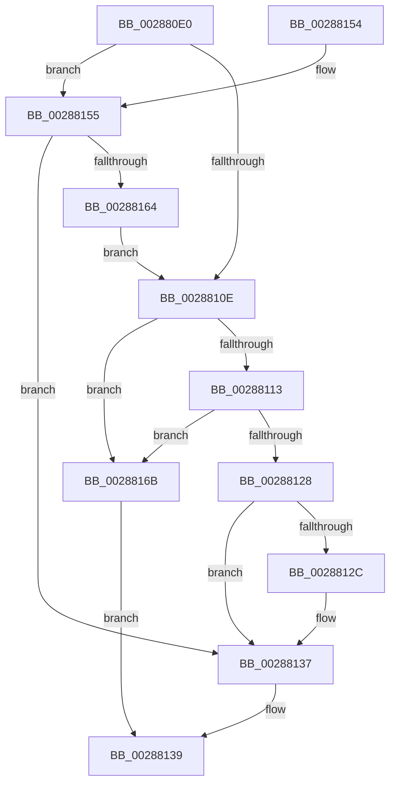

# MmChargeResources

- RVA: `0x002880E0`–`0x00288172` (길이 `146` bytes)
- VA: `0x00000001402880E0`
- 실행 섹션: `.text`
- PDB 이름 있음: `예`; PDB Function 태그: `아니요`
- unwind 정보 RVA: `0x00066DB8`
- 디코드: `44`개 명령, `146/146` bytes 표시
- 미해석 바이트: `0` (있으면 어셈블리에 `.byte`로 보존)

> 이 문서는 커널 이미지의 기계어와 PDB 기호를 분석해 생성했습니다. 4번과 5번은 함수 원형과 자료형을 바이너리 사용 방식에서 추정한 C 해석이며 원본 소스 복구 결과는 아닙니다.

## 1. Dependencies

- 직접 호출 지점: **3**; 고유 호출 대상: **3**
- 직접 호출자로 확인된 함수: **2**
- RIP 상대 이미지 참조: **0**

### Outgoing calls
- `0x0028811F` → [MiChargeCommit](MiChargeCommit_function_00286EB0.md) (function, `0x00286EB0`)
- `0x00288132` → [MiReturnResident](MiReturnResident_function_00286890.md) (function, `0x00286890`)
- `0x0028815B` → [MiChargeResident](MiChargeResident_function_0028A0F0.md) (function, `0x0028A0F0`)

### Direct callers
- [SmFpAllocate](../31/SmFpAllocate_function_00317D10.md) at `0x00317DEA`
- [SmKmAllocateMdlForLock](../47/SmKmAllocateMdlForLock_function_00470E68.md) at `0x00470E93`

### Static image references
- 디코드된 RIP-relative 메모리 참조가 없습니다.

## 2. Other-region calls and transfers

- 다른 실행 섹션으로 향하는 call: **0**
- 별도 외부 분기/꼬리 이동을 확인하지 못했습니다.

## 3. Assembly (complete function range)

```asm
002880E0  48 89 5C 24 08                  mov qword ptr [rsp + 8], rbx
002880E5  48 89 6C 24 10                  mov qword ptr [rsp + 0x10], rbp
002880EA  48 89 74 24 18                  mov qword ptr [rsp + 0x18], rsi
002880EF  48 89 7C 24 20                  mov qword ptr [rsp + 0x20], rdi
002880F4  41 56                           push r14
002880F6  48 83 EC 20                     sub rsp, 0x20
002880FA  4C 8B 31                        mov r14, qword ptr [rcx]
002880FD  33 ED                           xor ebp, ebp
002880FF  41 8B D8                        mov ebx, r8d
00288102  48 8B FA                        mov rdi, rdx
00288105  48 8B F1                        mov rsi, rcx
00288108  41 F6 C0 02                     test r8b, 2
0028810C  75 47                           jne 0x140288155
0028810E  F6 C3 01                        test bl, 1
00288111  74 58                           je 0x14028816b
00288113  41 B8 01 00 00 00               mov r8d, 1
00288119  48 8B D7                        mov rdx, rdi
0028811C  49 8B CE                        mov rcx, r14
0028811F  E8 8C ED FF FF                  call 0x140286eb0
00288124  85 C0                           test eax, eax
00288126  75 43                           jne 0x14028816b
00288128  85 ED                           test ebp, ebp
0028812A  74 0B                           je 0x140288137
0028812C  48 8B 0E                        mov rcx, qword ptr [rsi]
0028812F  48 8B D7                        mov rdx, rdi
00288132  E8 59 E7 FF FF                  call 0x140286890
00288137  33 C0                           xor eax, eax
00288139  48 8B 5C 24 30                  mov rbx, qword ptr [rsp + 0x30]
0028813E  48 8B 6C 24 38                  mov rbp, qword ptr [rsp + 0x38]
00288143  48 8B 74 24 40                  mov rsi, qword ptr [rsp + 0x40]
00288148  48 8B 7C 24 48                  mov rdi, qword ptr [rsp + 0x48]
0028814D  48 83 C4 20                     add rsp, 0x20
00288151  41 5E                           pop r14
00288153  C3                              ret
00288154  CC                              int3
00288155  45 33 C0                        xor r8d, r8d
00288158  49 8B CE                        mov rcx, r14
0028815B  E8 90 1F 00 00                  call 0x14028a0f0
00288160  85 C0                           test eax, eax
00288162  74 D3                           je 0x140288137
00288164  BD 02 00 00 00                  mov ebp, 2
00288169  EB A3                           jmp 0x14028810e
0028816B  B8 01 00 00 00                  mov eax, 1
00288170  EB C7                           jmp 0x140288139
```

## 4. C-style interpretation (structured pseudocode)

```c
__int64 __fastcall MmChargeResources(__int64 a1, __int64 a2, int a3)
{
    __int64 result;
    __int64 v_rbp;
    __int64 v_rsp;
    unsigned __int64 v_stack_p10;
    unsigned __int64 v_stack_p18;
    unsigned __int64 v_stack_p20;
    unsigned __int64 v_stack_p8;

    v_stack_p8 = v_rbx;
    v_stack_p10 = v_rbp;
    v_stack_p18 = v_rsi;
    v_stack_p20 = v_rdi;
    v_rsp = (v_rsp) - (32);
    v_rbp = 0;
    if ((((unsigned __int8)(a3)) & (2)) != 0) goto loc_00288155;
loc_0028810E:
    if ((((unsigned __int8)((unsigned int)(a3))) & (1)) == 0) goto loc_0028816B;
    result = MiChargeCommit(*(unsigned __int64 *)(a1), a2, 1, a4);
    if ((unsigned int)(result) != 0) goto loc_0028816B;
    if (0 != 0) {
        a1 = *(unsigned __int64 *)(a1);
        a2 = a2;
        result = MiReturnResident(a1, a2, 1, a4);
    }
    result = 0;
loc_00288139:
    v_rsp = (v_rsp) + (32);
    return result;
loc_00288155:
    a3 = 0;
    result = MiChargeResident(*(unsigned __int64 *)(a1), a2, a3, a4);
    if ((unsigned int)(result) == 0) goto loc_00288137;
    goto loc_0028810E;
loc_0028816B:
    goto loc_00288139;
}
```

## 5. (Beta) C Style

```c
int64_t MmChargeResources(void *Arg1, int64_t Arg2, int32_t Arg3)
{
    uint8_t *arg1 = (uint8_t *)Arg1;

    int64_t result;
    int64_t local_rbp;
    int64_t local_rsp;
    uint64_t v_stack_p10;
    uint64_t v_stack_p18;
    uint64_t v_stack_p20;
    uint64_t v_stack_p8;

    v_stack_p8 = local_rbx;
    v_stack_p10 = local_rbp;
    v_stack_p18 = local_rsi;
    v_stack_p20 = local_rdi;
    local_rsp = (local_rsp) - (32);
    local_rbp = 0;
    if ((((uint8_t)(Arg3)) & (2)) != 0) goto loc_00288155;
loc_0028810E:
    if ((((uint8_t)((uint32_t)(Arg3))) & (1)) == 0) goto loc_0028816B;
    result = MiChargeCommit(*(uint64_t *)(arg1), Arg2, 1, a4);
    if ((uint32_t)(result) != 0) goto loc_0028816B;
    if (0 != 0) {
        Arg1 = *(uint64_t *)(arg1);
        Arg2 = Arg2;
        result = MiReturnResident(Arg1, Arg2, 1, a4);
    }
    result = 0;
loc_00288139:
    local_rsp = (local_rsp) + (32);
    return result;
loc_00288155:
    Arg3 = 0;
    result = MiChargeResident(*(uint64_t *)(arg1), Arg2, Arg3, a4);
    if ((uint32_t)(result) == 0) goto loc_00288137;
    goto loc_0028810E;
loc_0028816B:
    goto loc_00288139;
}
```

### 관측된 메모리 오프셋

구조체 형식이 확인되지 않은 접근은 인자 기준의 오프셋으로만 기록했습니다.

| 기준 인자 | 오프셋 표현 | 폭 (bit) | 접근 |
|---|---:|---:|---|
| `Arg1` | `+ 0x0` | `64` | `R` |

## 6. Execution-region graph

[열기: 2D/3D 그래프와 함수 탐색 컨트롤 패널](../../../control-panel.html?section=text&rva=0x002880E0&view=graph)

- 2D 그래프는 위에서 아래로 흐르고, 3D 그래프는 빈 공간을 드래그해 회전합니다. Shift+드래그는 이동, 휠은 확대·축소, 함수 노드 선택은 대상 보고서 이동입니다.

### Static fallback


