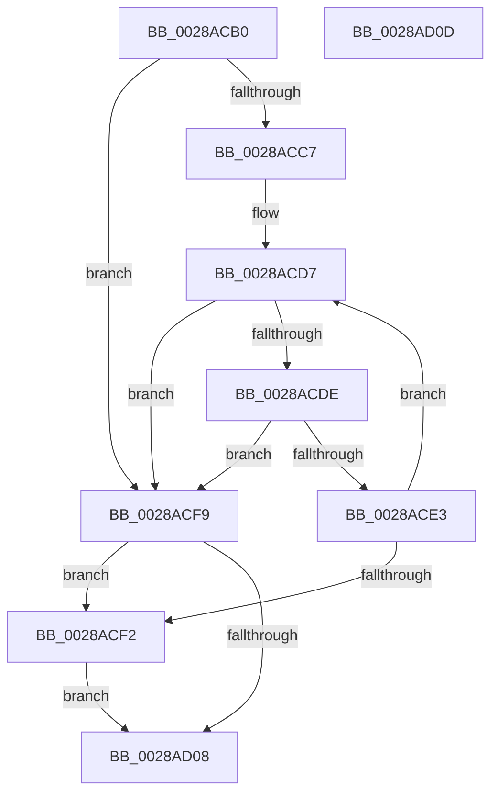

# MmStoreChargeResidentAvailableForRead

- RVA: `0x0028ACB0`–`0x0028AD0E` (길이 `94` bytes)
- VA: `0x000000014028ACB0`
- 실행 섹션: `.text`
- PDB 이름 있음: `예`; PDB Function 태그: `아니요`
- unwind 정보 RVA: `0x0005C788`
- 디코드: `27`개 명령, `94/94` bytes 표시
- 미해석 바이트: `0` (있으면 어셈블리에 `.byte`로 보존)

> 이 문서는 커널 이미지의 기계어와 PDB 기호를 분석해 생성했습니다. 4번과 5번은 함수 원형과 자료형을 바이너리 사용 방식에서 추정한 C 해석이며 원본 소스 복구 결과는 아닙니다.

## 1. Dependencies

- 직접 호출 지점: **1**; 고유 호출 대상: **1**
- 직접 호출자로 확인된 함수: **1**
- RIP 상대 이미지 참조: **1**

### Outgoing calls
- `0x0028ACFF` → [MiChargePartitionResidentAvailable](MiChargePartitionResidentAvailable_function_0028B000.md) (function, `0x0028B000`)

### Direct callers
- [SmFirstTimeInit](../4E/SmFirstTimeInit_function_004EA944.md) at `0x004EAC0D`

### Static image references
- `0x0028ACB7` → RVA `0x00E38D00` (`.data`; read)

## 2. Other-region calls and transfers

- 다른 실행 섹션으로 향하는 call: **0**
- 별도 외부 분기/꼬리 이동을 확인하지 못했습니다.

## 3. Assembly (complete function range)

```asm
0028ACB0  48 83 EC 28                     sub rsp, 0x28
0028ACB4  4C 8B 09                        mov r9, qword ptr [rcx]
0028ACB7  48 8D 05 42 E0 BA 00            lea rax, [rip + 0xbae042]
0028ACBE  48 83 C2 30                     add rdx, 0x30
0028ACC2  4C 3B C8                        cmp r9, rax
0028ACC5  75 32                           jne 0x14028acf9
0028ACC7  65 4C 8B 04 25 20 00 00 00      mov r8, qword ptr gs:[0x20]
0028ACD0  41 8B 80 9C 8B 00 00            mov eax, dword ptr [r8 + 0x8b9c]
0028ACD7  8B C8                           mov ecx, eax
0028ACD9  48 3B D1                        cmp rdx, rcx
0028ACDC  77 1B                           ja 0x14028acf9
0028ACDE  83 F8 FF                        cmp eax, -1
0028ACE1  74 16                           je 0x14028acf9
0028ACE3  8B C8                           mov ecx, eax
0028ACE5  2B CA                           sub ecx, edx
0028ACE7  F0 41 0F B1 88 9C 8B 00 00      lock cmpxchg dword ptr [r8 + 0x8b9c], ecx
0028ACF0  75 E5                           jne 0x14028acd7
0028ACF2  B8 01 00 00 00                  mov eax, 1
0028ACF7  EB 0F                           jmp 0x14028ad08
0028ACF9  45 33 C0                        xor r8d, r8d
0028ACFC  49 8B C9                        mov rcx, r9
0028ACFF  E8 FC 02 00 00                  call 0x14028b000
0028AD04  85 C0                           test eax, eax
0028AD06  75 EA                           jne 0x14028acf2
0028AD08  48 83 C4 28                     add rsp, 0x28
0028AD0C  C3                              ret
0028AD0D  CC                              int3
```

## 4. C-style interpretation (structured pseudocode)

```c
__int64 __fastcall MmStoreChargeResidentAvailableForRead(__int64 a1, __int64 a2)
{
    __int64 result;
    __int64 v_rsp;

    v_rsp = (v_rsp) - (40);
    a2 = (a2) + (48);
    if ((*(unsigned __int64 *)(a1)) != (v_rip + 12247106)) goto loc_0028ACF9;
loc_0028ACD7:
    if (a2 > ((unsigned int)((unsigned int)((unsigned int)(*(unsigned int *)(*(unsigned __int64 *)(gs_base + (0 + 32)) + 35740)))))) goto loc_0028ACF9;
    if (((unsigned int)((unsigned int)(*(unsigned int *)(*(unsigned __int64 *)(gs_base + (0 + 32)) + 35740)))) == -1) goto loc_0028ACF9;
    a1 = (unsigned int)(((unsigned int)((unsigned int)((unsigned int)(*(unsigned int *)(*(unsigned __int64 *)(gs_base + (0 + 32)) + 35740))))) - ((unsigned int)(a2)));
    if (condition_is_not_equal) goto loc_0028ACD7;
loc_0028ACF2:
    goto loc_0028AD08;
loc_0028ACF9:
    a3 = 0;
    result = MiChargePartitionResidentAvailable(*(unsigned __int64 *)(a1), a2, a3, *(unsigned __int64 *)(a1));
    if ((unsigned int)(result) != 0) goto loc_0028ACF2;
loc_0028AD08:
    v_rsp = (v_rsp) + (40);
    return result;
}
```

## 5. (Beta) C Style

```c
int64_t MmStoreChargeResidentAvailableForRead(void *Arg1, int64_t Arg2)
{
    uint8_t *arg1 = (uint8_t *)Arg1;

    int64_t result;
    int64_t local_rsp;

    local_rsp = (local_rsp) - (40);
    Arg2 = (Arg2) + (48);
    if ((*(uint64_t *)(arg1)) != (v_rip + 12247106)) goto loc_0028ACF9;
loc_0028ACD7:
    if (Arg2 > ((uint32_t)((uint32_t)((uint32_t)(*(uint32_t *)(*(uint64_t *)(gs_base + (0 + 0x20)) + 0x8B9C)))))) goto loc_0028ACF9;
    if (((uint32_t)((uint32_t)(*(uint32_t *)(*(uint64_t *)(gs_base + (0 + 0x20)) + 0x8B9C)))) == -1) goto loc_0028ACF9;
    Arg1 = (uint32_t)(((uint32_t)((uint32_t)((uint32_t)(*(uint32_t *)(*(uint64_t *)(gs_base + (0 + 0x20)) + 0x8B9C))))) - ((uint32_t)(Arg2)));
    if (condition_is_not_equal) goto loc_0028ACD7;
loc_0028ACF2:
    goto loc_0028AD08;
loc_0028ACF9:
    a3 = 0;
    result = MiChargePartitionResidentAvailable(*(uint64_t *)(arg1), Arg2, a3, *(uint64_t *)(arg1));
    if ((uint32_t)(result) != 0) goto loc_0028ACF2;
loc_0028AD08:
    local_rsp = (local_rsp) + (40);
    return result;
}
```

### 관측된 메모리 오프셋

구조체 형식이 확인되지 않은 접근은 인자 기준의 오프셋으로만 기록했습니다.

| 기준 인자 | 오프셋 표현 | 폭 (bit) | 접근 |
|---|---:|---:|---|
| `Arg1` | `+ 0x0` | `64` | `R` |

## 6. Execution-region graph

[열기: 2D/3D 그래프와 함수 탐색 컨트롤 패널](../../../control-panel.html?section=text&rva=0x0028ACB0&view=graph)

- 2D 그래프는 위에서 아래로 흐르고, 3D 그래프는 빈 공간을 드래그해 회전합니다. Shift+드래그는 이동, 휠은 확대·축소, 함수 노드 선택은 대상 보고서 이동입니다.

### Static fallback


