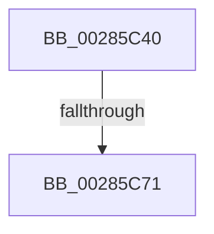

# SmAcquireReleaseCharges

- RVA: `0x00285C40`–`0x00285C73` (길이 `51` bytes)
- VA: `0x0000000140285C40`
- 실행 섹션: `.text`
- PDB 이름 있음: `예`; PDB Function 태그: `아니요`
- unwind 정보 RVA: `0x00066AE0`
- 디코드: `16`개 명령, `51/51` bytes 표시
- 미해석 바이트: `0` (있으면 어셈블리에 `.byte`로 보존)

> 이 문서는 커널 이미지의 기계어와 PDB 기호를 분석해 생성했습니다. 4번과 5번은 함수 원형과 자료형을 바이너리 사용 방식에서 추정한 C 해석이며 원본 소스 복구 결과는 아닙니다.

## 1. Dependencies

- 직접 호출 지점: **0**; 고유 호출 대상: **0**
- 직접 호출자로 확인된 함수: **13**
- RIP 상대 이미지 참조: **0**

### Outgoing calls
- 직접 디코드된 call 명령이 없습니다.

### Direct callers
- [SMKM_STORE&lt;SM_TRAITS&gt;::SmStReadThread](../20/SMKM_STORE_SM_TRAITS_SmStReadThread_function_00203230.md) at `0x002033D0`
- [sub_0034CE1C](../34/Unknown_function_0034CE1C.md) at `0x0034CE2D`
- [sub_0034CE47](../34/Unknown_function_0034CE47.md) at `0x0034CEBA`
- [sub_0034D947](../34/Unknown_function_0034D947.md) at `0x0034DA1E`
- [SMKM_STORE&lt;SM_TRAITS&gt;::SmStCleanup](../3B/SMKM_STORE_SM_TRAITS_SmStCleanup_function_003B00E0.md) at `0x003B025B`
- [SMKM_STORE&lt;SM_TRAITS&gt;::SmStStart](../3B/SMKM_STORE_SM_TRAITS_SmStStart_function_003B14DC.md) at `0x003B1824`
- [SmKmStoreHelperCommandProcess](../3C/SmKmStoreHelperCommandProcess_function_003C3AA4.md) at `0x003C3D77`
- [SmKmFreeMdlForLock](../3C/SmKmFreeMdlForLock_function_003C3D98.md) at `0x003C3DAE`
- [SmFpFree](../43/SmFpFree_function_00436350.md) at `0x004363E4`
- [SmFpFree](../43/SmFpFree_function_00436350.md) at `0x00436435`
- [SmKmAllocateMdlForLock](../47/SmKmAllocateMdlForLock_function_00470E68.md) at `0x00470F0B`
- [SmFpPreAllocate](../4C/SmFpPreAllocate_function_004CF32C.md) at `0x004CF42D`
- [sub_006E7030](../6E/Unknown_function_006E7030.md) at `0x006E705C`
- [sub_006E8004](../6E/Unknown_function_006E8004.md) at `0x006E80C2`
- [sub_006E8004](../6E/Unknown_function_006E8004.md) at `0x006E80F0`

### Static image references
- 디코드된 RIP-relative 메모리 참조가 없습니다.

## 2. Other-region calls and transfers

- 다른 실행 섹션으로 향하는 call: **0**
- call이 아닌 외부 분기/꼬리 이동: **1**
  - `0x00285C6F` → [sub_00285CD2 + 0x14](Unknown_function_00285CD2.md) (`tail-transfer`)

## 3. Assembly (complete function range)

```asm
00285C40  48 89 5C 24 18                  mov qword ptr [rsp + 0x18], rbx
00285C45  48 89 6C 24 20                  mov qword ptr [rsp + 0x20], rbp
00285C4A  56                              push rsi
00285C4B  57                              push rdi
00285C4C  41 56                           push r14
00285C4E  48 83 EC 20                     sub rsp, 0x20
00285C52  4C 8B B1 30 08 00 00            mov r14, qword ptr [rcx + 0x830]
00285C59  41 8B D8                        mov ebx, r8d
00285C5C  48 8B FA                        mov rdi, rdx
00285C5F  41 8B F0                        mov esi, r8d
00285C62  48 C1 EF 0C                     shr rdi, 0xc
00285C66  83 E6 01                        and esi, 1
00285C69  83 E3 02                        and ebx, 2
00285C6C  45 85 C9                        test r9d, r9d
00285C6F  75 75                           jne 0x140285ce6
00285C71  33 ED                           xor ebp, ebp
```

## 4. C-style interpretation (structured pseudocode)

```c
void __fastcall SmAcquireReleaseCharges(__int64 a1, __int64 a2, int a3, int a4)
{
    __int64 v_rbp;
    __int64 v_rbx;
    __int64 v_rdi;
    __int64 v_rsi;
    __int64 v_rsp;
    unsigned __int64 v_stack_p18;
    unsigned __int64 v_stack_p20;

    v_stack_p18 = v_rbx;
    v_stack_p20 = v_rbp;
    v_rsp = (v_rsp) - (32);
    v_rdi = (a2) >> (12);
    v_rsi = (unsigned int)(((unsigned int)(a3)) & (1));
    v_rbx = (unsigned int)(((unsigned int)(a3)) & (2));
    v_rbp = 0;
    return;
}
```

## 5. (Beta) C Style

```c
void SmAcquireReleaseCharges(void *Arg1, int64_t Arg2, int32_t Arg3, int32_t Arg4)
{
    uint8_t *arg1 = (uint8_t *)Arg1;

    int64_t local_rbp;
    int64_t local_rbx;
    int64_t local_rdi;
    int64_t local_rsi;
    int64_t local_rsp;
    uint64_t v_stack_p18;
    uint64_t v_stack_p20;

    v_stack_p18 = local_rbx;
    v_stack_p20 = local_rbp;
    local_rsp = (local_rsp) - (32);
    local_rdi = (Arg2) >> (12);
    local_rsi = (uint32_t)(((uint32_t)(Arg3)) & (1));
    local_rbx = (uint32_t)(((uint32_t)(Arg3)) & (2));
    local_rbp = 0;
    return;
}
```

### 관측된 메모리 오프셋

구조체 형식이 확인되지 않은 접근은 인자 기준의 오프셋으로만 기록했습니다.

| 기준 인자 | 오프셋 표현 | 폭 (bit) | 접근 |
|---|---:|---:|---|
| `Arg1` | `+ 0x830` | `64` | `R` |

## 6. Execution-region graph

[열기: 2D/3D 그래프와 함수 탐색 컨트롤 패널](../../../control-panel.html?section=text&rva=0x00285C40&view=graph)

- 2D 그래프는 위에서 아래로 흐르고, 3D 그래프는 빈 공간을 드래그해 회전합니다. Shift+드래그는 이동, 휠은 확대·축소, 함수 노드 선택은 대상 보고서 이동입니다.

### Static fallback


