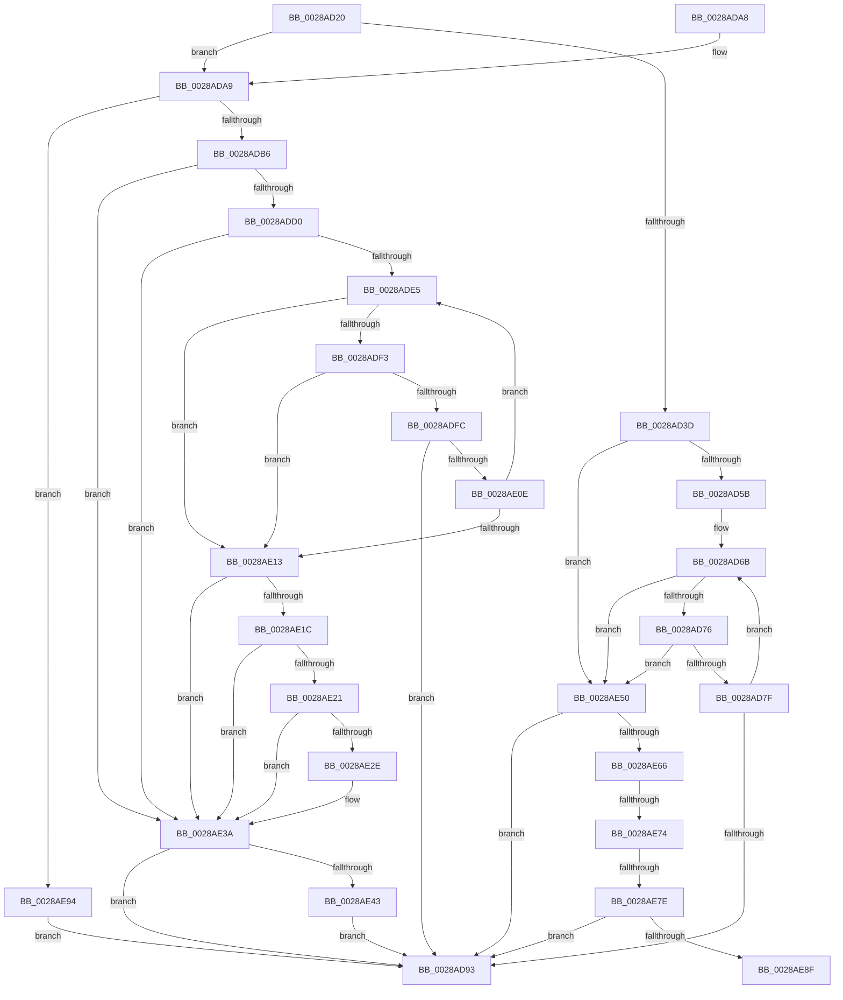

# SmAcquireReleaseResAvailForRead

- RVA: `0x0028AD20`–`0x0028AEA2` (길이 `386` bytes)
- VA: `0x000000014028AD20`
- 실행 섹션: `.text`
- PDB 이름 있음: `예`; PDB Function 태그: `예`
- unwind 정보 RVA: `0x00066F00`
- 디코드: `92`개 명령, `386/386` bytes 표시
- 미해석 바이트: `0` (있으면 어셈블리에 `.byte`로 보존)

> 이 문서는 커널 이미지의 기계어와 PDB 기호를 분석해 생성했습니다. 4번과 5번은 함수 원형과 자료형을 바이너리 사용 방식에서 추정한 C 해석이며 원본 소스 복구 결과는 아닙니다.

## 1. Dependencies

- 직접 호출 지점: **1**; 고유 호출 대상: **1**
- 직접 호출자로 확인된 함수: **2**
- RIP 상대 이미지 참조: **1**

### Outgoing calls
- `0x0028AE59` → [MiChargePartitionResidentAvailable](MiChargePartitionResidentAvailable_function_0028B000.md) (function, `0x0028B000`)

### Direct callers
- [SMKM_STORE_MGR&lt;SM_TRAITS&gt;::SmIoCtxWorkItemComplete](../20/SMKM_STORE_MGR_SM_TRAITS_SmIoCtxWorkItemComplete_function_00205850.md) at `0x002059C6`
- [SMKM_STORE_MGR&lt;SM_TRAITS&gt;::SmPageRead](../34/SMKM_STORE_MGR_SM_TRAITS_SmPageRead_function_0034C1D0.md) at `0x0034C3B2`
- [SMKM_STORE_MGR&lt;SM_TRAITS&gt;::SmPageRead](../34/SMKM_STORE_MGR_SM_TRAITS_SmPageRead_function_0034C1D0.md) at `0x0034C475`

### Static image references
- `0x0028AD4B` → RVA `0x00E38D00` (`.data`; read)

## 2. Other-region calls and transfers

- 다른 실행 섹션으로 향하는 call: **0**
- call이 아닌 외부 분기/꼬리 이동: **3**
  - `0x0028AE6E` → [sub_006DA3E6](../6D/Unknown_function_006DA3E6.md) (`tail-transfer`)
  - `0x0028AE78` → [sub_006DA3E6](../6D/Unknown_function_006DA3E6.md) (`tail-transfer`)
  - `0x0028AE8F` → [sub_006DA3E6](../6D/Unknown_function_006DA3E6.md) (`tail-transfer`)

## 3. Assembly (complete function range)

```asm
0028AD20  48 89 5C 24 10                  mov qword ptr [rsp + 0x10], rbx
0028AD25  48 89 74 24 18                  mov qword ptr [rsp + 0x18], rsi
0028AD2A  57                              push rdi
0028AD2B  48 83 EC 20                     sub rsp, 0x20
0028AD2F  49 8B F8                        mov rdi, r8
0028AD32  48 8B F2                        mov rsi, rdx
0028AD35  48 8B D9                        mov rbx, rcx
0028AD38  45 85 C9                        test r9d, r9d
0028AD3B  75 6C                           jne 0x14028ada9
0028AD3D  48 8B 81 30 08 00 00            mov rax, qword ptr [rcx + 0x830]
0028AD44  4D 8D 48 30                     lea r9, [r8 + 0x30]
0028AD48  4C 8B 10                        mov r10, qword ptr [rax]
0028AD4B  48 8D 05 AE DF BA 00            lea rax, [rip + 0xbadfae]
0028AD52  4C 3B D0                        cmp r10, rax
0028AD55  0F 85 F5 00 00 00               jne 0x14028ae50
0028AD5B  65 4C 8B 04 25 20 00 00 00      mov r8, qword ptr gs:[0x20]
0028AD64  41 8B 90 9C 8B 00 00            mov edx, dword ptr [r8 + 0x8b9c]
0028AD6B  8B C2                           mov eax, edx
0028AD6D  4C 3B C8                        cmp r9, rax
0028AD70  0F 87 DA 00 00 00               ja 0x14028ae50
0028AD76  83 FA FF                        cmp edx, -1
0028AD79  0F 84 D1 00 00 00               je 0x14028ae50
0028AD7F  8B CA                           mov ecx, edx
0028AD81  8B C2                           mov eax, edx
0028AD83  41 2B C9                        sub ecx, r9d
0028AD86  F0 41 0F B1 88 9C 8B 00 00      lock cmpxchg dword ptr [r8 + 0x8b9c], ecx
0028AD8F  8B D0                           mov edx, eax
0028AD91  75 D8                           jne 0x14028ad6b
0028AD93  B8 01 00 00 00                  mov eax, 1
0028AD98  48 8B 5C 24 38                  mov rbx, qword ptr [rsp + 0x38]
0028AD9D  48 8B 74 24 40                  mov rsi, qword ptr [rsp + 0x40]
0028ADA2  48 83 C4 20                     add rsp, 0x20
0028ADA6  5F                              pop rdi
0028ADA7  C3                              ret
0028ADA8  CC                              int3
0028ADA9  48 39 B1 A8 08 00 00            cmp qword ptr [rcx + 0x8a8], rsi
0028ADB0  0F 84 DE 00 00 00               je 0x14028ae94
0028ADB6  48 8B 81 30 08 00 00            mov rax, qword ptr [rcx + 0x830]
0028ADBD  48 83 C7 30                     add rdi, 0x30
0028ADC1  4C 8B 08                        mov r9, qword ptr [rax]
0028ADC4  48 8D 05 35 DF BA 00            lea rax, [rip + 0xbadf35]
0028ADCB  4C 3B C8                        cmp r9, rax
0028ADCE  75 6A                           jne 0x14028ae3a
0028ADD0  65 4C 8B 04 25 20 00 00 00      mov r8, qword ptr gs:[0x20]
0028ADD9  41 8B 90 9C 8B 00 00            mov edx, dword ptr [r8 + 0x8b9c]
0028ADE0  83 FA FF                        cmp edx, -1
0028ADE3  74 55                           je 0x14028ae3a
0028ADE5  48 63 C2                        movsxd rax, edx
0028ADE8  48 03 C7                        add rax, rdi
0028ADEB  48 3D 00 01 00 00               cmp rax, 0x100
0028ADF1  77 20                           ja 0x14028ae13
0028ADF3  48 81 FF 00 00 08 00            cmp rdi, 0x80000
0028ADFA  73 17                           jae 0x14028ae13
0028ADFC  8D 0C 3A                        lea ecx, [rdx + rdi]
0028ADFF  8B C2                           mov eax, edx
0028AE01  F0 41 0F B1 88 9C 8B 00 00      lock cmpxchg dword ptr [r8 + 0x8b9c], ecx
0028AE0A  8B D0                           mov edx, eax
0028AE0C  74 85                           je 0x14028ad93
0028AE0E  83 F8 FF                        cmp eax, -1
0028AE11  75 D2                           jne 0x14028ade5
0028AE13  B9 C0 00 00 00                  mov ecx, 0xc0
0028AE18  3B D1                           cmp edx, ecx
0028AE1A  7E 1E                           jle 0x14028ae3a
0028AE1C  83 FA FF                        cmp edx, -1
0028AE1F  74 19                           je 0x14028ae3a
0028AE21  8B C2                           mov eax, edx
0028AE23  F0 41 0F B1 88 9C 8B 00 00      lock cmpxchg dword ptr [r8 + 0x8b9c], ecx
0028AE2C  75 0C                           jne 0x14028ae3a
0028AE2E  8D 82 40 FF FF FF               lea eax, [rdx - 0xc0]
0028AE34  48 63 C8                        movsxd rcx, eax
0028AE37  48 03 F9                        add rdi, rcx
0028AE3A  48 85 FF                        test rdi, rdi
0028AE3D  0F 84 50 FF FF FF               je 0x14028ad93
0028AE43  F0 49 01 B9 40 49 00 00         lock add qword ptr [r9 + 0x4940], rdi
0028AE4B  E9 43 FF FF FF                  jmp 0x14028ad93
0028AE50  45 33 C0                        xor r8d, r8d
0028AE53  49 8B D1                        mov rdx, r9
0028AE56  49 8B CA                        mov rcx, r10
0028AE59  E8 A2 01 00 00                  call 0x14028b000
0028AE5E  85 C0                           test eax, eax
0028AE60  0F 85 2D FF FF FF               jne 0x14028ad93
0028AE66  48 83 BB A8 08 00 00 00         cmp qword ptr [rbx + 0x8a8], 0
0028AE6E  0F 85 72 F5 44 00               jne 0x1406da3e6
0028AE74  48 83 FF 01                     cmp rdi, 1
0028AE78  0F 85 68 F5 44 00               jne 0x1406da3e6
0028AE7E  33 C0                           xor eax, eax
0028AE80  F0 48 0F B1 B3 A8 08 00 00      lock cmpxchg qword ptr [rbx + 0x8a8], rsi
0028AE89  0F 84 04 FF FF FF               je 0x14028ad93
0028AE8F  E9 52 F5 44 00                  jmp 0x1406da3e6
0028AE94  33 C0                           xor eax, eax
0028AE96  48 87 81 A8 08 00 00            xchg qword ptr [rcx + 0x8a8], rax
0028AE9D  E9 F1 FE FF FF                  jmp 0x14028ad93
```

## 4. C-style interpretation (structured pseudocode)

```c
__int64 __fastcall SmAcquireReleaseResAvailForRead(__int64 a1, __int64 a2, __int64 a3, int a4)
{
    __int64 result;
    __int64 v_rdi;
    __int64 v_rsp;
    unsigned __int64 v_stack_p10;
    unsigned __int64 v_stack_p18;

    v_stack_p10 = v_rbx;
    v_stack_p18 = v_rsi;
    v_rsp = (v_rsp) - (32);
    if (a4 != 0) goto loc_0028ADA9;
    if ((*(unsigned __int64 *)(*(unsigned __int64 *)(a1 + 2096))) != (v_rip + 12246958)) goto loc_0028AE50;
loc_0028AD6B:
    if ((a3 + 48) > ((unsigned int)((unsigned int)((unsigned int)(*(unsigned int *)(*(unsigned __int64 *)(gs_base + (0 + 32)) + 35740)))))) goto loc_0028AE50;
    if (((unsigned int)((unsigned int)(*(unsigned int *)(*(unsigned __int64 *)(gs_base + (0 + 32)) + 35740)))) == -1) goto loc_0028AE50;
    a1 = (unsigned int)(((unsigned int)((unsigned int)((unsigned int)(*(unsigned int *)(*(unsigned __int64 *)(gs_base + (0 + 32)) + 35740))))) - ((unsigned int)(a3 + 48)));
    if (condition_is_not_equal) goto loc_0028AD6B;
loc_0028AD93:
    v_rsp = (v_rsp) + (32);
    return 1;
loc_0028ADA9:
    if ((*(unsigned __int64 *)(a1 + 2216)) == v_stack_p18) goto loc_0028AE94;
    v_rdi = (a3) + (48);
    if ((*(unsigned __int64 *)(*(unsigned __int64 *)(a1 + 2096))) != (v_rip + 12246837)) goto loc_0028AE3A;
    if (((unsigned int)((unsigned int)(*(unsigned int *)(*(unsigned __int64 *)(gs_base + (0 + 32)) + 35740)))) == -1) goto loc_0028AE3A;
loc_0028ADE5:
    result = ((int)((unsigned int)((unsigned int)(*(unsigned int *)(*(unsigned __int64 *)(gs_base + (0 + 32)) + 35740))))) + (v_rdi);
    if (result > 256) goto loc_0028AE13;
    if (v_rdi >= 0x80000ULL) goto loc_0028AE13;
    if (v_rdi == 0x80000ULL) goto loc_0028AD93;
    if (((unsigned int)((unsigned int)((unsigned int)((unsigned int)(*(unsigned int *)(*(unsigned __int64 *)(gs_base + (0 + 32)) + 35740)))))) != -1) goto loc_0028ADE5;
loc_0028AE13:
    if (((unsigned int)((unsigned int)((unsigned int)((unsigned int)((unsigned int)((unsigned int)(*(unsigned int *)(*(unsigned __int64 *)(gs_base + (0 + 32)) + 35740)))))))) <= 192) goto loc_0028AE3A;
    if (((unsigned int)((unsigned int)((unsigned int)((unsigned int)((unsigned int)((unsigned int)(*(unsigned int *)(*(unsigned __int64 *)(gs_base + (0 + 32)) + 35740)))))))) == -1) goto loc_0028AE3A;
    result = (unsigned int)((unsigned int)((unsigned int)((unsigned int)((unsigned int)((unsigned int)((unsigned int)(*(unsigned int *)(*(unsigned __int64 *)(gs_base + (0 + 32)) + 35740))))))));
    if (((unsigned int)((unsigned int)((unsigned int)((unsigned int)((unsigned int)((unsigned int)(*(unsigned int *)(*(unsigned __int64 *)(gs_base + (0 + 32)) + 35740)))))))) == -1) {
        result = (unsigned int)((unsigned int)((unsigned int)((unsigned int)((unsigned int)(*(unsigned int *)(*(unsigned __int64 *)(gs_base + (0 + 32)) + 35740)))))) - 192;
        a1 = (int)((unsigned int)(result));
        v_rdi = (v_rdi) + (a1);
    }
    if (v_rdi == 0) goto loc_0028AD93;
    goto loc_0028AD93;
loc_0028AE50:
    a3 = 0;
    result = MiChargePartitionResidentAvailable(*(unsigned __int64 *)(*(unsigned __int64 *)(a1 + 2096)), *(unsigned __int64 *)(*(unsigned __int64 *)(a1 + 2096)), a3, *(unsigned __int64 *)(*(unsigned __int64 *)(a1 + 2096)));
    if ((unsigned int)(result) != 0) goto loc_0028AD93;
    result = 0;
    if (condition_is_equal) goto loc_0028AD93;
loc_0028AE94:
    result = 0;
    goto loc_0028AD93;
}
```

## 5. (Beta) C Style

```c
int64_t SmAcquireReleaseResAvailForRead(void *Arg1, int64_t Arg2, void *Arg3, int32_t Arg4)
{
    uint8_t *arg1 = (uint8_t *)Arg1;
    uint8_t *arg3 = (uint8_t *)Arg3;

    int64_t result;
    int64_t local_rdi;
    int64_t local_rsp;
    uint64_t v_stack_p10;
    uint64_t v_stack_p18;

    v_stack_p10 = local_rbx;
    v_stack_p18 = local_rsi;
    local_rsp = (local_rsp) - (32);
    if (Arg4 != 0) goto loc_0028ADA9;
    if ((*(uint64_t *)(*(uint64_t *)(arg1 + 0x830))) != (v_rip + 12246958)) goto loc_0028AE50;
loc_0028AD6B:
    if ((Arg3 + 48) > ((uint32_t)((uint32_t)((uint32_t)(*(uint32_t *)(*(uint64_t *)(gs_base + (0 + 0x20)) + 0x8B9C)))))) goto loc_0028AE50;
    if (((uint32_t)((uint32_t)(*(uint32_t *)(*(uint64_t *)(gs_base + (0 + 0x20)) + 0x8B9C)))) == -1) goto loc_0028AE50;
    Arg1 = (uint32_t)(((uint32_t)((uint32_t)((uint32_t)(*(uint32_t *)(*(uint64_t *)(gs_base + (0 + 0x20)) + 0x8B9C))))) - ((uint32_t)(Arg3 + 48)));
    if (condition_is_not_equal) goto loc_0028AD6B;
loc_0028AD93:
    local_rsp = (local_rsp) + (32);
    return 1;
loc_0028ADA9:
    if ((*(uint64_t *)(arg1 + 0x8A8)) == v_stack_p18) goto loc_0028AE94;
    local_rdi = (Arg3) + (48);
    if ((*(uint64_t *)(*(uint64_t *)(arg1 + 0x830))) != (v_rip + 12246837)) goto loc_0028AE3A;
    if (((uint32_t)((uint32_t)(*(uint32_t *)(*(uint64_t *)(gs_base + (0 + 0x20)) + 0x8B9C)))) == -1) goto loc_0028AE3A;
loc_0028ADE5:
    result = ((int32_t)((uint32_t)((uint32_t)(*(uint32_t *)(*(uint64_t *)(gs_base + (0 + 0x20)) + 0x8B9C))))) + (local_rdi);
    if (result > 256) goto loc_0028AE13;
    if (local_rdi >= 0x80000ULL) goto loc_0028AE13;
    if (local_rdi == 0x80000ULL) goto loc_0028AD93;
    if (((uint32_t)((uint32_t)((uint32_t)((uint32_t)(*(uint32_t *)(*(uint64_t *)(gs_base + (0 + 0x20)) + 0x8B9C)))))) != -1) goto loc_0028ADE5;
loc_0028AE13:
    if (((uint32_t)((uint32_t)((uint32_t)((uint32_t)((uint32_t)((uint32_t)(*(uint32_t *)(*(uint64_t *)(gs_base + (0 + 0x20)) + 0x8B9C)))))))) <= 192) goto loc_0028AE3A;
    if (((uint32_t)((uint32_t)((uint32_t)((uint32_t)((uint32_t)((uint32_t)(*(uint32_t *)(*(uint64_t *)(gs_base + (0 + 0x20)) + 0x8B9C)))))))) == -1) goto loc_0028AE3A;
    result = (uint32_t)((uint32_t)((uint32_t)((uint32_t)((uint32_t)((uint32_t)((uint32_t)(*(uint32_t *)(*(uint64_t *)(gs_base + (0 + 0x20)) + 0x8B9C))))))));
    if (((uint32_t)((uint32_t)((uint32_t)((uint32_t)((uint32_t)((uint32_t)(*(uint32_t *)(*(uint64_t *)(gs_base + (0 + 0x20)) + 0x8B9C)))))))) == -1) {
        result = (uint32_t)((uint32_t)((uint32_t)((uint32_t)((uint32_t)(*(uint32_t *)(*(uint64_t *)(gs_base + (0 + 0x20)) + 0x8B9C)))))) - 192;
        Arg1 = (int32_t)((uint32_t)(result));
        local_rdi = (local_rdi) + (Arg1);
    }
    if (local_rdi == 0) goto loc_0028AD93;
    goto loc_0028AD93;
loc_0028AE50:
    Arg3 = 0;
    result = MiChargePartitionResidentAvailable(*(uint64_t *)(*(uint64_t *)(arg1 + 0x830)), *(uint64_t *)(*(uint64_t *)(arg1 + 0x830)), Arg3, *(uint64_t *)(*(uint64_t *)(arg1 + 0x830)));
    if ((uint32_t)(result) != 0) goto loc_0028AD93;
    result = 0;
    if (condition_is_equal) goto loc_0028AD93;
loc_0028AE94:
    result = 0;
    goto loc_0028AD93;
}
```

### 관측된 메모리 오프셋

구조체 형식이 확인되지 않은 접근은 인자 기준의 오프셋으로만 기록했습니다.

| 기준 인자 | 오프셋 표현 | 폭 (bit) | 접근 |
|---|---:|---:|---|
| `Arg1` | `+ 0x830` | `64` | `R` |
| `Arg1` | `+ 0x8A8` | `64` | `R` |
| `Arg1` | `+ 0x8A8` | `64` | `R/W` |
| `Arg3` | `+ 0x30` | `64` | `R` |

## 6. Execution-region graph

[열기: 2D/3D 그래프와 함수 탐색 컨트롤 패널](../../../control-panel.html?section=text&rva=0x0028AD20&view=graph)

- 2D 그래프는 위에서 아래로 흐르고, 3D 그래프는 빈 공간을 드래그해 회전합니다. Shift+드래그는 이동, 휠은 확대·축소, 함수 노드 선택은 대상 보고서 이동입니다.

### Static fallback


