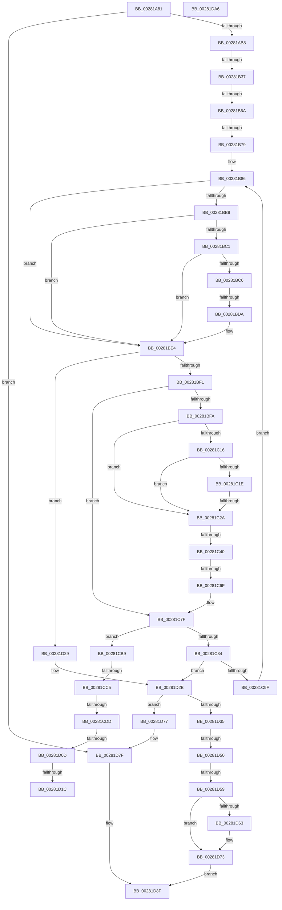

# sub_00281A81

- RVA: `0x00281A81`–`0x00281DA7` (길이 `806` bytes)
- VA: `0x0000000140281A81`
- 실행 섹션: `.text`
- PDB 이름 있음: `아니요`; PDB Function 태그: `아니요`
- unwind 정보 RVA: `0x00066744`
- 디코드: `181`개 명령, `806/806` bytes 표시
- 미해석 바이트: `0` (있으면 어셈블리에 `.byte`로 보존)

> 이 문서는 커널 이미지의 기계어와 PDB 기호를 분석해 생성했습니다. 4번과 5번은 함수 원형과 자료형을 바이너리 사용 방식에서 추정한 C 해석이며 원본 소스 복구 결과는 아닙니다.

## 1. Dependencies

- 직접 호출 지점: **3**; 고유 호출 대상: **3**
- 직접 호출자로 확인된 함수: **0**
- RIP 상대 이미지 참조: **1**

### Outgoing calls
- `0x00281C4A` → [MiWriteValidPteNewProtection](MiWriteValidPteNewProtection_function_00281810.md) (function, `0x00281810`)
- `0x00281D1F` → [KxWaitForLockOwnerShip](../25/KxWaitForLockOwnerShip_function_00257EB0.md) (function, `0x00257EB0`)
- `0x00281D6E` → [MiUnlockWorkingSetShared](../27/MiUnlockWorkingSetShared_function_0027D690.md) (function, `0x0027D690`)

### Direct callers
- 이 함수 시작 RVA로 연결되는 직접 call은 확인되지 않았습니다. 간접 호출은 완전히 역산할 수 없습니다.

### Static image references
- `0x00281B5D` → RVA `0x00FC6B06` (`ALMOSTRO`; read)

## 2. Other-region calls and transfers

- 다른 실행 섹션으로 향하는 call: **0**
- call이 아닌 외부 분기/꼬리 이동: **14**
  - `0x00281B31` → [sub_0028216F + 0x2C](Unknown_function_0028216F.md) (`tail-transfer`)
  - `0x00281B64` → [sub_002822AC + 0x216](Unknown_function_002822AC.md) (`tail-transfer`)
  - `0x00281B73` → [sub_00282570 + 0xE1](Unknown_function_00282570.md) (`tail-transfer`)
  - `0x00281BD4` → [sub_00281DE9](Unknown_function_00281DE9.md) (`tail-transfer`)
  - `0x00281C24` → [sub_0028271E + 0xFF](Unknown_function_0028271E.md) (`tail-transfer`)
  - `0x00281C3A` → [sub_0028271E + 0x137](Unknown_function_0028271E.md) (`tail-transfer`)
  - `0x00281C69` → [sub_0028271E + 0x148](Unknown_function_0028271E.md) (`tail-transfer`)
  - `0x00281CBF` → [sub_00281DE9 + 0x6E](Unknown_function_00281DE9.md) (`tail-transfer`)
  - `0x00281CD7` → [sub_0028216F](Unknown_function_0028216F.md) (`tail-transfer`)
  - `0x00281D07` → [sub_002822AC + 0x1E6](Unknown_function_002822AC.md) (`tail-transfer`)
  - `0x00281D16` → [sub_00281DE9 + 0x18B](Unknown_function_00281DE9.md) (`tail-transfer`)
  - `0x00281D24` → [sub_00281DE9 + 0x188](Unknown_function_00281DE9.md) (`tail-transfer`)
  - `0x00281D4A` → [sub_002822AC + 0x18](Unknown_function_002822AC.md) (`tail-transfer`)
  - `0x00281D53` → [sub_002822AC + 0x21](Unknown_function_002822AC.md) (`tail-transfer`)

## 3. Assembly (complete function range)

```asm
00281A81  4C 89 6C 24 78                  mov qword ptr [rsp + 0x78], r13
00281A86  49 B8 00 00 00 00 80 F6 FF FF   movabs r8, 0xfffff68000000000
00281A90  4D 8B C8                        mov r9, r8
00281A93  49 C1 E1 19                     shl r9, 0x19
00281A97  48 8B C5                        mov rax, rbp
00281A9A  48 C1 E0 19                     shl rax, 0x19
00281A9E  49 2B C1                        sub rax, r9
00281AA1  4C 89 4C 24 40                  mov qword ptr [rsp + 0x40], r9
00281AA6  48 C1 F8 10                     sar rax, 0x10
00281AAA  41 F7 04 24 00 10 00 00         test dword ptr [r12], 0x1000
00281AB2  0F 85 C7 02 00 00               jne 0x140281d7f
00281AB8  48 C1 E8 09                     shr rax, 9
00281ABC  48 BA F8 FF FF FF 7F 00 00 00   movabs rdx, 0x7ffffffff8
00281AC6  48 23 C2                        and rax, rdx
00281AC9  49 8B C8                        mov rcx, r8
00281ACC  48 03 C1                        add rax, rcx
00281ACF  48 89 44 24 50                  mov qword ptr [rsp + 0x50], rax
00281AD4  48 C1 E8 09                     shr rax, 9
00281AD8  48 23 C2                        and rax, rdx
00281ADB  49 8B C8                        mov rcx, r8
00281ADE  48 03 C1                        add rax, rcx
00281AE1  48 89 44 24 58                  mov qword ptr [rsp + 0x58], rax
00281AE6  48 C1 E8 09                     shr rax, 9
00281AEA  48 23 C2                        and rax, rdx
00281AED  49 8B C8                        mov rcx, r8
00281AF0  48 03 C1                        add rax, rcx
00281AF3  48 89 44 24 60                  mov qword ptr [rsp + 0x60], rax
00281AF8  48 C1 E8 09                     shr rax, 9
00281AFC  48 23 C2                        and rax, rdx
00281AFF  49 8B C8                        mov rcx, r8
00281B02  48 03 C1                        add rax, rcx
00281B05  48 BF 68 DF BE 7D FB F6 FF FF   movabs rdi, 0xfffff6fb7dbedf68
00281B0F  48 89 44 24 68                  mov qword ptr [rsp + 0x68], rax
00281B14  48 8B EF                        mov rbp, rdi
00281B17  65 4C 8B 04 25 20 00 00 00      mov r8, qword ptr gs:[0x20]
00281B20  41 8B 86 B8 00 00 00            mov eax, dword ptr [r14 + 0xb8]
00281B27  48 89 AC 24 D8 00 00 00         mov qword ptr [rsp + 0xd8], rbp
00281B2F  24 0F                           and al, 0xf
00281B31  0F 85 64 06 00 00               jne 0x14028219b
00281B37  41 8B CF                        mov ecx, r15d
00281B3A  49 8D 96 B0 00 00 00            lea rdx, [r14 + 0xb0]
00281B41  45 33 D2                        xor r10d, r10d
00281B44  8B C1                           mov eax, ecx
00281B46  48 8D 88 C4 09 00 00            lea rcx, [rax + 0x9c4]
00281B4D  48 8D 0C 48                     lea rcx, [rax + rcx*2]
00281B51  49 8D 0C C8                     lea rcx, [r8 + rcx*8]
00281B55  48 89 51 08                     mov qword ptr [rcx + 8], rdx
00281B59  4C 89 11                        mov qword ptr [rcx], r10
00281B5C  90                              nop
00281B5D  F6 05 A2 4F D4 00 21            test byte ptr [rip + 0xd44fa2], 0x21
00281B64  0F 85 58 09 00 00               jne 0x1402824c2
00281B6A  48 8B C1                        mov rax, rcx
00281B6D  48 87 02                        xchg qword ptr [rdx], rax
00281B70  48 85 C0                        test rax, rax
00281B73  0F 85 D8 0A 00 00               jne 0x140282651
00281B79  4D 8B EF                        mov r13, r15
00281B7C  49 B8 00 D0 BE 7D FB F6 FF FF   movabs r8, 0xfffff6fb7dbed000
00281B86  4A 8B 74 EC 50                  mov rsi, qword ptr [rsp + r13*8 + 0x50]
00281B8B  48 BA FF FF FF FF FF F6 FF FF   movabs rdx, 0xfffff6ffffffffff
00281B95  48 B9 FF DF BE 7D FB F6 FF FF   movabs rcx, 0xfffff6fb7dbedfff
00281B9F  49 BB F8 D7 BE 7D FB F6 FF FF   movabs r11, 0xfffff6fb7dbed7f8
00281BA9  48 8B 1E                        mov rbx, qword ptr [rsi]
00281BAC  4C 89 6C 24 38                  mov qword ptr [rsp + 0x38], r13
00281BB1  49 8B C0                        mov rax, r8
00281BB4  48 3B F0                        cmp rsi, rax
00281BB7  72 2B                           jb 0x140281be4
00281BB9  49 8B C3                        mov rax, r11
00281BBC  48 3B F0                        cmp rsi, rax
00281BBF  77 23                           ja 0x140281be4
00281BC1  F6 C3 01                        test bl, 1
00281BC4  74 1E                           je 0x140281be4
00281BC6  F6 C3 42                        test bl, 0x42
00281BC9  0F 95 C1                        setne cl
00281BCC  F6 C3 20                        test bl, 0x20
00281BCF  0F 95 C0                        setne al
00281BD2  84 C8                           test al, cl
00281BD4  0F 84 0F 02 00 00               je 0x140281de9
00281BDA  48 B9 FF DF BE 7D FB F6 FF FF   movabs rcx, 0xfffff6fb7dbedfff
00281BE4  0F B6 C3                        movzx eax, bl
00281BE7  24 81                           and al, 0x81
00281BE9  3C 01                           cmp al, 1
00281BEB  0F 85 38 01 00 00               jne 0x140281d29
00281BF1  F6 C3 20                        test bl, 0x20
00281BF4  0F 85 85 00 00 00               jne 0x140281c7f
00281BFA  41 8B 86 B8 00 00 00            mov eax, dword ptr [r14 + 0xb8]
00281C01  48 8B FE                        mov rdi, rsi
00281C04  48 C1 E7 19                     shl rdi, 0x19
00281C08  45 8B FA                        mov r15d, r10d
00281C0B  49 2B F9                        sub rdi, r9
00281C0E  48 C1 FF 10                     sar rdi, 0x10
00281C12  A8 0F                           test al, 0xf
00281C14  74 14                           je 0x140281c2a
00281C16  49 8B C0                        mov rax, r8
00281C19  48 3B F0                        cmp rsi, rax
00281C1C  72 0C                           jb 0x140281c2a
00281C1E  48 8B C1                        mov rax, rcx
00281C21  48 3B F0                        cmp rsi, rax
00281C24  0F 86 F3 0B 00 00               jbe 0x14028281d
00281C2A  48 B8 00 00 00 00 80 F6 FF FF   movabs rax, 0xfffff68000000000
00281C34  48 8B C0                        mov rax, rax
00281C37  48 3B F8                        cmp rdi, rax
00281C3A  0F 83 15 0C 00 00               jae 0x140282855
00281C40  48 83 CB 20                     or rbx, 0x20
00281C44  48 8B CE                        mov rcx, rsi
00281C47  48 8B D3                        mov rdx, rbx
00281C4A  E8 C1 FB FF FF                  call 0x140281810
00281C4F  45 33 D2                        xor r10d, r10d
00281C52  49 B8 00 D0 BE 7D FB F6 FF FF   movabs r8, 0xfffff6fb7dbed000
00281C5C  49 BB F8 D7 BE 7D FB F6 FF FF   movabs r11, 0xfffff6fb7dbed7f8
00281C66  45 85 FF                        test r15d, r15d
00281C69  0F 85 F7 0B 00 00               jne 0x140282866
00281C6F  48 BF 68 DF BE 7D FB F6 FF FF   movabs rdi, 0xfffff6fb7dbedf68
00281C79  41 BF 02 00 00 00               mov r15d, 2
00281C7F  48 3B F5                        cmp rsi, rbp
00281C82  75 35                           jne 0x140281cb9
00281C84  33 FF                           xor edi, edi
00281C86  49 B8 00 D0 BE 7D FB F6 FF FF   movabs r8, 0xfffff6fb7dbed000
00281C90  41 BF 02 00 00 00               mov r15d, 2
00281C96  4D 85 ED                        test r13, r13
00281C99  0F 84 8C 00 00 00               je 0x140281d2b
00281C9F  4C 8B 4C 24 40                  mov r9, qword ptr [rsp + 0x40]
00281CA4  49 FF CD                        dec r13
00281CA7  45 33 D2                        xor r10d, r10d
00281CAA  48 BF 68 DF BE 7D FB F6 FF FF   movabs rdi, 0xfffff6fb7dbedf68
00281CB4  E9 CD FE FF FF                  jmp 0x140281b86
00281CB9  48 8B C7                        mov rax, rdi
00281CBC  48 3B F0                        cmp rsi, rax
00281CBF  0F 85 92 01 00 00               jne 0x140281e57
00281CC5  65 4C 8B 04 25 20 00 00 00      mov r8, qword ptr gs:[0x20]
00281CCE  41 8B 86 B8 00 00 00            mov eax, dword ptr [r14 + 0xb8]
00281CD5  24 0F                           and al, 0xf
00281CD7  0F 85 92 04 00 00               jne 0x14028216f
00281CDD  41 8B CF                        mov ecx, r15d
00281CE0  49 8D 96 B0 00 00 00            lea rdx, [r14 + 0xb0]
00281CE7  8B C1                           mov eax, ecx
00281CE9  48 8D 88 C4 09 00 00            lea rcx, [rax + 0x9c4]
00281CF0  48 8D 0C 48                     lea rcx, [rax + rcx*2]
00281CF4  49 8D 0C C8                     lea rcx, [r8 + rcx*8]
00281CF8  48 89 51 08                     mov qword ptr [rcx + 8], rdx
00281CFC  4C 89 11                        mov qword ptr [rcx], r10
00281CFF  90                              nop
00281D00  F6 05 FF 4D D4 00 21            test byte ptr [rip + 0xd44dff], 0x21
00281D07  0F 85 85 07 00 00               jne 0x140282492
00281D0D  48 8B C1                        mov rax, rcx
00281D10  48 87 02                        xchg qword ptr [rdx], rax
00281D13  48 85 C0                        test rax, rax
00281D16  0F 84 58 02 00 00               je 0x140281f74
00281D1C  48 8B D0                        mov rdx, rax
00281D1F  E8 8C 61 FD FF                  call 0x140257eb0
00281D24  E9 48 02 00 00                  jmp 0x140281f71
00281D29  33 FF                           xor edi, edi
00281D2B  48 3B AC 24 C8 00 00 00         cmp rbp, qword ptr [rsp + 0xc8]
00281D33  74 42                           je 0x140281d77
00281D35  48 B8 68 DF BE 7D FB F6 FF FF   movabs rax, 0xfffff6fb7dbedf68
00281D3F  48 8B C0                        mov rax, rax
00281D42  41 F7 04 24 00 10 00 00         test dword ptr [r12], 0x1000
00281D4A  0F 84 74 05 00 00               je 0x1402822c4
00281D50  48 3B E8                        cmp rbp, rax
00281D53  0F 85 74 05 00 00               jne 0x1402822cd
00281D59  83 BC 24 D0 00 00 00 00         cmp dword ptr [rsp + 0xd0], 0
00281D61  75 10                           jne 0x140281d73
00281D63  41 0F B6 54 24 09               movzx edx, byte ptr [r12 + 9]
00281D69  49 8B 4C 24 20                  mov rcx, qword ptr [r12 + 0x20]
00281D6E  E8 1D B9 FF FF                  call 0x14027d690
00281D73  33 C0                           xor eax, eax
00281D75  EB 18                           jmp 0x140281d8f
00281D77  48 8B AC 24 C8 00 00 00         mov rbp, qword ptr [rsp + 0xc8]
00281D7F  41 83 64 24 04 FE               and dword ptr [r12 + 4], 0xfffffffe
00281D85  B8 01 00 00 00                  mov eax, 1
00281D8A  49 89 6C 24 38                  mov qword ptr [r12 + 0x38], rbp
00281D8F  4C 8B 6C 24 78                  mov r13, qword ptr [rsp + 0x78]
00281D94  48 81 C4 80 00 00 00            add rsp, 0x80
00281D9B  41 5F                           pop r15
00281D9D  41 5E                           pop r14
00281D9F  41 5C                           pop r12
00281DA1  5F                              pop rdi
00281DA2  5E                              pop rsi
00281DA3  5D                              pop rbp
00281DA4  5B                              pop rbx
00281DA5  C3                              ret
00281DA6  CC                              int3
```

## 4. C-style interpretation (structured pseudocode)

```c
__int64 __fastcall sub_00281A81(__int64 a1, __int64 a2, __int64 a3, __int64 a4, __int64 a5, __int64 a6, __int64 a7, __int64 a8, __int64 a9, __int64 a10, __int64 a11, __int64 a12, __int64 a13, __int64 a14, __int64 a15, __int64 a16, __int64 a17, __int64 a18, __int64 a19, __int64 a20, __int64 a21, __int64 a22, __int64 a23, __int64 a24, __int64 a25, unsigned int a26)
{
    __int64 result;
    __int64 v_r10;
    __int64 v_r13;
    __int64 v_rbx;
    __int64 v_rdi;
    __int64 v_rsp;
    unsigned __int64 v_stack_p38;
    unsigned __int64 v_stack_p40;
    unsigned __int64 v_stack_p50;
    unsigned __int64 v_stack_p58;
    unsigned __int64 v_stack_p60;
    unsigned __int64 v_stack_p68;
    unsigned __int64 v_stack_p78;
    unsigned __int64 v_stack_pD8;

    v_stack_p78 = v_r13;
    a4 = (a3) << (25);
    result = (v_rbp) << (25);
    result = (result) - (a4);
    v_stack_p40 = a4;
    result = (result) >> (16);
    if (((*(unsigned int *)(v_r12)) & (0x1000ULL)) != 0) goto loc_00281D7F;
    result = (result) >> (9);
    result = (result) & (a2);
    result = (result) + (a3);
    v_stack_p50 = result;
    result = (result) >> (9);
    result = (result) & (a2);
    result = (result) + (a3);
    v_stack_p58 = result;
    result = (result) >> (9);
    result = (result) & (a2);
    result = (result) + (a3);
    v_stack_p60 = result;
    result = (result) >> (9);
    result = (result) & (a2);
    result = (result) + (a3);
    v_stack_p68 = result;
    v_stack_pD8 = v_rdi;
    result = (unsigned __int8)(((unsigned int)(*(unsigned int *)(v_r14 + 184))) & (15));
    v_r10 = 0;
    *(unsigned __int64 *)(*(unsigned __int64 *)(gs_base + (0 + 32)) + (unsigned int)((unsigned int)((unsigned int)((unsigned int)(v_r15)))) + (unsigned int)((unsigned int)((unsigned int)((unsigned int)(v_r15)))) + 2500 * 2 * 8 + 8) = v_r14 + 176;
    *(unsigned __int64 *)(*(unsigned __int64 *)(gs_base + (0 + 32)) + (unsigned int)((unsigned int)((unsigned int)((unsigned int)(v_r15)))) + (unsigned int)((unsigned int)((unsigned int)((unsigned int)(v_r15)))) + 2500 * 2 * 8) = 0;
loc_00281B86:
    v_stack_p38 = v_r15;
    if ((*(unsigned __int64 *)(v_rsp + v_r15 * 8 + 80)) < (*(unsigned __int64 *)(gs_base + (0 + 32)))) goto loc_00281BE4;
    if ((*(unsigned __int64 *)(v_rsp + v_r15 * 8 + 80)) > v_r11) goto loc_00281BE4;
    if ((((unsigned __int8)(*(unsigned __int64 *)(*(unsigned __int64 *)(v_rsp + v_r15 * 8 + 80)))) & (1)) == 0) goto loc_00281BE4;
    a1 = ((((unsigned __int8)(*(unsigned __int64 *)(*(unsigned __int64 *)(v_rsp + v_r15 * 8 + 80)))) & (66)) != 0) ? 1 : 0;
    result = ((((unsigned __int8)(*(unsigned __int64 *)(*(unsigned __int64 *)(v_rsp + v_r15 * 8 + 80)))) & (32)) != 0) ? 1 : 0;
loc_00281BE4:
    result = (unsigned __int8)(((unsigned __int8)(*(unsigned __int64 *)(*(unsigned __int64 *)(v_rsp + v_r15 * 8 + 80)))) & (129));
    if (((unsigned __int8)(result)) != 1) goto loc_00281D29;
    if ((((unsigned __int8)(*(unsigned __int64 *)(*(unsigned __int64 *)(v_rsp + v_r15 * 8 + 80)))) & (32)) != 0) goto loc_00281C7F;
    v_rdi = (*(unsigned __int64 *)(v_rsp + v_r15 * 8 + 80)) << (25);
    v_rdi = (v_rdi) - (a4);
    v_rdi = (v_rdi) >> (16);
    if ((((unsigned __int8)((unsigned int)(*(unsigned int *)(v_r14 + 184)))) & (15)) == 0) goto loc_00281C2A;
    if ((*(unsigned __int64 *)(v_rsp + v_r15 * 8 + 80)) < (*(unsigned __int64 *)(gs_base + (0 + 32)))) goto loc_00281C2A;
loc_00281C2A:
    v_rbx = (*(unsigned __int64 *)(*(unsigned __int64 *)(v_rsp + v_r15 * 8 + 80))) | (32);
    result = MiWriteValidPteNewProtection(*(unsigned __int64 *)(v_rsp + v_r15 * 8 + 80), v_rbx, *(unsigned __int64 *)(gs_base + (0 + 32)), a4);
    v_r10 = 0;
loc_00281C7F:
    if ((*(unsigned __int64 *)(v_rsp + v_r15 * 8 + 80)) != v_rdi) goto loc_00281CB9;
    v_rdi = 0;
    if (v_r15 == 0) goto loc_00281D2B;
    v_r13 = (v_r15) - 1;
    v_r10 = 0;
    goto loc_00281B86;
loc_00281CB9:
    result = (unsigned __int8)(((unsigned int)(*(unsigned int *)(v_r14 + 184))) & (15));
    *(unsigned __int64 *)(*(unsigned __int64 *)(gs_base + (0 + 32)) + 2 + 2 + 2500 * 2 * 8 + 8) = v_r14 + 176;
    *(unsigned __int64 *)(*(unsigned __int64 *)(gs_base + (0 + 32)) + 2 + 2 + 2500 * 2 * 8) = 0;
    result = KxWaitForLockOwnerShip(*(unsigned __int64 *)(gs_base + (0 + 32)) + 2 + 2 + 2500 * 2 * 8, *(unsigned __int64 *)(gs_base + (0 + 32)) + 2 + 2 + 2500 * 2 * 8, *(unsigned __int64 *)(gs_base + (0 + 32)), a8);
loc_00281D29:
    v_rdi = 0;
loc_00281D2B:
    if (0 == a25) goto loc_00281D77;
    if (a26 == 0) {
        a2 = *(unsigned __int8 *)(v_r12 + 9);
        a1 = *(unsigned __int64 *)(v_r12 + 32);
        result = MiUnlockWorkingSetShared(a1, a2, *(unsigned __int64 *)(gs_base + (0 + 32)), a8);
    }
    result = 0;
    goto loc_00281D8F;
loc_00281D77:
loc_00281D7F:
    *(unsigned __int64 *)(v_r12 + 56) = a25;
loc_00281D8F:
    v_rsp = (v_rsp) + (128);
    return 1;
}
```

## 5. (Beta) C Style

```c
int64_t sub_00281A81(int64_t Arg1, int64_t Arg2, int64_t Arg3, int64_t Arg4, uint64_t Arg5, uint64_t Arg6, uint64_t Arg7, int64_t Arg8, uint64_t Arg9, void *Arg10, uint64_t Arg11, uint64_t Arg12, uint64_t Arg13, uint64_t Arg14, int64_t Arg15, uint64_t Arg16, uint64_t Arg17, uint64_t Arg18, uint64_t Arg19, uint64_t Arg20, uint64_t Arg21, uint64_t Arg22, uint64_t Arg23, uint64_t Arg24, int64_t Arg25, uint32_t Arg26)
{
    uint8_t *arg10 = (uint8_t *)Arg10;

    int64_t result;
    int64_t local_r10;
    int64_t local_r13;
    int64_t local_rbx;
    int64_t local_rdi;
    int64_t local_rsp;
    uint64_t v_stack_p38;
    uint64_t v_stack_p40;
    uint64_t v_stack_p50;
    uint64_t v_stack_p58;
    uint64_t v_stack_p60;
    uint64_t v_stack_p68;
    uint64_t v_stack_p78;
    uint64_t v_stack_pD8;

    v_stack_p78 = local_r13;
    Arg4 = (Arg3) << (25);
    result = (local_rbp) << (25);
    result = (result) - (Arg4);
    v_stack_p40 = Arg4;
    result = (result) >> (16);
    if (((*(uint32_t *)(local_r12)) & (0x1000ULL)) != 0) goto loc_00281D7F;
    result = (result) >> (9);
    result = (result) & (Arg2);
    result = (result) + (Arg3);
    v_stack_p50 = result;
    result = (result) >> (9);
    result = (result) & (Arg2);
    result = (result) + (Arg3);
    v_stack_p58 = result;
    result = (result) >> (9);
    result = (result) & (Arg2);
    result = (result) + (Arg3);
    v_stack_p60 = result;
    result = (result) >> (9);
    result = (result) & (Arg2);
    result = (result) + (Arg3);
    v_stack_p68 = result;
    v_stack_pD8 = local_rdi;
    result = (uint8_t)(((uint32_t)(*(uint32_t *)(local_r14 + 0xB8))) & (15));
    local_r10 = 0;
    *(uint64_t *)(*(uint64_t *)(gs_base + (0 + 0x20)) + (uint32_t)((uint32_t)((uint32_t)((uint32_t)(local_r15)))) + (uint32_t)((uint32_t)((uint32_t)((uint32_t)(local_r15)))) + 0x9C4 * 2 * 8 + 0x8) = local_r14 + 176;
    *(uint64_t *)(*(uint64_t *)(gs_base + (0 + 0x20)) + (uint32_t)((uint32_t)((uint32_t)((uint32_t)(local_r15)))) + (uint32_t)((uint32_t)((uint32_t)((uint32_t)(local_r15)))) + 0x9C4 * 2 * 8) = 0;
loc_00281B86:
    v_stack_p38 = local_r15;
    if ((*(uint64_t *)(local_rsp + local_r15 * 8 + 0x50)) < (*(uint64_t *)(gs_base + (0 + 0x20)))) goto loc_00281BE4;
    if ((*(uint64_t *)(local_rsp + local_r15 * 8 + 0x50)) > local_r11) goto loc_00281BE4;
    if ((((uint8_t)(*(uint64_t *)(*(uint64_t *)(local_rsp + local_r15 * 8 + 0x50)))) & (1)) == 0) goto loc_00281BE4;
    Arg1 = ((((uint8_t)(*(uint64_t *)(*(uint64_t *)(local_rsp + local_r15 * 8 + 0x50)))) & (66)) != 0) ? 1 : 0;
    result = ((((uint8_t)(*(uint64_t *)(*(uint64_t *)(local_rsp + local_r15 * 8 + 0x50)))) & (32)) != 0) ? 1 : 0;
loc_00281BE4:
    result = (uint8_t)(((uint8_t)(*(uint64_t *)(*(uint64_t *)(local_rsp + local_r15 * 8 + 0x50)))) & (129));
    if (((uint8_t)(result)) != 1) goto loc_00281D29;
    if ((((uint8_t)(*(uint64_t *)(*(uint64_t *)(local_rsp + local_r15 * 8 + 0x50)))) & (32)) != 0) goto loc_00281C7F;
    local_rdi = (*(uint64_t *)(local_rsp + local_r15 * 8 + 0x50)) << (25);
    local_rdi = (local_rdi) - (Arg4);
    local_rdi = (local_rdi) >> (16);
    if ((((uint8_t)((uint32_t)(*(uint32_t *)(local_r14 + 0xB8)))) & (15)) == 0) goto loc_00281C2A;
    if ((*(uint64_t *)(local_rsp + local_r15 * 8 + 0x50)) < (*(uint64_t *)(gs_base + (0 + 0x20)))) goto loc_00281C2A;
loc_00281C2A:
    local_rbx = (*(uint64_t *)(*(uint64_t *)(local_rsp + local_r15 * 8 + 0x50))) | (32);
    result = MiWriteValidPteNewProtection(*(uint64_t *)(local_rsp + local_r15 * 8 + 0x50), local_rbx, *(uint64_t *)(gs_base + (0 + 0x20)), Arg4);
    local_r10 = 0;
loc_00281C7F:
    if ((*(uint64_t *)(local_rsp + local_r15 * 8 + 0x50)) != local_rdi) goto loc_00281CB9;
    local_rdi = 0;
    if (local_r15 == 0) goto loc_00281D2B;
    local_r13 = (local_r15) - 1;
    local_r10 = 0;
    goto loc_00281B86;
loc_00281CB9:
    result = (uint8_t)(((uint32_t)(*(uint32_t *)(local_r14 + 0xB8))) & (15));
    *(uint64_t *)(*(uint64_t *)(gs_base + (0 + 0x20)) + 0x2 + 0x2 + 0x9C4 * 2 * 8 + 0x8) = local_r14 + 176;
    *(uint64_t *)(*(uint64_t *)(gs_base + (0 + 0x20)) + 0x2 + 0x2 + 0x9C4 * 2 * 8) = 0;
    result = KxWaitForLockOwnerShip(*(uint64_t *)(gs_base + (0 + 0x20)) + 2 + 2 + 2500 * 2 * 8, *(uint64_t *)(gs_base + (0 + 0x20)) + 2 + 2 + 2500 * 2 * 8, *(uint64_t *)(gs_base + (0 + 0x20)), Arg8);
loc_00281D29:
    local_rdi = 0;
loc_00281D2B:
    if (0 == Arg25) goto loc_00281D77;
    if (Arg26 == 0) {
        Arg2 = *(uint8_t *)(local_r12 + 0x9);
        Arg1 = *(uint64_t *)(local_r12 + 0x20);
        result = MiUnlockWorkingSetShared(Arg1, Arg2, *(uint64_t *)(gs_base + (0 + 0x20)), Arg8);
    }
    result = 0;
    goto loc_00281D8F;
loc_00281D77:
loc_00281D7F:
    *(uint64_t *)(local_r12 + 0x38) = Arg25;
loc_00281D8F:
    local_rsp = (local_rsp) + (128);
    return 1;
}
```

### 관측된 메모리 오프셋

구조체 형식이 확인되지 않은 접근은 인자 기준의 오프셋으로만 기록했습니다.

| 기준 인자 | 오프셋 표현 | 폭 (bit) | 접근 |
|---|---:|---:|---|
| `Arg10` | `+ 0x0` | `64` | `R` |

## 6. Execution-region graph

[열기: 2D/3D 그래프와 함수 탐색 컨트롤 패널](../../../control-panel.html?section=text&rva=0x00281A81&view=graph)

- 2D 그래프는 위에서 아래로 흐르고, 3D 그래프는 빈 공간을 드래그해 회전합니다. Shift+드래그는 이동, 휠은 확대·축소, 함수 노드 선택은 대상 보고서 이동입니다.

### Static fallback


