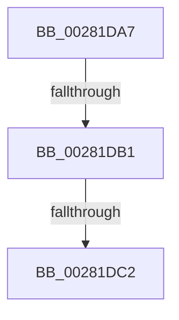

# sub_00281DA7

- RVA: `0x00281DA7`–`0x00281DE9` (길이 `66` bytes)
- VA: `0x0000000140281DA7`
- 실행 섹션: `.text`
- PDB 이름 있음: `아니요`; PDB Function 태그: `아니요`
- unwind 정보 RVA: `0x0006675C`
- 디코드: `16`개 명령, `66/66` bytes 표시
- 미해석 바이트: `0` (있으면 어셈블리에 `.byte`로 보존)

> 이 문서는 커널 이미지의 기계어와 PDB 기호를 분석해 생성했습니다. 4번과 5번은 함수 원형과 자료형을 바이너리 사용 방식에서 추정한 C 해석이며 원본 소스 복구 결과는 아닙니다.

## 1. Dependencies

- 직접 호출 지점: **1**; 고유 호출 대상: **1**
- 직접 호출자로 확인된 함수: **0**
- RIP 상대 이미지 참조: **1**

### Outgoing calls
- `0x00281DDF` → [ExAcquireSpinLockSharedAtDpcLevel](../24/ExAcquireSpinLockSharedAtDpcLevel_function_00248E30.md) (function, `0x00248E30`)

### Direct callers
- 이 함수 시작 RVA로 연결되는 직접 call은 확인되지 않았습니다. 간접 호출은 완전히 역산할 수 없습니다.

### Static image references
- `0x00281DC2` → RVA `0x00E38840` (`.data`; read)

## 2. Other-region calls and transfers

- 다른 실행 섹션으로 향하는 call: **0**
- call이 아닌 외부 분기/꼬리 이동: **3**
  - `0x00281DAB` → [sub_00281A81](Unknown_function_00281A81.md) (`tail-transfer`)
  - `0x00281DBC` → [sub_00282712](Unknown_function_00282712.md) (`tail-transfer`)
  - `0x00281DE4` → [MiReacquireWalkLocks + 0xC6](MiReacquireWalkLocks_function_002819A0.md) (`tail-transfer`)

## 3. Assembly (complete function range)

```asm
00281DA7  24 0F                           and al, 0xf
00281DA9  3C 05                           cmp al, 5
00281DAB  0F 87 D0 FC FF FF               ja 0x140281a81
00281DB1  41 8B 86 B8 00 00 00            mov eax, dword ptr [r14 + 0xb8]
00281DB8  24 0F                           and al, 0xf
00281DBA  3C 01                           cmp al, 1
00281DBC  0F 85 50 09 00 00               jne 0x140282712
00281DC2  48 8D 05 77 6A BB 00            lea rax, [rip + 0xbb6a77]
00281DC9  65 8B 1C 25 A4 01 00 00         mov ebx, dword ptr gs:[0x1a4]
00281DD1  D1 EB                           shr ebx, 1
00281DD3  83 E3 03                        and ebx, 3
00281DD6  8B CB                           mov ecx, ebx
00281DD8  48 C1 E1 06                     shl rcx, 6
00281DDC  48 03 08                        add rcx, qword ptr [rax]
00281DDF  E8 4C 70 FC FF                  call 0x140248e30
00281DE4  E9 7D FC FF FF                  jmp 0x140281a66
```

## 4. C-style interpretation (structured pseudocode)

```c
__int64 __fastcall sub_00281DA7(void)
{
    __int64 result;
    __int64 v_rbx;

    result = (unsigned __int8)((result) & (15));
    result = (unsigned __int8)(((unsigned int)(*(unsigned int *)(v_r14 + 184))) & (15));
    v_rbx = (unsigned int)(((unsigned int)(*(unsigned int *)(gs_base + (0 + 420)))) >> (1));
    v_rbx = (unsigned int)((v_rbx) & (3));
    a1 = ((unsigned int)((unsigned int)(v_rbx))) << (6);
    a1 = (a1) + (*(unsigned __int64 *)(v_rip + 12282487));
    result = ExAcquireSpinLockSharedAtDpcLevel(a1, a2, a3, a4);
}
```

## 5. (Beta) C Style

```c
void sub_00281DA7(void)
{
    int64_t result;
    int64_t local_rbx;

    result = (uint8_t)((result) & (15));
    result = (uint8_t)(((uint32_t)(*(uint32_t *)(local_r14 + 0xB8))) & (15));
    local_rbx = (uint32_t)(((uint32_t)(*(uint32_t *)(gs_base + (0 + 0x1A4)))) >> (1));
    local_rbx = (uint32_t)((local_rbx) & (3));
    a1 = ((uint32_t)((uint32_t)(local_rbx))) << (6);
    a1 = (a1) + (*(uint64_t *)(v_rip + 0xBB6A77));
    result = ExAcquireSpinLockSharedAtDpcLevel(a1, a2, a3, a4);
}
```

## 6. Execution-region graph

[열기: 2D/3D 그래프와 함수 탐색 컨트롤 패널](../../../control-panel.html?section=text&rva=0x00281DA7&view=graph)

- 2D 그래프는 위에서 아래로 흐르고, 3D 그래프는 빈 공간을 드래그해 회전합니다. Shift+드래그는 이동, 휠은 확대·축소, 함수 노드 선택은 대상 보고서 이동입니다.

### Static fallback


