# sub_00281DE9

- RVA: `0x00281DE9`–`0x00282144` (길이 `859` bytes)
- VA: `0x0000000140281DE9`
- 실행 섹션: `.text`
- PDB 이름 있음: `아니요`; PDB Function 태그: `아니요`
- unwind 정보 RVA: `0x0006676C`
- 디코드: `190`개 명령, `859/859` bytes 표시
- 미해석 바이트: `0` (있으면 어셈블리에 `.byte`로 보존)

> 이 문서는 커널 이미지의 기계어와 PDB 기호를 분석해 생성했습니다. 4번과 5번은 함수 원형과 자료형을 바이너리 사용 방식에서 추정한 C 해석이며 원본 소스 복구 결과는 아닙니다.

## 1. Dependencies

- 직접 호출 지점: **2**; 고유 호출 대상: **2**
- 직접 호출자로 확인된 함수: **0**
- RIP 상대 이미지 참조: **3**

### Outgoing calls
- `0x0028209B` → [KxWaitForLockChainValid](../21/KxWaitForLockChainValid_function_00217AA0.md) (function, `0x00217AA0`)
- `0x002820BD` → [KeWakeAddressAll](../21/KeWakeAddressAll_function_00217C20.md) (function, `0x00217C20`)

### Direct callers
- 이 함수 시작 RVA로 연결되는 직접 call은 확인되지 않았습니다. 간접 호출은 완전히 역산할 수 없습니다.

### Static image references
- `0x00281DE9` → RVA `0x00FC6A88` (`ALMOSTRO`; read)
- `0x00282025` → RVA `0x00FC6B06` (`ALMOSTRO`; read)
- `0x00282114` → RVA `0x00E2CB40` (`.data`; read)

## 2. Other-region calls and transfers

- 다른 실행 섹션으로 향하는 call: **0**
- call이 아닌 외부 분기/꼬리 이동: **17**
  - `0x00281DF4` → [sub_00281A81 + 0x159](Unknown_function_00281A81.md) (`tail-transfer`)
  - `0x00281E11` → [sub_00281A81 + 0x159](Unknown_function_00281A81.md) (`tail-transfer`)
  - `0x00281E52` → [sub_00281A81 + 0x159](Unknown_function_00281A81.md) (`tail-transfer`)
  - `0x00281E60` → [sub_0028216F + 0xB4](Unknown_function_0028216F.md) (`tail-transfer`)
  - `0x00281EA1` → [sub_002826A2 + 0x3D](Unknown_function_002826A2.md) (`tail-transfer`)
  - `0x00281EC0` → [sub_00282570 + 0x21](Unknown_function_00282570.md) (`tail-transfer`)
  - `0x00281EEF` → [sub_0028216F + 0xC3](Unknown_function_0028216F.md) (`tail-transfer`)
  - `0x00281F21` → [sub_002822AC + 0x236](Unknown_function_002822AC.md) (`tail-transfer`)
  - `0x00281FC0` → [sub_00281A81 + 0x205](Unknown_function_00281A81.md) (`tail-transfer`)
  - `0x00282017` → [sub_0028216F + 0x8B](Unknown_function_0028216F.md) (`tail-transfer`)
  - `0x0028201F` → [sub_00282570 + 0x10B](Unknown_function_00282570.md) (`tail-transfer`)
  - `0x0028202C` → [sub_0028271E](Unknown_function_0028271E.md) (`tail-transfer`)
  - `0x00282042` → [sub_00281A81 + 0x205](Unknown_function_00281A81.md) (`tail-transfer`)
  - `0x00282059` → [sub_002822AC](Unknown_function_002822AC.md) (`tail-transfer`)
  - `0x00282075` → [sub_0028216F + 0x5B](Unknown_function_0028216F.md) (`tail-transfer`)
  - `0x002820CD` → [sub_00281A81 + 0x205](Unknown_function_00281A81.md) (`tail-transfer`)
  - `0x0028213F` → [sub_00281A81 + 0x205](Unknown_function_00281A81.md) (`tail-transfer`)

## 3. Assembly (complete function range)

```asm
00281DE9  48 F7 05 94 4C D4 00 00 00 60 00  test qword ptr [rip + 0xd44c94], 0x600000
00281DF4  0F 84 E0 FD FF FF               je 0x140281bda
00281DFA  65 48 8B 04 25 88 01 00 00      mov rax, qword ptr gs:[0x188]
00281E03  48 8B 88 B8 00 00 00            mov rcx, qword ptr [rax + 0xb8]
00281E0A  80 B9 60 01 00 00 01            cmp byte ptr [rcx + 0x160], 1
00281E11  0F 84 C3 FD FF FF               je 0x140281bda
00281E17  48 8B 91 08 05 00 00            mov rdx, qword ptr [rcx + 0x508]
00281E1E  48 85 D2                        test rdx, rdx
00281E21  74 25                           je 0x140281e48
00281E23  48 8B C6                        mov rax, rsi
00281E26  48 C1 E8 03                     shr rax, 3
00281E2A  25 FF 01 00 00                  and eax, 0x1ff
00281E2F  48 8B 04 C2                     mov rax, qword ptr [rdx + rax*8]
00281E33  A8 20                           test al, 0x20
00281E35  74 04                           je 0x140281e3b
00281E37  48 83 CB 20                     or rbx, 0x20
00281E3B  48 8B CB                        mov rcx, rbx
00281E3E  48 83 CB 42                     or rbx, 0x42
00281E42  A8 42                           test al, 0x42
00281E44  48 0F 44 D9                     cmove rbx, rcx
00281E48  48 BA FF FF FF FF FF F6 FF FF   movabs rdx, 0xfffff6ffffffffff
00281E52  E9 83 FD FF FF                  jmp 0x140281bda
00281E57  41 8B 86 B8 00 00 00            mov eax, dword ptr [r14 + 0xb8]
00281E5E  A8 0F                           test al, 0xf
00281E60  0F 85 BD 03 00 00               jne 0x140282223
00281E66  49 8B C0                        mov rax, r8
00281E69  48 BA FF DF BE 7D FB F6 FF FF   movabs rdx, 0xfffff6fb7dbedfff
00281E73  48 3B F0                        cmp rsi, rax
00281E76  72 2F                           jb 0x140281ea7
00281E78  48 8B C2                        mov rax, rdx
00281E7B  48 3B F0                        cmp rsi, rax
00281E7E  77 27                           ja 0x140281ea7
00281E80  65 48 8B 04 25 88 01 00 00      mov rax, qword ptr gs:[0x188]
00281E89  48 8B 88 B8 00 00 00            mov rcx, qword ptr [rax + 0xb8]
00281E90  48 8B 81 10 04 00 00            mov rax, qword ptr [rcx + 0x410]
00281E97  48 8B 88 68 05 00 00            mov rcx, qword ptr [rax + 0x568]
00281E9E  48 85 C9                        test rcx, rcx
00281EA1  0F 85 38 08 00 00               jne 0x1402826df
00281EA7  41 8B 86 B8 00 00 00            mov eax, dword ptr [r14 + 0xb8]
00281EAE  A8 0F                           test al, 0xf
00281EB0  74 14                           je 0x140281ec6
00281EB2  49 8B C0                        mov rax, r8
00281EB5  48 3B F0                        cmp rsi, rax
00281EB8  72 0C                           jb 0x140281ec6
00281EBA  48 8B C2                        mov rax, rdx
00281EBD  48 3B F0                        cmp rsi, rax
00281EC0  0F 86 CB 06 00 00               jbe 0x140282591
00281EC6  48 8B 1E                        mov rbx, qword ptr [rsi]
00281EC9  45 8B FA                        mov r15d, r10d
00281ECC  49 8B C0                        mov rax, r8
00281ECF  48 3B F0                        cmp rsi, rax
00281ED2  72 21                           jb 0x140281ef5
00281ED4  49 8B C3                        mov rax, r11
00281ED7  48 3B F0                        cmp rsi, rax
00281EDA  77 19                           ja 0x140281ef5
00281EDC  F6 C3 01                        test bl, 1
00281EDF  74 14                           je 0x140281ef5
00281EE1  F6 C3 42                        test bl, 0x42
00281EE4  0F 95 C1                        setne cl
00281EE7  F6 C3 20                        test bl, 0x20
00281EEA  0F 95 C0                        setne al
00281EED  84 C8                           test al, cl
00281EEF  0F 84 3D 03 00 00               je 0x140282232
00281EF5  49 BD 00 00 00 00 80 F6 FF FF   movabs r13, 0xfffff68000000000
00281EFF  49 BC FF FF FF FF FF FF FF DF   movabs r12, 0xdfffffffffffffff
00281F09  49 BE 20 00 00 00 00 00 00 10   movabs r14, 0x1000000000000020
00281F13  F6 C3 01                        test bl, 1
00281F16  74 35                           je 0x140281f4d
00281F18  48 8B C3                        mov rax, rbx
00281F1B  48 C1 E8 3C                     shr rax, 0x3c
00281F1F  A8 01                           test al, 1
00281F21  0F 85 BB 05 00 00               jne 0x1402824e2
00281F27  48 8B CB                        mov rcx, rbx
00281F2A  49 23 CC                        and rcx, r12
00281F2D  49 0B CE                        or rcx, r14
00281F30  48 F7 05 4D 4B D4 00 00 00 00 02  test qword ptr [rip + 0xd44b4d], 0x2000000
00281F3B  74 03                           je 0x140281f40
00281F3D  0F AE E8                        lfence
00281F40  48 8B C3                        mov rax, rbx
00281F43  F0 48 0F B1 0E                  lock cmpxchg qword ptr [rsi], rcx
00281F48  48 8B D8                        mov rbx, rax
00281F4B  75 C6                           jne 0x140281f13
00281F4D  48 8B AC 24 D8 00 00 00         mov rbp, qword ptr [rsp + 0xd8]
00281F55  4C 8B 74 24 48                  mov r14, qword ptr [rsp + 0x48]
00281F5A  4C 8B A4 24 C0 00 00 00         mov r12, qword ptr [rsp + 0xc0]
00281F62  4C 8B 6C 24 38                  mov r13, qword ptr [rsp + 0x38]
00281F67  48 BF 68 DF BE 7D FB F6 FF FF   movabs rdi, 0xfffff6fb7dbedf68
00281F71  45 33 D2                        xor r10d, r10d
00281F74  48 8B C7                        mov rax, rdi
00281F77  48 3B E8                        cmp rbp, rax
00281F7A  0F 84 C7 00 00 00               je 0x140282047
00281F80  41 8B 86 B8 00 00 00            mov eax, dword ptr [r14 + 0xb8]
00281F87  49 B8 00 D0 BE 7D FB F6 FF FF   movabs r8, 0xfffff6fb7dbed000
00281F91  A8 0F                           test al, 0xf
00281F93  74 30                           je 0x140281fc5
00281F95  41 8B 86 B8 00 00 00            mov eax, dword ptr [r14 + 0xb8]
00281F9C  A8 0F                           test al, 0xf
00281F9E  0F 85 2E 01 00 00               jne 0x1402820d2
00281FA4  48 B8 FF FF FF FF FF FF FF CF   movabs rax, 0xcfffffffffffffff
00281FAE  F0 48 21 45 00                  lock and qword ptr [rbp], rax
00281FB3  33 FF                           xor edi, edi
00281FB5  48 8B EE                        mov rbp, rsi
00281FB8  48 89 B4 24 D8 00 00 00         mov qword ptr [rsp + 0xd8], rsi
00281FC0  E9 C1 FC FF FF                  jmp 0x140281c86
00281FC5  49 8B C0                        mov rax, r8
00281FC8  48 3B E8                        cmp rbp, rax
00281FCB  72 C8                           jb 0x140281f95
00281FCD  48 B8 FF DF BE 7D FB F6 FF FF   movabs rax, 0xfffff6fb7dbedfff
00281FD7  48 8B C0                        mov rax, rax
00281FDA  48 3B E8                        cmp rbp, rax
00281FDD  77 B6                           ja 0x140281f95
00281FDF  65 48 8B 04 25 88 01 00 00      mov rax, qword ptr gs:[0x188]
00281FE8  48 8B 88 B8 00 00 00            mov rcx, qword ptr [rax + 0xb8]
00281FEF  48 8B 81 10 04 00 00            mov rax, qword ptr [rcx + 0x410]
00281FF6  48 8B 88 68 05 00 00            mov rcx, qword ptr [rax + 0x568]
00281FFD  48 85 C9                        test rcx, rcx
00282000  74 93                           je 0x140281f95
00282002  C1 ED 03                        shr ebp, 3
00282005  81 E5 FF 01 00 00               and ebp, 0x1ff
0028200B  8B 04 A9                        mov eax, dword ptr [rcx + rbp*4]
0028200E  48 8D 0C A9                     lea rcx, [rcx + rbp*4]
00282012  A9 FF FF FF 3F                  test eax, 0x3fffffff
00282017  0F 85 DD 01 00 00               jne 0x1402821fa
0028201D  85 C0                           test eax, eax
0028201F  0F 89 56 06 00 00               jns 0x14028267b
00282025  F6 05 DA 4A D4 00 01            test byte ptr [rip + 0xd44ada], 1
0028202C  0F 85 EC 06 00 00               jne 0x14028271e
00282032  44 89 11                        mov dword ptr [rcx], r10d
00282035  33 FF                           xor edi, edi
00282037  48 8B EE                        mov rbp, rsi
0028203A  48 89 B4 24 D8 00 00 00         mov qword ptr [rsp + 0xd8], rsi
00282042  E9 3F FC FF FF                  jmp 0x140281c86
00282047  65 48 8B 14 25 20 00 00 00      mov rdx, qword ptr gs:[0x20]
00282050  41 8B 86 B8 00 00 00            mov eax, dword ptr [r14 + 0xb8]
00282057  24 0F                           and al, 0xf
00282059  0F 85 4D 02 00 00               jne 0x1402822ac
0028205F  B9 30 00 00 00                  mov ecx, 0x30
00282064  48 8D 9A 40 9C 00 00            lea rbx, [rdx + 0x9c40]
0028206B  48 03 D9                        add rbx, rcx
0028206E  F6 05 91 4A D4 00 01            test byte ptr [rip + 0xd44a91], 1
00282075  0F 85 4F 01 00 00               jne 0x1402821ca
0028207B  0F 0D 0B                        prefetchw byte ptr [rbx]
0028207E  48 8B 03                        mov rax, qword ptr [rbx]
00282081  48 85 C0                        test rax, rax
00282084  75 1A                           jne 0x1402820a0
00282086  48 8B 4B 08                     mov rcx, qword ptr [rbx + 8]
0028208A  48 8B C3                        mov rax, rbx
0028208D  F0 4C 0F B1 11                  lock cmpxchg qword ptr [rcx], r10
00282092  0F 84 1B FF FF FF               je 0x140281fb3
00282098  48 8B CB                        mov rcx, rbx
0028209B  E8 00 5A F9 FF                  call 0x140217aa0
002820A0  48 8D 48 08                     lea rcx, [rax + 8]
002820A4  33 FF                           xor edi, edi
002820A6  48 89 3B                        mov qword ptr [rbx], rdi
002820A9  48 8B 53 08                     mov rdx, qword ptr [rbx + 8]
002820AD  48 8B C2                        mov rax, rdx
002820B0  48 87 01                        xchg qword ptr [rcx], rax
002820B3  32 C2                           xor al, dl
002820B5  A8 04                           test al, 4
002820B7  0F 84 F8 FE FF FF               je 0x140281fb5
002820BD  E8 5E 5B F9 FF                  call 0x140217c20
002820C2  48 8B EE                        mov rbp, rsi
002820C5  48 89 B4 24 D8 00 00 00         mov qword ptr [rsp + 0xd8], rsi
002820CD  E9 B4 FB FF FF                  jmp 0x140281c86
002820D2  49 8B C0                        mov rax, r8
002820D5  48 3B E8                        cmp rbp, rax
002820D8  0F 82 C6 FE FF FF               jb 0x140281fa4
002820DE  48 B8 FF DF BE 7D FB F6 FF FF   movabs rax, 0xfffff6fb7dbedfff
002820E8  48 8B C0                        mov rax, rax
002820EB  48 3B E8                        cmp rbp, rax
002820EE  0F 87 B0 FE FF FF               ja 0x140281fa4
002820F4  49 8B C0                        mov rax, r8
002820F7  48 2B E8                        sub rbp, rax
002820FA  41 8B 86 B8 00 00 00            mov eax, dword ptr [r14 + 0xb8]
00282101  48 C1 FD 03                     sar rbp, 3
00282105  8D 14 6D 00 00 00 00            lea edx, [rbp*2]
0028210C  8B C2                           mov eax, edx
0028210E  8B CA                           mov ecx, edx
00282110  48 C1 E8 05                     shr rax, 5
00282114  48 8D 15 25 AA BA 00            lea rdx, [rip + 0xbaaa25]
0028211B  83 E1 1F                        and ecx, 0x1f
0028211E  48 8D 14 82                     lea rdx, [rdx + rax*4]
00282122  B8 03 00 00 00                  mov eax, 3
00282127  D3 E0                           shl eax, cl
00282129  F7 D0                           not eax
0028212B  F0 21 82 6C 26 00 00            lock and dword ptr [rdx + 0x266c], eax
00282132  33 FF                           xor edi, edi
00282134  48 89 B4 24 D8 00 00 00         mov qword ptr [rsp + 0xd8], rsi
0028213C  48 8B EE                        mov rbp, rsi
0028213F  E9 42 FB FF FF                  jmp 0x140281c86
```

## 4. C-style interpretation (structured pseudocode)

```c
__int64 __fastcall sub_00281DE9(__int64 a1, __int64 a2, __int64 a3)
{
    __int64 result;
    __int64 v_rbx;
    unsigned __int64 v_stack_p38;
    unsigned __int64 v_stack_p48;
    unsigned __int64 v_stack_pC0;
    unsigned __int64 v_stack_pD8;

    if (*(unsigned __int64 *)(*(unsigned __int64 *)(*(unsigned __int64 *)(gs_base + (0 + 392)) + 184) + 1288) == 0) goto loc_00281E48;
    result = (v_rsi) >> (3);
    result = (unsigned int)((result) & (511));
    if ((((unsigned __int8)(*(unsigned __int64 *)(*(unsigned __int64 *)(*(unsigned __int64 *)(*(unsigned __int64 *)(gs_base + (0 + 392)) + 184) + 1288) + result * 8))) & (32)) != 0) {
        v_rbx = (v_rbx) | (32);
    }
    v_rbx = (v_rbx) | (66);
    if ((((unsigned __int8)(*(unsigned __int64 *)(*(unsigned __int64 *)(*(unsigned __int64 *)(*(unsigned __int64 *)(gs_base + (0 + 392)) + 184) + 1288) + result * 8))) & (66)) == 0) { v_rbx = v_rbx; }
loc_00281E48:
}
```

## 5. (Beta) C Style

```c
int64_t sub_00281DE9(int64_t Arg1, int64_t Arg2, int64_t Arg3)
{
    int64_t result;
    int64_t local_rbx;
    uint64_t v_stack_p38;
    uint64_t v_stack_p48;
    uint64_t v_stack_pC0;
    uint64_t v_stack_pD8;

    if (*(uint64_t *)(*(uint64_t *)(*(uint64_t *)(gs_base + (0 + 0x188)) + 0xB8) + 0x508) == 0) goto loc_00281E48;
    result = (local_rsi) >> (3);
    result = (uint32_t)((result) & (511));
    if ((((uint8_t)(*(uint64_t *)(*(uint64_t *)(*(uint64_t *)(*(uint64_t *)(gs_base + (0 + 0x188)) + 0xB8) + 0x508) + result * 8))) & (32)) != 0) {
        local_rbx = (local_rbx) | (32);
    }
    local_rbx = (local_rbx) | (66);
    if ((((uint8_t)(*(uint64_t *)(*(uint64_t *)(*(uint64_t *)(*(uint64_t *)(gs_base + (0 + 0x188)) + 0xB8) + 0x508) + result * 8))) & (66)) == 0) { local_rbx = local_rbx; }
loc_00281E48:
}
```

## 6. Execution-region graph

[열기: 2D/3D 그래프와 함수 탐색 컨트롤 패널](../../../control-panel.html?section=text&rva=0x00281DE9&view=graph)

- 2D 그래프는 위에서 아래로 흐르고, 3D 그래프는 빈 공간을 드래그해 회전합니다. Shift+드래그는 이동, 휠은 확대·축소, 함수 노드 선택은 대상 보고서 이동입니다.

### Static fallback

```mermaid
flowchart TD
  bb_00281DE9[BB_00281DE9]
  bb_00281DFA[BB_00281DFA]
  bb_00281E17[BB_00281E17]
  bb_00281E23[BB_00281E23]
  bb_00281E37[BB_00281E37]
  bb_00281E3B[BB_00281E3B]
  bb_00281E48[BB_00281E48]
  bb_00281E57[BB_00281E57]
  bb_00281E66[BB_00281E66]
  bb_00281E78[BB_00281E78]
  bb_00281E80[BB_00281E80]
  bb_00281EA7[BB_00281EA7]
  bb_00281EB2[BB_00281EB2]
  bb_00281EBA[BB_00281EBA]
  bb_00281EC6[BB_00281EC6]
  bb_00281ED4[BB_00281ED4]
  bb_00281EDC[BB_00281EDC]
  bb_00281EE1[BB_00281EE1]
  bb_00281EF5[BB_00281EF5]
  bb_00281F13[BB_00281F13]
  bb_00281F18[BB_00281F18]
  bb_00281F27[BB_00281F27]
  bb_00281F3D[BB_00281F3D]
  bb_00281F40[BB_00281F40]
  bb_00281F4D[BB_00281F4D]
  bb_00281F80[BB_00281F80]
  bb_00281F95[BB_00281F95]
  bb_00281FA4[BB_00281FA4]
  bb_00281FB3[BB_00281FB3]
  bb_00281FB5[BB_00281FB5]
  bb_00281FC5[BB_00281FC5]
  bb_00281FCD[BB_00281FCD]
  bb_00281FDF[BB_00281FDF]
  bb_00282002[BB_00282002]
  bb_0028201D[BB_0028201D]
  bb_00282025[BB_00282025]
  bb_00282032[BB_00282032]
  bb_00282047[BB_00282047]
  bb_0028205F[BB_0028205F]
  bb_0028207B[BB_0028207B]
  bb_00282086[BB_00282086]
  bb_00282098[BB_00282098]
  bb_002820A0[BB_002820A0]
  bb_002820BD[BB_002820BD]
  bb_002820D2[BB_002820D2]
  bb_002820DE[BB_002820DE]
  bb_002820F4[BB_002820F4]
  bb_00281DE9 -->|fallthrough| bb_00281DFA
  bb_00281DFA -->|fallthrough| bb_00281E17
  bb_00281E17 -->|branch| bb_00281E48
  bb_00281E17 -->|fallthrough| bb_00281E23
  bb_00281E23 -->|branch| bb_00281E3B
  bb_00281E23 -->|fallthrough| bb_00281E37
  bb_00281E37 -->|flow| bb_00281E3B
  bb_00281E3B -->|flow| bb_00281E48
  bb_00281E57 -->|fallthrough| bb_00281E66
  bb_00281E66 -->|branch| bb_00281EA7
  bb_00281E66 -->|fallthrough| bb_00281E78
  bb_00281E78 -->|branch| bb_00281EA7
  bb_00281E78 -->|fallthrough| bb_00281E80
  bb_00281E80 -->|fallthrough| bb_00281EA7
  bb_00281EA7 -->|branch| bb_00281EC6
  bb_00281EA7 -->|fallthrough| bb_00281EB2
  bb_00281EB2 -->|branch| bb_00281EC6
  bb_00281EB2 -->|fallthrough| bb_00281EBA
  bb_00281EBA -->|fallthrough| bb_00281EC6
  bb_00281EC6 -->|branch| bb_00281EF5
  bb_00281EC6 -->|fallthrough| bb_00281ED4
  bb_00281ED4 -->|branch| bb_00281EF5
  bb_00281ED4 -->|fallthrough| bb_00281EDC
  bb_00281EDC -->|branch| bb_00281EF5
  bb_00281EDC -->|fallthrough| bb_00281EE1
  bb_00281EE1 -->|fallthrough| bb_00281EF5
  bb_00281EF5 -->|flow| bb_00281F13
  bb_00281F13 -->|branch| bb_00281F4D
  bb_00281F13 -->|fallthrough| bb_00281F18
  bb_00281F18 -->|fallthrough| bb_00281F27
  bb_00281F27 -->|branch| bb_00281F40
  bb_00281F27 -->|fallthrough| bb_00281F3D
  bb_00281F3D -->|flow| bb_00281F40
  bb_00281F40 -->|branch| bb_00281F13
  bb_00281F40 -->|fallthrough| bb_00281F4D
  bb_00281F4D -->|branch| bb_00282047
  bb_00281F4D -->|fallthrough| bb_00281F80
  bb_00281F80 -->|branch| bb_00281FC5
  bb_00281F80 -->|fallthrough| bb_00281F95
  bb_00281F95 -->|branch| bb_002820D2
  bb_00281F95 -->|fallthrough| bb_00281FA4
  bb_00281FA4 -->|flow| bb_00281FB3
  bb_00281FB3 -->|flow| bb_00281FB5
  bb_00281FC5 -->|branch| bb_00281F95
  bb_00281FC5 -->|fallthrough| bb_00281FCD
  bb_00281FCD -->|branch| bb_00281F95
  bb_00281FCD -->|fallthrough| bb_00281FDF
  bb_00281FDF -->|branch| bb_00281F95
  bb_00281FDF -->|fallthrough| bb_00282002
  bb_00282002 -->|fallthrough| bb_0028201D
  bb_0028201D -->|fallthrough| bb_00282025
  bb_00282025 -->|fallthrough| bb_00282032
  bb_00282047 -->|fallthrough| bb_0028205F
  bb_0028205F -->|fallthrough| bb_0028207B
  bb_0028207B -->|branch| bb_002820A0
  bb_0028207B -->|fallthrough| bb_00282086
  bb_00282086 -->|branch| bb_00281FB3
  bb_00282086 -->|fallthrough| bb_00282098
  bb_00282098 -->|flow| bb_002820A0
  bb_002820A0 -->|branch| bb_00281FB5
  bb_002820A0 -->|fallthrough| bb_002820BD
  bb_002820D2 -->|branch| bb_00281FA4
  bb_002820D2 -->|fallthrough| bb_002820DE
  bb_002820DE -->|branch| bb_00281FA4
  bb_002820DE -->|fallthrough| bb_002820F4
```


