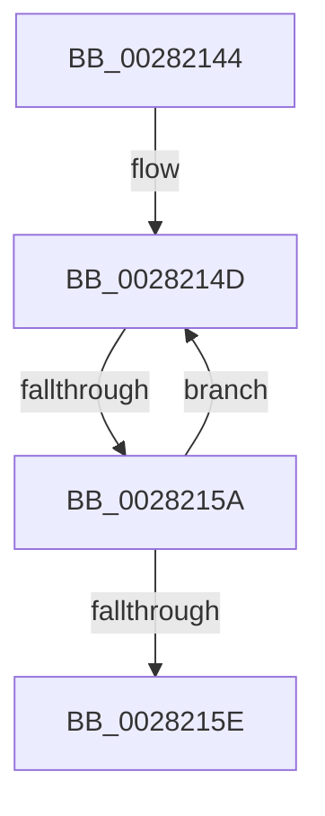

# sub_00282144

- RVA: `0x00282144`–`0x0028216F` (길이 `43` bytes)
- VA: `0x0000000140282144`
- 실행 섹션: `.text`
- PDB 이름 있음: `아니요`; PDB Function 태그: `아니요`
- unwind 정보 RVA: `0x00066780`
- 디코드: `12`개 명령, `43/43` bytes 표시
- 미해석 바이트: `0` (있으면 어셈블리에 `.byte`로 보존)

> 이 문서는 커널 이미지의 기계어와 PDB 기호를 분석해 생성했습니다. 4번과 5번은 함수 원형과 자료형을 바이너리 사용 방식에서 추정한 C 해석이며 원본 소스 복구 결과는 아닙니다.

## 1. Dependencies

- 직접 호출 지점: **1**; 고유 호출 대상: **1**
- 직접 호출자로 확인된 함수: **0**
- RIP 상대 이미지 참조: **0**

### Outgoing calls
- `0x00282165` → [ExpWaitForSpinLockSharedAndAcquire](../36/ExpWaitForSpinLockSharedAndAcquire_function_00362380.md) (function, `0x00362380`)

### Direct callers
- 이 함수 시작 RVA로 연결되는 직접 call은 확인되지 않았습니다. 간접 호출은 완전히 역산할 수 없습니다.

### Static image references
- 디코드된 RIP-relative 메모리 참조가 없습니다.

## 2. Other-region calls and transfers

- 다른 실행 섹션으로 향하는 call: **0**
- call이 아닌 외부 분기/꼬리 이동: **2**
  - `0x00282154` → [MiReacquireWalkLocks + 0xC6](MiReacquireWalkLocks_function_002819A0.md) (`tail-transfer`)
  - `0x0028216A` → [MiReacquireWalkLocks + 0xC6](MiReacquireWalkLocks_function_002819A0.md) (`tail-transfer`)

## 3. Assembly (complete function range)

```asm
00282144  0F 0D 0F                        prefetchw byte ptr [rdi]
00282147  8B 07                           mov eax, dword ptr [rdi]
00282149  0F BA F0 1F                     btr eax, 0x1f
0028214D  8D 48 01                        lea ecx, [rax + 1]
00282150  F0 0F B1 0F                     lock cmpxchg dword ptr [rdi], ecx
00282154  0F 84 0C F9 FF FF               je 0x140281a66
0028215A  85 C0                           test eax, eax
0028215C  79 EF                           jns 0x14028214d
0028215E  40 0F B6 D6                     movzx edx, sil
00282162  48 8B CF                        mov rcx, rdi
00282165  E8 16 02 0E 00                  call 0x140362380
0028216A  E9 F7 F8 FF FF                  jmp 0x140281a66
```

## 4. C-style interpretation (structured pseudocode)

```c
__int64 __fastcall sub_00282144(void)
{
    __int64 result;

loc_0028214D:
    if (!sign_flag) goto loc_0028214D;
    result = ExpWaitForSpinLockSharedAndAcquire(v_rdi, (unsigned __int8)(v_rsi), a3, a4);
}
```

## 5. (Beta) C Style

```c
void sub_00282144(void)
{
    int64_t result;

loc_0028214D:
    if (!sign_flag) goto loc_0028214D;
    result = ExpWaitForSpinLockSharedAndAcquire(local_rdi, (uint8_t)(local_rsi), a3, a4);
}
```

## 6. Execution-region graph

[열기: 2D/3D 그래프와 함수 탐색 컨트롤 패널](../../../control-panel.html?section=text&rva=0x00282144&view=graph)

- 2D 그래프는 위에서 아래로 흐르고, 3D 그래프는 빈 공간을 드래그해 회전합니다. Shift+드래그는 이동, 휠은 확대·축소, 함수 노드 선택은 대상 보고서 이동입니다.

### Static fallback


