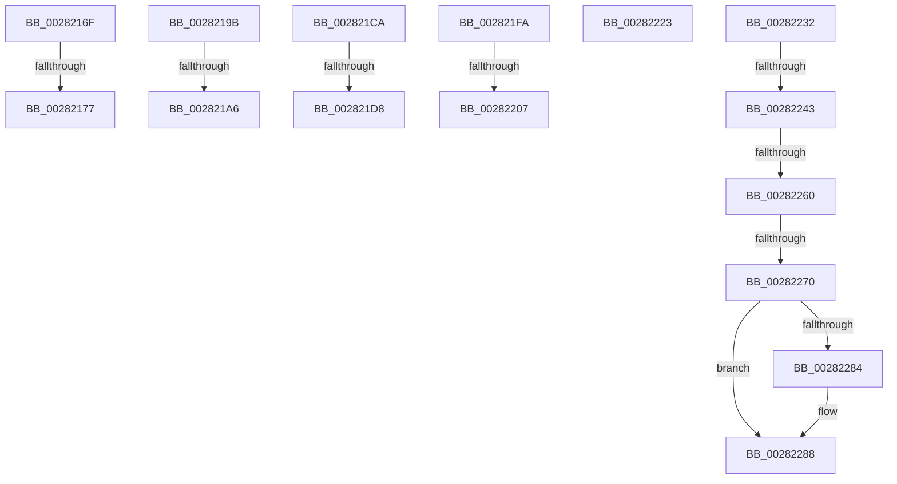

# sub_0028216F

- RVA: `0x0028216F`–`0x0028229A` (길이 `299` bytes)
- VA: `0x000000014028216F`
- 실행 섹션: `.text`
- PDB 이름 있음: `아니요`; PDB Function 태그: `아니요`
- unwind 정보 RVA: `0x00066790`
- 디코드: `62`개 명령, `299/299` bytes 표시
- 미해석 바이트: `0` (있으면 어셈블리에 `.byte`로 보존)

> 이 문서는 커널 이미지의 기계어와 PDB 기호를 분석해 생성했습니다. 4번과 5번은 함수 원형과 자료형을 바이너리 사용 방식에서 추정한 C 해석이며 원본 소스 복구 결과는 아닙니다.

## 1. Dependencies

- 직접 호출 지점: **1**; 고유 호출 대상: **1**
- 직접 호출자로 확인된 함수: **0**
- RIP 상대 이미지 참조: **4**

### Outgoing calls
- `0x002821E3` → [KiReleaseQueuedSpinLockInstrumented](../21/KiReleaseQueuedSpinLockInstrumented_function_002179F0.md) (function, `0x002179F0`)

### Direct callers
- 이 함수 시작 RVA로 연결되는 직접 call은 확인되지 않았습니다. 간접 호출은 완전히 역산할 수 없습니다.

### Static image references
- `0x00282184` → RVA `0x00E2CB40` (`.data`; read)
- `0x002821CA` → RVA `0x00F0DE58` (`.data`; read)
- `0x002821FA` → RVA `0x00FC6B06` (`ALMOSTRO`; read)
- `0x00282232` → RVA `0x00FC6A88` (`ALMOSTRO`; read)

## 2. Other-region calls and transfers

- 다른 실행 섹션으로 향하는 call: **0**
- call이 아닌 외부 분기/꼬리 이동: **13**
  - `0x00282171` → [sub_002822AC + 0x281](Unknown_function_002822AC.md) (`tail-transfer`)
  - `0x00282196` → [sub_00281A81 + 0x266](Unknown_function_00281A81.md) (`tail-transfer`)
  - `0x002821A0` → [sub_002822AC + 0x28B](Unknown_function_002822AC.md) (`tail-transfer`)
  - `0x002821C5` → [sub_00281A81 + 0xC3](Unknown_function_00281A81.md) (`tail-transfer`)
  - `0x002821D2` → [sub_00281DE9 + 0x292](Unknown_function_00281DE9.md) (`tail-transfer`)
  - `0x002821F5` → [sub_00281A81 + 0x205](Unknown_function_00281A81.md) (`tail-transfer`)
  - `0x00282201` → [sub_0028271E + 0x8A](Unknown_function_0028271E.md) (`tail-transfer`)
  - `0x0028221E` → [sub_00281A81 + 0x205](Unknown_function_00281A81.md) (`tail-transfer`)
  - `0x0028222D` → [sub_00281DE9 + 0xBE](Unknown_function_00281DE9.md) (`tail-transfer`)
  - `0x0028223D` → [sub_00281DE9 + 0x10C](Unknown_function_00281DE9.md) (`tail-transfer`)
  - `0x0028225A` → [sub_00281DE9 + 0x10C](Unknown_function_00281DE9.md) (`tail-transfer`)
  - `0x0028226A` → [sub_00281DE9 + 0x10C](Unknown_function_00281DE9.md) (`tail-transfer`)
  - `0x00282295` → [sub_00281DE9 + 0x10C](Unknown_function_00281DE9.md) (`tail-transfer`)

## 3. Assembly (complete function range)

```asm
0028216F  3C 07                           cmp al, 7
00282171  0F 84 B6 03 00 00               je 0x14028252d
00282177  3C 05                           cmp al, 5
00282179  B9 03 00 00 00                  mov ecx, 3
0028217E  41 0F 44 CA                     cmove ecx, r10d
00282182  8B C1                           mov eax, ecx
00282184  48 8D 15 B5 A9 BA 00            lea rdx, [rip + 0xbaa9b5]
0028218B  48 8D 14 C2                     lea rdx, [rdx + rax*8]
0028218F  48 81 C2 80 32 00 00            add rdx, 0x3280
00282196  E9 4C FB FF FF                  jmp 0x140281ce7
0028219B  45 33 D2                        xor r10d, r10d
0028219E  3C 07                           cmp al, 7
002821A0  0F 84 91 03 00 00               je 0x140282537
002821A6  3C 05                           cmp al, 5
002821A8  B9 03 00 00 00                  mov ecx, 3
002821AD  41 0F 44 CA                     cmove ecx, r10d
002821B1  8B D1                           mov edx, ecx
002821B3  4C 8D 1D 86 A9 BA 00            lea r11, [rip + 0xbaa986]
002821BA  4D 8D 9B 80 32 00 00            lea r11, [r11 + 0x3280]
002821C1  49 8D 14 D3                     lea rdx, [r11 + rdx*8]
002821C5  E9 7A F9 FF FF                  jmp 0x140281b44
002821CA  8B 05 88 BC C8 00               mov eax, dword ptr [rip + 0xc8bc88]
002821D0  85 C0                           test eax, eax
002821D2  0F 85 A3 FE FF FF               jne 0x14028207b
002821D8  48 8B 94 24 B8 00 00 00         mov rdx, qword ptr [rsp + 0xb8]
002821E0  48 8B CB                        mov rcx, rbx
002821E3  E8 08 58 F9 FF                  call 0x1402179f0
002821E8  33 FF                           xor edi, edi
002821EA  48 89 B4 24 D8 00 00 00         mov qword ptr [rsp + 0xd8], rsi
002821F2  48 8B EE                        mov rbp, rsi
002821F5  E9 8C FA FF FF                  jmp 0x140281c86
002821FA  F6 05 05 49 D4 00 01            test byte ptr [rip + 0xd44905], 1
00282201  0F 85 A1 05 00 00               jne 0x1402827a8
00282207  F0 81 21 FF FF FF BF            lock and dword ptr [rcx], 0xbfffffff
0028220E  F0 FF 09                        lock dec dword ptr [rcx]
00282211  48 8B EE                        mov rbp, rsi
00282214  33 FF                           xor edi, edi
00282216  48 89 B4 24 D8 00 00 00         mov qword ptr [rsp + 0xd8], rsi
0028221E  E9 63 FA FF FF                  jmp 0x140281c86
00282223  48 BA FF DF BE 7D FB F6 FF FF   movabs rdx, 0xfffff6fb7dbedfff
0028222D  E9 75 FC FF FF                  jmp 0x140281ea7
00282232  48 F7 05 4B 48 D4 00 00 00 60 00  test qword ptr [rip + 0xd4484b], 0x600000
0028223D  0F 84 B2 FC FF FF               je 0x140281ef5
00282243  65 48 8B 04 25 88 01 00 00      mov rax, qword ptr gs:[0x188]
0028224C  48 8B 88 B8 00 00 00            mov rcx, qword ptr [rax + 0xb8]
00282253  80 B9 60 01 00 00 01            cmp byte ptr [rcx + 0x160], 1
0028225A  0F 84 95 FC FF FF               je 0x140281ef5
00282260  48 8B 91 08 05 00 00            mov rdx, qword ptr [rcx + 0x508]
00282267  48 85 D2                        test rdx, rdx
0028226A  0F 84 85 FC FF FF               je 0x140281ef5
00282270  48 8B C6                        mov rax, rsi
00282273  48 C1 E8 03                     shr rax, 3
00282277  25 FF 01 00 00                  and eax, 0x1ff
0028227C  48 8B 04 C2                     mov rax, qword ptr [rdx + rax*8]
00282280  A8 20                           test al, 0x20
00282282  74 04                           je 0x140282288
00282284  48 83 CB 20                     or rbx, 0x20
00282288  48 8B CB                        mov rcx, rbx
0028228B  48 83 CB 42                     or rbx, 0x42
0028228F  A8 42                           test al, 0x42
00282291  48 0F 44 D9                     cmove rbx, rcx
00282295  E9 5B FC FF FF                  jmp 0x140281ef5
```

## 4. C-style interpretation (structured pseudocode)

```c
__int64 __fastcall sub_0028216F(void)
{
    unsigned __int64 v_stack_pB8;
    unsigned __int64 v_stack_pD8;

    a1 = 3;
    if (((unsigned __int8)(result)) == 5) { a1 = (unsigned int)(v_r10); }
    a2 = (v_rip + 12233141 + (unsigned int)((unsigned int)(a1)) * 8) + (0x3280ULL);
}
```

## 5. (Beta) C Style

```c
void sub_0028216F(void)
{
    uint64_t v_stack_pB8;
    uint64_t v_stack_pD8;

    a1 = 3;
    if (((uint8_t)(result)) == 5) { a1 = (uint32_t)(local_r10); }
    a2 = (v_rip + 12233141 + (uint32_t)((uint32_t)(a1)) * 8) + (0x3280ULL);
}
```

## 6. Execution-region graph

[열기: 2D/3D 그래프와 함수 탐색 컨트롤 패널](../../../control-panel.html?section=text&rva=0x0028216F&view=graph)

- 2D 그래프는 위에서 아래로 흐르고, 3D 그래프는 빈 공간을 드래그해 회전합니다. Shift+드래그는 이동, 휠은 확대·축소, 함수 노드 선택은 대상 보고서 이동입니다.

### Static fallback


