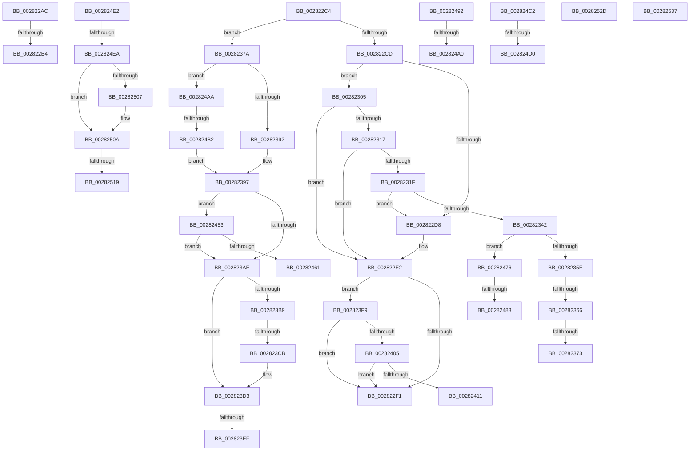

# sub_002822AC

- RVA: `0x002822AC`–`0x00282541` (길이 `661` bytes)
- VA: `0x00000001402822AC`
- 실행 섹션: `.text`
- PDB 이름 있음: `아니요`; PDB Function 태그: `아니요`
- unwind 정보 RVA: `0x000667B4`
- 디코드: `142`개 명령, `661/661` bytes 표시
- 미해석 바이트: `0` (있으면 어셈블리에 `.byte`로 보존)

> 이 문서는 커널 이미지의 기계어와 PDB 기호를 분석해 생성했습니다. 4번과 5번은 함수 원형과 자료형을 바이너리 사용 방식에서 추정한 C 해석이며 원본 소스 복구 결과는 아닙니다.

## 1. Dependencies

- 직접 호출 지점: **5**; 고유 호출 대상: **4**
- 직접 호출자로 확인된 함수: **0**
- RIP 상대 이미지 참조: **4**

### Outgoing calls
- `0x002823CE` → [KxWaitForLockChainValid](../21/KxWaitForLockChainValid_function_00217AA0.md) (function, `0x00217AA0`)
- `0x002823EF` → [KeWakeAddressAll](../21/KeWakeAddressAll_function_00217C20.md) (function, `0x00217C20`)
- `0x0028246C` → [KiReleaseQueuedSpinLockInstrumented](../21/KiReleaseQueuedSpinLockInstrumented_function_002179F0.md) (function, `0x002179F0`)
- `0x002824A0` → [KiAcquireQueuedSpinLockInstrumented](../27/KiAcquireQueuedSpinLockInstrumented_function_00275850.md) (function, `0x00275850`)
- `0x002824D0` → [KiAcquireQueuedSpinLockInstrumented](../27/KiAcquireQueuedSpinLockInstrumented_function_00275850.md) (function, `0x00275850`)

### Direct callers
- 이 함수 시작 RVA로 연결되는 직접 call은 확인되지 않았습니다. 간접 호출은 완전히 역산할 수 없습니다.

### Static image references
- `0x00282366` → RVA `0x00FC6B06` (`ALMOSTRO`; read)
- `0x0028243E` → RVA `0x00E2CB40` (`.data`; read)
- `0x00282453` → RVA `0x00F0DE58` (`.data`; read)
- `0x002824FA` → RVA `0x00FC6A88` (`ALMOSTRO`; read)

## 2. Other-region calls and transfers

- 다른 실행 섹션으로 향하는 call: **0**
- call이 아닌 외부 분기/꼬리 이동: **23**
  - `0x002822AE` → [sub_00282570 + 0xCD](Unknown_function_00282570.md) (`tail-transfer`)
  - `0x002822BF` → [sub_00281DE9 + 0x27B](Unknown_function_00281DE9.md) (`tail-transfer`)
  - `0x00282300` → [sub_00281A81 + 0x2D8](Unknown_function_00281A81.md) (`tail-transfer`)
  - `0x00282360` → [sub_002826A2 + 0x55](Unknown_function_002826A2.md) (`tail-transfer`)
  - `0x0028236D` → [sub_0028271E + 0x6A](Unknown_function_0028271E.md) (`tail-transfer`)
  - `0x00282375` → [sub_00281A81 + 0x2D8](Unknown_function_00281A81.md) (`tail-transfer`)
  - `0x002823C5` → [sub_00281A81 + 0x2D8](Unknown_function_00281A81.md) (`tail-transfer`)
  - `0x002823E9` → [sub_00281A81 + 0x2D8](Unknown_function_00281A81.md) (`tail-transfer`)
  - `0x002823F4` → [sub_00281A81 + 0x2D8](Unknown_function_00281A81.md) (`tail-transfer`)
  - `0x0028244E` → [sub_00281A81 + 0x2D8](Unknown_function_00281A81.md) (`tail-transfer`)
  - `0x00282471` → [sub_00281A81 + 0x2D8](Unknown_function_00281A81.md) (`tail-transfer`)
  - `0x0028247D` → [sub_0028271E + 0xB7](Unknown_function_0028271E.md) (`tail-transfer`)
  - `0x0028248D` → [sub_00281A81 + 0x2D8](Unknown_function_00281A81.md) (`tail-transfer`)
  - `0x0028249A` → [sub_00281A81 + 0x28C](Unknown_function_00281A81.md) (`tail-transfer`)
  - `0x002824A5` → [sub_00281DE9 + 0x188](Unknown_function_00281DE9.md) (`tail-transfer`)
  - `0x002824AC` → [sub_00282570 + 0xD7](Unknown_function_00282570.md) (`tail-transfer`)
  - `0x002824CA` → [sub_00281A81 + 0xE9](Unknown_function_00281A81.md) (`tail-transfer`)
  - `0x002824DD` → [sub_00281A81 + 0xF8](Unknown_function_00281A81.md) (`tail-transfer`)
  - `0x002824E4` → [sub_00282570](Unknown_function_00282570.md) (`tail-transfer`)
  - `0x00282513` → [sub_002826A2](Unknown_function_002826A2.md) (`tail-transfer`)
  - `0x00282528` → [sub_00281DE9 + 0x12A](Unknown_function_00281DE9.md) (`tail-transfer`)
  - `0x00282532` → [sub_0028216F + 0x13](Unknown_function_0028216F.md) (`tail-transfer`)
  - `0x0028253C` → [sub_0028216F + 0x42](Unknown_function_0028216F.md) (`tail-transfer`)

## 3. Assembly (complete function range)

```asm
002822AC  3C 07                           cmp al, 7
002822AE  0F 84 89 03 00 00               je 0x14028263d
002822B4  3C 05                           cmp al, 5
002822B6  B9 48 00 00 00                  mov ecx, 0x48
002822BB  49 0F 44 CA                     cmove rcx, r10
002822BF  E9 A0 FD FF FF                  jmp 0x140282064
002822C4  48 3B E8                        cmp rbp, rax
002822C7  0F 84 AD 00 00 00               je 0x14028237a
002822CD  41 8B 86 B8 00 00 00            mov eax, dword ptr [r14 + 0xb8]
002822D4  A8 0F                           test al, 0xf
002822D6  74 2D                           je 0x140282305
002822D8  48 B9 FF DF BE 7D FB F6 FF FF   movabs rcx, 0xfffff6fb7dbedfff
002822E2  41 8B 86 B8 00 00 00            mov eax, dword ptr [r14 + 0xb8]
002822E9  A8 0F                           test al, 0xf
002822EB  0F 85 08 01 00 00               jne 0x1402823f9
002822F1  48 B8 FF FF FF FF FF FF FF CF   movabs rax, 0xcfffffffffffffff
002822FB  F0 48 21 45 00                  lock and qword ptr [rbp], rax
00282300  E9 54 FA FF FF                  jmp 0x140281d59
00282305  49 8B C0                        mov rax, r8
00282308  48 B9 FF DF BE 7D FB F6 FF FF   movabs rcx, 0xfffff6fb7dbedfff
00282312  48 3B E8                        cmp rbp, rax
00282315  72 CB                           jb 0x1402822e2
00282317  48 8B C1                        mov rax, rcx
0028231A  48 3B E8                        cmp rbp, rax
0028231D  77 C3                           ja 0x1402822e2
0028231F  65 48 8B 04 25 88 01 00 00      mov rax, qword ptr gs:[0x188]
00282328  48 8B 88 B8 00 00 00            mov rcx, qword ptr [rax + 0xb8]
0028232F  48 8B 81 10 04 00 00            mov rax, qword ptr [rcx + 0x410]
00282336  48 8B 88 68 05 00 00            mov rcx, qword ptr [rax + 0x568]
0028233D  48 85 C9                        test rcx, rcx
00282340  74 96                           je 0x1402822d8
00282342  48 C1 ED 03                     shr rbp, 3
00282346  81 E5 FF 01 00 00               and ebp, 0x1ff
0028234C  8B 04 A9                        mov eax, dword ptr [rcx + rbp*4]
0028234F  48 8D 0C A9                     lea rcx, [rcx + rbp*4]
00282353  A9 FF FF FF 3F                  test eax, 0x3fffffff
00282358  0F 85 18 01 00 00               jne 0x140282476
0028235E  85 C0                           test eax, eax
00282360  0F 89 91 03 00 00               jns 0x1402826f7
00282366  F6 05 99 47 D4 00 01            test byte ptr [rip + 0xd44799], 1
0028236D  0F 85 15 04 00 00               jne 0x140282788
00282373  89 39                           mov dword ptr [rcx], edi
00282375  E9 DF F9 FF FF                  jmp 0x140281d59
0028237A  65 48 8B 0C 25 20 00 00 00      mov rcx, qword ptr gs:[0x20]
00282383  41 8B 86 B8 00 00 00            mov eax, dword ptr [r14 + 0xb8]
0028238A  24 0F                           and al, 0xf
0028238C  0F 85 18 01 00 00               jne 0x1402824aa
00282392  BA 30 00 00 00                  mov edx, 0x30
00282397  48 8D 99 40 9C 00 00            lea rbx, [rcx + 0x9c40]
0028239E  48 03 DA                        add rbx, rdx
002823A1  F6 05 5E 47 D4 00 01            test byte ptr [rip + 0xd4475e], 1
002823A8  0F 85 A5 00 00 00               jne 0x140282453
002823AE  0F 0D 0B                        prefetchw byte ptr [rbx]
002823B1  48 8B 03                        mov rax, qword ptr [rbx]
002823B4  48 85 C0                        test rax, rax
002823B7  75 1A                           jne 0x1402823d3
002823B9  48 8B 4B 08                     mov rcx, qword ptr [rbx + 8]
002823BD  48 8B C3                        mov rax, rbx
002823C0  F0 48 0F B1 39                  lock cmpxchg qword ptr [rcx], rdi
002823C5  0F 84 8E F9 FF FF               je 0x140281d59
002823CB  48 8B CB                        mov rcx, rbx
002823CE  E8 CD 56 F9 FF                  call 0x140217aa0
002823D3  48 8D 48 08                     lea rcx, [rax + 8]
002823D7  48 89 3B                        mov qword ptr [rbx], rdi
002823DA  48 8B 53 08                     mov rdx, qword ptr [rbx + 8]
002823DE  48 8B C2                        mov rax, rdx
002823E1  48 87 01                        xchg qword ptr [rcx], rax
002823E4  32 D0                           xor dl, al
002823E6  F6 C2 04                        test dl, 4
002823E9  0F 84 6A F9 FF FF               je 0x140281d59
002823EF  E8 2C 58 F9 FF                  call 0x140217c20
002823F4  E9 60 F9 FF FF                  jmp 0x140281d59
002823F9  49 8B C0                        mov rax, r8
002823FC  48 3B E8                        cmp rbp, rax
002823FF  0F 82 EC FE FF FF               jb 0x1402822f1
00282405  48 8B C1                        mov rax, rcx
00282408  48 3B E8                        cmp rbp, rax
0028240B  0F 87 E0 FE FF FF               ja 0x1402822f1
00282411  49 8B C0                        mov rax, r8
00282414  48 2B E8                        sub rbp, rax
00282417  41 8B 86 B8 00 00 00            mov eax, dword ptr [r14 + 0xb8]
0028241E  48 C1 FD 03                     sar rbp, 3
00282422  8D 14 6D 00 00 00 00            lea edx, [rbp*2]
00282429  8B CA                           mov ecx, edx
0028242B  8B C2                           mov eax, edx
0028242D  83 E1 1F                        and ecx, 0x1f
00282430  41 D3 E7                        shl r15d, cl
00282433  41 F7 D7                        not r15d
00282436  41 0F B3 CF                     btr r15d, ecx
0028243A  48 C1 E8 05                     shr rax, 5
0028243E  48 8D 0D FB A6 BA 00            lea rcx, [rip + 0xbaa6fb]
00282445  F0 44 21 BC 81 6C 26 00 00      lock and dword ptr [rcx + rax*4 + 0x266c], r15d
0028244E  E9 06 F9 FF FF                  jmp 0x140281d59
00282453  8B 05 FF B9 C8 00               mov eax, dword ptr [rip + 0xc8b9ff]
00282459  85 C0                           test eax, eax
0028245B  0F 85 4D FF FF FF               jne 0x1402823ae
00282461  48 8B 94 24 B8 00 00 00         mov rdx, qword ptr [rsp + 0xb8]
00282469  48 8B CB                        mov rcx, rbx
0028246C  E8 7F 55 F9 FF                  call 0x1402179f0
00282471  E9 E3 F8 FF FF                  jmp 0x140281d59
00282476  F6 05 89 46 D4 00 01            test byte ptr [rip + 0xd44689], 1
0028247D  0F 85 52 03 00 00               jne 0x1402827d5
00282483  F0 81 21 FF FF FF BF            lock and dword ptr [rcx], 0xbfffffff
0028248A  F0 FF 09                        lock dec dword ptr [rcx]
0028248D  E9 C7 F8 FF FF                  jmp 0x140281d59
00282492  8B 05 C0 B9 C8 00               mov eax, dword ptr [rip + 0xc8b9c0]
00282498  85 C0                           test eax, eax
0028249A  0F 85 6D F8 FF FF               jne 0x140281d0d
002824A0  E8 AB 33 FF FF                  call 0x140275850
002824A5  E9 C7 FA FF FF                  jmp 0x140281f71
002824AA  3C 07                           cmp al, 7
002824AC  0F 84 95 01 00 00               je 0x140282647
002824B2  3C 05                           cmp al, 5
002824B4  BA 48 00 00 00                  mov edx, 0x48
002824B9  48 0F 44 D7                     cmove rdx, rdi
002824BD  E9 D5 FE FF FF                  jmp 0x140282397
002824C2  8B 05 90 B9 C8 00               mov eax, dword ptr [rip + 0xc8b990]
002824C8  85 C0                           test eax, eax
002824CA  0F 85 9A F6 FF FF               jne 0x140281b6a
002824D0  E8 7B 33 FF FF                  call 0x140275850
002824D5  4C 8B 4C 24 40                  mov r9, qword ptr [rsp + 0x40]
002824DA  45 33 D2                        xor r10d, r10d
002824DD  E9 97 F6 FF FF                  jmp 0x140281b79
002824E2  A8 02                           test al, 2
002824E4  0F 85 86 00 00 00               jne 0x140282570
002824EA  48 8B FB                        mov rdi, rbx
002824ED  48 B8 00 00 00 00 00 00 00 20   movabs rax, 0x2000000000000000
002824F7  48 0B F8                        or rdi, rax
002824FA  48 F7 05 83 45 D4 00 00 00 00 02  test qword ptr [rip + 0xd44583], 0x2000000
00282505  74 03                           je 0x14028250a
00282507  0F AE E8                        lfence
0028250A  48 0F BA 25 75 45 D4 00 24      bt qword ptr [rip + 0xd44575], 0x24
00282513  0F 82 89 01 00 00               jb 0x1402826a2
00282519  48 8B C3                        mov rax, rbx
0028251C  F0 48 0F B1 3E                  lock cmpxchg qword ptr [rsi], rdi
00282521  48 8B D8                        mov rbx, rax
00282524  48 0F 44 DF                     cmove rbx, rdi
00282528  E9 E6 F9 FF FF                  jmp 0x140281f13
0028252D  B9 01 00 00 00                  mov ecx, 1
00282532  E9 4B FC FF FF                  jmp 0x140282182
00282537  B9 01 00 00 00                  mov ecx, 1
0028253C  E9 70 FC FF FF                  jmp 0x1402821b1
```

## 4. C-style interpretation (structured pseudocode)

```c
__int64 __fastcall sub_002822AC(__int64 a1, __int64 a2, __int64 a3)
{
    unsigned __int64 v_stack_p40;
    unsigned __int64 v_stack_pB8;

    a1 = 72;
    if (((unsigned __int8)(result)) == 5) { a1 = v_r10; }
}
```

## 5. (Beta) C Style

```c
int64_t sub_002822AC(int64_t Arg1, int64_t Arg2, int64_t Arg3)
{
    uint64_t v_stack_p40;
    uint64_t v_stack_pB8;

    Arg1 = 72;
    if (((uint8_t)(result)) == 5) { Arg1 = local_r10; }
}
```

## 6. Execution-region graph

[열기: 2D/3D 그래프와 함수 탐색 컨트롤 패널](../../../control-panel.html?section=text&rva=0x002822AC&view=graph)

- 2D 그래프는 위에서 아래로 흐르고, 3D 그래프는 빈 공간을 드래그해 회전합니다. Shift+드래그는 이동, 휠은 확대·축소, 함수 노드 선택은 대상 보고서 이동입니다.

### Static fallback


