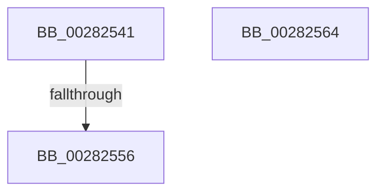

# sub_00282541

- RVA: `0x00282541`–`0x00282570` (길이 `47` bytes)
- VA: `0x0000000140282541`
- 실행 섹션: `.text`
- PDB 이름 있음: `아니요`; PDB Function 태그: `아니요`
- unwind 정보 RVA: `0x000667C8`
- 디코드: `9`개 명령, `47/47` bytes 표시
- 미해석 바이트: `0` (있으면 어셈블리에 `.byte`로 보존)

> 이 문서는 커널 이미지의 기계어와 PDB 기호를 분석해 생성했습니다. 4번과 5번은 함수 원형과 자료형을 바이너리 사용 방식에서 추정한 C 해석이며 원본 소스 복구 결과는 아닙니다.

## 1. Dependencies

- 직접 호출 지점: **1**; 고유 호출 대상: **1**
- 직접 호출자로 확인된 함수: **0**
- RIP 상대 이미지 참조: **1**

### Outgoing calls
- `0x0028255A` → [KiRaiseIrqlProcessIrqlFlags](../4F/KiRaiseIrqlProcessIrqlFlags_function_004F56FC.md) (function, `0x004F56FC`)

### Direct callers
- 이 함수 시작 RVA로 연결되는 직접 call은 확인되지 않았습니다. 간접 호출은 완전히 역산할 수 없습니다.

### Static image references
- `0x00282549` → RVA `0x00FC6D20` (`ALMOSTRO`; read)

## 2. Other-region calls and transfers

- 다른 실행 섹션으로 향하는 call: **0**
- call이 아닌 외부 분기/꼬리 이동: **2**
  - `0x00282550` → [sub_00281A81](Unknown_function_00281A81.md) (`tail-transfer`)
  - `0x0028255F` → [sub_00281A81](Unknown_function_00281A81.md) (`tail-transfer`)

## 3. Assembly (complete function range)

```asm
00282541  44 0F 20 C1                     mov rcx, cr8
00282545  45 0F 22 C7                     mov cr8, r15
00282549  83 3D D0 47 D4 00 00            cmp dword ptr [rip + 0xd447d0], 0
00282550  0F 84 2B F5 FF FF               je 0x140281a81
00282556  41 0F B6 D7                     movzx edx, r15b
0028255A  E8 9D 31 27 00                  call 0x1404f56fc
0028255F  E9 1D F5 FF FF                  jmp 0x140281a81
00282564  0F 1F 40 00                     nop dword ptr [rax]
00282568  0F 1F 84 00 00 00 00 00         nop dword ptr [rax + rax]
```

## 4. C-style interpretation (structured pseudocode)

```c
__int64 __fastcall sub_00282541(void)
{
    __int64 result;

    result = KiRaiseIrqlProcessIrqlFlags(v_cr8, (unsigned __int8)(v_r15), a3, a4);
}
```

## 5. (Beta) C Style

```c
void sub_00282541(void)
{
    int64_t result;

    result = KiRaiseIrqlProcessIrqlFlags(v_cr8, (uint8_t)(local_r15), a3, a4);
}
```

## 6. Execution-region graph

[열기: 2D/3D 그래프와 함수 탐색 컨트롤 패널](../../../control-panel.html?section=text&rva=0x00282541&view=graph)

- 2D 그래프는 위에서 아래로 흐르고, 3D 그래프는 빈 공간을 드래그해 회전합니다. Shift+드래그는 이동, 휠은 확대·축소, 함수 노드 선택은 대상 보고서 이동입니다.

### Static fallback


