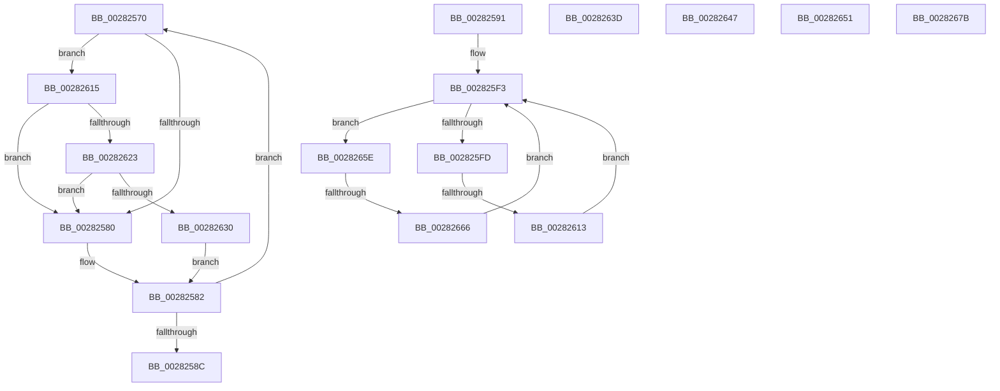

# sub_00282570

- RVA: `0x00282570`–`0x00282696` (길이 `294` bytes)
- VA: `0x0000000140282570`
- 실행 섹션: `.text`
- PDB 이름 있음: `아니요`; PDB Function 태그: `아니요`
- unwind 정보 RVA: `0x000667D8`
- 디코드: `77`개 명령, `294/294` bytes 표시
- 미해석 바이트: `0` (있으면 어셈블리에 `.byte`로 보존)

> 이 문서는 커널 이미지의 기계어와 PDB 기호를 분석해 생성했습니다. 4번과 5번은 함수 원형과 자료형을 바이너리 사용 방식에서 추정한 C 해석이며 원본 소스 복구 결과는 아닙니다.

## 1. Dependencies

- 직접 호출 지점: **4**; 고유 호출 대상: **4**
- 직접 호출자로 확인된 함수: **0**
- RIP 상대 이미지 참조: **3**

### Outgoing calls
- `0x00282623` → [KiCheckVpBackingLongSpinWaitHypercall](../30/KiCheckVpBackingLongSpinWaitHypercall_function_0030F490.md) (function, `0x0030F490`)
- `0x00282633` → [HvlNotifyLongSpinWait](../30/HvlNotifyLongSpinWait_function_0030F460.md) (function, `0x0030F460`)
- `0x00282654` → [KxWaitForLockOwnerShip](../25/KxWaitForLockOwnerShip_function_00257EB0.md) (function, `0x00257EB0`)
- `0x00282690` → [KeBugCheckEx](../4F/KeBugCheckEx_function_004FD660.md) (function, `0x004FD660`)

### Direct callers
- 이 함수 시작 RVA로 연결되는 직접 call은 확인되지 않았습니다. 간접 호출은 완전히 역산할 수 없습니다.

### Static image references
- `0x00282573` → RVA `0x00FC52AC` (`ALMOSTRO`; reference)
- `0x002825C3` → RVA `0x00E2CB40` (`.data`; read)
- `0x00282615` → RVA `0x00FC6AB8` (`ALMOSTRO`; read)

## 2. Other-region calls and transfers

- 다른 실행 섹션으로 향하는 call: **0**
- call이 아닌 외부 분기/꼬리 이동: **6**
  - `0x0028258C` → [sub_00281DE9 + 0x12A](Unknown_function_00281DE9.md) (`tail-transfer`)
  - `0x0028260D` → [sub_00281DE9 + 0x179](Unknown_function_00281DE9.md) (`tail-transfer`)
  - `0x00282642` → [sub_00281DE9 + 0x27B](Unknown_function_00281DE9.md) (`tail-transfer`)
  - `0x0028264C` → [sub_002822AC + 0xEB](Unknown_function_002822AC.md) (`tail-transfer`)
  - `0x00282659` → [sub_002822AC + 0x229](Unknown_function_002822AC.md) (`tail-transfer`)
  - `0x00282660` → [sub_0028271E + 0x2D](Unknown_function_0028271E.md) (`tail-transfer`)

## 3. Assembly (complete function range)

```asm
00282570  41 FF C7                        inc r15d
00282573  44 85 3D 32 2D D4 00            test dword ptr [rip + 0xd42d32], r15d
0028257A  0F 84 95 00 00 00               je 0x140282615
00282580  F3 90                           pause
00282582  48 8B 1E                        mov rbx, qword ptr [rsi]
00282585  48 0F BA E3 3C                  bt rbx, 0x3c
0028258A  72 E4                           jb 0x140282570
0028258C  E9 82 F9 FF FF                  jmp 0x140281f13
00282591  44 89 94 24 D8 00 00 00         mov dword ptr [rsp + 0xd8], r10d
00282599  49 8B C0                        mov rax, r8
0028259C  48 8B CE                        mov rcx, rsi
0028259F  41 BF 01 00 00 00               mov r15d, 1
002825A5  48 2B C8                        sub rcx, rax
002825A8  41 B8 02 00 00 00               mov r8d, 2
002825AE  41 8B 86 B8 00 00 00            mov eax, dword ptr [r14 + 0xb8]
002825B5  48 C1 F9 03                     sar rcx, 3
002825B9  03 C9                           add ecx, ecx
002825BB  8B D9                           mov ebx, ecx
002825BD  8B F9                           mov edi, ecx
002825BF  48 C1 EB 05                     shr rbx, 5
002825C3  48 8D 0D 76 A5 BA 00            lea rcx, [rip + 0xbaa576]
002825CA  48 8D 89 6C 26 00 00            lea rcx, [rcx + 0x266c]
002825D1  83 E7 1F                        and edi, 0x1f
002825D4  8B 14 99                        mov edx, dword ptr [rcx + rbx*4]
002825D7  48 8D 1C 99                     lea rbx, [rcx + rbx*4]
002825DB  8B CF                           mov ecx, edi
002825DD  41 D3 E7                        shl r15d, cl
002825E0  41 D3 E0                        shl r8d, cl
002825E3  45 8B E8                        mov r13d, r8d
002825E6  44 89 7C 24 30                  mov dword ptr [rsp + 0x30], r15d
002825EB  41 F7 D5                        not r13d
002825EE  44 89 44 24 34                  mov dword ptr [rsp + 0x34], r8d
002825F3  8B CF                           mov ecx, edi
002825F5  8B C2                           mov eax, edx
002825F7  D3 E8                           shr eax, cl
002825F9  A8 01                           test al, 1
002825FB  75 61                           jne 0x14028265e
002825FD  41 8B CF                        mov ecx, r15d
00282600  8B C2                           mov eax, edx
00282602  0B CA                           or ecx, edx
00282604  41 23 CD                        and ecx, r13d
00282607  F0 0F B1 0B                     lock cmpxchg dword ptr [rbx], ecx
0028260B  8B D0                           mov edx, eax
0028260D  0F 84 4F F9 FF FF               je 0x140281f62
00282613  EB DE                           jmp 0x1402825f3
00282615  8B 05 9D 44 D4 00               mov eax, dword ptr [rip + 0xd4449d]
0028261B  A8 40                           test al, 0x40
0028261D  0F 84 5D FF FF FF               je 0x140282580
00282623  E8 68 CE 08 00                  call 0x14030f490
00282628  84 C0                           test al, al
0028262A  0F 84 50 FF FF FF               je 0x140282580
00282630  41 8B CF                        mov ecx, r15d
00282633  E8 28 CE 08 00                  call 0x14030f460
00282638  E9 45 FF FF FF                  jmp 0x140282582
0028263D  B9 18 00 00 00                  mov ecx, 0x18
00282642  E9 1D FA FF FF                  jmp 0x140282064
00282647  BA 18 00 00 00                  mov edx, 0x18
0028264C  E9 46 FD FF FF                  jmp 0x140282397
00282651  48 8B D0                        mov rdx, rax
00282654  E8 57 58 FD FF                  call 0x140257eb0
00282659  E9 77 FE FF FF                  jmp 0x1402824d5
0028265E  A8 02                           test al, 2
00282660  0F 85 E5 00 00 00               jne 0x14028274b
00282666  8B CA                           mov ecx, edx
00282668  8B C2                           mov eax, edx
0028266A  41 0B C8                        or ecx, r8d
0028266D  F0 0F B1 0B                     lock cmpxchg dword ptr [rbx], ecx
00282671  8B D0                           mov edx, eax
00282673  0F 44 D1                        cmove edx, ecx
00282676  E9 78 FF FF FF                  jmp 0x1402825f3
0028267B  45 33 C9                        xor r9d, r9d
0028267E  4C 89 54 24 20                  mov qword ptr [rsp + 0x20], r10
00282683  48 8B D1                        mov rdx, rcx
00282686  41 B8 00 01 00 00               mov r8d, 0x100
0028268C  41 8D 49 10                     lea ecx, [r9 + 0x10]
00282690  E8 CB AF 27 00                  call 0x1404fd660
00282695  CC                              int3
```

## 4. C-style interpretation (structured pseudocode)

```c
__int64 __fastcall sub_00282570(__int64 a1, __int64 a2, __int64 a3, int a4)
{
    __int64 result;
    __int64 v_r15;
    unsigned __int64 v_stack_p20;
    unsigned int v_stack_p30;
    unsigned int v_stack_p34;
    unsigned int v_stack_pD8;

    v_r15 = (unsigned int)((v_r15) + 1);
    if (((*(unsigned int *)(v_rip + 13905202)) & ((unsigned int)(v_r15))) == 0) goto loc_00282615;
loc_00282580:
loc_00282582:
    if (condition_is_below) goto loc_00282570;
loc_00282615:
    if ((((unsigned __int8)((unsigned int)(*(unsigned int *)(v_rip + 13911197)))) & (64)) == 0) goto loc_00282580;
    result = KiCheckVpBackingLongSpinWaitHypercall(a1, a2, a3, a4);
    if ((unsigned __int8)(result) == 0) goto loc_00282580;
    result = HvlNotifyLongSpinWait((unsigned int)((unsigned int)(v_r15)), a2, a3, a4);
    goto loc_00282582;
}
```

## 5. (Beta) C Style

```c
int64_t sub_00282570(int64_t Arg1, int64_t Arg2, int64_t Arg3, int32_t Arg4)
{
    int64_t result;
    int64_t local_r15;
    uint64_t v_stack_p20;
    uint32_t v_stack_p30;
    uint32_t v_stack_p34;
    uint32_t v_stack_pD8;

    local_r15 = (uint32_t)((local_r15) + 1);
    if (((*(uint32_t *)(v_rip + 0xD42D32)) & ((uint32_t)(local_r15))) == 0) goto loc_00282615;
loc_00282580:
loc_00282582:
    if (condition_is_below) goto loc_00282570;
loc_00282615:
    if ((((uint8_t)((uint32_t)(*(uint32_t *)(v_rip + 0xD4449D)))) & (64)) == 0) goto loc_00282580;
    result = KiCheckVpBackingLongSpinWaitHypercall(Arg1, Arg2, Arg3, Arg4);
    if ((uint8_t)(result) == 0) goto loc_00282580;
    result = HvlNotifyLongSpinWait((uint32_t)((uint32_t)(local_r15)), Arg2, Arg3, Arg4);
    goto loc_00282582;
}
```

## 6. Execution-region graph

[열기: 2D/3D 그래프와 함수 탐색 컨트롤 패널](../../../control-panel.html?section=text&rva=0x00282570&view=graph)

- 2D 그래프는 위에서 아래로 흐르고, 3D 그래프는 빈 공간을 드래그해 회전합니다. Shift+드래그는 이동, 휠은 확대·축소, 함수 노드 선택은 대상 보고서 이동입니다.

### Static fallback


