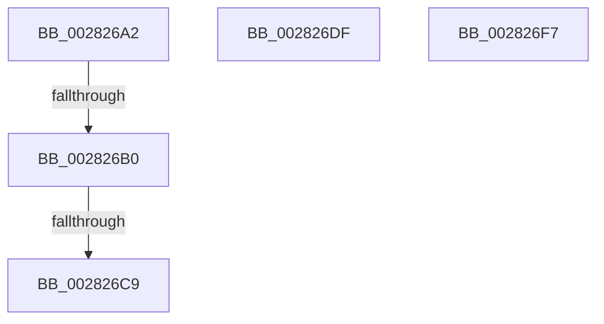

# sub_002826A2

- RVA: `0x002826A2`–`0x00282712` (길이 `112` bytes)
- VA: `0x00000001402826A2`
- 실행 섹션: `.text`
- PDB 이름 있음: `아니요`; PDB Function 태그: `아니요`
- unwind 정보 RVA: `0x000667FC`
- 디코드: `27`개 명령, `112/112` bytes 표시
- 미해석 바이트: `0` (있으면 어셈블리에 `.byte`로 보존)

> 이 문서는 커널 이미지의 기계어와 PDB 기호를 분석해 생성했습니다. 4번과 5번은 함수 원형과 자료형을 바이너리 사용 방식에서 추정한 C 해석이며 원본 소스 복구 결과는 아닙니다.

## 1. Dependencies

- 직접 호출 지점: **3**; 고유 호출 대상: **3**
- 직접 호출자로 확인된 함수: **0**
- RIP 상대 이미지 참조: **0**

### Outgoing calls
- `0x002826D5` → [MiCheckLinearProtectedPteAccessedBit](../29/MiCheckLinearProtectedPteAccessedBit_function_00292D80.md) (function, `0x00292D80`)
- `0x002826ED` → [ExAcquireSpinLockExclusiveAtDpcLevel](../24/ExAcquireSpinLockExclusiveAtDpcLevel_function_00248E80.md) (function, `0x00248E80`)
- `0x0028270C` → [KeBugCheckEx](../4F/KeBugCheckEx_function_004FD660.md) (function, `0x004FD660`)

### Direct callers
- 이 함수 시작 RVA로 연결되는 직접 call은 확인되지 않았습니다. 간접 호출은 완전히 역산할 수 없습니다.

### Static image references
- 디코드된 RIP-relative 메모리 참조가 없습니다.

## 2. Other-region calls and transfers

- 다른 실행 섹션으로 향하는 call: **0**
- call이 아닌 외부 분기/꼬리 이동: **4**
  - `0x002826AA` → [sub_002822AC + 0x26D](Unknown_function_002822AC.md) (`tail-transfer`)
  - `0x002826C3` → [sub_002822AC + 0x26D](Unknown_function_002822AC.md) (`tail-transfer`)
  - `0x002826DA` → [sub_002822AC + 0x26D](Unknown_function_002822AC.md) (`tail-transfer`)
  - `0x002826F2` → [sub_00281DE9 + 0x188](Unknown_function_00281DE9.md) (`tail-transfer`)

## 3. Assembly (complete function range)

```asm
002826A2  40 0F B6 C7                     movzx eax, dil
002826A6  24 21                           and al, 0x21
002826A8  3C 01                           cmp al, 1
002826AA  0F 85 69 FE FF FF               jne 0x140282519
002826B0  49 8B C5                        mov rax, r13
002826B3  48 B9 00 00 00 00 40 00 00 00   movabs rcx, 0x4000000000
002826BD  48 03 C1                        add rax, rcx
002826C0  48 3B F0                        cmp rsi, rax
002826C3  0F 82 50 FE FF FF               jb 0x140282519
002826C9  41 B8 80 00 00 00               mov r8d, 0x80
002826CF  48 8B D7                        mov rdx, rdi
002826D2  48 8B CE                        mov rcx, rsi
002826D5  E8 A6 06 01 00                  call 0x140292d80
002826DA  E9 3A FE FF FF                  jmp 0x140282519
002826DF  8B C6                           mov eax, esi
002826E1  C1 E8 03                        shr eax, 3
002826E4  25 FF 01 00 00                  and eax, 0x1ff
002826E9  48 8D 0C 81                     lea rcx, [rcx + rax*4]
002826ED  E8 8E 67 FC FF                  call 0x140248e80
002826F2  E9 7A F8 FF FF                  jmp 0x140281f71
002826F7  45 33 C9                        xor r9d, r9d
002826FA  48 89 7C 24 20                  mov qword ptr [rsp + 0x20], rdi
002826FF  48 8B D1                        mov rdx, rcx
00282702  41 B8 00 01 00 00               mov r8d, 0x100
00282708  41 8D 49 10                     lea ecx, [r9 + 0x10]
0028270C  E8 4F AF 27 00                  call 0x1404fd660
00282711  CC                              int3
```

## 4. C-style interpretation (structured pseudocode)

```c
__int64 __fastcall sub_002826A2(__int64 a1, __int64 a2, __int64 a3, int a4)
{
    __int64 result;
    unsigned __int64 v_stack_p20;

    result = (unsigned __int8)(((unsigned __int8)(v_rdi)) & (33));
    result = (v_r13) + (a1);
    result = MiCheckLinearProtectedPteAccessedBit(v_rsi, v_rdi, 128, a4);
}
```

## 5. (Beta) C Style

```c
int64_t sub_002826A2(int64_t Arg1, int64_t Arg2, int64_t Arg3, int32_t Arg4)
{
    int64_t result;
    uint64_t v_stack_p20;

    result = (uint8_t)(((uint8_t)(local_rdi)) & (33));
    result = (local_r13) + (Arg1);
    result = MiCheckLinearProtectedPteAccessedBit(local_rsi, local_rdi, 128, Arg4);
}
```

## 6. Execution-region graph

[열기: 2D/3D 그래프와 함수 탐색 컨트롤 패널](../../../control-panel.html?section=text&rva=0x002826A2&view=graph)

- 2D 그래프는 위에서 아래로 흐르고, 3D 그래프는 빈 공간을 드래그해 회전합니다. Shift+드래그는 이동, 휠은 확대·축소, 함수 노드 선택은 대상 보고서 이동입니다.

### Static fallback


