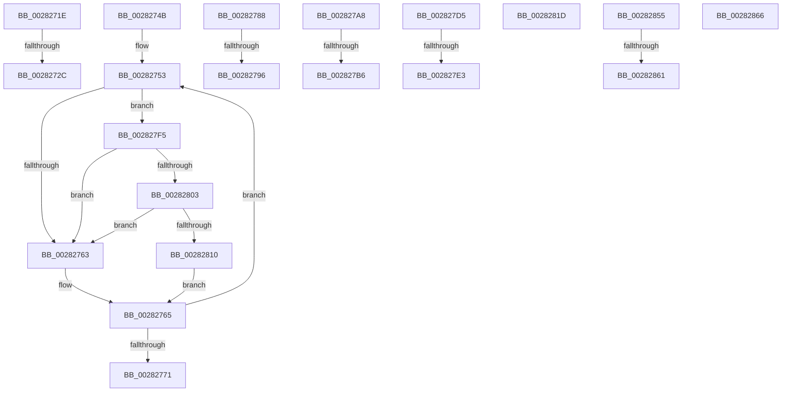

# sub_0028271E

- RVA: `0x0028271E`–`0x0028288E` (길이 `368` bytes)
- VA: `0x000000014028271E`
- 실행 섹션: `.text`
- PDB 이름 있음: `아니요`; PDB Function 태그: `아니요`
- unwind 정보 RVA: `0x00066820`
- 디코드: `72`개 명령, `368/368` bytes 표시
- 미해석 바이트: `0` (있으면 어셈블리에 `.byte`로 보존)

> 이 문서는 커널 이미지의 기계어와 PDB 기호를 분석해 생성했습니다. 4번과 5번은 함수 원형과 자료형을 바이너리 사용 방식에서 추정한 C 해석이며 원본 소스 복구 결과는 아닙니다.

## 1. Dependencies

- 직접 호출 지점: **8**; 고유 호출 대상: **6**
- 직접 호출자로 확인된 함수: **0**
- RIP 상대 이미지 참조: **4**

### Outgoing calls
- `0x00282734` → [ExpReleaseSpinLockExclusiveFromDpcLevelInstrumented](../2C/ExpReleaseSpinLockExclusiveFromDpcLevelInstrumented_function_002C0F44.md) (function, `0x002C0F44`)
- `0x0028279E` → [ExpReleaseSpinLockExclusiveFromDpcLevelInstrumented](../2C/ExpReleaseSpinLockExclusiveFromDpcLevelInstrumented_function_002C0F44.md) (function, `0x002C0F44`)
- `0x002827BE` → [ExpReleaseSpinLockSharedFromDpcLevelInstrumented](../2F/ExpReleaseSpinLockSharedFromDpcLevelInstrumented_function_002F0F48.md) (function, `0x002F0F48`)
- `0x002827EB` → [ExpReleaseSpinLockSharedFromDpcLevelInstrumented](../2F/ExpReleaseSpinLockSharedFromDpcLevelInstrumented_function_002F0F48.md) (function, `0x002F0F48`)
- `0x00282803` → [KiCheckVpBackingLongSpinWaitHypercall](../30/KiCheckVpBackingLongSpinWaitHypercall_function_0030F490.md) (function, `0x0030F490`)
- `0x00282813` → [HvlNotifyLongSpinWait](../30/HvlNotifyLongSpinWait_function_0030F460.md) (function, `0x0030F460`)
- `0x0028282A` → [ExAcquireSpinLockExclusiveAtDpcLevel](../24/ExAcquireSpinLockExclusiveAtDpcLevel_function_00248E80.md) (function, `0x00248E80`)
- `0x0028286D` → [ExReleaseSpinLockExclusiveFromDpcLevel](../24/ExReleaseSpinLockExclusiveFromDpcLevel_function_002497E0.md) (function, `0x002497E0`)

### Direct callers
- 이 함수 시작 RVA로 연결되는 직접 call은 확인되지 않았습니다. 간접 호출은 완전히 역산할 수 없습니다.

### Static image references
- `0x0028271E` → RVA `0x00F0DE58` (`.data`; read)
- `0x00282756` → RVA `0x00FC52AC` (`ALMOSTRO`; reference)
- `0x002827F5` → RVA `0x00FC6AB8` (`ALMOSTRO`; read)
- `0x0028281D` → RVA `0x00E374C0` (`.data`; read)

## 2. Other-region calls and transfers

- 다른 실행 섹션으로 향하는 call: **0**
- call이 아닌 외부 분기/꼬리 이동: **13**
  - `0x00282726` → [sub_00281DE9 + 0x249](Unknown_function_00281DE9.md) (`tail-transfer`)
  - `0x00282746` → [sub_00281A81 + 0x205](Unknown_function_00281A81.md) (`tail-transfer`)
  - `0x00282783` → [sub_00282570 + 0x83](Unknown_function_00282570.md) (`tail-transfer`)
  - `0x00282790` → [sub_002822AC + 0xC7](Unknown_function_002822AC.md) (`tail-transfer`)
  - `0x002827A3` → [sub_00281A81 + 0x2D8](Unknown_function_00281A81.md) (`tail-transfer`)
  - `0x002827B0` → [sub_0028216F + 0x98](Unknown_function_0028216F.md) (`tail-transfer`)
  - `0x002827D0` → [sub_00281A81 + 0x205](Unknown_function_00281A81.md) (`tail-transfer`)
  - `0x002827DD` → [sub_002822AC + 0x1D7](Unknown_function_002822AC.md) (`tail-transfer`)
  - `0x002827F0` → [sub_00281A81 + 0x2D8](Unknown_function_00281A81.md) (`tail-transfer`)
  - `0x00282850` → [sub_00281A81 + 0x1A9](Unknown_function_00281A81.md) (`tail-transfer`)
  - `0x0028285B` → [sub_00281A81 + 0x1BF](Unknown_function_00281A81.md) (`tail-transfer`)
  - `0x00282861` → [sub_006DA196](../6D/Unknown_function_006DA196.md) (`tail-transfer`)
  - `0x00282889` → [sub_00281A81 + 0x1EE](Unknown_function_00281A81.md) (`tail-transfer`)

## 3. Assembly (complete function range)

```asm
0028271E  8B 05 34 B7 C8 00               mov eax, dword ptr [rip + 0xc8b734]
00282724  85 C0                           test eax, eax
00282726  0F 85 06 F9 FF FF               jne 0x140282032
0028272C  48 8B 94 24 B8 00 00 00         mov rdx, qword ptr [rsp + 0xb8]
00282734  E8 0B E8 03 00                  call 0x1402c0f44
00282739  33 FF                           xor edi, edi
0028273B  48 89 B4 24 D8 00 00 00         mov qword ptr [rsp + 0xd8], rsi
00282743  48 8B EE                        mov rbp, rsi
00282746  E9 3B F5 FF FF                  jmp 0x140281c86
0028274B  44 8B BC 24 D8 00 00 00         mov r15d, dword ptr [rsp + 0xd8]
00282753  41 FF C7                        inc r15d
00282756  44 85 3D 4F 2B D4 00            test dword ptr [rip + 0xd42b4f], r15d
0028275D  0F 84 92 00 00 00               je 0x1402827f5
00282763  F3 90                           pause
00282765  8B 13                           mov edx, dword ptr [rbx]
00282767  8B CF                           mov ecx, edi
00282769  8B C2                           mov eax, edx
0028276B  D3 E8                           shr eax, cl
0028276D  A8 01                           test al, 1
0028276F  75 E2                           jne 0x140282753
00282771  44 8B 44 24 34                  mov r8d, dword ptr [rsp + 0x34]
00282776  44 89 BC 24 D8 00 00 00         mov dword ptr [rsp + 0xd8], r15d
0028277E  44 8B 7C 24 30                  mov r15d, dword ptr [rsp + 0x30]
00282783  E9 6B FE FF FF                  jmp 0x1402825f3
00282788  8B 05 CA B6 C8 00               mov eax, dword ptr [rip + 0xc8b6ca]
0028278E  85 C0                           test eax, eax
00282790  0F 85 DD FB FF FF               jne 0x140282373
00282796  48 8B 94 24 B8 00 00 00         mov rdx, qword ptr [rsp + 0xb8]
0028279E  E8 A1 E7 03 00                  call 0x1402c0f44
002827A3  E9 B1 F5 FF FF                  jmp 0x140281d59
002827A8  8B 05 AA B6 C8 00               mov eax, dword ptr [rip + 0xc8b6aa]
002827AE  85 C0                           test eax, eax
002827B0  0F 85 51 FA FF FF               jne 0x140282207
002827B6  48 8B 94 24 B8 00 00 00         mov rdx, qword ptr [rsp + 0xb8]
002827BE  E8 85 E7 06 00                  call 0x1402f0f48
002827C3  33 FF                           xor edi, edi
002827C5  48 89 B4 24 D8 00 00 00         mov qword ptr [rsp + 0xd8], rsi
002827CD  48 8B EE                        mov rbp, rsi
002827D0  E9 B1 F4 FF FF                  jmp 0x140281c86
002827D5  8B 05 7D B6 C8 00               mov eax, dword ptr [rip + 0xc8b67d]
002827DB  85 C0                           test eax, eax
002827DD  0F 85 A0 FC FF FF               jne 0x140282483
002827E3  48 8B 94 24 B8 00 00 00         mov rdx, qword ptr [rsp + 0xb8]
002827EB  E8 58 E7 06 00                  call 0x1402f0f48
002827F0  E9 64 F5 FF FF                  jmp 0x140281d59
002827F5  8B 05 BD 42 D4 00               mov eax, dword ptr [rip + 0xd442bd]
002827FB  A8 40                           test al, 0x40
002827FD  0F 84 60 FF FF FF               je 0x140282763
00282803  E8 88 CC 08 00                  call 0x14030f490
00282808  84 C0                           test al, al
0028280A  0F 84 53 FF FF FF               je 0x140282763
00282810  41 8B CF                        mov ecx, r15d
00282813  E8 48 CC 08 00                  call 0x14030f460
00282818  E9 48 FF FF FF                  jmp 0x140282765
0028281D  48 8D 0D 9C 4C BB 00            lea rcx, [rip + 0xbb4c9c]
00282824  41 BF 01 00 00 00               mov r15d, 1
0028282A  E8 51 66 FC FF                  call 0x140248e80
0028282F  45 33 D2                        xor r10d, r10d
00282832  49 B8 00 D0 BE 7D FB F6 FF FF   movabs r8, 0xfffff6fb7dbed000
0028283C  49 BB F8 D7 BE 7D FB F6 FF FF   movabs r11, 0xfffff6fb7dbed7f8
00282846  48 BA FF FF FF FF FF F6 FF FF   movabs rdx, 0xfffff6ffffffffff
00282850  E9 D5 F3 FF FF                  jmp 0x140281c2a
00282855  48 8B C2                        mov rax, rdx
00282858  48 3B F8                        cmp rdi, rax
0028285B  0F 87 DF F3 FF FF               ja 0x140281c40
00282861  E9 30 79 45 00                  jmp 0x1406da196
00282866  48 8D 0D 53 4C BB 00            lea rcx, [rip + 0xbb4c53]
0028286D  E8 6E 6F FC FF                  call 0x1402497e0
00282872  45 33 D2                        xor r10d, r10d
00282875  49 B8 00 D0 BE 7D FB F6 FF FF   movabs r8, 0xfffff6fb7dbed000
0028287F  49 BB F8 D7 BE 7D FB F6 FF FF   movabs r11, 0xfffff6fb7dbed7f8
00282889  E9 E1 F3 FF FF                  jmp 0x140281c6f
```

## 4. C-style interpretation (structured pseudocode)

```c
__int64 __fastcall sub_0028271E(__int64 a1, __int64 a2, __int64 a3, __int64 a4, __int64 a5, __int64 a6, __int64 a7, __int64 a8, __int64 a9, __int64 a10, __int64 a11, __int64 a12, __int64 a13, __int64 a14, __int64 a15, __int64 a16, __int64 a17, __int64 a18, __int64 a19, __int64 a20, __int64 a21, __int64 a22, __int64 a23)
{
    __int64 result;
    __int64 v_rdi;
    unsigned int v_stack_p30;
    unsigned int v_stack_p34;
    unsigned __int64 v_stack_pB8;
    unsigned __int64 v_stack_pD8;

    result = ExpReleaseSpinLockExclusiveFromDpcLevelInstrumented(a1, a23, a3, a4);
    v_rdi = 0;
    v_stack_pD8 = v_rsi;
}
```

## 5. (Beta) C Style

```c
int64_t sub_0028271E(int64_t Arg1, int64_t Arg2, int64_t Arg3, int64_t Arg4, uint64_t Arg5, uint64_t Arg6, uint64_t Arg7, uint64_t Arg8, uint64_t Arg9, uint64_t Arg10, uint64_t Arg11, uint64_t Arg12, uint64_t Arg13, uint64_t Arg14, uint64_t Arg15, uint64_t Arg16, uint64_t Arg17, uint64_t Arg18, uint64_t Arg19, uint64_t Arg20, uint64_t Arg21, uint64_t Arg22, int64_t Arg23)
{
    int64_t result;
    int64_t local_rdi;
    uint32_t v_stack_p30;
    uint32_t v_stack_p34;
    uint64_t v_stack_pB8;
    uint64_t v_stack_pD8;

    result = ExpReleaseSpinLockExclusiveFromDpcLevelInstrumented(Arg1, Arg23, Arg3, Arg4);
    local_rdi = 0;
    v_stack_pD8 = local_rsi;
}
```

## 6. Execution-region graph

[열기: 2D/3D 그래프와 함수 탐색 컨트롤 패널](../../../control-panel.html?section=text&rva=0x0028271E&view=graph)

- 2D 그래프는 위에서 아래로 흐르고, 3D 그래프는 빈 공간을 드래그해 회전합니다. Shift+드래그는 이동, 휠은 확대·축소, 함수 노드 선택은 대상 보고서 이동입니다.

### Static fallback


