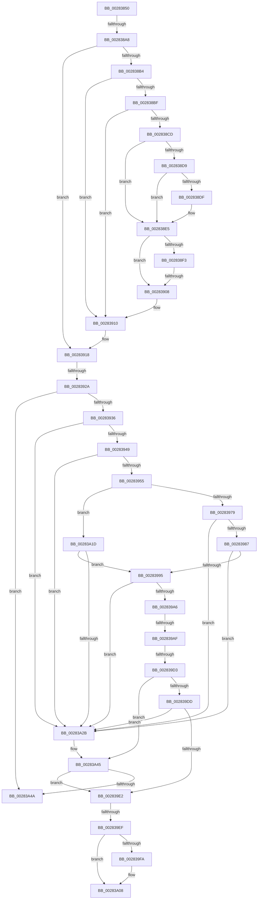

# sub_00283850

- RVA: `0x00283850`–`0x00283AC5` (길이 `629` bytes)
- VA: `0x0000000140283850`
- 실행 섹션: `.text`
- PDB 이름 있음: `아니요`; PDB Function 태그: `아니요`
- unwind 정보 RVA: `0x00066880`
- 디코드: `148`개 명령, `629/629` bytes 표시
- 미해석 바이트: `0` (있으면 어셈블리에 `.byte`로 보존)

> 이 문서는 커널 이미지의 기계어와 PDB 기호를 분석해 생성했습니다. 4번과 5번은 함수 원형과 자료형을 바이너리 사용 방식에서 추정한 C 해석이며 원본 소스 복구 결과는 아닙니다.

## 1. Dependencies

- 직접 호출 지점: **8**; 고유 호출 대상: **8**
- 직접 호출자로 확인된 함수: **0**
- RIP 상대 이미지 참조: **1**

### Outgoing calls
- `0x0028391D` → [MiUnlinkPageFromListEx](MiUnlinkPageFromListEx_function_00287590.md) (function, `0x00287590`)
- `0x00283998` → [MiGetPfnSlabType](MiGetPfnSlabType_function_0028E2D0.md) (function, `0x0028E2D0`)
- `0x002839B1` → [MiLockVadTree](../27/MiLockVadTree_function_0027C0F0.md) (function, `0x0027C0F0`)
- `0x002839B9` → [MiLocateAddress](../31/MiLocateAddress_function_003168D0.md) (function, `0x003168D0`)
- `0x002839C5` → [MiUnlockVadTree](../29/MiUnlockVadTree_function_00297020.md) (function, `0x00297020`)
- `0x00283A03` → [KeSetEvent](../33/KeSetEvent_function_0033F310.md) (function, `0x0033F310`)
- `0x00283A0B` → [MiFreeInPageSupportBlock](../2B/MiFreeInPageSupportBlock_function_002B5900.md) (function, `0x002B5900`)
- `0x00283A37` → [MiMigratePfn](MiMigratePfn_function_0028DBB0.md) (function, `0x0028DBB0`)

### Direct callers
- 이 함수 시작 RVA로 연결되는 직접 call은 확인되지 않았습니다. 간접 호출은 완전히 역산할 수 없습니다.

### Static image references
- `0x002838CD` → RVA `0x00E2DC80` (`.data`; read)

## 2. Other-region calls and transfers

- 다른 실행 섹션으로 향하는 call: **0**
- call이 아닌 외부 분기/꼬리 이동: **7**
  - `0x002838A2` → [sub_00283AFC + 0x5F](Unknown_function_00283AFC.md) (`tail-transfer`)
  - `0x00283902` → [sub_00283AFC](Unknown_function_00283AFC.md) (`tail-transfer`)
  - `0x00283924` → [sub_00283AFC + 0xD4](Unknown_function_00283AFC.md) (`tail-transfer`)
  - `0x002839A9` → [sub_00283AFC + 0x182](Unknown_function_00283AFC.md) (`tail-transfer`)
  - `0x002839CD` → [sub_00283AFC + 0x182](Unknown_function_00283AFC.md) (`tail-transfer`)
  - `0x002839E9` → [sub_00283AFC + 0xCA](Unknown_function_00283AFC.md) (`tail-transfer`)
  - `0x00283A18` → [sub_00283AFC + 0xCA](Unknown_function_00283AFC.md) (`tail-transfer`)

## 3. Assembly (complete function range)

```asm
00283850  48 89 9C 24 90 00 00 00         mov qword ptr [rsp + 0x90], rbx
00283858  49 8B 1C 24                     mov rbx, qword ptr [r12]
0028385C  48 8B C8                        mov rcx, rax
0028385F  48 C1 E9 0B                     shr rcx, 0xb
00283863  81 E2 00 04 00 00               and edx, 0x400
00283869  48 C1 E8 03                     shr rax, 3
0028386D  48 85 D2                        test rdx, rdx
00283870  48 89 74 24 58                  mov qword ptr [rsp + 0x58], rsi
00283875  BE 01 00 00 00                  mov esi, 1
0028387A  4C 89 74 24 50                  mov qword ptr [rsp + 0x50], r14
0028387F  0F 45 C1                        cmovne eax, ecx
00283882  4C 89 84 24 C0 00 00 00         mov qword ptr [rsp + 0xc0], r8
0028388A  48 89 9C 24 B0 00 00 00         mov qword ptr [rsp + 0xb0], rbx
00283892  4D 8B F0                        mov r14, r8
00283895  48 B9 FF FF FE FF FF 7F 00 00   movabs rcx, 0x7ffffffeffff
0028389F  40 84 C6                        test sil, al
002838A2  0F 85 B3 02 00 00               jne 0x140283b5b
002838A8  48 8B 47 28                     mov rax, qword ptr [rdi + 0x28]
002838AC  49 8B D6                        mov rdx, r14
002838AF  48 85 C0                        test rax, rax
002838B2  79 64                           jns 0x140283918
002838B4  4C 8B 77 10                     mov r14, qword ptr [rdi + 0x10]
002838B8  49 0F BA E6 0A                  bt r14, 0xa
002838BD  73 51                           jae 0x140283910
002838BF  48 8B 47 28                     mov rax, qword ptr [rdi + 0x28]
002838C3  48 C1 E8 3C                     shr rax, 0x3c
002838C7  24 07                           and al, 7
002838C9  3C 03                           cmp al, 3
002838CB  74 43                           je 0x140283910
002838CD  48 8B 05 AC A3 BA 00            mov rax, qword ptr [rip + 0xbaa3ac]
002838D4  48 85 C0                        test rax, rax
002838D7  74 0C                           je 0x1402838e5
002838D9  41 F6 C6 10                     test r14b, 0x10
002838DD  75 06                           jne 0x1402838e5
002838DF  48 F7 D0                        not rax
002838E2  4C 23 F0                        and r14, rax
002838E5  49 C1 FE 10                     sar r14, 0x10
002838E9  49 8B 1E                        mov rbx, qword ptr [r14]
002838EC  8B 43 38                        mov eax, dword ptr [rbx + 0x38]
002838EF  A8 20                           test al, 0x20
002838F1  74 15                           je 0x140283908
002838F3  48 8B 5B 60                     mov rbx, qword ptr [rbx + 0x60]
002838F7  48 83 E3 F8                     and rbx, 0xfffffffffffffff8
002838FB  48 8B 5B 28                     mov rbx, qword ptr [rbx + 0x28]
002838FF  48 85 DB                        test rbx, rbx
00283902  0F 85 F4 01 00 00               jne 0x140283afc
00283908  48 8B 9C 24 B0 00 00 00         mov rbx, qword ptr [rsp + 0xb0]
00283910  4C 8B B4 24 C0 00 00 00         mov r14, qword ptr [rsp + 0xc0]
00283918  33 D2                           xor edx, edx
0028391A  48 8B CF                        mov rcx, rdi
0028391D  E8 6E 3C 00 00                  call 0x140287590
00283922  A8 03                           test al, 3
00283924  0F 85 A6 02 00 00               jne 0x140283bd0
0028392A  48 0F BA 67 28 35               bt qword ptr [rdi + 0x28], 0x35
00283930  0F 82 14 01 00 00               jb 0x140283a4a
00283936  48 B8 FF FF FE FF FF 7F 00 00   movabs rax, 0x7ffffffeffff
00283940  48 3B D8                        cmp rbx, rax
00283943  0F 87 E2 00 00 00               ja 0x140283a2b
00283949  8B 47 20                        mov eax, dword ptr [rdi + 0x20]
0028394C  66 85 C0                        test ax, ax
0028394F  0F 85 D6 00 00 00               jne 0x140283a2b
00283955  65 48 8B 04 25 88 01 00 00      mov rax, qword ptr gs:[0x188]
0028395E  48 8B 88 B8 00 00 00            mov rcx, qword ptr [rax + 0xb8]
00283965  48 8B 47 28                     mov rax, qword ptr [rdi + 0x28]
00283969  48 8B 91 10 04 00 00            mov rdx, qword ptr [rcx + 0x410]
00283970  48 85 C0                        test rax, rax
00283973  0F 89 A4 00 00 00               jns 0x140283a1d
00283979  8B 47 10                        mov eax, dword ptr [rdi + 0x10]
0028397C  48 0F BA E0 0A                  bt rax, 0xa
00283981  0F 82 A4 00 00 00               jb 0x140283a2b
00283987  48 83 BA 98 04 00 00 00         cmp qword ptr [rdx + 0x498], 0
0028398F  0F 84 96 00 00 00               je 0x140283a2b
00283995  48 8B CF                        mov rcx, rdi
00283998  E8 33 A9 00 00                  call 0x14028e2d0
0028399D  83 F8 09                        cmp eax, 9
002839A0  0F 85 85 00 00 00               jne 0x140283a2b
002839A6  4D 85 F6                        test r14, r14
002839A9  0F 85 CF 02 00 00               jne 0x140283c7e
002839AF  8B CE                           mov ecx, esi
002839B1  E8 3A 87 FF FF                  call 0x14027c0f0
002839B6  48 8B CB                        mov rcx, rbx
002839B9  E8 12 2F 09 00                  call 0x1403168d0
002839BE  B2 11                           mov dl, 0x11
002839C0  8B CE                           mov ecx, esi
002839C2  4C 8B F0                        mov r14, rax
002839C5  E8 56 36 01 00                  call 0x140297020
002839CA  4D 85 F6                        test r14, r14
002839CD  0F 85 AB 02 00 00               jne 0x140283c7e
002839D3  80 BC 24 A8 00 00 00 00         cmp byte ptr [rsp + 0xa8], 0
002839DB  75 68                           jne 0x140283a45
002839DD  48 85 F6                        test rsi, rsi
002839E0  75 49                           jne 0x140283a2b
002839E2  48 8B 5D 00                     mov rbx, qword ptr [rbp]
002839E6  48 85 DB                        test rbx, rbx
002839E9  0F 84 D7 01 00 00               je 0x140283bc6
002839EF  8B 83 B0 00 00 00               mov eax, dword ptr [rbx + 0xb0]
002839F5  83 F8 01                        cmp eax, 1
002839F8  7E 0E                           jle 0x140283a08
002839FA  48 8D 4B 38                     lea rcx, [rbx + 0x38]
002839FE  45 33 C0                        xor r8d, r8d
00283A01  33 D2                           xor edx, edx
00283A03  E8 08 B9 0B 00                  call 0x14033f310
00283A08  48 8B CB                        mov rcx, rbx
00283A0B  E8 F0 1E 03 00                  call 0x1402b5900
00283A10  48 C7 45 00 00 00 00 00         mov qword ptr [rbp], 0
00283A18  E9 A9 01 00 00                  jmp 0x140283bc6
00283A1D  48 83 BA 90 04 00 00 00         cmp qword ptr [rdx + 0x490], 0
00283A25  0F 85 6A FF FF FF               jne 0x140283995
00283A2B  4C 8B CD                        mov r9, rbp
00283A2E  4D 8B C5                        mov r8, r13
00283A31  48 8B D7                        mov rdx, rdi
00283A34  49 8B CC                        mov rcx, r12
00283A37  E8 74 A1 00 00                  call 0x14028dbb0
00283A3C  48 8B F0                        mov rsi, rax
00283A3F  49 89 07                        mov qword ptr [r15], rax
00283A42  48 8B F8                        mov rdi, rax
00283A45  48 85 F6                        test rsi, rsi
00283A48  74 98                           je 0x1402839e2
00283A4A  48 8B 47 18                     mov rax, qword ptr [rdi + 0x18]
00283A4E  48 B9 01 00 00 00 00 00 00 C0   movabs rcx, 0xc000000000000001
00283A58  48 23 C1                        and rax, rcx
00283A5B  48 83 C8 01                     or rax, 1
00283A5F  48 89 47 18                     mov qword ptr [rdi + 0x18], rax
00283A63  8B 47 20                        mov eax, dword ptr [rdi + 0x20]
00283A66  89 84 24 C0 00 00 00            mov dword ptr [rsp + 0xc0], eax
00283A6D  66 FF C0                        inc ax
00283A70  66 89 84 24 C0 00 00 00         mov word ptr [rsp + 0xc0], ax
00283A78  8B 84 24 C0 00 00 00            mov eax, dword ptr [rsp + 0xc0]
00283A7F  89 47 20                        mov dword ptr [rdi + 0x20], eax
00283A82  8B 47 20                        mov eax, dword ptr [rdi + 0x20]
00283A85  89 84 24 C0 00 00 00            mov dword ptr [rsp + 0xc0], eax
00283A8C  C1 E8 10                        shr eax, 0x10
00283A8F  24 FE                           and al, 0xfe
00283A91  0C 06                           or al, 6
00283A93  88 84 24 C2 00 00 00            mov byte ptr [rsp + 0xc2], al
00283A9A  8B 84 24 C0 00 00 00            mov eax, dword ptr [rsp + 0xc0]
00283AA1  89 47 20                        mov dword ptr [rdi + 0x20], eax
00283AA4  33 C0                           xor eax, eax
00283AA6  48 8B 74 24 58                  mov rsi, qword ptr [rsp + 0x58]
00283AAB  48 8B 9C 24 90 00 00 00         mov rbx, qword ptr [rsp + 0x90]
00283AB3  4C 8B 74 24 50                  mov r14, qword ptr [rsp + 0x50]
00283AB8  48 83 C4 60                     add rsp, 0x60
00283ABC  41 5F                           pop r15
00283ABE  41 5D                           pop r13
00283AC0  41 5C                           pop r12
00283AC2  5F                              pop rdi
00283AC3  5D                              pop rbp
00283AC4  C3                              ret
```

## 4. C-style interpretation (structured pseudocode)

```c
__int64 __fastcall sub_00283850(__int64 a1, int a2, __int64 a3, __int64 a4, __int64 a5, __int64 a6, __int64 a7, __int64 a8, __int64 a9, __int64 a10, __int64 a11, __int64 a12, __int64 a13, __int64 a14, __int64 a15, __int64 a16, __int64 a17, __int64 a18, __int64 a19, __int64 a20, unsigned __int8 a21, __int64 a22, __int64 a23, unsigned int a24)
{
    __int64 result;
    __int64 v_r14;
    __int64 v_rbx;
    __int64 v_rsp;
    unsigned __int64 v_stack_p50;
    unsigned __int64 v_stack_p58;
    unsigned __int64 v_stack_p90;
    unsigned __int64 v_stack_pB0;
    unsigned __int64 v_stack_pC0;
    unsigned __int8 v_stack_pC2;

    v_stack_p90 = v_rbx;
    a1 = (result) >> (11);
    a2 = (unsigned int)((a2) & (0x400ULL));
    result = (result) >> (3);
    v_stack_p58 = v_rsi;
    v_stack_p50 = v_r14;
    if (a2 != 0) { result = (unsigned int)(a1); }
    v_stack_pC0 = a3;
    v_stack_pB0 = *(unsigned __int64 *)(v_r12);
    if (!sign_flag) goto loc_00283918;
    if (condition_is_above_or_equal) goto loc_00283910;
    result = (*(unsigned __int64 *)(v_rdi + 40)) >> (60);
    result = (unsigned __int8)((result) & (7));
    if (((unsigned __int8)(result)) == 3) goto loc_00283910;
    if (*(unsigned __int64 *)(v_rip + 12231596) == 0) goto loc_002838E5;
    result = *(unsigned __int64 *)(v_rip + 12231596);
    v_r14 = *(unsigned __int64 *)(v_rdi + 16);
    if ((((unsigned __int8)(*(unsigned __int64 *)(v_rdi + 16))) & (16)) == 0) {
        result = ~(*(unsigned __int64 *)(v_rip + 12231596));
        v_r14 = (*(unsigned __int64 *)(v_rdi + 16)) & (result);
    }
    v_r14 = (v_r14) >> (16);
    if ((((unsigned __int8)((unsigned int)(*(unsigned int *)(*(unsigned __int64 *)(v_r14) + 56)))) & (32)) == 0) goto loc_00283908;
    v_rbx = (*(unsigned __int64 *)(*(unsigned __int64 *)(v_r14) + 96)) & (-8);
loc_00283908:
loc_00283910:
loc_00283918:
    a2 = 0;
    result = MiUnlinkPageFromListEx(v_rdi, a2, a3, a4);
    if (condition_is_below) goto loc_00283A4A;
    if (a22 > result) goto loc_00283A2B;
    if ((unsigned __int16)((unsigned int)(*(unsigned int *)(v_rdi + 32))) != 0) goto loc_00283A2B;
    if (!sign_flag) goto loc_00283A1D;
    if (condition_is_below) goto loc_00283A2B;
    if ((*(unsigned __int64 *)(*(unsigned __int64 *)(*(unsigned __int64 *)(*(unsigned __int64 *)(gs_base + (0 + 392)) + 184) + 1040) + 1176)) == 0) goto loc_00283A2B;
loc_00283995:
    result = MiGetPfnSlabType(v_rdi, *(unsigned __int64 *)(*(unsigned __int64 *)(*(unsigned __int64 *)(gs_base + (0 + 392)) + 184) + 1040), a3, a4);
    if (((unsigned int)(result)) != 9) goto loc_00283A2B;
    result = MiLockVadTree(1, *(unsigned __int64 *)(*(unsigned __int64 *)(*(unsigned __int64 *)(gs_base + (0 + 392)) + 184) + 1040), a3, a4);
    result = MiLocateAddress(a22, *(unsigned __int64 *)(*(unsigned __int64 *)(*(unsigned __int64 *)(gs_base + (0 + 392)) + 184) + 1040), a3, a4);
    result = MiUnlockVadTree(1, 17, a3, a4);
    if (a21 != 0) goto loc_00283A45;
    if (1 != 0) goto loc_00283A2B;
loc_002839E2:
    result = (unsigned int)(*(unsigned int *)(*(unsigned __int64 *)(v_rbp) + 176));
    if (((unsigned int)((unsigned int)(*(unsigned int *)(*(unsigned __int64 *)(v_rbp) + 176)))) >= = 1) {
        a1 = *(unsigned __int64 *)(v_rbp) + 56;
        a3 = 0;
        a2 = 0;
        result = KeSetEvent(a1, a2, a3, a4);
    }
    result = MiFreeInPageSupportBlock(*(unsigned __int64 *)(v_rbp), a2, a3, a4);
    *(unsigned __int64 *)(v_rbp) = 0;
loc_00283A1D:
    if ((*(unsigned __int64 *)(a2 + 1168)) != 0) goto loc_00283995;
loc_00283A2B:
    result = MiMigratePfn(v_r12, v_rdi, v_r13, v_rbp);
    *(unsigned __int64 *)(v_r15) = result;
loc_00283A45:
    if (result == 0) goto loc_002839E2;
loc_00283A4A:
    result = (*(unsigned __int64 *)(result + 24)) & (v_r12);
    result = (result) | (1);
    *(unsigned __int64 *)(result + 24) = result;
    v_stack_pC0 = (unsigned int)((unsigned int)(*(unsigned int *)(result + 32)));
    result = (unsigned __int16)(((unsigned int)(*(unsigned int *)(result + 32))) + 1);
    v_stack_pC0 = (unsigned __int16)(result);
    *(unsigned int *)(result + 32) = (unsigned int)((unsigned int)(a24));
    v_stack_pC0 = (unsigned int)((unsigned int)(*(unsigned int *)(result + 32)));
    result = (unsigned int)(((unsigned int)(*(unsigned int *)(result + 32))) >> (16));
    result = (unsigned __int8)((result) & (254));
    result = (unsigned __int8)((result) | (6));
    v_stack_pC2 = (unsigned __int8)(result);
    *(unsigned int *)(result + 32) = (unsigned int)((unsigned int)(a24));
    result = 0;
    v_rsp = (v_rsp) + (96);
    return result;
}
```

## 5. (Beta) C Style

```c
int64_t sub_00283850(int64_t Arg1, int32_t Arg2, int64_t Arg3, int64_t Arg4, uint64_t Arg5, uint64_t Arg6, uint64_t Arg7, uint64_t Arg8, uint64_t Arg9, int64_t Arg10, int64_t Arg11, uint64_t Arg12, uint64_t Arg13, uint64_t Arg14, uint64_t Arg15, uint64_t Arg16, uint64_t Arg17, int64_t Arg18, uint64_t Arg19, uint64_t Arg20, uint8_t Arg21, int64_t Arg22, uint64_t Arg23, uint32_t Arg24)
{
    int64_t result;
    int64_t local_r14;
    int64_t local_rbx;
    int64_t local_rsp;
    uint64_t v_stack_p50;
    uint64_t v_stack_p58;
    uint64_t v_stack_p90;
    uint64_t v_stack_pB0;
    uint64_t v_stack_pC0;
    uint8_t v_stack_pC2;

    v_stack_p90 = local_rbx;
    Arg1 = (result) >> (11);
    Arg2 = (uint32_t)((Arg2) & (0x400ULL));
    result = (result) >> (3);
    v_stack_p58 = local_rsi;
    v_stack_p50 = local_r14;
    if (Arg2 != 0) { result = (uint32_t)(Arg1); }
    v_stack_pC0 = Arg3;
    v_stack_pB0 = *(uint64_t *)(local_r12);
    if (!sign_flag) goto loc_00283918;
    if (condition_is_above_or_equal) goto loc_00283910;
    result = (*(uint64_t *)(local_rdi + 0x28)) >> (60);
    result = (uint8_t)((result) & (7));
    if (((uint8_t)(result)) == 3) goto loc_00283910;
    if (*(uint64_t *)(v_rip + 0xBAA3AC) == 0) goto loc_002838E5;
    result = *(uint64_t *)(v_rip + 0xBAA3AC);
    local_r14 = *(uint64_t *)(local_rdi + 0x10);
    if ((((uint8_t)(*(uint64_t *)(local_rdi + 0x10))) & (16)) == 0) {
        result = ~(*(uint64_t *)(v_rip + 0xBAA3AC));
        local_r14 = (*(uint64_t *)(local_rdi + 0x10)) & (result);
    }
    local_r14 = (local_r14) >> (16);
    if ((((uint8_t)((uint32_t)(*(uint32_t *)(*(uint64_t *)(local_r14) + 0x38)))) & (32)) == 0) goto loc_00283908;
    local_rbx = (*(uint64_t *)(*(uint64_t *)(local_r14) + 0x60)) & (-8);
loc_00283908:
loc_00283910:
loc_00283918:
    Arg2 = 0;
    result = MiUnlinkPageFromListEx(local_rdi, Arg2, Arg3, Arg4);
    if (condition_is_below) goto loc_00283A4A;
    if (Arg22 > result) goto loc_00283A2B;
    if ((uint16_t)((uint32_t)(*(uint32_t *)(local_rdi + 0x20))) != 0) goto loc_00283A2B;
    if (!sign_flag) goto loc_00283A1D;
    if (condition_is_below) goto loc_00283A2B;
    if ((*(uint64_t *)(*(uint64_t *)(*(uint64_t *)(*(uint64_t *)(gs_base + (0 + 0x188)) + 0xB8) + 0x410) + 0x498)) == 0) goto loc_00283A2B;
loc_00283995:
    result = MiGetPfnSlabType(local_rdi, *(uint64_t *)(*(uint64_t *)(*(uint64_t *)(gs_base + (0 + 0x188)) + 0xB8) + 0x410), Arg3, Arg4);
    if (((uint32_t)(result)) != 9) goto loc_00283A2B;
    result = MiLockVadTree(1, *(uint64_t *)(*(uint64_t *)(*(uint64_t *)(gs_base + (0 + 0x188)) + 0xB8) + 0x410), Arg3, Arg4);
    result = MiLocateAddress(Arg22, *(uint64_t *)(*(uint64_t *)(*(uint64_t *)(gs_base + (0 + 0x188)) + 0xB8) + 0x410), Arg3, Arg4);
    result = MiUnlockVadTree(1, 17, Arg3, Arg4);
    if (Arg21 != 0) goto loc_00283A45;
    if (1 != 0) goto loc_00283A2B;
loc_002839E2:
    result = (uint32_t)(*(uint32_t *)(*(uint64_t *)(local_rbp) + 0xB0));
    if (((uint32_t)((uint32_t)(*(uint32_t *)(*(uint64_t *)(local_rbp) + 0xB0)))) >= = 1) {
        Arg1 = *(uint64_t *)(local_rbp) + 56;
        Arg3 = 0;
        Arg2 = 0;
        result = KeSetEvent(Arg1, Arg2, Arg3, Arg4);
    }
    result = MiFreeInPageSupportBlock(*(uint64_t *)(local_rbp), Arg2, Arg3, Arg4);
    *(uint64_t *)(local_rbp) = 0;
loc_00283A1D:
    if ((*(uint64_t *)(Arg2 + 0x490)) != 0) goto loc_00283995;
loc_00283A2B:
    result = MiMigratePfn(local_r12, local_rdi, local_r13, local_rbp);
    *(uint64_t *)(local_r15) = result;
loc_00283A45:
    if (result == 0) goto loc_002839E2;
loc_00283A4A:
    result = (*(uint64_t *)(result + 0x18)) & (local_r12);
    result = (result) | (1);
    *(uint64_t *)(result + 0x18) = result;
    v_stack_pC0 = (uint32_t)((uint32_t)(*(uint32_t *)(result + 0x20)));
    result = (uint16_t)(((uint32_t)(*(uint32_t *)(result + 0x20))) + 1);
    v_stack_pC0 = (uint16_t)(result);
    *(uint32_t *)(result + 0x20) = (uint32_t)((uint32_t)(Arg24));
    v_stack_pC0 = (uint32_t)((uint32_t)(*(uint32_t *)(result + 0x20)));
    result = (uint32_t)(((uint32_t)(*(uint32_t *)(result + 0x20))) >> (16));
    result = (uint8_t)((result) & (254));
    result = (uint8_t)((result) | (6));
    v_stack_pC2 = (uint8_t)(result);
    *(uint32_t *)(result + 0x20) = (uint32_t)((uint32_t)(Arg24));
    result = 0;
    local_rsp = (local_rsp) + (96);
    return result;
}
```

## 6. Execution-region graph

[열기: 2D/3D 그래프와 함수 탐색 컨트롤 패널](../../../control-panel.html?section=text&rva=0x00283850&view=graph)

- 2D 그래프는 위에서 아래로 흐르고, 3D 그래프는 빈 공간을 드래그해 회전합니다. Shift+드래그는 이동, 휠은 확대·축소, 함수 노드 선택은 대상 보고서 이동입니다.

### Static fallback


