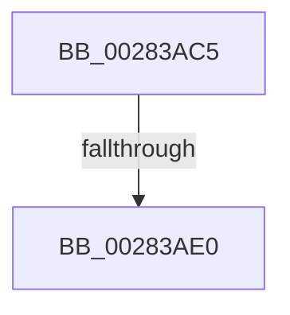

# sub_00283AC5

- RVA: `0x00283AC5`–`0x00283AFC` (길이 `55` bytes)
- VA: `0x0000000140283AC5`
- 실행 섹션: `.text`
- PDB 이름 있음: `아니요`; PDB Function 태그: `아니요`
- unwind 정보 RVA: `0x000668A0`
- 디코드: `13`개 명령, `55/55` bytes 표시
- 미해석 바이트: `0` (있으면 어셈블리에 `.byte`로 보존)

> 이 문서는 커널 이미지의 기계어와 PDB 기호를 분석해 생성했습니다. 4번과 5번은 함수 원형과 자료형을 바이너리 사용 방식에서 추정한 C 해석이며 원본 소스 복구 결과는 아닙니다.

## 1. Dependencies

- 직접 호출 지점: **1**; 고유 호출 대상: **1**
- 직접 호출자로 확인된 함수: **0**
- RIP 상대 이미지 참조: **0**

### Outgoing calls
- `0x00283AF6` → [KeBugCheckEx](../4F/KeBugCheckEx_function_004FD660.md) (function, `0x004FD660`)

### Direct callers
- 이 함수 시작 RVA로 연결되는 직접 call은 확인되지 않았습니다. 간접 호출은 완전히 역산할 수 없습니다.

### Static image references
- 디코드된 RIP-relative 메모리 참조가 없습니다.

## 2. Other-region calls and transfers

- 다른 실행 섹션으로 향하는 call: **0**
- call이 아닌 외부 분기/꼬리 이동: **1**
  - `0x00283ADA` → [MiHandleTransitionFault + 0x49](MiHandleTransitionFault_function_00283800.md) (`tail-transfer`)

## 3. Assembly (complete function range)

```asm
00283AC5  CC                              int3
00283AC6  49 8B 41 08                     mov rax, qword ptr [r9 + 8]
00283ACA  48 B9 00 00 00 00 00 00 00 80   movabs rcx, 0x8000000000000000
00283AD4  48 0B C1                        or rax, rcx
00283AD7  48 3B D0                        cmp rdx, rax
00283ADA  0F 84 69 FD FF FF               je 0x140283849
00283AE0  4D 8B 49 08                     mov r9, qword ptr [r9 + 8]
00283AE4  4C 8B C2                        mov r8, rdx
00283AE7  BA 8A 88 00 00                  mov edx, 0x888a
00283AEC  48 89 7C 24 20                  mov qword ptr [rsp + 0x20], rdi
00283AF1  B9 1A 00 00 00                  mov ecx, 0x1a
00283AF6  E8 65 9B 27 00                  call 0x1404fd660
00283AFB  CC                              int3
```

## 4. C-style interpretation (structured pseudocode)

```c
__int64 __fastcall sub_00283AC5(__int64 a1, __int64 a2, __int64 a3, __int64 a4)
{
    __int64 result;
    unsigned __int64 v_stack_p20;

    result = (*(unsigned __int64 *)(a4 + 8)) | (a1);
    v_stack_p20 = v_rdi;
    result = KeBugCheckEx(26, (unsigned int)(0x888AULL), a2, *(unsigned __int64 *)(a4 + 8));
    return result;
}
```

## 5. (Beta) C Style

```c
int64_t sub_00283AC5(int64_t Arg1, int64_t Arg2, int64_t Arg3, void *Arg4)
{
    uint8_t *arg4 = (uint8_t *)Arg4;

    int64_t result;
    uint64_t v_stack_p20;

    result = (*(uint64_t *)(arg4 + 0x8)) | (Arg1);
    v_stack_p20 = local_rdi;
    result = KeBugCheckEx(26, (uint32_t)(0x888AULL), Arg2, *(uint64_t *)(arg4 + 0x8));
    return result;
}
```

### 관측된 메모리 오프셋

구조체 형식이 확인되지 않은 접근은 인자 기준의 오프셋으로만 기록했습니다.

| 기준 인자 | 오프셋 표현 | 폭 (bit) | 접근 |
|---|---:|---:|---|
| `Arg4` | `+ 0x8` | `64` | `R` |

## 6. Execution-region graph

[열기: 2D/3D 그래프와 함수 탐색 컨트롤 패널](../../../control-panel.html?section=text&rva=0x00283AC5&view=graph)

- 2D 그래프는 위에서 아래로 흐르고, 3D 그래프는 빈 공간을 드래그해 회전합니다. Shift+드래그는 이동, 휠은 확대·축소, 함수 노드 선택은 대상 보고서 이동입니다.

### Static fallback


